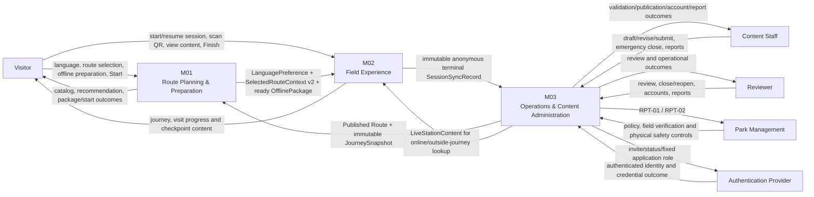

# System Context Diagram — Cúc Phương Quest

Sơ đồ mô tả ranh giới logic của MVP theo ba module spec. Đây không phải deployment diagram hoặc physical API/database design.

## Ranh giới trách nhiệm

| Module | Sở hữu | Không sở hữu |
|---|---|---|
| M01 | Language preference, recommendation, `OfflinePackage`/`OfflineResource` lifecycle, Start và handoff hiện tại | QR scanning, session progress, source-content administration |
| M02 | `PlaySession`, `CheckpointVisit`, copied journey, local progress và terminal sync queue | Route/package administration, M01 context mutation, M03 source mutation |
| M03 | Routes, checkpoints, QR, content/media, review/publication, snapshots, admin roles, persisted `SessionRecord` và reports | Visitor field progress, device package, remote interruption of running sessions |

## Contract liên module

| Hướng | Contract | Điều kiện chính |
|---|---|---|
| M03 → M01 | Published Route | Canonical fields; M01 chỉ chọn `HOAT_DONG` có `activeContentVersion`. |
| M03 → M01 | `JourneySnapshot` | Bất biến; chứa toàn bộ checkpoint active; offline resource chỉ cho `OFFLINE_REQUIRED`. |
| M01 → M02 | `LanguagePreference` | Required `languageCode: Enum(vi, en)`; thay đổi độc lập với session/package. |
| M01 → M02 | `SelectedRouteContext v2` | Atomic, UUID handoff dùng một lần, manifest metadata đầy đủ. |
| M01 → M02 | `OfflinePackage` | M02 chỉ đọc active `SAN_SANG`; `resources[]` chứa M01-owned `OfflineResource` values và có thể `CURRENT` hoặc `OUTDATED`. |
| M03 → M02 | `LiveStationContent` (live QR/content) | Dùng cho checkpoint online và QR ngoài journey; lỗi nguồn khác QR invalid. |
| M02 → M03 | `SessionSyncRecord` | UUID, terminal, immutable, anonymous; identical retry idempotent, changed retry conflict. M03 lưu accepted business fields thành `SessionRecord` và bổ sung M03-owned `ingestedAt`. |
| Auth Provider ↔ M03 | Admin identity | Provider sở hữu credential; M03 sở hữu role/status ứng dụng. |

## Giới hạn hệ thống

- M01 có thể Start offline chỉ khi đã có package `SAN_SANG`; trạng thái đóng mới nhất có thể chưa được biết.
- Check-in khóa theo `(sessionId, checkpointId)`, không theo từng QR vật lý.
- Journey của M02 được chốt từ handoff; M02 không dựng lại journey từ M03.
- Nội dung `OFFLINE_REQUIRED` đọc từ package; nội dung `ONLINE_AVAILABLE` đọc trực tiếp từ M03.
- Đóng route/checkpoint chỉ ảnh hưởng lượt đọc/Start mới; không cảnh báo hoặc ngắt phiên đã chạy.
- Reports chỉ chứa terminal sessions đã đồng bộ thành công và không phải realtime.
- Canonical contracts là logical; physical APIs/tables thuộc tài liệu thiết kế tương ứng.

## Nguồn

- [Specification M01](../spec/spec-M01.md)
- [Specification M02](../spec/spec-M02.md)
- [Specification M03](../spec/spec-M03.md)
