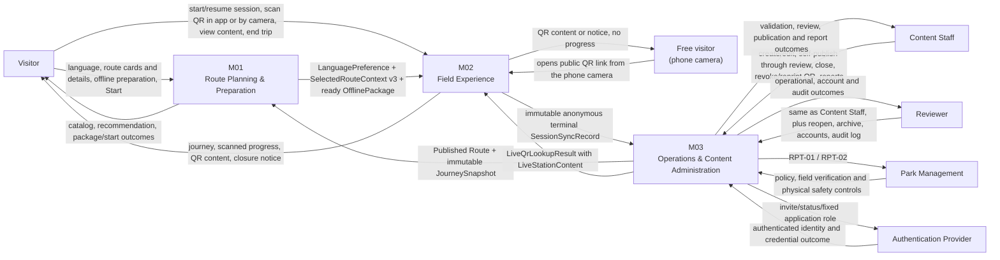

# System Context Diagram — Cúc Phương Quest

Sơ đồ mô tả ranh giới logic của MVP theo ba module spec (M01 v3.2, M02 v3.2, M03 v3.6). Đây không phải deployment diagram hoặc physical API/database design.

## Ranh giới trách nhiệm

| Module | Sở hữu | Không sở hữu |
|---|---|---|
| M01 | Language preference (nút đổi ngôn ngữ trên mọi màn du khách), recommendation, `OfflinePackage`/`OfflineResource` lifecycle, Start và handoff v3 hiện tại | QR scanning, session progress, source-content administration |
| M02 | `PlaySession`, `CheckpointVisit`, copied journey, local progress, terminal sync queue và trang mở từ link QR | Route/package administration, M01 context mutation, M03 source mutation |
| M03 | Routes, thư viện checkpoint dùng chung, QR objects và link QR công khai, `Revision`, media, publication review, snapshots, audit, admin roles, persisted `SessionRecord` và reports | Visitor field progress, device package, remote interruption of running sessions |

## Contract liên module

| Hướng | Contract | Điều kiện chính |
|---|---|---|
| M03 → M01 | Published Route | Canonical fields; M01 chỉ chọn `HOAT_DONG` có `activeContentVersion`. |
| M03 → M01 | `JourneySnapshot` | Bất biến; chứa toàn bộ checkpoint active; tài nguyên offline theo từng mã QR chỉ cho `OFFLINE_REQUIRED`; sơ đồ tuyến offline và dung lượng ước tính là tùy chọn. |
| M01 → M02 | `LanguagePreference` | Required `languageCode: Enum(vi, en)`; thay đổi độc lập với session/package. |
| M01 → M02 | `SelectedRouteContext v3` | Atomic, UUID handoff dùng một lần, hạn 24 giờ, manifest metadata đầy đủ. |
| M01 → M02 | `OfflinePackage` | M02 chỉ đọc active `SAN_SANG`; `resources[]` chứa M01-owned `OfflineResource` values theo từng mã QR và có thể `CURRENT` hoặc `OUTDATED`. |
| M03 → M02 | `LiveQrLookupResult` với `LiveStationContent` | Tra mọi mã quét khi online; `VALID` (kèm nội dung của mã), `TEMPORARILY_CLOSED` hoặc `INVALID`; lỗi nguồn khác `INVALID`. |
| M03 → M02 | Link QR công khai `{QR_PUBLIC_BASE_URL}/q/{qrIdentifier}` | Mã in ra là link cố định; camera điện thoại mở trang của M02. |
| M02 → M03 | `SessionSyncRecord` | UUID, terminal, immutable, anonymous; identical retry idempotent, changed retry conflict; M03 kiểm tra từng điểm đã quét theo snapshot. M03 lưu accepted business fields thành `SessionRecord` và bổ sung M03-owned `ingestedAt`. |
| Auth Provider ↔ M03 | Admin identity | Provider sở hữu credential; M03 sở hữu role/status ứng dụng. |

## Giới hạn hệ thống

- M01 có thể Start offline chỉ khi đã có package `SAN_SANG`; trạng thái đóng mới nhất có thể chưa được biết.
- Check-in khóa theo `(sessionId, checkpointId)`, không theo từng QR vật lý; lượt ghé chỉ được ghi khi lần quét được chấp nhận (online `VALID`, hoặc offline với mã thuộc journey đã đóng băng).
- Journey của M02 được chốt từ handoff; M02 không dựng lại journey từ M03.
- Khi online, nội dung của mọi mã quét lấy từ tra cứu M03; package chỉ dùng khi offline hoặc tra cứu lỗi.
- Đóng route/checkpoint ảnh hưởng lượt đọc/Start mới và làm tra cứu trả thông báo khu vực tạm đóng; không chủ động cảnh báo hoặc ngắt phiên đã chạy.
- Phiên chỉ được nhận diện trong cùng trình duyệt; quét từ camera ở trình duyệt khác là khách tự do.
- Reports chỉ chứa terminal sessions đã đồng bộ thành công và không phải realtime.
- Canonical contracts là logical; physical APIs/tables thuộc tài liệu thiết kế tương ứng.

## Nguồn

- [Specification M01](../spec/spec-M01.md) v3.2
- [Specification M02](../spec/spec-M02.md) v3.2
- [Specification M03](../spec/spec-M03.md) v3.6
