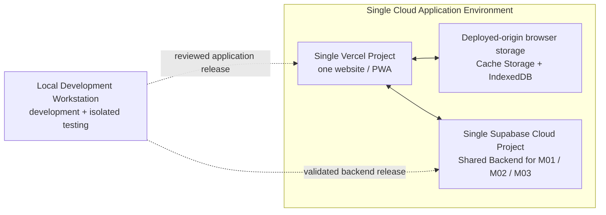

# Environment Configuration — Cúc Phương Quest

## 1. Purpose

Tài liệu này là nguồn canonical cho environment strategy và configuration policy của MVP Cúc Phương Quest. Technology choices nằm tại [Tech Stack](tech-stack.md); runtime topology nằm tại [System Configuration / Runtime Architecture](system-configuration.md).

Kiến trúc sử dụng một **Single Cloud Application Environment** gồm đúng một **Single Vercel Project** phục vụ website/PWA và một **Single Supabase Cloud Project** làm **Shared Backend** cho **M01 / M02 / M03 — Logical Modules**. **Local Development Workstation** chỉ phục vụ development/testing và không phải hosted application environment.

Repository hiện là documentation-only; các technology và workflow dưới đây là quyết định kiến trúc, không phải implementation evidence. Không ghi secret, password, token, credential hoặc key value thật trong tài liệu.

## 2. Environment Strategy

| Context | Purpose | Frontend | Backend/Data |
|---|---|---|---|
| **Local Development Workstation** | Development, unit/contract tests và các kiểm tra cô lập | Local dev server hoặc local optimized build khi implementation tồn tại | Mock, local database hoặc local Supabase-compatible runtime khi được thiết lập |
| **Single Cloud Application Environment** | Runtime duy nhất phục vụ visitor và M03 administration | Một website/PWA trong **Single Vercel Project** | **Single Supabase Cloud Project** chứa PostgreSQL, Auth, RLS, Storage, Edge Functions, PostgreSQL RPC/database functions và Data API |

Vercel có thể lưu nhiều build, deployment record và generated URL trong cùng project. Các artifact vận hành đó không tạo thêm application environment hoặc backend.

## 3. Environment Topology

Browser data bị scope theo origin và device. Build/deployment record không thay đổi canonical environment topology và không làm browser state tự động được chia sẻ giữa các origin.

## 4. Configuration Variables

| Variable | Consumer | Classification | Rule |
|---|---|---|---|
| `VITE_SUPABASE_URL` | Frontend | Public configuration | Trỏ tới Single Supabase Cloud Project |
| `VITE_SUPABASE_PUBLISHABLE_KEY` | Frontend | Public client credential/configuration | Publishable key của cùng project; RLS và server-side authorization vẫn bắt buộc |
| `APP_BACKEND_SECRET_KEY` | Edge Functions/server-side runtime only | Secret | Chỉ tồn tại trong server-side secret store; không có prefix `VITE_` |
| `VITE_APP_VERSION` | Frontend | Public, build-generated | Nhận diện build/release; không dùng làm environment selector |
| `SUPABASE_URL` | Edge runtime | Platform configuration | URL của Supabase project đang chạy function |

`VITE_*` được đưa vào browser bundle nên chỉ chứa public configuration. Không hard-code project URL, key, bucket name hoặc privileged credential trong business logic.

## 5. Configuration Sources and Placement

| Configuration class | Local Development Workstation | Single Cloud Application Environment | Repository rule |
|---|---|---|---|
| Frontend public variables | Ignored local file hoặc test injection | Vercel project settings của active website | Chỉ commit placeholder names/default-safe values |
| Server secrets | Fake/test-only value trong isolated runtime | Supabase Edge secret settings | Không commit hoặc log secret value |
| Supabase configuration | Local test configuration | Settings của single linked Supabase project | Configuration-as-code phải được review khi artifact được tạo |
| Database migrations | Replay trên clean local/ephemeral database | Apply vào single linked Supabase project sau approval | Không sửa migration history đã apply |
| Test data | Synthetic, deterministic và disposable | Chỉ non-destructive smoke-test data được kiểm soát | Không remote reset hoặc seed Shared Backend |
| Vercel configuration | Local build/dev configuration | Settings của Single Vercel Project và active HTTPS origin | Generated deployment không tạo environment riêng |

Auth redirect/callback URL sử dụng active HTTPS website origin. Local callback chỉ phục vụ local development và không thay thế release verification trên website đã deploy.

## 6. Environment-specific Behavior

| Concern | Local Development Workstation | Single Cloud Application Environment |
|---|---|---|
| Frontend | Local dev server hoặc local optimized build | Một website/PWA từ Single Vercel Project |
| Backend | Mock/local isolated runtime | Single Supabase Cloud Project |
| Data | Synthetic và disposable | Shared application data; không được coi là disposable |
| Auth/RLS/Storage/Edge | Test local khi harness hỗ trợ | Chỉ non-destructive acceptance/smoke checks |
| Browser storage | Origin-local và disposable theo test plan | Origin/device-local; có thể mất do browser eviction/clearing |
| M03 | Test UI/contract locally | Online-only với Shared Backend |
| Reports | Fixture/local assertions | Chỉ phản ánh `SessionRecord` đã ingest thành công |
| Timezone | `Asia/Ho_Chi_Minh` | `Asia/Ho_Chi_Minh` |

Environment không được override business behavior, canonical contract, report timezone hoặc module ownership.

## 7. Public and Secret Configuration Boundary

| Boundary | Allowed | Not allowed |
|---|---|---|
| Frontend/browser | Supabase URL, publishable key, app version, report timezone | Secret/service-role key, privileged database credential, private token |
| Server-side Supabase runtime | Secrets cần cho Edge Functions và privileged platform operations | Trả secret qua response hoặc ghi secret vào log |
| Repository | Variable names, placeholder-only examples, non-sensitive defaults | Real `.env` values, passwords, tokens hoặc API keys |
| Documentation | Variable purpose, owner, classification và placement | Secret values hoặc copied platform credentials |

## 8. Runtime Configuration Rules

- M01, M02 và M03 dùng chung một frontend application, một Vercel Project và một Supabase Cloud Project nhưng giữ nguyên logical ownership.
- `VITE_SUPABASE_URL` và `VITE_SUPABASE_PUBLISHABLE_KEY` của website cùng trỏ tới Shared Backend.
- M03 dùng Supabase Auth của cùng project chứa PostgreSQL business data. M01/M02 đọc public projections và gửi contract được phép vào chính backend đó.
- Frontend chỉ nhận public configuration; privileged secrets chỉ thuộc server-side runtime.
- Generated deployment URL không tạo backend hoặc acceptance environment riêng.
- M03 remains online-only; environment strategy không tạo offline admin draft synchronization.
- Report timezone là shared constant `Asia/Ho_Chi_Minh`.
- Build version, browser-storage schema version và `contentVersion` giữ semantics riêng.
- Remote reset, destructive seed và destructive Auth/RLS/Storage tests bị cấm trên Shared Backend.

## 9. Environment Non-goals

| Excluded capability | Decision |
|---|---|
| Additional hosted application environment | Không thuộc kiến trúc đã duyệt |
| Additional Supabase/Vercel project cho test isolation | Test isolation phải thực hiện local |
| Shared visitor state across devices/origins | Ngoài MVP; browser data vẫn origin/device-local |
| Offline M03 administration | Ngoài MVP; M03 là online-only |

## 10. Configuration Activation

1. Link application tooling tới đúng Single Supabase Cloud Project.
2. Cấu hình Single Vercel Project với `VITE_SUPABASE_URL` và `VITE_SUPABASE_PUBLISHABLE_KEY` của Shared Backend.
3. Cấu hình active HTTPS origin và approved Auth callback/recovery URLs.
4. Giữ privileged secrets trong Supabase server-side settings.
5. Xác minh public reads, M03 Auth/authorization, Storage, terminal intake và report access bằng non-destructive checks.

## 11. Development, Testing and Deployment Workflow

### Local development and contract testing

- Chạy lint/typecheck, unit tests, contract validation và local persistence tests trên Local Development Workstation khi implementation tồn tại.
- Dùng synthetic fixtures; không sao chép operational data, Auth identities hoặc secrets vào test data.
- Test PWA/offline bằng local optimized build và secure-context/device strategy phù hợp.
- Kiểm tra Published Route, `JourneySnapshot`, `LanguagePreference`, `SelectedRouteContext v2`, ready `OfflinePackage`, `LiveStationContent` và `SessionSyncRecord` theo canonical spec hiện hành.

### Backend integration testing

- Database/RPC assertions chạy trong transaction rollback hoặc trên clean local/ephemeral database.
- Full Auth, RLS, Storage và Edge Function integration cần isolated local runtime. Có thể dùng Supabase CLI local stack cho full-platform local testing khi implementation được tạo.
- Coverage không thể chạy an toàn trong local isolation phải ghi `NOT RUN`; không chuyển destructive test sang Shared Backend.

### Schema and backend release

- Mỗi schema change được lưu thành reviewed migration và replay từ đầu trên clean local database.
- Supabase CLI chỉ link tới Single Supabase Cloud Project; operator kiểm tra project ref trước mọi remote command.
- Review migration list, dry-run khi CLI version hỗ trợ, kiểm tra backup/recovery readiness rồi mới apply.
- Seed và destructive test-data load vào Shared Backend bị cấm.
- Migration đã apply không được rewrite; dùng corrective/forward migration.

### Application deployment and verification

- Build/release reviewed artifact lên Single Vercel Project.
- Trước release, xác nhận build và database schema tương thích với nhau.
- Sau release, chạy non-destructive smoke checks trên active website cho public reads, M03 login/authorization, media access, offline path và terminal sync.
- Application rollback không rollback Supabase schema/data/config; database recovery dùng backup/restore hoặc forward-fix đã được phê duyệt.

## 12. Operational Risks and Controls

| Risk | Control |
|---|---|
| Test data ảnh hưởng shared application data/report | Local-first testing; cloud smoke checks phải non-destructive và có owner |
| Auth/RLS/Storage/Edge test cần isolation | Dùng isolated local runtime; nếu không có thì ghi `NOT RUN` |
| Schema change ảnh hưởng active application | Clean replay, review, backup verification và forward-fix plan |
| Accidental destructive operation | Target confirmation, least privilege và cấm remote reset/seed |
| Frontend deployment failure | Retain deployment history, smoke-test và rollback application build |
| Shared Backend outage | Monitoring, incident response và recovery procedure |
| Data/media recovery failure | Xác minh backup retention và thực hành restore định kỳ |

## 13. Official References

- [Supabase CLI local development](https://supabase.com/docs/guides/local-development/cli/getting-started)
- [Supabase database migrations](https://supabase.com/docs/guides/local-development/database-migrations)
- [Supabase database testing](https://supabase.com/docs/guides/database/testing)
- [Vercel Git deployments](https://vercel.com/docs/git)
- [Vercel deployments](https://vercel.com/docs/deployments)
- [Vercel Instant Rollback](https://vercel.com/docs/instant-rollback)
