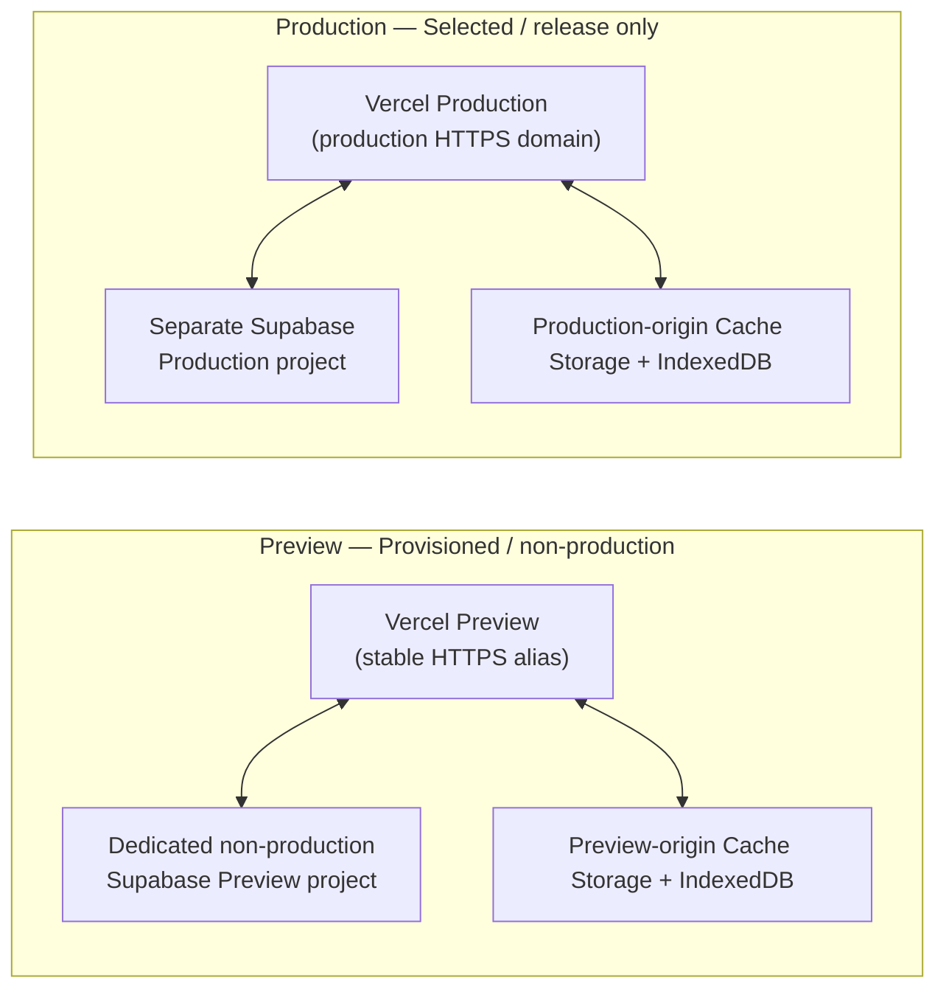

# Environment Configuration — Cúc Phương Quest

## 1. Purpose

Tài liệu này là nguồn canonical cho cấu hình theo environment của MVP Cúc Phương Quest: environment nào tồn tại, frontend/backend tương ứng, configuration injection và ranh giới public/secret values. Technology choices nằm tại [Tech Stack](tech-stack.md); runtime topology nằm tại [System Configuration / Runtime Architecture](system-configuration.md).

Không có secret, password, token hoặc key value thật trong tài liệu này. Repository đã có `.env.example`, `supabase/config.toml`, migrations và deterministic seed. Supabase Preview và HTTPS Vercel Preview origin đã được provision; chưa có frontend build hoặc callback/recovery routes hoạt động. Kết quả kiểm tra có ngày thực thi nằm tại [Storage Validation](../../data/07-storage-validation.md).

Nguồn cho các quyết định environment được chuyển khỏi `system-configuration.md` là configuration baseline tại commit `bbf35d9` (`git show bbf35d9:docs/architecture/system-configuration.md`, §§10–12).

MVP chỉ có hai deployed runtime environment: Preview (dùng cho phát triển, testing và nghiệm thu) và Production (chỉ dùng cho bản phát hành/demo MVP). Máy phát triển local là development workstation (chạy type checks, unit/data tests và repository tooling), không phải môi trường ứng dụng riêng và không cần Supabase project riêng hay Docker. Tên biến cấu hình được mô tả tại §10.

## 2. Environment Strategy

| Environment | Purpose | Frontend | Backend/Data | Persistence | Status |
|---|---|---|---|---|---|
| Preview | Phát triển, integration testing, PWA/offline testing, Auth/RLS/Storage testing, bug fixing và pre-release acceptance | Vercel Preview deployment với stable HTTPS preview origin/alias | Một dedicated non-production Supabase Preview project; synthetic/test data được phép, tuyệt đối không dùng production data | Browser storage theo stable preview origin; PostgreSQL/Auth/Storage trên Supabase Preview project | Provisioned — 18 migrations đồng bộ; hosted Auth/frontend acceptance còn deferred |
| Production | Chỉ dùng cho bản phát hành/demo MVP | Vercel Production deployment | Supabase Production project riêng biệt; không dùng synthetic development seed | Browser data theo production origin; hosted PostgreSQL/Storage trên Supabase Production project | Selected — config not present |

MVP chỉ sử dụng đúng hai deployed runtime environment: Preview và Production. Không có môi trường runtime Development, Staging, QA hoặc UAT riêng. Máy phát triển local là development workstation (chạy type checks, unit/data tests và repository tooling), không phải môi trường ứng dụng riêng và không cần Supabase project riêng. Preview và Production bắt buộc dùng hai Supabase project riêng biệt; Preview tuyệt đối không trỏ tới hoặc dùng dữ liệu Production.

## 3. Environment Topology

Dedicated Preview hiện dùng Supabase `cuc-phuong-dbiz-preview` và `https://cuc-phuong-dbiz-preview.vercel.app`. Scope nội bộ Vercel `Production` của project Preview vẫn thuộc logical Preview. Người dùng xác nhận `VITE_SUPABASE_URL` và `VITE_SUPABASE_PUBLISHABLE_KEY` trong cả hai Vercel scopes; cả hai phải trỏ Supabase Preview. Đây chưa phải kiểm chứng browser bundle. Origin tồn tại không chứng minh `/auth/callback` hoặc `/auth/recovery` hoạt động.

Mỗi frontend origin có browser storage riêng. Package, preference, handoff và session local không được chia sẻ tự động giữa Preview và Production. Ưu tiên HTTPS preview origin/alias ổn định vì PWA Cache Storage và IndexedDB có phạm vi theo origin. Máy phát triển local là development workstation chạy repository tooling/tests và không phải runtime environment riêng.

## 4. Configuration Variables

| Variable | Consumer | Classification | Environment behavior | Status |
|---|---|---|---|---|
| `VITE_SUPABASE_URL` | Frontend | Public configuration | Trỏ tới Supabase Cloud project của Preview hoặc Production | Preview Vercel settings: user-confirmed; chưa có browser bundle để nghiệm thu |
| `VITE_SUPABASE_PUBLISHABLE_KEY` | Frontend | Public client credential/configuration | Dùng publishable key tương ứng với backend của Preview hoặc Production; quyền thực tế do RLS kiểm soát | Preview Vercel settings: user-confirmed; chưa có browser bundle để nghiệm thu |
| `APP_BACKEND_SECRET_KEY` | Edge Functions/server-side runtime only | Secret | Khác theo backend environment (Preview hoặc Production); không có prefix `VITE_` và không được bundle vào frontend | Preview Edge deployment đã được kiểm thử; không ghi giá trị secret |
| `VITE_APP_VERSION` | Frontend release identification | Public, build-generated | Derive từ package.json version + commit SHA; không nhập thủ công theo environment | Selected |
| `SUPABASE_URL` | Edge runtime | Platform configuration | Backend của environment; hosted platform cung cấp | Selected |

`VITE_*` là dữ liệu nhìn thấy được trong browser bundle và không được dùng để chứa secret. Public publishable key không thay thế RLS hoặc server-side permission checks.

## 5. Configuration Sources and Placement

| Configuration class | Preview | Production | Repository rule |
|---|---|---|---|
| Frontend public variables | Vercel Preview environment settings (hoặc `.env.local` ignored trên developer workstation khi cần kết nối Preview) | Vercel Production environment settings | Chỉ placeholder names/default-safe values được phép commit; root `.env.example` giữ placeholders |
| Server secrets | Dedicated Preview project Edge secret settings | Production project secret settings | Không commit secret values; tên biến trong `supabase/.env.example` |
| Supabase project configuration | Dedicated Preview settings; CLI links tới Preview project ref | Production settings; CLI links tới Production project ref | `supabase/config.toml` khai báo workspace/migration/seed và Auth/Data API settings; link hoặc `db push` không tự áp dụng hosted config, phải kiểm tra/apply riêng |
| Database migrations | CLI `db push` tới Preview; synthetic seed chỉ cho fixture database trống/non-production | Apply tested migrations tới Production mà không có synthetic seed | Files trong `supabase/migrations/` sở hữu canonical physical schema; không sửa DDL trực tiếp trên Dashboard |
| Vercel configuration | Preview project/deployment settings (stable alias) | Production project settings | `vercel.json` khi scaffold: SPA navigation fallback to index.html, không rewrite assets thành HTML |

The repository `.gitignore` excludes `.env` and `.env.*` while allowing `.env.example`. The root `.env.example` contains safe placeholders only. Local developer machines are development workstations and may run type checks, unit/data tests and repository tooling; localhost is not a separate application environment and does not require its own Supabase project.

## 6. Environment Differences

| Concern | Preview | Production |
|---|---|---|
| Purpose | Development, integration testing, PWA/offline testing, Auth/RLS/Storage testing, bug fixing và pre-release acceptance | Chỉ dùng cho released/demo MVP |
| Availability | Dedicated non-production environment; backend calls require network | Persistent MVP runtime |
| Frontend host | Vercel Preview deployment (stable HTTPS preview origin/alias) | Vercel Production deployment |
| Backend | Dedicated non-production Supabase Preview project | Separate Supabase Production project |
| Data | Synthetic/test data allowed; never use production data | Operational/demo MVP data; no synthetic development seed |
| Browser storage | Bound to stable Preview HTTPS origin (Cache Storage + IndexedDB) | Bound to Production origin (Cache Storage + IndexedDB) |
| Admin connectivity | Online-only (kết nối Supabase Preview) | Online-only (kết nối Supabase Production) |
| Reports | Preview synchronized test sessions only | Successfully synchronized Production sessions only |
| Timezone | `Asia/Ho_Chi_Minh` | `Asia/Ho_Chi_Minh` |

Preview và Production bắt buộc dùng hai Supabase project riêng biệt. Preview frontend và backend tuyệt đối không được trỏ vào hoặc dùng Production data. Local developer machines là development workstations, không phải một runtime environment riêng.

## 7. Public and Secret Configuration Boundary

| Boundary | Allowed | Not allowed |
|---|---|---|
| Frontend/browser | Supabase URL, publishable key, app version, report timezone | Backend secret key, privileged database credential, private token |
| Server-side Supabase runtime | Environment-specific secrets required by server-side functions | Returning secrets in API responses or logs |
| Repository | Variable names, placeholder-only `.env.example`, non-sensitive defaults | Real `.env` values, passwords, tokens or keys |
| Documentation | Variable purpose, owner and classification | Secret values or copied platform credentials |

## 8. Runtime Configuration Rules

- Application code reads backend location from environment configuration; it must not hard-code project URLs, keys or bucket names in business logic.
- Preview và Production bắt buộc dùng hai Supabase project riêng biệt và hai frontend deployment riêng biệt. Preview tuyệt đối không được trỏ vào Production backend/data.
- Ưu tiên stable Preview HTTPS origin/alias vì PWA Cache Storage và IndexedDB có phạm vi theo origin.
- Local developer machines là development workstations (chạy tests/tooling), không phải runtime environment riêng và không yêu cầu Supabase project riêng.
- Migrations trong `supabase/migrations/` là cơ chế thay đổi physical schema canonical duy nhất; áp dụng cho cả Preview và Production qua CLI.
- M03 remains online-only in every environment; no environment enables offline admin draft synchronization.
- Report timezone là shared code constant `Asia/Ho_Chi_Minh` và cùng giá trị trong SQL reports theo Spec M03 v2.0; không cho environment override.
- Build version nhận diện release; Dexie integer schema version điều khiển migration; `contentVersion` nhận diện journey snapshot. Không xóa local DB chỉ vì app version đổi.
- Environment-specific secrets thuộc platform settings của từng environment (Supabase/Vercel), không commit vào repository hay bundle vào frontend variables.

## 9. Environment Non-goals

| Excluded environment/capability | Decision | Source |
|---|---|---|
| Separate Development runtime environment | MVP uses only Preview and Production; local machine is a development workstation, not a separate application environment | Environment strategy §2 |
| Staging, QA or UAT environments | Not part of MVP; Preview covers development, testing and pre-release acceptance | Environment strategy §2 |
| Shared visitor state across environments/devices | Browser data is origin/device-local; cross-device recovery is outside MVP | [Spec M01](../spec/spec-M01.md) §1.3; [Spec M02](../spec/spec-M02.md) §9 |
| Offline M03 environment mode | M03 is online-only in all environments | [MVP Scope](../../MVP-Scope.md) §5 |
| CI/CD pipeline definition | No pipeline/config currently exists; deployment workflow is outside this document | Repository inventory |

## 10. Decisions and Configuration Migration

| Previous configuration | Selected replacement | Reason |
|---|---|---|
| VITE_SUPABASE_ANON_KEY | VITE_SUPABASE_PUBLISHABLE_KEY | New application uses publishable keys; key is sent as apikey, not mistaken for a user JWT |
| SUPABASE_SERVICE_ROLE_KEY as application dependency | APP_BACKEND_SECRET_KEY | Project-owned server-only setting for a Supabase secret key; avoid reserved SUPABASE_ custom secret names |
| VITE_DEFAULT_TIMEZONE | Shared constant Asia/Ho_Chi_Minh | Business timezone cannot vary per deployment |
| Manually assigned VITE_APP_VERSION | package.json version + build commit SHA | Reproducible release identity, independent of local schema migration |
| Dedicated Preview environment | One dedicated non-production Supabase Preview project | Predictable isolation for development, testing and acceptance; only two deployed environments (Preview & Production) |

Platform may expose legacy variables internally; application adapters use the canonical names above. Preview hosted configuration has been inspected during backend validation; see the dated evidence record. Public API keys are not user identities. Admin Edge requests validate the user's access token and application account; guest intake intentionally has no visitor login. Configure gateway/function validation for publishable keys explicitly instead of treating them as JWTs; guest writes still undergo strict payload validation and transactional intake. No visitor/device identifier is added.

## 11. Development and Preview Workflow

- Developer workstation: `http://localhost:5173`, strict port if running frontend locally. Backend calls use the dedicated Supabase Preview project HTTPS URL. Root `.env.example` contains blank frontend placeholders; populate ignored `.env.local` from the Preview Dashboard. Local developer machines are development workstations for running tests and repository tooling; localhost is not a separate application environment and does not require its own Supabase project.
- Node.js 24 LTS + npm run the existing type/seed/PGlite/IndexedDB checks without Docker. Use Supabase CLI for `login`, explicit project linking and `db push`; do not require `start`, local reset, local serving or Docker-based diff/dump tools.
- Keep schema changes in migration files as canonical physical-schema change mechanism. Link to Preview explicitly (`supabase link --project-ref <previewProjectRef>`), inspect `migration list` and `db push --dry-run`, then apply `db push`. After testing on Preview, apply tested migrations to Production (`supabase db push`) without synthetic seed. After a migration has been applied, append a corrective migration instead of editing its history. One person applies migrations to a shared project at a time.
- Synthetic seed is optional and separate: only import into an empty, disposable non-production fixture database in Preview. The seed creates synthetic application accounts without Auth users; an Auth/bootstrap acceptance project must start unseeded. Production receives migrations without the synthetic seed. Production data must never be used in Preview. No remote reset command is part of this workflow.
- Hosted configuration is applied per project in the Dashboard: expose only SQL schema `api` after migrations create it; keep `app` private; Data API max rows 1000; Storage enabled with a 50 MiB project upload limit. Migrations create the private `quest-media` bucket and its policies.
- Auth: disable public signup and anonymous sign-in; enable email confirmations. Preview Site URL là `https://cuc-phuong-dbiz-preview.vercel.app`. Chỉ thêm callback/recovery URLs đã được phê duyệt khi routes hoạt động; không dùng localhost để thay nghiệm thu hosted HTTPS. Production dùng HTTPS origin/callback riêng. Configure hosted email delivery and verify invitation/recovery; there is no local mail-capture service.
- `APP_BACKEND_SECRET_KEY` is set only in each project's Edge secret settings. `supabase/.env.example` records its name; real values stay outside Git. `SUPABASE_URL` is supplied by the hosted Edge runtime.
- `supabase/config.toml` declares workspace metadata and Auth/Data API settings. Linking selects the remote project; applying and inspecting hosted settings is a separate step from `db push`. Project refs and credentials are deployment inputs. Query the actual hosted PostgreSQL version during acceptance and record it with the results; the migration target remains PostgreSQL 17-compatible SQL.
- Preview is deployed on Vercel with a stable HTTPS preview origin/alias and connects to the dedicated non-production Supabase Preview project. Stable HTTPS alias is preferred because PWA Cache Storage and IndexedDB are origin-scoped, and camera (`getUserMedia`) checks require a secure context (HTTPS).
- Vercel production origin stays stable so browser data remains accessible. A different Preview origin starts with its own isolated IndexedDB/Cache Storage. PWA offline checks use a production build; ordinary Vite dev mode does not prove offline readiness.
- Run integration checks against Preview for real Auth, RLS/Data API, Storage and independent database transactions. Existing pgTAP SQL can run in the SQL Editor of a seeded disposable fixture project in Preview, inside its rollback transaction; it is never a Production check. Detailed commands and expected results are in [supabase/README.md](../../supabase/README.md).
- Vercel public configuration is injected at build time; changing it requires a new build. Dedicated Supabase Preview đã provision và linked; Vercel Preview origin đã tồn tại, frontend/callback/recovery chưa hoạt động.

## 12. Official References

- [Supabase API keys](https://supabase.com/docs/guides/getting-started/api-keys): publishable/secret keys and their different privileges.
- [Supabase migrations](https://supabase.com/docs/guides/deployment/database-migrations): linked project deployment and seed.
- [Custom schemas](https://supabase.com/docs/guides/api/using-custom-schemas): hosted Data API exposure.
- [Vite environment variables](https://vite.dev/guide/env-and-mode): public build-time configuration.
- [getUserMedia secure contexts](https://developer.mozilla.org/en-US/docs/Web/API/MediaDevices/getUserMedia): camera testing environment.
