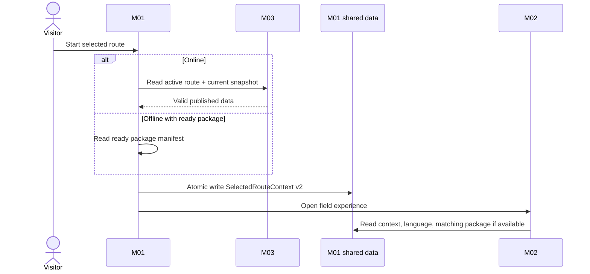
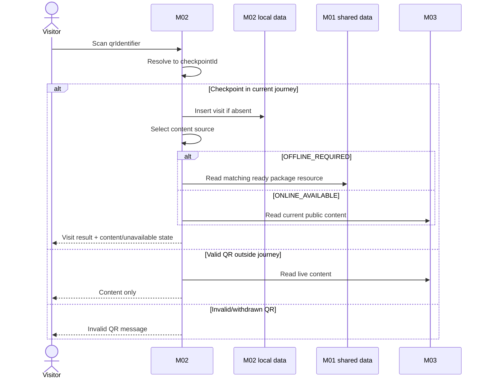
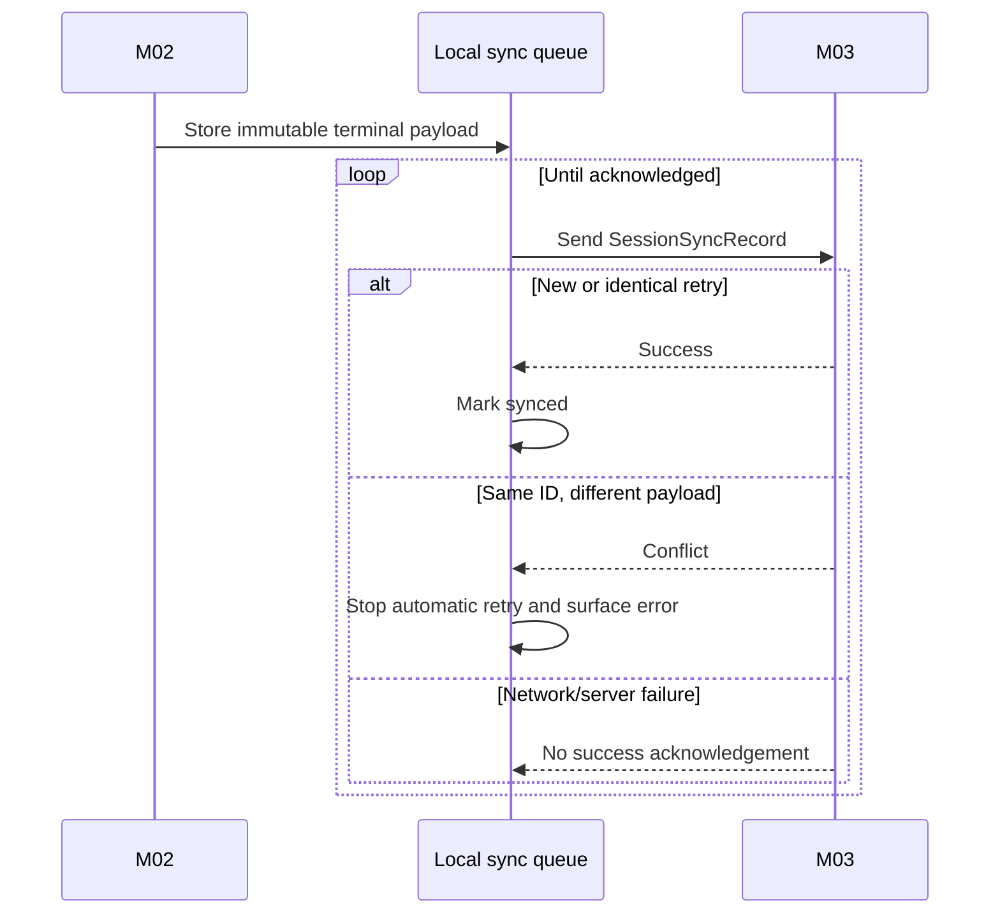
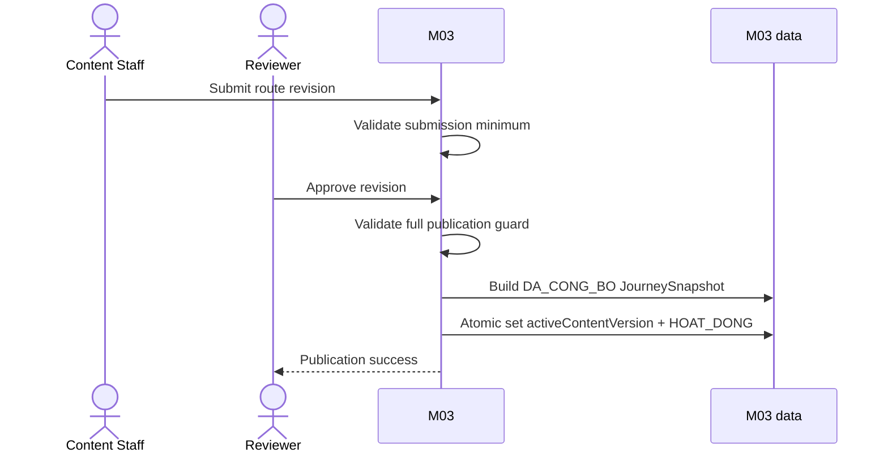

# Main Sequence Diagrams — Cúc Phương Quest

Tài liệu này tập hợp nguyên văn các block `sequenceDiagram` trong ba module spec. Khi sequence trong spec thay đổi, bản sao tương ứng tại đây phải được cập nhật; file này không định nghĩa hành vi mới.

## Danh mục sequence

1. [SD-01 — M01 Start Route & Handoff](#sd-01--m01-start-route--handoff)
2. [SD-02 — M02 QR Check-in](#sd-02--m02-qr-check-in)
3. [SD-03 — M02 Terminal Session Sync](#sd-03--m02-terminal-session-sync)
4. [SD-04 — M03 First Route Publication](#sd-04--m03-first-route-publication)

## SD-01 — M01 Start Route & Handoff

Nguồn: [spec-M01.md](../spec/spec-M01.md), §4.7.

## SD-02 — M02 QR Check-in

Nguồn: [spec-M02.md](../spec/spec-M02.md), §4.2.

## SD-03 — M02 Terminal Session Sync

Nguồn: [spec-M02.md](../spec/spec-M02.md), §4.3.

## SD-04 — M03 First Route Publication

Nguồn: [spec-M03.md](../spec/spec-M03.md), §4.2.

