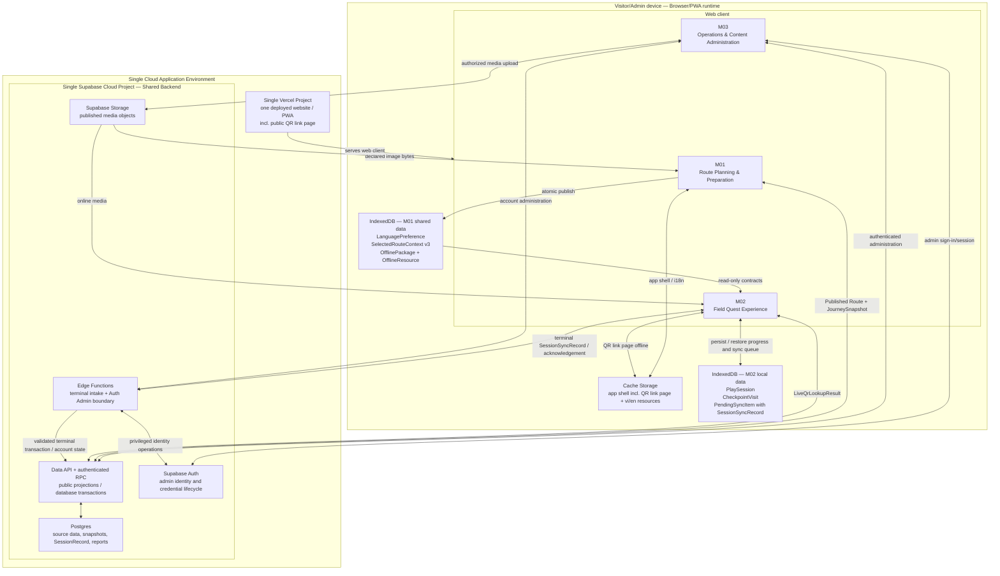

# System Configuration / Runtime Architecture

## Purpose and boundary

Tài liệu này mô tả runtime architecture đã duyệt của Cúc Phương Quest trong phạm vi MVP M01–M03: các runtime component đã chọn, nơi đặt ba module, các vùng lưu trữ, luồng dữ liệu quan trọng, cách hệ thống hoạt động khi offline và các contract tích hợp. Đây không phải bằng chứng implementation hoặc deployment đã tồn tại.

Baseline nghiệp vụ và contract là Spec M01 v3.2, M02 v3.2 và M03 v3.6 hiện hành trên branch này. Architecture không thay đổi behavior hoặc contract trong các spec này.

Runtime topology là **Single Cloud Application Environment**: một website/PWA trong **Single Vercel Project** và một **Single Supabase Cloud Project** làm **Shared Backend**. **M01 / M02 / M03 — Logical Modules** chạy trong cùng frontend application và không trở thành ba service/deployment. **Local Development Workstation** dùng cho development/testing nhưng không phải deployed environment. Cấu hình, migration state và giới hạn kiểm thử nằm tại [Environment Configuration](environment.md).

Topology dưới đây là runtime architecture duy nhất của MVP.

## System Configuration Diagram

Sơ đồ thể hiện đúng một Vercel deployment unit và đúng một Supabase backend project. Data API/RPC, Edge Functions, Auth, PostgreSQL và Storage đều thuộc Shared Backend đó. Browser đọc public projections qua Data API/RLS và media qua Storage; không có proxy Edge bắt buộc cho mọi request. Physical payload/schema chi tiết nằm ngoài tài liệu này.

## Runtime components and responsibilities

| Runtime component | Responsibility in MVP | Module placement |
|---|---|---|
| Single Vercel Project | Phân phối một web client cho public visitor routes (gồm trang link QR công khai `/q/{qrIdentifier}` mà camera điện thoại mở), và protected administration routes. | Chứa artifact của M01, M02, M03; không sở hữu business data. |
| Browser/PWA runtime | Chạy UI, QR interaction, online requests và offline behavior trên thiết bị hiện tại. | M01 và M02 là public flows; M03 là authenticated, online-only flow. |
| Cache Storage | Giữ app shell và resource i18n `vi/en` cần để mở ứng dụng khi offline; app shell cũng phục vụ trang link QR khi offline nếu trình duyệt này đã từng mở app. | M01 quản lý phạm vi chuẩn bị/offline của visitor client. |
| IndexedDB — M01 shared data | Giữ preference, handoff hiện tại, package active và candidate/staging chưa công bố. | M01 ghi; M02 chỉ đọc các contract đã công bố. |
| IndexedDB — M02 local data | Giữ phiên, lượt ghé checkpoint và terminal sync record chưa được xác nhận; dữ liệu thuộc từng trình duyệt, mỗi trình duyệt tối đa một phiên đang chạy. | M02 sở hữu và ghi liên tục. |
| Single Supabase Cloud Project / backend service boundary | Data API/RLS cho reads, authenticated RPC cho commands/transactions và reports. | Shared Backend phục vụ cả M01–M03; không tạo thêm business module thứ tư hoặc backend thứ hai. |
| Edge Functions | Validate terminal intake và xử lý privileged Auth Admin calls trước khi gọi platform/database operations. | M02 sync và M03 account administration; không proxy public reads. |
| Authentication provider | Xác thực admin, quản lý invitation/credential/session; không sở hữu application role/status. | Hỗ trợ M03; application role/status thuộc dữ liệu M03. |
| Database | Giữ source data của route/checkpoint/QR/content, revision/public state, immutable `JourneySnapshot`, persisted `SessionRecord` và dữ liệu report. | M03 là owner nghiệp vụ; M01/M02 chỉ đọc hoặc gửi contract được phép. |
| Object storage | Giữ media được M03 quản lý và backend công bố/tham chiếu. | M03 quản lý ảnh/audio/video; package offline chỉ sao chép text song ngữ và ảnh tĩnh cần thiết. |

Backend MVP không có message broker, background queue, cron hoặc scheduler riêng. Snapshot được tạo trong luồng publication nguyên tử; report được query theo yêu cầu; retry terminal session do M02 thực hiện từ local queue.

M03 dùng Supabase Auth của chính project chứa PostgreSQL business data. M01/M02 đọc public contracts/projections và gửi `SessionSyncRecord` được phép vào cùng project; hợp nhất hạ tầng không thay đổi producer/consumer ownership.

## Module placement and ownership

| Module | Runs in | Owns at runtime | Reads from other boundaries | Must not mutate |
|---|---|---|---|---|
| M01 — Route Planning & Preparation | Public web-client routes | `LanguagePreference`, `SelectedRouteContext v3`, lifecycle của `OfflinePackage`, `OfflineResource` và candidate staging | Published Route, `JourneySnapshot` từ backend/M03 | M02 session/progress; M03 source data |
| M02 — Field Quest Experience | Public web-client routes, gồm trang link QR `/q/{qrIdentifier}` | `PlaySession`, `CheckpointVisit`, frozen session journey và pending `SessionSyncRecord` | M01 shared contracts; `LiveQrLookupResult` từ backend/M03 | M01 context/package; M03 source data |
| M03 — Operations & Content Administration | Protected, online-only web-client routes plus backend-owned operations/data | Route, thư viện checkpoint dùng chung, QR objects, revision, media, publication review, snapshot, audit, admin role/status, persisted `SessionRecord` và reports | Admin identity/session từ Auth; `SessionSyncRecord` từ M02 | Visitor local package, handoff hoặc running-session progress |

M03 `JourneySnapshot` là nguồn cho M01 `OfflinePackage.manifest` và `SelectedRouteContext v3.routeJourneyManifest`. Khi tạo phiên, M02 sao chép handoff manifest thành `PlaySession.journeyCheckpoints`; `RouteJourneyMap` là view chỉ đọc, có thứ tự, của mảng frozen này, không phải contract hoặc entity M03 riêng. Nguồn: Spec M01 §5.3; Spec M02 §1, §5.1 và §6; Spec M03 §5.1 và §11.

Closure ở M03 không trực tiếp sửa dữ liệu trên thiết bị. Khi M01 đọc thành công trạng thái route không còn khả dụng, M01 chặn Start mới và đánh dấu current context của route là `REVOKED`; package vẫn được giữ và phiên M02 đã tạo tiếp tục độc lập (Spec M01 US-M01-05, BR-M01-011).

## Data placement and ownership

| Data/contract | Runtime location | Writer/owner | Reader/consumer | Runtime invariant |
|---|---|---|---|---|
| App shell, bundled i18n `vi/en` | Cache Storage | Web client/M01 offline lifecycle | M01, M02 | Có thể mở và dùng phần đã bundle khi offline. |
| `LanguagePreference` | Shared client data in IndexedDB | M01 | M01, M02 | Singleton với `languageCode: Enum(vi, en)`; đổi ngôn ngữ không thay package/session. |
| `SelectedRouteContext v3` | Shared client data in IndexedDB | M01 | M02 read-only | Một current context; ghi atomic sau Start hợp lệ; `handoffId` mới cho mỗi Start; hạn 24 giờ. |
| Active `OfflinePackage` and `OfflineResource` values | IndexedDB | M01 | M01, M02 read-only | Tài nguyên theo từng mã QR, kèm sơ đồ tuyến offline và chữ cốt lõi khi có; M02 chỉ thấy package `SAN_SANG`; `OfflineStationContent` chỉ là M02 read-only view của resource, không phải persisted entity khác; text/ảnh không bị nhân đôi vào handoff. |
| Package candidate/staging | IndexedDB | M01 | M01 only | Không được lộ cho M02; lỗi update giữ nguyên active package cũ. |
| `PlaySession`, frozen journey, `CheckpointVisit` | IndexedDB | M02 | M02 | Khôi phục được sau reload/offline; visit duy nhất theo `(sessionId, checkpointId)` và chỉ ghi cho lần quét được chấp nhận. |
| `PendingSyncItem` containing `SessionSyncRecord` | IndexedDB | M02 | M02 sync process | Queue item giữ terminal payload bất biến đến khi success hoặc conflict; chỉ `syncStatus` thay đổi. |
| Published Route and `JourneySnapshot` | Database/public backend projection | M03 | M01; heritage journey cho M02 qua handoff | Snapshot đã công bố là bất biến; public/version switch nguyên tử. |
| `LiveQrLookupResult` with `LiveStationContent` | Database/object storage through public backend read | M03 | M02 | Outcome `VALID`/`TEMPORARILY_CLOSED`/`INVALID`; nội dung chỉ từ mã, checkpoint và route đang công khai; source failure khác invalid QR. |
| Administrative source/revision/audit data | Database | M03 | Authorized M03 users | Write đi qua server-side authorization/concurrency/publication rules. |
| Persisted `SessionRecord` and report data | Database | M03 after `SessionSyncRecord` intake | M03 reports | Accepted business fields bất biến; M03 bổ sung `ingestedAt`; identical retry idempotent, changed retry conflict. |

`Media` metadata thuộc Database; byte của image/audio/video đã phát hành thuộc Object Storage và được tham chiếu qua `sourceRef`. `LiveQrLookupResult`/`LiveStationContent` là public transport projection từ source hiện hành, không phải một persisted entity riêng.

`introductionText` là tên field được dùng nhất quán trong các Spec M01–M03 hiện tại cho nội dung giới thiệu offline. Không có field `storytellingText` trong bộ nguồn hiện tại; tài liệu này không đổi tên domain field.

## Important runtime data flows

### M03 publication to M01/M02

1. M03 gửi authenticated administration command qua backend boundary.
2. Backend ghi source/revision data và, khi publication ảnh hưởng journey, tạo `JourneySnapshot` bất biến.
3. Khi phát hành lần đầu hoặc thay đổi ảnh hưởng journey, public state, `activeContentVersion` và snapshot mới được chuyển nguyên tử sau khi publication thành công. Metadata ngoài snapshot có thể được phát hành mà không đổi `contentVersion`; một thay đổi ở checkpoint dùng chung chuyển snapshot của mọi tuyến liên quan cùng lúc (Spec M03 BR-M03-G04–G06, BR-M03-X02).
4. M01 đọc Published Route và `JourneySnapshot` để browse, recommend, prepare package và Start.
5. M02 không cập nhật journey đang chạy từ publication mới. Khi online, M02 tra live mọi mã được quét (cả hai loại kết nối); package chỉ dùng khi offline hoặc tra cứu lỗi.

### M01 offline preparation and handoff to M02

1. M01 đọc snapshot hiện hành và xác định các checkpoint `OFFLINE_REQUIRED`.
2. M01 tải full manifest, tài nguyên offline của từng mã QR (tên đối tượng, `introductionText` song ngữ, ảnh tĩnh được khai báo), sơ đồ tuyến offline khi có và chữ cốt lõi của tuyến thành candidate package.
3. Chỉ sau khi manifest, text và toàn bộ ảnh khai báo được kiểm tra đầy đủ, M01 mới atomic-switch candidate thành active `OfflinePackage` `SAN_SANG`.
4. Khi Start hợp lệ, M01 ghi atomic `SelectedRouteContext v3` với `expiresAt` sau 24 giờ; context chứa journey metadata nhưng không nhân đôi offline text/ảnh.
5. M02 đọc context, current language và package active nếu có, rồi sao chép manifest thành frozen journey của `PlaySession`.

### QR check-in and content selection

1. Mã đến từ nút Quét trong app hoặc từ link công khai `{QR_PUBLIC_BASE_URL}/q/{qrIdentifier}` mà camera điện thoại mở; M02 lấy `qrIdentifier` từ link và coi link của môi trường khác là mã không hợp lệ.
2. Khi online, M02 tra `LiveQrLookupResult` (kèm `routeId` khi có phiên); không có trả lời trong `LOOKUP_TIMEOUT_SECONDS` thì coi là tra cứu lỗi.
3. M02 chỉ ghi `CheckpointVisit` cho lần quét được chấp nhận: online `VALID` với checkpoint thuộc journey (theo mã đã đóng băng hoặc `checkpointId` trả về), hoặc offline/tra cứu lỗi với mã thuộc journey đã đóng băng. Visit được ghi trước khi hiển thị nội dung; lỗi nội dung không xóa visit. `TEMPORARILY_CLOSED` hiện thông báo khu vực tạm đóng, `INVALID` hiện mã không hợp lệ; cả hai không ghi visit.
4. Online, M02 hiển thị nội dung trả về của đúng mã đã quét. Offline hoặc tra cứu lỗi, M02 đọc `OfflineResource` theo `qrIdentifier` từ active ready package của M01 qua read-only `OfflineStationContent` view; checkpoint `ONLINE_AVAILABLE` khi đó không có nội dung.
5. Trang link QR chỉ nhận diện phiên trong cùng trình duyệt; không có phiên thì là khách tự do (không tạo phiên, không ghi dữ liệu). Mỗi lần mở app, phiên đã bắt đầu quá 24 giờ được tự đóng: `HOAN_TAT` nếu đã quét điểm cuối, ngược lại `BO_DO`.

### Terminal session sync and reporting

1. Khi session chuyển `HOAN_TAT` hoặc `BO_DO` (kể cả khi tự đóng sau 24 giờ), M02 đóng băng một anonymous `SessionSyncRecord` và ghi vào local sync queue.
2. M02 gửi record qua terminal-session intake của backend khi có thể; kết thúc trải nghiệm không bị chặn bởi trạng thái mạng.
3. M03 lưu accepted business fields thành immutable `SessionRecord` theo `sessionId` và bổ sung `ingestedAt`; retry cùng normalized business payload trả success, payload khác với cùng ID trả conflict và không ghi đè. M03 kiểm tra từng điểm đã quét khớp snapshot của `(routeId, contentVersion)`; bản ghi sai bị từ chối và M02 dừng tự gửi lại.
4. RPT-01/RPT-02 chỉ đọc các `SessionRecord` đã ingest thành công; report không phản ánh record còn nằm trên thiết bị và không phải realtime.

## Offline runtime architecture

| Situation | Runtime behavior |
|---|---|
| App opened without network | App shell và i18n được đọc từ Cache Storage; local preference/context/package/session được đọc từ IndexedDB. |
| Source appears online but request fails | Không dùng riêng trạng thái kết nối của browser để coi nguồn là khả dụng; kết quả request thực tế quyết định online path. |
| Online Start | M01 xác nhận route và current published snapshot từ backend, sau đó atomic-write handoff. |
| Offline Start with ready package | M01 dùng manifest của active package `SAN_SANG`; package có thể `OUTDATED` nhưng vẫn dùng được với cảnh báo khi biết trạng thái. |
| Offline Start without ready package | Start bị chặn vì không có manifest hợp lệ để tạo handoff. |
| Package download/update interrupted | Candidate không được công bố; active ready package trước đó vẫn đọc được. |
| `OFFLINE_REQUIRED` content | M02 đọc nội dung song ngữ và ảnh tĩnh của đúng mã đã quét từ package local theo `qrIdentifier`. |
| `ONLINE_AVAILABLE` content while offline | Hiển thị content unavailable; không có offline fallback được định nghĩa. |
| Session progress while offline/reload | M02 tiếp tục ghi local và khôi phục cùng `PlaySession`/visits. |
| Session becomes terminal while offline | Immutable `SessionSyncRecord` ở local queue và được retry sau; Finish không chờ sync. |
| QR link opened from the phone camera without network | Trang chỉ mở được nếu trình duyệt này đã từng mở app (app shell trong Cache Storage); khi đó hoạt động như quét offline trong app. Nếu chưa, trình duyệt tự báo không có kết nối. Chỉ nút Quét trong app được cam kết khi offline. |
| App opened with a session older than 24 hours | Phiên được tự đóng trước khi xử lý handoff, rồi xếp hàng đồng bộ như mọi phiên kết thúc. |
| M03 administration loses connectivity | Save báo lỗi; M03 không có offline draft synchronization. |
| Route/checkpoint closes remotely | Không xóa package và không cảnh báo/ngắt running session. Khi M01 đọc được route không còn khả dụng, M01 chặn Start mới và chuyển current context của route sang `REVOKED`; khi chưa biết closure do offline, Start vẫn tuân theo ready package local. |

Không có cross-device recovery. Xóa browser data có thể làm mất preference, package, context, session, visits và pending sync record trên thiết bị đó.

## Integration contracts

| Direction | Logical contract | Runtime transport/location | Required boundary behavior |
|---|---|---|---|
| M03 → M01 | Published Route | Public backend read | Chỉ route `HOAT_DONG` có `activeContentVersion` hợp lệ mới selectable. |
| M03 → M01 | `JourneySnapshot` | Public backend read | Full active journey, immutable by `(routeId, contentVersion)`; `offlineResources` (mỗi mã QR một mục) chỉ cho `OFFLINE_REQUIRED`; `offlineRouteMap` và `estimatedOfflineSizeBytes` là tùy chọn. |
| M01 → M02 | `LanguagePreference` | Shared IndexedDB data | Required `languageCode: Enum(vi, en)`; M02 chỉ đọc. |
| M01 → M02 | `SelectedRouteContext v3` | Atomic shared IndexedDB value | `AUTHORIZED`, UUID handoff chưa dùng, chưa quá `expiresAt` (24 giờ), full manifest; context không chứa offline resource bytes; version 2 bị từ chối. |
| M01 → M02 | Active `OfflinePackage` with `OfflineResource` values | Shared IndexedDB data | Chỉ `SAN_SANG`, có `CURRENT` hoặc `OUTDATED`; M02 dùng `OfflineStationContent` như read-only view; staging/partial data không được expose. |
| M03 → M02 | `LiveQrLookupResult` with `LiveStationContent` | Public backend read + media reference | Request `qrIdentifier` (+ `routeId` khi có phiên); outcome `VALID`/`TEMPORARILY_CLOSED`/`INVALID`; source failure là tín hiệu riêng, không phải `INVALID`. |
| M03 → M02 | Printed public QR link | Phone camera opens `{QR_PUBLIC_BASE_URL}/q/{qrIdentifier}` on the Single Vercel Project | Link cố định trong suốt vòng đời tem; giá trị base URL do [Environment Configuration](environment.md) quản lý. |
| M02 → M03 | `SessionSyncRecord` | Backend terminal-session intake | Chỉ `HOAN_TAT` hoặc `BO_DO`, anonymous, immutable; accepted fields được lưu thành M03 `SessionRecord` cộng `ingestedAt`; retry idempotent hoặc conflict như phần Terminal session sync and reporting; từng điểm đã quét phải khớp snapshot. |
| Auth provider ↔ M03 | Admin identity/session | Supabase Auth runtime | Provider sở hữu credential lifecycle; M03 sở hữu fixed role và account status. |

Các contract trên là logical contract. Runtime split Edge/RPC đã chốt ở phần Runtime decisions; physical endpoint, table/column và bucket thuộc implementation design.

## Traceability

| Area in this document | Source baseline |
|---|---|
| Module boundary, ownership and cross-module contracts | [Spec M01](../spec/spec-M01.md), [Spec M02](../spec/spec-M02.md), [Spec M03](../spec/spec-M03.md), [System Context](context-diagram.md) |
| Offline package, handoff and browser persistence | [Spec M01](../spec/spec-M01.md) §§4–6; [Tech Stack](tech-stack.md) §4 |
| Session, QR/content selection and terminal sync | [Spec M02](../spec/spec-M02.md) §§4–6; [Sequence Diagrams](sequence-diagrams.md) |
| Publication, snapshots, Auth/data/media and reports | [Spec M03](../spec/spec-M03.md) §§3–6; [Tech Stack](tech-stack.md) §5 |
| MVP inclusion and exclusions | [MVP Scope](../../MVP-Scope.md) |

Các BRD M01–M03 không tồn tại trong working tree tại thời điểm refactor; ba module spec (M01 v3.2, M02 v3.2, M03 v3.6) tự khai báo là implementation source of truth và được dùng làm behavioral/contract baseline hiện hành.
