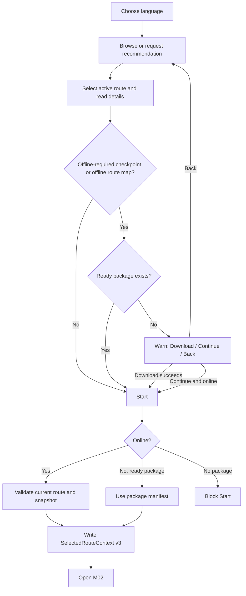
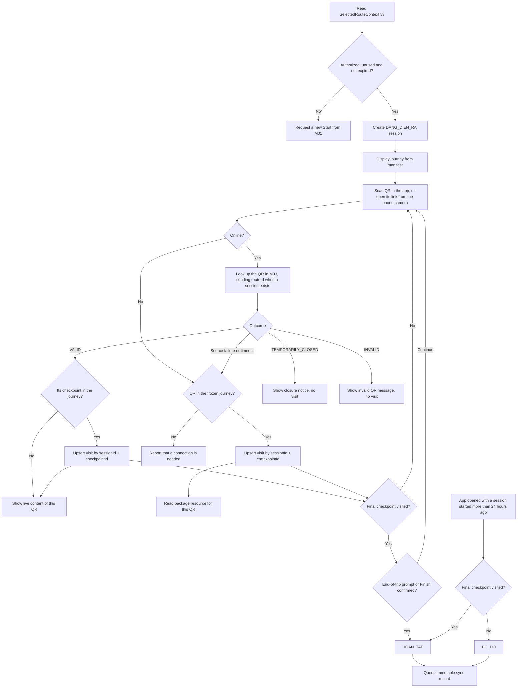
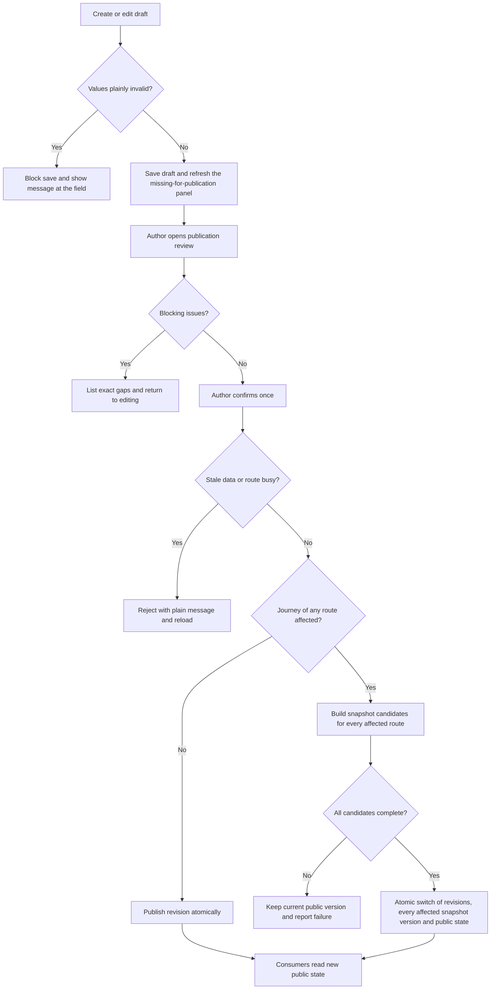
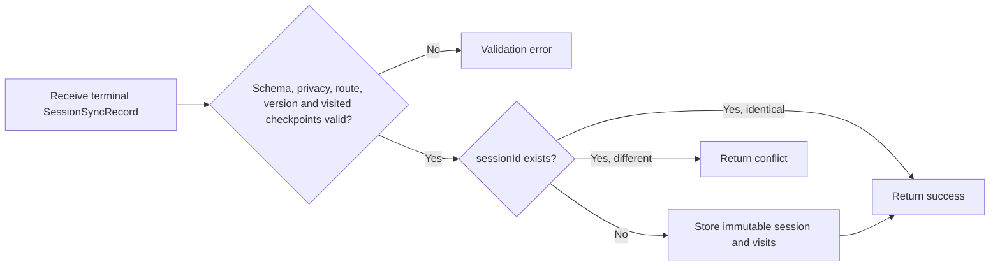
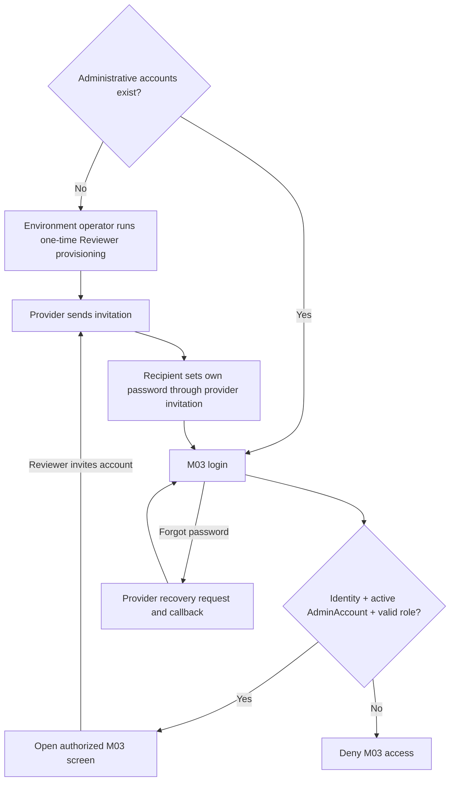
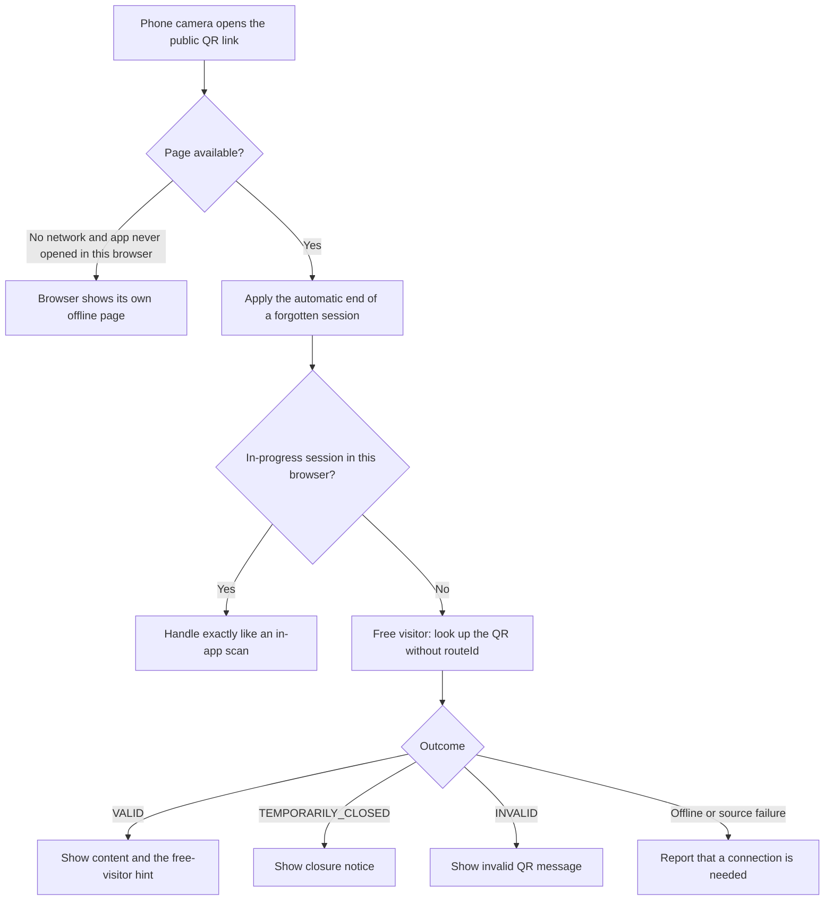
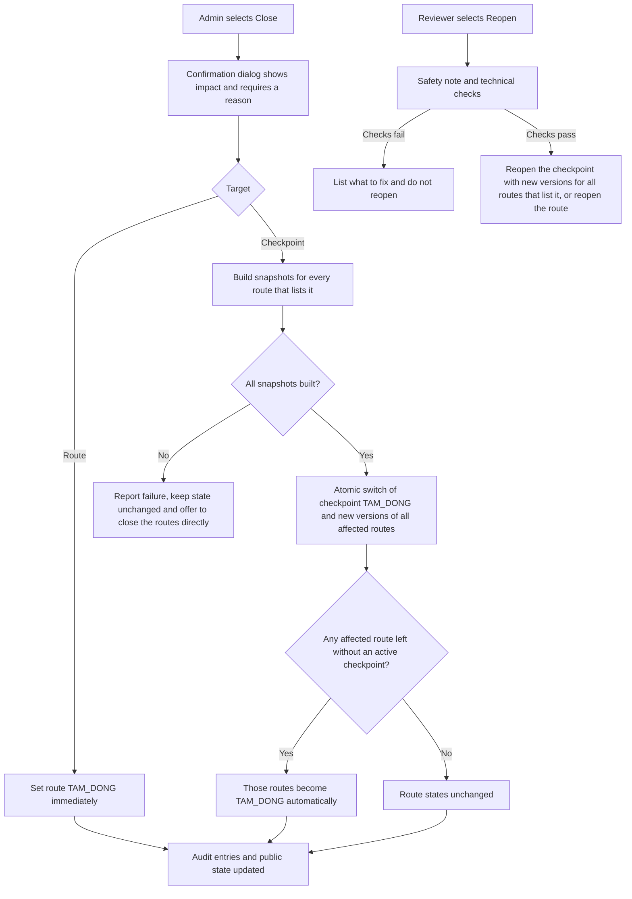
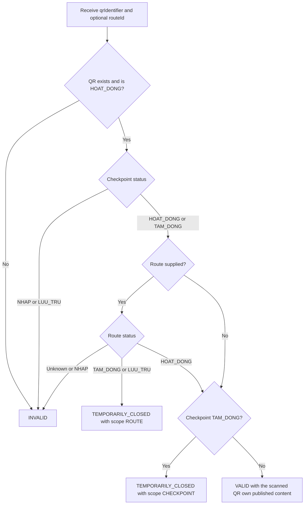
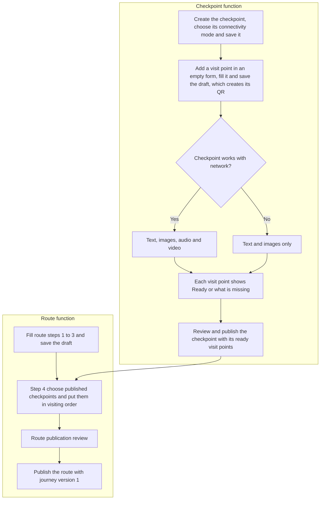

# Main Usage Flow — Cúc Phương Quest

Tài liệu này tập hợp nguyên văn các block `flowchart` trong ba module spec. File không bổ sung nhánh hoặc hành vi ngoài spec; khi flow trong spec thay đổi, bản sao tại đây phải được cập nhật. Đồng bộ ngày 2026-10-27 với Spec M01 v3.2, M02 v3.3, M03 v3.7.

## Danh mục

1. [UF-01 — M01 Overall Usage](#uf-01--m01-overall-usage)
2. [UF-02 — M02 Field Experience](#uf-02--m02-field-experience)
3. [UF-03 — M03 Draft, Review & Publication](#uf-03--m03-draft-review--publication)
4. [UF-04 — M03 Session Ingest](#uf-04--m03-session-ingest)
5. [UF-05 — M03 Administrative Access](#uf-05--m03-administrative-access)
6. [UF-06 — M02 Public QR Link Entry](#uf-06--m02-public-qr-link-entry)
7. [UF-07 — M03 Closure & Reopen](#uf-07--m03-closure--reopen)
8. [UF-08 — M03 Live QR Lookup](#uf-08--m03-live-qr-lookup)
9. [UF-09 — M03 Checkpoint & Route Creation](#uf-09--m03-checkpoint--route-creation)

## UF-01 — M01 Overall Usage

Nguồn: [spec-M01.md](../spec/spec-M01.md) v3.2, §4.1.

## UF-02 — M02 Field Experience

Nguồn: [spec-M02.md](../spec/spec-M02.md) v3.3, §4.1.

## UF-03 — M03 Draft, Review & Publication

Nguồn: [spec-M03.md](../spec/spec-M03.md) v3.7, §4.1.

## UF-04 — M03 Session Ingest

Nguồn: [spec-M03.md](../spec/spec-M03.md) v3.7, §4.4.

## UF-05 — M03 Administrative Access

Nguồn: [spec-M03.md](../spec/spec-M03.md) v3.7, §4.3.

## UF-06 — M02 Public QR Link Entry

Nguồn: [spec-M02.md](../spec/spec-M02.md) v3.3, §4.4.

## UF-07 — M03 Closure & Reopen

Nguồn: [spec-M03.md](../spec/spec-M03.md) v3.7, §4.5.

## UF-08 — M03 Live QR Lookup

Nguồn: [spec-M03.md](../spec/spec-M03.md) v3.7, §4.6.

## UF-09 — M03 Checkpoint & Route Creation

Nguồn: [spec-M03.md](../spec/spec-M03.md) v3.7, §4.7.

