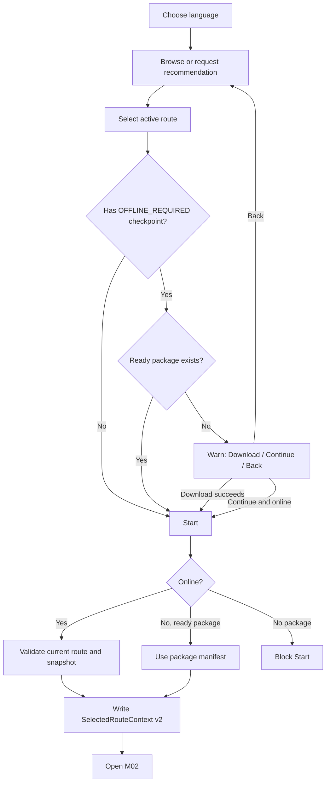
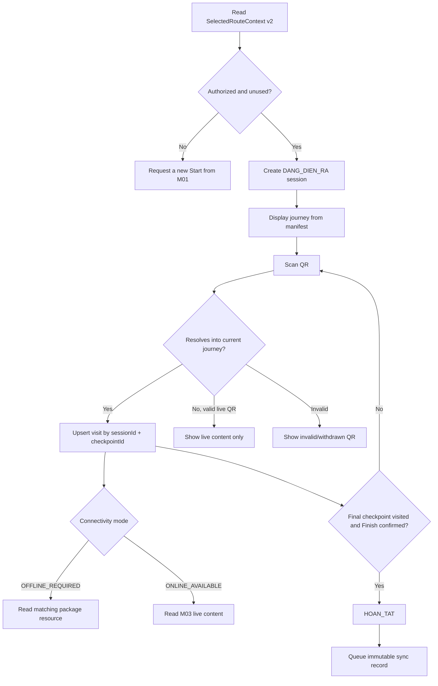
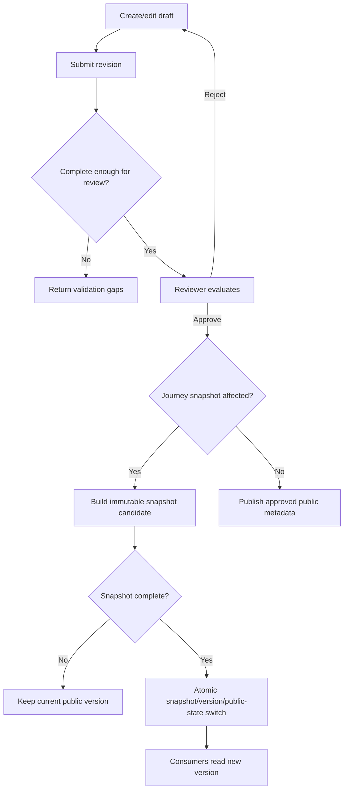
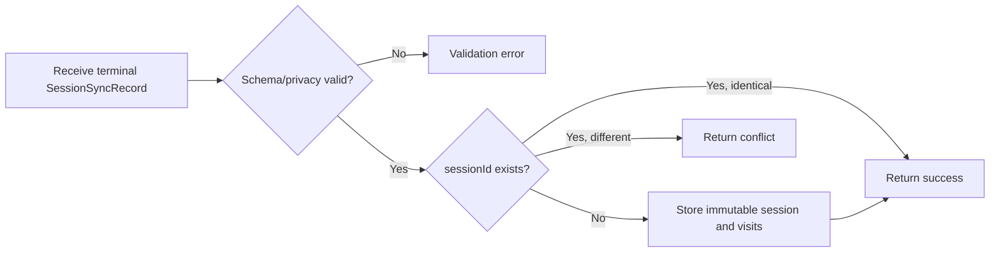

# Main Usage Flow — Cúc Phương Quest

Tài liệu này tập hợp nguyên văn các block `flowchart` trong ba module spec. File không bổ sung nhánh hoặc hành vi ngoài spec.

## Danh mục flow

1. [UF-01 — M01 Overall Usage](#uf-01--m01-overall-usage)
2. [UF-02 — M02 Field Experience](#uf-02--m02-field-experience)
3. [UF-03 — M03 Review & Publication](#uf-03--m03-review--publication)
4. [UF-04 — M03 Session Ingest](#uf-04--m03-session-ingest)

## UF-01 — M01 Overall Usage

Nguồn: [spec-M01.md](../spec/spec-M01.md), §4.1.

## UF-02 — M02 Field Experience

Nguồn: [spec-M02.md](../spec/spec-M02.md), §4.1.

## UF-03 — M03 Review & Publication

Nguồn: [spec-M03.md](../spec/spec-M03.md), §4.1.

## UF-04 — M03 Session Ingest

Nguồn: [spec-M03.md](../spec/spec-M03.md), §4.4.

