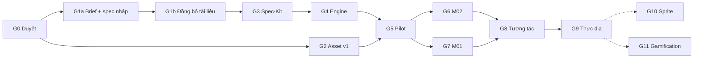

# Mascot Implementation Roadmap

| Trường | Giá trị |
|---|---|
| Trạng thái | **PROPOSED**. Chờ người dùng duyệt; không sửa code trước khi duyệt |
| Ngày | 2026-11-20; cập nhật 2026-11-22 (v1.1) |
| Quy trình | Như AI Integration: change brief → spec canonical → tài liệu dẫn xuất → gói Spec-Kit → code → validation report ([runbook](../../M03_Documentation_Refactor_Runbook_v2.md) §3, §13; AGENTS.md §2) |

## 1. Các giai đoạn

| Giai đoạn | Nội dung | Phụ thuộc | Ai làm | Ra |
|---|---|---|---|---|
| **G0 — Duyệt bộ tài liệu này** | Chốt MAS-D-01…14 ([BRD](MASCOT_BUSINESS_REQUIREMENTS.md) §7) | — | Người dùng | Quyết định có ngày |
| **G1a — Brief + spec nháp** *(xong 2026-11-21)* | Change brief [CHG-MASCOT-2026-11-21-01](../../specs/005-visitor-mascot/change-brief-CHG-MASCOT-2026-11-21-01.md); [spec-Mascot.md](../spec/spec-Mascot.md) v0.1 | G0 | Agent soạn | Người dùng duyệt 2026-11-21 |
| **G1b — Đưa vào quản trị** *(xong 2026-11-21)* | Brief APPROVED; OD-MAS-01…16 đã chốt: spec-Mascot v1.0; AGENTS.md §2/§3.1/§4; MVP-Scope; function-list-Mascot; design-system (§4.3, §5.4, mục Mascot, token); screen spec SCR-M01-001…004, SCR-M02-001…004 và screen list; architecture (environment nếu có cờ); README | G1a | Agent soạn, người dùng duyệt | Tài liệu canonical và dẫn xuất đồng bộ |
| **G2 — Asset v1** | Người dùng tạo 12 tư thế theo [Asset spec](MASCOT_ASSET_SPECIFICATION.md) §5; agent xuất WebP 240/480, đo dung lượng, kiểm viền alpha; vẽ SVG lá FX-01 | G0 (có thể song song G1) | Người dùng + agent | `assets/mascot/` |
| **G3 — Gói Spec-Kit** | `specs/005-visitor-mascot/`: specify → clarify → plan → tasks → analyze | G1b | Agent | Gói READY |
| **G4 — Engine** | `src/shared/mascot` (events, machine, rules, arbiter, idle, dialogue) + test MAS-TC-001…012; cờ `VITE_FEATURE_MASCOT` mặc định tắt | G3 | Agent | Engine có test, chưa hiện gì |
| **G5 — Pilot 3 khoảnh khắc** | Host + slot + 3 điểm: giới thiệu sau chọn ngôn ngữ (MAS-B-001…003), quét thành công (MAS-B-050/051), màn kết quả (MAS-B-062/063); ảnh tạm được phép dùng ở `dev:fake` nếu G2 chưa xong | G4, G2 (ảnh thật trước khi bật cờ ở Production) | Agent | PR pilot; người dùng thử trên điện thoại |
| **G6 — M02 đầy đủ** | Scanner (hướng dẫn, không hoạt động, bị kẹt), BUSY, tạm đóng, ngoài hành trình, mạng, dialog cuối chuyến, Đi tiếp, chào mừng quay lại, đồng bộ | G5 được duyệt | Agent | PR |
| **G7 — M01 đầy đủ** | Danh mục, gợi ý, chi tiết (nhắc an toàn), gói tải trước, trạng thái rỗng và lỗi | G5 | Agent | PR |
| **G8 — Tương tác & hoàn thiện** | Chạm để nhận gợi ý (một câu mỗi màn), lời nhắc thiên nhiên (sau khi Ban Quản lý duyệt) | G6, G7 | Agent | PR |
| **G9 — Kiểm thực địa** | Checklist thiết bị (MAS-TC-073…075, 084, 092), chỉnh ngưỡng không hoạt động (MAS-D-11), bật cờ ở Production | G8 | Người dùng + agent | Validation report |
| **G8b — Mila sống động (v1.1)** | [CHG-MASCOT-2026-11-22-02](../../specs/005-visitor-mascot/change-brief-CHG-MASCOT-2026-11-22-02.md): bong bóng kiểu A + chữ hiện dần + cỡ mới; công tắc chuyển động + cử chỉ tự động; chạm theo ngữ cảnh + chạm nhiều lần; ba cấp ăn mừng; ngữ cảnh hoạt động; chớp mắt (khi có ảnh MA-20) | G5 | Agent; người dùng tạo ảnh đợt 2, 3 | PR |
| G10 — Sprite (tùy chọn) | MA-21, 22: vẫy tay, ăn mừng (chớp mắt MA-20 chuyển lên G8b) | G9 | Người dùng (asset) + agent | — |
| G11 — Gamification (FUTURE) | Huy hiệu, sổ tay, câu đố: sửa MVP-Scope §4 và spec-M02 trước | Quyết định riêng | — | — |
| G12 — Rive (tùy chọn) | Vẽ lại vector có rig; đổi renderer | Quyết định phong cách riêng | — | — |

## 2. Thứ tự ưu tiên

1. **G5 (pilot)** mang lại cảm nhận lớn nhất với ít rủi ro nhất: ba khoảnh khắc vui, không đụng trạng thái lỗi.
2. **G6 trước G7**, vì M02 là nơi du khách ở ngoài rừng và cần đồng hành nhất.
3. Tương tác chủ động (chạm để hỏi) để sau, khi hành vi thụ động đã được kiểm.

## 3. Definition of Done (mỗi giai đoạn code G4–G9)

- [ ] Chỉ sửa file trong phạm vi change brief; `git diff` không có thay đổi ngoài phạm vi.
- [ ] `npm run ci` PASS (typecheck, lint token, test, build) với cờ mascot bật và tắt.
- [ ] `npm run e2e` PASS cho `m01`, `m02`; test hiện có không bị sửa để "cho qua".
- [ ] Test mới của giai đoạn (theo [Testing Checklist](MASCOT_TESTING_CHECKLIST.md)) PASS.
- [ ] Không thêm dependency runtime; không đổi schema `visitorDb`, contract hay migration.
- [ ] Câu chữ mới đã nằm trong bảng copy screen spec trước khi vào `vi.ts`/`en.ts`.
- [ ] Ngân sách precache và chunk đạt (MAS-TC-090, 091).
- [ ] Giảm chuyển động kiểm bằng Playwright `reducedMotion`.
- [ ] Validation report ghi lệnh đã chạy thật; phần chưa chạy ghi `NOT RUN`.
- [ ] Không commit hoặc push nếu người dùng chưa yêu cầu.

## 4. Rủi ro

| Rủi ro | Mức | Giảm thiểu |
|---|---|---|
| Mascot gây phiền, du khách tắt hoặc bỏ app | Cao | Không có nút ẩn (quyết định 2026-11-21), nên phải dựa hoàn toàn vào luật ưu tiên, cooldown, giới hạn 3 câu/10 phút và pilot trên máy thật; G9 có thể siết ngưỡng |
| Asset production chậm hoặc không đồng nhất | Trung bình | Đặc tả §5 rõ ràng; engine làm trước với ảnh tạm ở `dev:fake` |
| Precache phình, mạng yếu cài lâu | Trung bình | Chỉ precache cỡ 240; đo trong CI |
| Lời thoại vi phạm SC-M02-013 hoặc hứa sai về offline/đồng bộ | Trung bình | Test từ cấm; review theo MAS-BR-07 |
| Phong cách 3D không cho cử động mượt như Duolingo | Trung bình | Chấp nhận cho v1; sprite (G10) hoặc Rive (G12) là đường nâng cấp đã chừa sẵn |
| Đụng ranh giới module | Thấp | Engine ở `shared`, host ở `app`; test kiến trúc |
