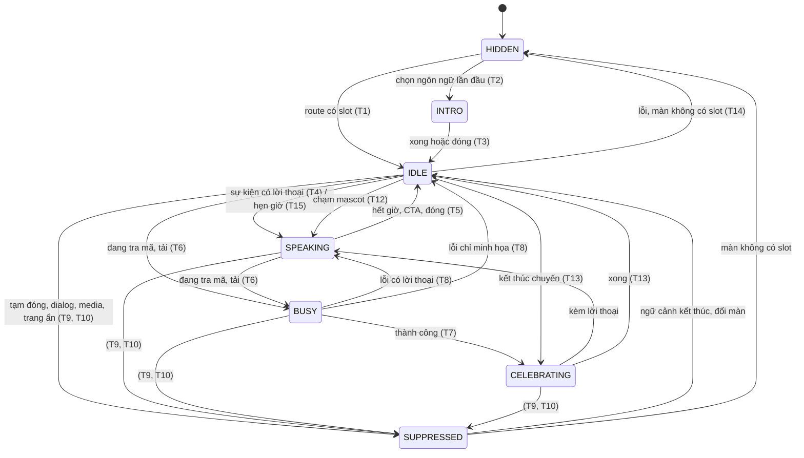

# Mascot State Machine & Event System

| Trường | Giá trị |
|---|---|
| Trạng thái | **PROPOSED** |
| Ngày | 2026-11-20; cập nhật 2026-11-22 theo spec-Mascot v1.1 (CHG-MASCOT-2026-11-22-02) và 2026-11-23 theo spec-Mascot v1.3 (CHG-MASCOT-2026-11-23-04); §5.2 luật 3, 4 đồng bộ với code (T071) |
| Liên quan | [Behavior Matrix](MASCOT_BEHAVIOR_MATRIX.md), [Dialogue Library](MASCOT_DIALOGUE_LIBRARY.md), [Technical spec](MASCOT_TECHNICAL_SPECIFICATION.md) |

## 1. Mô hình

Mascot được điều khiển bởi **một máy trạng thái thuần** (pure reducer). Đầu vào gồm:

```text
(trạng thái hiện tại, sự kiện, ngữ cảnh màn, thời điểm) → (trạng thái mới, hiệu ứng)
```

- **Sự kiện** do M01, M02 và lớp app phát ra (§4).
- **Ngữ cảnh** do màn hiện tại khai báo: slot được phép, có hộp thoại không, đang phát media không.
- **Hiệu ứng** gồm: hiện/ẩn, đổi tư thế, chạy animation, hiện bong bóng, đặt hoặc hủy hẹn giờ.

Cùng đầu vào thì luôn ra cùng kết quả: không có ngẫu nhiên ngoài việc xoay pool câu (dùng bộ đếm, không dùng `Math.random`), không có AI. Nhờ vậy test được bằng Vitest mà không cần trình duyệt.

Cảm xúc (vui, bối rối, suy nghĩ…) **không phải trạng thái riêng**. Đó là thuộc tính `pose` của trạng thái `SPEAKING`, `IDLE` hoặc `INLINE`. Cách này giữ máy trạng thái nhỏ, trong khi danh sách tư thế vẫn mở rộng được.

## 2. Chế độ hiển thị

| Mode | Mô tả | Kích thước (token đề xuất) | Dùng ở | Kết thúc |
|---|---|---|---|---|
| `INTRO` | Lớp phủ cả màn (v1.3): Mila cỡ lớn và một bong bóng ở giữa màn, nền mờ; hộp thoại modal | `--mascot-size-xl` (200 px) | Chỉ MAS-B-001 | Chạm khi chữ đã hiện hết, Back hoặc Esc → `DOCK`; không tự đóng |
| `DOCK` | Mascot nhỏ đứng ở slot cố định trong layout (không nổi lên trên nội dung) | Theo slot (v1.1): hero SCR-M01-001 112 px, SCR-M02-001 128 px, cạnh huy hiệu SCR-M02-003 104 px | SCR-M02-001 (trên nút Quét), hero SCR-M01-001, SCR-M02-003 | Luôn hiện khi màn có slot; không có nút ẩn (quyết định 2026-11-21) |
| `AVATAR` | Avatar tròn kèm bong bóng, xuất hiện tạm thời | `--mascot-size-sm` (56 px, v1.1; ảnh avatar MA-11) | Scanner (dải dưới), SCR-M02-002/004 (cạnh toast), panel gói | Tự ẩn theo thời lượng hoặc × |
| `INLINE` | Minh họa nằm trong luồng nội dung, cạnh câu thông báo; không bong bóng | `--mascot-size-md` | Trạng thái rỗng, lỗi, dialog, màn kết quả | Không cần đóng (là một phần của trạng thái) |
| `CELEBRATE` | Mascot ăn mừng kèm lá rơi, **không chặn** thao tác, tối đa 2,4 s, chạm để bỏ qua | `--mascot-size-xl` (200 px, v1.1) | Chỉ màn kết quả SCR-M02-003 (MAS-B-062, 064) | Tự kết thúc → `DOCK` cạnh huy hiệu |

Slot là phần tử do layout của màn đặt sẵn và chiếm chỗ thật, nên mascot không bao giờ đè lên nút hay nội dung. Cách đặt slot giống `FieldNotice` hiện có (portal vào vùng định trước). Màn không khai báo slot thì mascot không render.

Kích thước px ở trên là giá trị đã chốt 2026-11-22 (design-system §9.2); token nằm trong `tokens.css`.

## 3. Trạng thái

| State | Ý nghĩa | Hiện ra | Tư thế mặc định |
|---|---|---|---|
| `HIDDEN` | Không có slot, cờ tính năng tắt, hoặc lỗi tải ảnh | Không gì | — |
| `INTRO` | Đang giới thiệu (mode `INTRO`) | Mascot lớn + bong bóng | Vẫy tay |
| `IDLE` | Có mặt, không nói (DOCK hoặc INLINE) | Mascot tĩnh; thở nhẹ tối đa 10 s rồi đứng yên | Theo ngữ cảnh (§3.1) |
| `SPEAKING` | Đang hiện một bong bóng | Mascot + bong bóng | Theo lời thoại |
| `BUSY` | Hệ thống đang làm việc (tra mã, tải gói, tải danh mục) | Mascot + chuyển động chờ, có thể có bong bóng | Kính lúp / ba lô / bản đồ |
| `CELEBRATING` | Ăn mừng một lần | Animation ăn mừng | Ăn mừng / giơ ngón cái |
| `SUPPRESSED` | Tạm im vì ngữ cảnh: có thông báo an toàn, hộp thoại, media đang phát, trang ẩn | Không gì (hoặc giữ `INLINE` tĩnh nếu là một phần của dialog) | — |

**Đã gộp hoặc bỏ so với danh sách gợi ý:**
- `GREETING`, `EXPLAINING`, `ENCOURAGING`, `CONFUSED`, `SAD`, `THINKING`, `OBSERVING` gộp vào `SPEAKING`/`IDLE` với `pose` tương ứng.
- `WAITING` gộp vào `BUSY`.
- `DISMISSED`/`MINIMIZED` bỏ: không có nút ẩn hay chế độ yên lặng (quyết định 2026-11-21). Nút × chỉ đóng bong bóng, mascot về `IDLE`.
- `WARNING` bỏ: cảnh báo an toàn là việc của giao diện cố định, mascot không đóng vai cảnh báo.
- `SLEEPING` bỏ: mascot ngủ dễ bị hiểu là app treo, và vô ích ngoài thực địa.

### 3.1 Tư thế mặc định của DOCK trên SCR-M02-001 (suy ra từ dữ liệu phiên, không lưu)

| Điều kiện | Tư thế |
|---|---|
| Không có phiên (khách tự do hoặc bị từ chối) | Bối rối (INLINE cạnh câu thông báo) |
| Phiên chưa có lượt ghé nào | Ống nhòm |
| Đã có lượt ghé, chưa quét điểm cuối | Đọc bản đồ |
| Đã quét điểm cuối, phiên còn chạy (đã chọn Đi tiếp) | Giơ ngón cái |

## 4. Sự kiện

### 4.1 Quy ước đặt tên

Code hiện không có event bus. Quy ước của repo: enum nghiệp vụ dạng `UPPER_SNAKE` (`DANG_DIEN_RA`, `VALID`), `kind` dạng `UPPER_SNAKE`, hàm `camelCase`. Đề xuất:

- **Tên sự kiện**: `<nguồn>.<miền>.<động từ quá khứ camelCase>`. Nguồn là `app`, `m01` hoặc `m02`. Ví dụ `m02.scan.resolved`, `m01.package.ready`. Tên cho thấy module sở hữu (modular monolith), và một sự kiện mang payload phân loại thay vì nhân bản nhiều tên.
- **Payload** dùng lại giá trị enum có sẵn (`display.kind`, `syncStatus`, `PackageFailure`), không tạo enum mới.
- Payload **không chứa** nội dung bài, tên du khách, id thiết bị. Chỉ có id opaque khi thật cần (ví dụ `routeId` để tính cooldown theo tuyến).
- Sự kiện chỉ sống trong bộ nhớ; **không lưu, không gửi đi**.

### 4.2 Danh mục sự kiện

Cột "Nguồn" chỉ nơi trong code hiện tại sẽ phát sự kiện (chỉ thêm một lời gọi `emit`, không đổi logic). Mọi sự kiện đều chạy offline.

| Event | Nguồn (component/file hiện có) | Điều kiện phát | Payload | Phản ứng của mascot | Lưu? |
|---|---|---|---|---|---|
| `app.route.changed` | `src/app/App.tsx` (đã theo dõi `router.state.location.pathname` cho `UpdatePrompt`) | Mỗi lần đổi path | `{ path }` | Hủy bong bóng của màn cũ, hủy hẹn giờ, chọn slot mới | Không |
| `app.visibility.changed` | Listener `visibilitychange` (mới, trong host mascot) | Trang ẩn/hiện | `{ visible, hiddenForMs }` | Ẩn → `SUPPRESSED` + dừng hẹn giờ; hiện lại sau > 10 phút có phiên → MAS-B-034 | Không |
| `app.network.changed` | Listener `online`/`offline` (mới, trong host mascot) | `navigator.onLine` đổi | `{ online }` | MAS-B-074/075. Chỉ tin `offline`; `online` không đủ để nói "có mạng chắc chắn" (giống `sourceClient.ts`) | Không |
| `app.motion.changed` | `matchMedia('(prefers-reduced-motion)')` | Người dùng đổi cài đặt | `{ reduced }` | Đổi bộ animation | Không |
| `m01.language.selected` | `LanguageGate.tsx` (nút chọn) | Ghi `LanguagePreference` thành công **từ panel** | `{ language }` | MAS-B-001 | Không (chính `LanguagePreference` đã lưu bởi M01) |
| `m01.language.changed` | `LanguageControl` (nút VI/EN) | Đổi ngôn ngữ | `{ language }` | Bong bóng đang hiện đổi ngôn ngữ (MAS-B-080) | Không |
| `m01.catalog.loaded` | `CatalogPage.tsx` (theo `catalog.status`) | `loading` → `ready` / `unavailable` | `{ status, count, stale }` | MAS-B-004…007 | Không |
| `m01.recommend.opened` | `RecommendPage.tsx` | Mount | — | MAS-B-010 | Không |
| `m01.recommend.resolved` | `RecommendPage.tsx` | Bấm "Xem tuyến phù hợp" có kết quả | `{ count }` | MAS-B-011…013 | Không |
| `m01.routeDetail.startPanelVisible` | `StartPanel.tsx` (IntersectionObserver) | Panel Bắt đầu vào khung nhìn lần đầu | `{ routeId, hasSafetyWarning }` | MAS-B-014 | Không |
| `m01.start.resolved` | `StartPanel.tsx` (`StartResult`) | Có kết quả Start | `{ kind }` | Lỗi → MAS-B-015; thành công → không (M02 tiếp nhận) | Không |
| `m01.offlineDecision.opened` | `OfflineDecisionDialog.tsx` | Mở dialog | — | MAS-B-016 | Không |
| `m01.package.downloadStarted` | Nơi gọi `packageOps` (`PackagePanel`, `OfflinePage`, `StartPanel`) | Bắt đầu tải/cập nhật | `{ routeId, update }` | MAS-B-020 | Không |
| `m01.package.resolved` | Như trên (`PackageOpResult`) | Thao tác kết thúc | `{ routeId, kind, reason? }` | `ready` → MAS-B-021; `failed` → MAS-B-024…026; `busy`/`deleted` → không | Không |
| `m01.offline.listShown` | `OfflinePage.tsx` | Danh sách rỗng | `{ empty }` | MAS-B-023 | Không |
| `m02.trip.entered` | `TripPage.tsx` (`useTripEntry`) | Có `EntryResult` | `{ kind, reason?, visitedCount, total }` | MAS-B-030, 031, 033 | Không |
| `m02.trip.shown` | `TripPage.tsx` | Mount/quay lại màn có phiên | `{ visitedCount, total, cameFromNewVisit }` | MAS-B-056/057 | Không |
| `m02.scanner.opened` / `.closed` | `TripPage.tsx` (`setScanning`) | Mở/đóng overlay | `{ visitedCount, freeVisitor }` | MAS-B-040; bắt đầu/hủy hẹn giờ không hoạt động | Không |
| `m02.scanner.cameraFailed` | `QrScanner.tsx` (`cameraFailed`) | Không mở được camera | `{ attempt }` | MAS-B-038 | Không |
| `m02.scanner.detected` | `TripPage.tsx` (`handleText` bắt đầu) | Đọc được chuỗi | — | MAS-B-043 | Không |
| `m02.scan.resolved` | `TripPage.tsx` / `ScanContent.tsx` / `QrLinkPage.tsx` (từ `ScanResult`) | Có kết quả quét | `{ display: ScanDisplay['kind'], freeVisitor, visitCreated, finalPromptNeeded, inJourney }` | MAS-B-045…054 | Không |
| `m02.visit.recorded` | `ScanContent.tsx` (khi `scan.visitCreated`) | Lượt ghé mới | `{ k, n, isFinal }` | MAS-B-050, 051, 055 (tính `k`, `n` từ phiên hiện có) | Không (lượt ghé đã lưu bởi M02) |
| `m02.media.playing` / `.stopped` | `MediaList.tsx` (sự kiện `play`/`pause`/`ended` của `<audio>`/`<video>`) | Phát/dừng | `{ type }` | `SUPPRESSED` khi phát | Không |
| `m02.finalPrompt.opened` / `.continued` / `.ended` | `FinalPrompt.tsx` | Mở dialog / bấm Đi tiếp / bấm Kết thúc | — | MAS-B-060, 061 | Không |
| `m02.trip.ended` | `EndPage.tsx` (có `state.sessionId` từ `useEndTrip`) | Vừa kết thúc | `{ status, k }` | MAS-B-062, 063 | Không |
| `m02.sync.statusChanged` | `EndPage.tsx` (`useSyncStatus`) | Trạng thái đổi | `{ status: 'PENDING' \| 'SYNCED' \| 'CONFLICT' }` | MAS-B-070…072 | Không |
| `mascot.user.tapped` / `.bubbleDismissed` | Component mascot | Du khách chạm mascot / bấm × trên bong bóng | `{ screen }` | MAS-B-009, 032, 059; đóng bong bóng | Không |
| `m02.challenge.*`, `m02.badge.unlocked` | — | — | — | FUTURE | — |

**Sự kiện được yêu cầu nhưng không có nguồn thật:**
- `SYNC_STARTED`: code không lộ trạng thái "đang gửi". Không giả lập.
- `JOURNEY_PAUSED`/`RESUMED`: spec không có tạm dừng. Thay bằng `app.visibility.changed` và `m02.trip.entered`.
- `AUDIO_COMPLETED`: lấy được từ `ended`, nhưng mascot không phản ứng (không khen nghe hết để tránh làm phiền).
- `CONTENT_VIEWED` theo nghĩa "đã đọc xong": không đo được một cách đáng tin. Không dùng.

## 5. Ưu tiên và giải quyết xung đột

### 5.1 Thang ưu tiên

| P | Lớp | Ví dụ | Ngắt được lớp thấp hơn? | Xếp hàng? |
|---|---|---|---|---|
| P0 | An toàn | Thông báo tạm đóng (`CLOSED`) | Có: ẩn mascot, xóa hàng đợi | — |
| P1 | Lỗi chặn | Camera hỏng, handoff bị từ chối, `CONFLICT` | Có | Không (chỉ minh họa INLINE) |
| P2 | Phản hồi hệ thống | Mã không hợp lệ lặp lại, cần mạng, tải lỗi, ngoài hành trình | Có | Giữ tối đa 1, sống 4 s |
| P3 | Du khách yêu cầu | Chạm mascot | Có (trừ P0–P2 đang hiện) | Không |
| P4 | Thành công | Lượt ghé mới, tải xong, kết thúc chuyến | Có với P5–P7 | Giữ tối đa 1, sống 4 s |
| P5 | Tiến độ | Nửa chặng, mất sóng, đang kiểm tra | Có với P6–P7 | Bỏ nếu đang bận |
| P6 | Hướng dẫn | Giới thiệu, hướng dẫn quét, cất máy | Chỉ với P7 | Bỏ nếu đang bận |
| P7 | Nền | Nhìn quanh, "có sóng lại", thở nhẹ | Không | Bỏ |

### 5.2 Luật

1. **Ngắt**: sự kiện có P cao hơn (số nhỏ hơn) ngắt bong bóng đang hiện. Animation hiện tại cắt bằng crossfade 150 ms.
2. **Cùng mức**: cái mới thay cái cũ nếu cái cũ đã hiện ≥ 1,5 s; nếu chưa, cái mới vào hàng đợi.
3. **Hàng đợi**: tối đa 1 mục. Mục quá hạn (TTL 4 s) bị bỏ. P5–P7 không vào hàng đợi khi đang có bong bóng khác. Ngoại lệ: ý định bị chặn **chỉ vì slot của màn chưa đăng ký** (sự kiện tới trước khi slot mount) chờ trong hàng đợi ở mọi mức, hiện ngay khi slot có (specs/005 DV-18).
4. **Trùng lặp**: cùng `messageId` trong cooldown → bỏ. Cùng sự kiện phát hai lần trong 500 ms (ví dụ StrictMode chạy effect hai lần ở dev) → bỏ lần sau. Không áp cho tín hiệu trạng thái, thao tác của du khách và sự kiện tải gói (mỗi lần bấm là một thao tác thật; specs/005 DV-67).
5. **Không lặp câu**: pool xoay vòng; câu không lặp hiện tối đa một lần theo phạm vi ghi trong thư viện.
6. **Đổi màn**: hủy bong bóng, hàng đợi và hẹn giờ của màn cũ. Riêng P4 vừa phát trên màn cũ (ví dụ lượt ghé mới, rồi điều hướng sang nội dung) được mang sang màn mới nếu màn mới có slot.
7. **Ngữ cảnh chặn**: có hộp thoại (trừ khi mascot là INLINE của chính dialog đó), media đang phát, trang ẩn → chỉ P0–P1 có hiệu lực, và chúng chỉ ở dạng INLINE.
8. **Không có chế độ yên lặng** (quyết định 2026-11-21). Vì mascot luôn có mặt, luật 1–7, cooldown và giới hạn 3 câu chủ động/10 phút (§6.3) là cơ chế duy nhất giữ mascot không làm phiền.
9. **Ví dụ xung đột** (quét thành công + mất sóng + huy hiệu cùng lúc): lượt ghé mới (P4) hiện trước; mất sóng (P5) bị bỏ vì đang bận và sẽ không nói lại cho tới lần `offline` sau cooldown; huy hiệu (FUTURE, P4) vào hàng đợi và hiện sau nếu chưa quá 4 s.

## 6. Phát hiện không hoạt động

### 6.1 Hoạt động có ý nghĩa (reset hẹn giờ)

`pointerdown`, `keydown`, `wheel`/`scroll` trong vùng nội dung, sự kiện scanner (`detected`), media `play`, mọi sự kiện M01/M02 ở §4.2, `visibilitychange` sang hiện.

### 6.2 Luật theo ngữ cảnh

| Ngữ cảnh | Có phát hiện? | Ngưỡng | Hành vi | Lý do |
|---|---|---|---|---|
| Scanner mở, chưa đọc được mã | **Có** | 15 s / 30 s / 90 s kể từ lần mở hoặc lần hoạt động cuối | 15 s: nhìn quanh (MAS-B-041). 30 s: hỏi giúp một lần (MAS-B-042). 90 s: gợi ý tắt camera (MAS-B-049). Sau đó im lặng tới khi đóng scanner | Đây là tác vụ có mục tiêu rõ; camera chạy tốn pin |
| Danh mục tuyến, lần đầu trong lần tải trang | **Có** | 20 s, chưa cuộn và chưa chạm thẻ | Một gợi ý (MAS-B-008), không lặp | Du khách có thể đang lưỡng lự |
| Màn chuyến đi SCR-M02-001 | Không | — | — | Du khách thường đang đi bộ, máy để trong túi |
| Đọc nội dung SCR-M02-002/004, chi tiết tuyến | Không | — | — | Đọc là hoạt động, không phải kẹt |
| Media đang phát | Không | — | `SUPPRESSED` | Không ngắt nghe/xem |
| Đang chờ tra mã | Không phải "không hoạt động" | 3 s | Báo sóng yếu (MAS-B-044) | Phản hồi tiến trình, không phải nhắc |
| Trang ẩn (sang app khác) | Không | — | Dừng mọi hẹn giờ; khi hiện lại, hẹn giờ chạy lại từ 0 | Constitution VII: không chạy nền |
| Offline | Theo ngữ cảnh trên | — | Không đưa gợi ý cần mạng | Tránh gợi ý không làm được |
| Gói đang tải | Không | — | — | Đã có MAS-B-020 |

### 6.3 Cooldown và giới hạn

- Mỗi lần mở scanner: tối đa 1 câu hỏi giúp + 1 gợi ý tắt camera.
- Tổng câu chủ động (P5–P7) tối đa 3 trong 10 phút trên toàn app.
- Mọi ngưỡng là hằng trong `src/shared/mascot/config.ts`, cùng kiểu với `src/modules/m02/config/limits.ts`, và là **giá trị tạm** cần kiểm ngoài thực địa (MAS-D-11).

### 6.4 Phát hiện "bị kẹt" (luật cố định)

| Mẫu | Đếm trong phạm vi | Phản ứng |
|---|---|---|
| 2 lần `INVALID` liên tiếp | Một lần ở SCR-M02-001 (reset khi đổi màn hoặc khi có kết quả khác) | MAS-B-046 |
| 2 lần `CONNECTION_NEEDED` liên tiếp | Như trên | MAS-B-048 |
| Camera lỗi sau khi bấm Thử lại | Một lần mở scanner | Không thêm chữ: câu cố định đã chỉ cách dùng camera điện thoại (MAS-B-038) |
| 2 lần tải gói lỗi liên tiếp cùng tuyến | Một lần tải trang | MAS-B-026 |
| 2 lần gợi ý tuyến 0 kết quả liên tiếp | Một lần ở SCR-M01-002 | MAS-B-013 |

### 6.5 Ngữ cảnh hoạt động (spec-Mascot BR-MAS-20, v1.1)

| Ngữ cảnh | Nhận biết | Mila làm gì | Không làm |
|---|---|---|---|
| Đang đọc bài | Ở SCR-M02-002/004 sau phản ứng lúc vừa vào | Chỉ trả lời khi được chạm; P0–P2 | Không câu chủ động, không cử chỉ tự động |
| Đang nghe audio / xem video | `m02.media.playing` (đếm nguồn, `holdMascotSignal`) | Bong bóng đang hiện đóng ngay; chỉ P0–P1 dạng INLINE | Không bong bóng, không cử chỉ |
| Đang chờ quét QR | Scanner mở | Hẹn giờ 15/30/90 s và kết quả quét (§6.2) | Không cử chỉ tự động ở DOCK |
| Đang tải dữ liệu | Danh mục đang tải, tra mã đang chờ, gói đang tải | Báo khi quá ngưỡng (MAS-B-005, 044); AN-THINK/AN-SEARCH/AN-PACK tối đa 5 s mỗi lượt | Không lặp chữ màn đã hiện |
| Đang thao tác | Chạm, cuộn, phím trong `MASCOT_INTERACTION_GRACE_MS` gần nhất | Phản ứng do chính thao tác đó gây ra vẫn chạy (chạm Mila, kết quả quét) | Bỏ (không xếp hàng) câu do hẹn giờ, lời nhắc, cử chỉ tự động (MAS-B-088) |
| Đang gặp lỗi | Kết quả lỗi, lỗi tải, camera lỗi | Minh họa INLINE cạnh câu lỗi; gợi ý khi lỗi lặp lại (§6.4) | Không thêm nút trùng nút của màn |
| Đang rời màn | `app.route.changed` | Hủy bong bóng, hàng đợi, hẹn giờ, lịch cử chỉ của màn cũ; chỉ mang sang câu thành công P4 (§5.2) | — |

### 6.6 Cử chỉ tự động và công tắc chuyển động (BR-MAS-21, v1.1)

- Lịch: sau mỗi cử chỉ, chọn hạn kế tiếp ngẫu nhiên trong `MASCOT_AMBIENT_MIN_MS`–`MASCOT_AMBIENT_MAX_MS` (4–7 s, v1.5; trước 8–15 s). Một hẹn giờ duy nhất như các hẹn giờ khác (`nextDeadline`).
- Điều kiện chạy (MAS-B-086): màn SCR-M01-001, SCR-M02-001 khi scanner đóng, SCR-M02-003; Mila ở DOCK; không bong bóng; công tắc bật; không ở ngữ cảnh BR-MAS-08; quá `MASCOT_INTERACTION_GRACE_MS` từ thao tác cuối. Không đạt thì bỏ lượt và hẹn lại, không xếp hàng.
- Cử chỉ chọn ngẫu nhiên, không lặp cùng cử chỉ hai lần liền; cử chỉ đổi tư thế luôn về tư thế ngữ cảnh (§3.1). Không tính vào giới hạn câu chủ động (BR-MAS-07) vì không có chữ.
- Công tắc "Hiệu ứng chuyển động" (MAS-B-087; nhãn v1.4, trước là "Chuyển động của Mila") ở màn Tài nguyên SCR-M01-004 (v1.3; trước đây ở thanh đầu trang). Từ v1.4 trạng thái nằm ở `src/shared/motion/` (dùng chung cho Mila và hiệu ứng trang trí T3), engine mascot chỉ đọc: trạng thái `motion: on | off` trong bộ nhớ của lần tải trang; khởi đầu `off` khi thiết bị yêu cầu giảm chuyển động. `off`: không animation, không lá rơi, chữ hiện ngay, không lịch cử chỉ, không rung. Công tắc không đổi `view` hay bong bóng: Mila vẫn hiện.

### 6.7 Chạm nhiều lần (BR-MAS-22, v1.1)

| Tình huống | Xử lý |
|---|---|
| Chạm trong 400 ms từ lần chạm trước | Bỏ qua (MAS-B-089) |
| Chạm khi animation đang chạy | Không chạy lại animation; vẫn xử lý câu |
| Chạm khi đang hiện câu hướng dẫn | Màn có nhiều câu (danh mục: 009 → 012): câu kế tiếp. Một câu: chỉ nhún nhẹ (AN-SUCCESS), chữ không nháy lại |
| Chạm khi đang hiện câu khác cấp thấp hơn P3 | Câu hướng dẫn thay vào |
| Chạm lần thứ 5 trong 3 s | Chóng mặt một lần mỗi lần tải trang (MAS-B-085); sau đó như thường |

## 7. Bảng chuyển trạng thái

| # | Từ | Trigger | Điều kiện | Sang | Animation | Lời thoại | Thời lượng | Thoát |
|---|---|---|---|---|---|---|---|---|
| T1 | `HIDDEN` | `app.route.changed` | Màn có slot, cờ bật, ảnh sẵn | `IDLE` | AN-ENTER | — | 250 ms | — |
| T2 | `HIDDEN` | `m01.language.selected` | Từ panel, lần đầu trong lần tải trang | `INTRO` (lớp phủ) | AN-INTRO | MAS-MSG-001 (một bong bóng, v1.3) | Tới khi du khách chạm | Chạm khi chữ đã hiện hết, Back/Esc, đổi màn |
| T3 | `INTRO` | Chạm để đóng / Back / Esc | — | `IDLE` (DOCK hero) | AN-SHRINK | — | 250 ms | — |
| T4 | `IDLE` | Sự kiện có lời thoại | Qua luật §5 | `SPEAKING` | AN-POP + đổi tư thế | Theo thư viện | Theo thư viện | Hết thời lượng, CTA, ×, ngắt |
| T5 | `SPEAKING` | Hết thời lượng / × / CTA | — | `IDLE` | AN-SETTLE | — | 150 ms | — |
| T6 | `IDLE`/`SPEAKING` | `m02.scanner.detected`, tải danh mục > 600 ms, tải gói | — | `BUSY` | AN-SEARCH (lặp ≤ 10 s) | MAS-MSG-044/005/020 khi có | Tới khi có kết quả | Kết quả về |
| T7 | `BUSY` | Kết quả thành công P4 | — | `CELEBRATING` | AN-HOP | MAS-MSG-050/051/021 | 600 ms + bong bóng | Hết animation → `SPEAKING` → `IDLE` |
| T8 | `BUSY` | Kết quả lỗi | — | `SPEAKING` hoặc `IDLE` (INLINE) | AN-TILT | Theo thư viện hoặc không | — | — |
| T9 | Bất kỳ | `m02.scan.resolved{CLOSED}` | — | `SUPPRESSED` | AN-EXIT (≤ 150 ms) | Không | Tới khi đổi màn hoặc có lần quét mới | Đổi màn / quét mới |
| T10 | Bất kỳ (trừ `HIDDEN`) | Dialog mở / media phát / trang ẩn | Mascot không thuộc dialog đó | `SUPPRESSED` | AN-EXIT | Không | — | Ngữ cảnh kết thúc → trạng thái trước (bỏ lời thoại cũ) |
| T11 | — | *(đã bỏ: thu nhỏ / yên lặng, quyết định 2026-11-21)* | — | — | — | — | — | — |
| T12 | `IDLE` | `mascot.user.tapped` | Màn có câu gợi ý (MAS-FR-11) | `SPEAKING` | AN-POP | MAS-MSG-009 / 032 / 059 | Theo thư viện | Hết thời lượng, × |
| T13 | `IDLE` | `m02.trip.ended{HOAN_TAT}` trên SCR-M02-003 | Vừa kết thúc (có `state.sessionId`) | `CELEBRATING` (mode CELEBRATE) | AN-CELEBRATE + lá rơi | MAS-MSG-065 (v1.10; trước: 062) | ≤ 2,4 s | Tự kết thúc / chạm → `IDLE` (DOCK ở ảnh bìa, v1.10) |
| T14 | Bất kỳ | Lỗi tải ảnh / lỗi bộ điều khiển | — | `HIDDEN` | Không | Không | — | Tải lại trang |
| T15 | `IDLE` | Hẹn giờ không hoạt động (§6) | Ngữ cảnh cho phép | `IDLE` (nhìn quanh) hoặc `SPEAKING` | AN-LOOK | MAS-MSG-042/049/008 | — | Hoạt động có ý nghĩa |



## 8. Mascot khi offline

- Mọi sự kiện ở §4.2 đều sinh trên máy, không cần mạng.
- Ảnh tư thế dùng ở M02 nằm trong precache Workbox. Ảnh chỉ dùng ở M01 cũng được precache (tổng vẫn dưới ngân sách MAS-NFR-01), vì M01 cũng mở được offline.
- Lời thoại nằm trong bundle JS.
- Không có lời thoại nào hứa điều chỉ đúng khi online, trừ câu đã gắn điều kiện (MAS-MSG-048, 070).
- Nếu ảnh không có trong cache (ví dụ lần mở đầu tiên bị ngắt giữa chừng), mascot sang `HIDDEN` (MAS-BR-12). App vẫn chạy như hiện tại.
