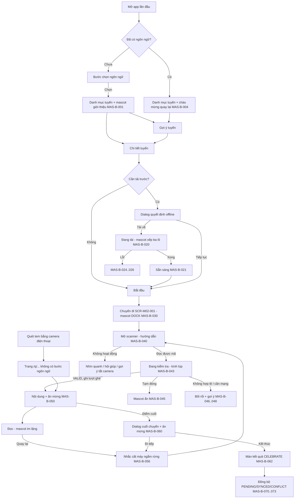

# Mascot User Journey — Bản đồ màn và hành trình du khách

| Trường | Giá trị |
|---|---|
| Trạng thái | **PROPOSED** (cột "Hiện tại" là EXISTING theo code; cột mascot là đề xuất) |
| Ngày | 2026-11-20 |
| Nguồn | [screen-list-M01](../../screens/screen%20list/screen-list-M01.md), [screen-list-M02](../../screens/screen%20list/screen-list-M02.md), code `src/modules/m01`, `src/modules/m02`, `src/app` |

Nhãn trạng thái: xem [Business Requirements](MASCOT_BUSINESS_REQUIREMENTS.md). Chế độ hiển thị (INTRO, DOCK, AVATAR, INLINE, CELEBRATE): xem [State Machine](MASCOT_STATE_MACHINE.md) §2.

## 1. Kiểm kê màn (Stage 2)

Chỉ liệt kê màn, hộp thoại và trạng thái **có thật** trong code. Mục không có trong code được đánh dấu riêng ở §3.

| Screen ID | Tên | Module | Mục tiêu của du khách | Thành phần chính | Hành động chính | Hành vi hiện tại | Vai trò mascot đề xuất | Mức cần |
|---|---|---|---|---|---|---|---|---|
| SCR-M01-001 (bước ngôn ngữ) | Chọn ngôn ngữ (`LanguageGate`) | M01 | Chọn VI/EN để vào app | Logo, tiêu đề song ngữ, 2 nút ngôn ngữ, ảnh nền rừng | Chọn Tiếng Việt / English | Chưa có `LanguagePreference` thì panel chặn toàn trang; bấm là ghi và vào danh mục ngay, không có chuyển cảnh | R1: không hiện trên panel (để panel đơn giản). Lời giới thiệu ở danh mục ngay sau khi chọn | Không cần trên panel; cần ở bước chuyển |
| SCR-M01-001 | Danh mục tuyến | M01 | Tìm tuyến để đi | Hero, link Gợi ý tuyến, thẻ tuyến, skeleton, thông báo dữ liệu cũ | Mở thẻ tuyến, mở Gợi ý tuyến, đổi VI/EN | Trạng thái: đang tải, có tuyến, rỗng, dữ liệu cũ, không tải được, ảnh lỗi | R1, R2, R10; minh họa ở trạng thái rỗng và lỗi | Tùy chọn (khuyến nghị) |
| SCR-M01-001 (shell) | Lời nhắc cập nhật ứng dụng (`UpdatePrompt`) | App | Cập nhật bản mới | Câu báo, nút Cập nhật / Để sau | Cập nhật, Để sau | Hoãn khi có phiên hoặc đang tải gói | Không | Không cần |
| SCR-M01-002 | Gợi ý tuyến | M01 | Tìm tuyến hợp với mình | 3 nhóm lựa chọn (Thời gian, Đối tượng, Trải nghiệm), nút Xem tuyến phù hợp, kết quả | Chọn tiêu chí, xem kết quả, đổi tiêu chí, xem tất cả | Khớp đúng cả 3 nhóm; 0 kết quả thì câu "Chưa có tuyến phù hợp…" | R2: mời chọn, ăn mừng nhẹ khi có kết quả, minh họa khi rỗng | Tùy chọn |
| SCR-M01-003 | Chi tiết tuyến & Chuẩn bị | M01 | Hiểu tuyến, chuẩn bị, bắt đầu | Thư viện ảnh, thông số, cảnh báo an toàn, mô tả, điểm xuất phát, yêu cầu, cần chuẩn bị, điểm dừng, sơ đồ, panel gói tải trước, nút Bắt đầu | Đọc, Tải về, Bắt đầu | Online thì dữ liệu mới; offline có gói thì dùng chữ cốt lõi đã lưu; các lỗi Start | R2: nhắc đọc cảnh báo an toàn ở panel Start; R7 khi Start lỗi | Tùy chọn; **không** đặt mascot trên khối cảnh báo an toàn |
| SCR-M01-003 (dialog) | Quyết định offline (`OfflineDecisionDialog`) | M01 | Chọn Tải về / Tiếp tục / Quay lại | Tiêu đề, danh sách điểm cần tải, dung lượng, gợi ý quét khi không có mạng | 3 nút | Chặn Start cho tới khi chọn | Minh họa nhỏ (ba lô) ở đầu dialog, không bong bóng | Tùy chọn |
| SCR-M01-003 / 004 | Panel gói tải trước (`PackagePanel`) | M01 | Theo dõi tải | Nhãn trạng thái, nút Tải về / Cập nhật / Tải lại | Tải, cập nhật | Chưa tải → Đang tải → Sẵn sàng / Chưa hoàn tất; lỗi nguồn, tải, lưu trữ | R7, R8: phản hồi khi bắt đầu tải, xong, lỗi | Khuyến nghị |
| SCR-M01-004 | Quản lý tài nguyên offline | M01 | Xem, cập nhật, xóa gói | Danh sách gói, trạng thái, phiên bản, xóa (dialog) | Xem, Cập nhật, Xóa | Rỗng: "Bạn chưa tải tuyến nào." | Minh họa ở trạng thái rỗng | Tùy chọn |
| SCR-M02-001 | Phiên trải nghiệm & Quét QR | M02 | Theo dõi hành trình, quét mã | Thanh app, vùng thông báo, bản đồ hành trình (danh sách), "Đã quét QR: n/tổng", nút Quét QR, nút Kết thúc chuyến | Quét, mở điểm đã quét, kết thúc | Kết quả vào phiên: STARTED, RESTORED, REJECTED (4 lý do), FREE, REPLACE_FAILED; thông báo ở lại màn (tạm đóng, không hợp lệ, cần kết nối); lỗi đồng bộ chuyến trước | R3, R4, R5, R8, R10: **DOCK** ở góc dưới, phía trên nút Quét | **Cần** (màn trung tâm) |
| SCR-M02-001 (overlay) | Trình quét QR (`QrScanner`) | M02 | Quét mã | Video camera toàn màn, khung ngắm pulse, câu hướng dẫn, Đóng camera, Thử lại | Quét, đóng, thử lại | Bỏ qua mã trùng trong thời gian ngắn; camera lỗi → câu cố định | R3: **AVATAR** ở dải dưới khung, không đè khung | **Cần** |
| SCR-M02-001 (dialog) | Câu hỏi cuối chuyến (`FinalPrompt`) | M02 | Quyết định kết thúc | Câu hỏi cố định, Kết thúc / Đi tiếp | 2 nút | Hiện một lần khi lượt ghé điểm cuối được ghi lần đầu, hoặc khi bấm Kết thúc chuyến | R6: minh họa ăn mừng trong đầu dialog, không làm chậm dialog | Khuyến nghị |
| SCR-M02-002 | Nội dung điểm tham quan | M02 | Đọc, xem ảnh, nghe/xem media | Ảnh đầu trang, tên điểm dừng, tên đối tượng, thư viện ảnh, giới thiệu, audio/video, Quay lại, toast "Đã ghi nhận lượt quét." | Đọc, vuốt ảnh, phát media, quay lại | Nguồn LIVE / PACKAGE / NO_OFFLINE / cần mạng; gói cũ; chế độ xem lại | R4, R5: AVATAR ăn mừng cùng toast; sau đó **im lặng** trong lúc đọc | Cần lúc mở, không cần khi đọc |
| SCR-M02-003 | Kết thúc phiên (màn kết quả) | M02 | Xem tổng kết | Huy hiệu, lời cảm ơn, thẻ hẹn gặp lại, danh sách "Đã tham quan", trạng thái gửi, Về danh sách tuyến | Về danh sách tuyến | Đồng bộ PENDING / SYNCED / CONFLICT | R6, R8: **CELEBRATE** một lần rồi **INLINE** cạnh huy hiệu | Khuyến nghị |
| SCR-M02-004 | Trang mở từ mã QR | M02 | Xem nhanh nội dung một mã | Như SCR-M02-002, thêm gợi ý khách tự do + "Chọn tuyến" | Đọc, đổi VI/EN, chọn tuyến | Không có phiên → khách tự do; có phiên → như quét trong app | Khách tự do: minh họa nhỏ cạnh gợi ý; có phiên: như SCR-M02-002 | Tùy chọn |

## 2. Hành trình du khách và điểm chạm của mascot

## 3. Đối chiếu kịch bản yêu cầu

### 3.1 M01 — Chuẩn bị

| # | Kịch bản | Hiện tại | Nhãn | Mascot | Hành vi |
|---|---|---|---|---|---|
| 1 | Vào web lần đầu | Bước chọn ngôn ngữ chặn trang (trừ `/q/…`) | EXISTING | Không trên panel | — |
| 2 | Du khách quay lại | Đã có ngôn ngữ → vào thẳng danh mục | EXISTING | Chào mừng quay lại, một lần mỗi lần tải trang | MAS-B-004 |
| 3 | Chọn ngôn ngữ | Ghi `LanguagePreference` rồi render danh mục | EXISTING | — | — |
| 4 | Chuyển từ ngôn ngữ sang danh mục | Không có chuyển cảnh | EXISTING (thiếu) → PROPOSED | Chuyển cảnh mờ dần 250 ms, mascot giới thiệu | MAS-B-001…003 |
| 5 | Danh mục tuyến | Có | EXISTING | DOCK nhỏ ở hero; minh họa khi rỗng hoặc lỗi; gợi ý khi lưỡng lự | MAS-B-005…009 |
| 6 | Chi tiết tuyến | Có | EXISTING | Im lặng trong lúc đọc; nhắc cảnh báo an toàn ở panel Start | MAS-B-014 |
| 7 | Chọn tuyến | Chạm thẻ tuyến hoặc kết quả gợi ý | EXISTING | Không | — |
| 8 | Hướng dẫn chuẩn bị | Các mục Cần chuẩn bị, Yêu cầu, Cảnh báo an toàn, gợi ý quét khi không có mạng | EXISTING | Nhắc đọc Cảnh báo an toàn (không thay nội dung) | MAS-B-014 |
| 9 | Tải nội dung offline | Dialog quyết định → Tải về | EXISTING | Minh họa ba lô trong dialog | MAS-B-016 |
| 10 | Đang tải | Nhãn "Đang tải", không phần trăm | EXISTING | Xếp ba lô, nhắc giữ trang mở; **không bịa phần trăm** | MAS-B-020 |
| 11 | Tải xong | "Sẵn sàng – mới nhất" | EXISTING | Ăn mừng nhẹ, nói đúng phạm vi offline | MAS-B-021 |
| 12 | Tải lỗi | Lỗi nguồn / tải / lưu trữ; cập nhật lỗi giữ bản cũ | EXISTING | Bối rối + việc cần làm | MAS-B-024…026 |
| 13 | Mở lại tuyến đã tải | Chi tiết offline dùng chữ đã lưu; trang offline có nút Xem | EXISTING | Không (đã có câu "Thông tin được lưu lúc…") | — |
| 14 | Đổi tuyến | Start tuyến khác: M02 thay phiên (cũ → `BO_DO`) | EXISTING | Không chen vào; phiên mới bắt đầu như MAS-B-030 | — |
| 15 | Rời / làm lại chuẩn bị | Chỉ là điều hướng; handoff hết hạn sau 24 giờ | EXISTING | Không | — |

### 3.2 M02 — Thực địa

| # | Kịch bản | Hiện tại | Nhãn | Mascot | Hành vi |
|---|---|---|---|---|---|
| 1 | Vào trải nghiệm thực địa | `/trip` gọi `enterTrip` | EXISTING | — | — |
| 2 | Bắt đầu hành trình | `STARTED` + câu gợi ý bắt đầu phiên | EXISTING | DOCK vẫy tay, hướng dẫn tìm tem QR | MAS-B-030 |
| 3 | Vào màn quét | Overlay camera | EXISTING | AVATAR ở dải dưới | MAS-B-040 |
| 4 | Hướng dẫn quét lần đầu | Chỉ có câu cố định trong scanner | EXISTING → PROPOSED | Hướng dẫn khi phiên chưa có lượt ghé nào | MAS-B-040 |
| 5 | Chờ quét | Khung pulse | EXISTING | Idle → nhìn quanh → hỏi giúp → gợi ý tắt camera | MAS-B-041, 042, 049 |
| 6 | Đã đọc được mã | Scanner đóng, "Đang kiểm tra mã QR…" | EXISTING | Kính lúp; sau 3 s nói sóng yếu | MAS-B-043, 044 |
| 7 | Quét thành công | Sang nội dung + toast | EXISTING | Ăn mừng + "{k}/{n}" | MAS-B-050, 051 |
| 8 | Mã không hợp lệ | Câu cố định `INVALID` | EXISTING | Bối rối; lặp 2 lần thì gợi ý | MAS-B-046 |
| 9 | Quét thất bại | Lỗi tra cứu → nội dung gói hoặc "Cần có kết nối mạng…"; scanner không báo lỗi giải mã | EXISTING | Như 6 và 8; lặp 2 lần cần mạng thì giải thích | MAS-B-047, 048 |
| 10 | Từ chối quyền camera | Câu camera cố định + Thử lại | EXISTING | Minh họa bối rối, không thêm chữ | MAS-B-038 |
| 11 | Không có camera | Cùng câu với 10 | EXISTING | Như 10 | MAS-B-038 |
| 12 | Nội dung đang tải | LIVE có sẵn trong router state; ảnh nạp lười | EXISTING | Không (nội dung hiện ngay) | — |
| 13–14 | Xem và đọc nội dung | Có | EXISTING | Im lặng | MAS-BR-06 |
| 15 | Nghe audio | `<audio>` online, đúng ngôn ngữ | EXISTING | Im lặng tuyệt đối | MAS-BR-06 |
| 16 | Xem video | `<video>` online | EXISTING | Im lặng tuyệt đối | MAS-BR-06 |
| 17 | Xem ảnh | Thư viện ảnh | EXISTING | Im lặng | — |
| 18 | Câu đố / thử thách | Không có; MVP Won't | FUTURE | Kênh giới thiệu và ăn mừng | MAS-B-090 |
| 19 | Hoàn thành checkpoint | Không có khái niệm "hoàn thành đọc". Mốc gần nhất: lượt ghé được ghi (`visitCreated`) | EXISTING (lượt ghé) | Coi lượt ghé đầu tiên là "hoàn thành"; không đoán việc đọc xong | MAS-B-050 |
| 20 | Xem lại điểm đã quét | Chạm điểm trong hành trình, mở chế độ xem lại | EXISTING | Không ăn mừng lại | MAS-B-053 |
| 21 | Xem tiến độ | "Đã quét QR: n/tổng" ở đầu hành trình | EXISTING | Nhắc nửa chặng (n ≥ 4) | MAS-B-055 |
| 22 | Mở khóa huy hiệu | Không có; Won't | FUTURE | Ăn mừng huy hiệu | MAS-B-091 |
| 23 | Chuyển online/offline | Xử lý theo từng lần quét; không có chỉ báo | EXISTING (ẩn) → PROPOSED | Báo nhẹ khi mất sóng, nói đúng cái gì còn dùng được | MAS-B-074, 075 |
| 24 | Mạng chập chờn | Tra cứu quá 8 s = lỗi tra cứu | EXISTING | MAS-B-044 | MAS-B-044 |
| 25 | Đang đồng bộ | Không lộ trạng thái "đang gửi" | UNKNOWN (không có tín hiệu) | Không giả lập; chỉ nói theo PENDING | — |
| 26 | Đồng bộ xong / lỗi | SYNCED / CONFLICT ở màn kết quả; lỗi chuyến trước ở SCR-M02-001 | EXISTING | Mừng nhẹ khi chuyển sang SYNCED; minh họa xin lỗi khi CONFLICT, không nút thử lại | MAS-B-070…073 |
| 27 | Tạm dừng hành trình | **Không có** và spec không có khái niệm tạm dừng | Không áp dụng | Mascot không nói "tạm dừng" | — |
| 28 | Tiếp tục hành trình | `RESTORED` khi mở lại | EXISTING | Chào mừng quay lại nếu vắng > 10 phút | MAS-B-034 |
| 29 | Hoàn tất tuyến | Dialog → `HOAN_TAT` → màn kết quả | EXISTING | Ăn mừng | MAS-B-060…063 |
| 30 | Rời web giữa chuyến | Phiên giữ trong trình duyệt; tự kết thúc sau 24 giờ khi mở lại | EXISTING | Khi trang ẩn: dừng mọi hẹn giờ. Khi mở lại sau tự kết thúc: không ăn mừng (đã có thông báo cố định) | MAS-B-035 |

### 3.3 Kịch bản thêm từ hành trình thật

| Kịch bản | Nhãn | Mascot | Hành vi |
|---|---|---|---|
| Handoff bị từ chối (cũ, đã dùng, hết hạn, thu hồi) hoặc không có chuyến | EXISTING | Minh họa bối rối cạnh câu cố định và link "Chọn tuyến"; không thêm chữ | MAS-B-031 |
| Không thay được phiên (REPLACE_FAILED) | EXISTING | Không xuất hiện (thông báo lỗi đủ rõ) | — |
| Mã `VALID` ngoài hành trình khi có phiên | EXISTING (thiếu nhãn) | Nói rõ không tính vào hành trình | MAS-B-052 |
| Nội dung từ gói tải trước khi mất mạng | EXISTING | Trấn an | MAS-B-054 |
| Không có nội dung offline cho điểm này | EXISTING | Minh họa, không thêm chữ | — |
| Bấm "Đi tiếp" ở câu hỏi cuối chuyến | EXISTING | Nói nút Kết thúc chuyến vẫn còn | MAS-B-061 |
| Khách tự do quét bằng nút Quét (không phiên) | EXISTING | Hướng dẫn quét như MAS-B-040, không ăn mừng tiến độ | MAS-BR-09 |
| Đổi VI/EN giữa lúc mascot đang nói | EXISTING (đổi ngôn ngữ) | Bong bóng đổi ngôn ngữ ngay | MAS-FR-09 |
| Lời nhắc cập nhật ứng dụng | EXISTING | Không xuất hiện | — |

## 4. Màn mà mascot **không** nên xuất hiện

- Panel chọn ngôn ngữ (giữ đơn giản và song ngữ).
- Khối Cảnh báo an toàn ở chi tiết tuyến.
- Thông báo tạm đóng ở mọi màn.
- Phần thân bài đọc, thư viện ảnh và trình phát media.
- Hộp thoại xóa gói, lời nhắc cập nhật ứng dụng.
- Toàn bộ M03.
