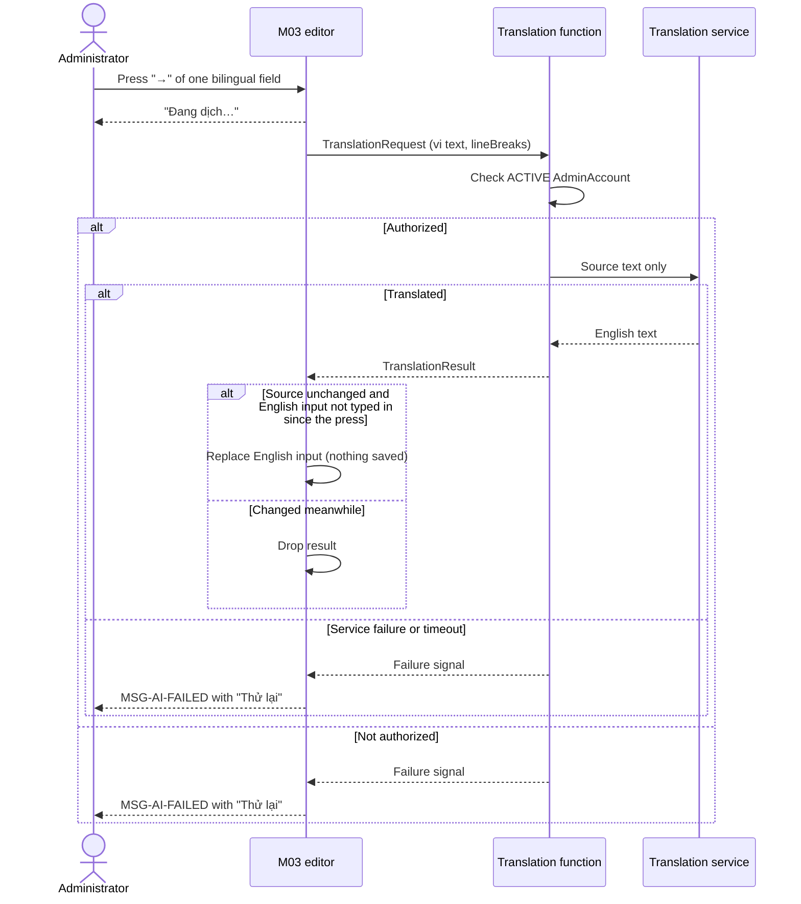

# Spec Document: AI Integration — English Translation on Request for M03

| Field | Value |
|---|---|
| Module | AI Integration (cross-cutting capability used by M03) |
| Version | 1.0 |
| Status | Behavioral baseline for the AI translation capability (AGENTS.md §3.1). Implementation requires the approved change brief CHG-AI-2026-11-03-01. |
| Last updated | 2026-11-03 |
| Consumer | M03 administrative editors (route, checkpoint, visit point) |
| Depends on | spec-M03 v3.7 (unchanged by this document) |
| MVP priority | Could (user decision 2026-11-03; to be recorded in MVP-Scope.md) |

This specification describes one capability: next to each bilingual text field of the M03 editors there is a small arrow button; when the administrator presses it, the system translates the Vietnamese text of that field into English and writes the result into the matching English field. Nothing is translated without that press. The English field stays fully editable. This document does not change any rule, contract, entity, state or permission of spec-M03; where it relies on a spec-M03 rule, it cites that rule. All administrative UI text is Vietnamese in plain everyday language, as in spec-M03.

Every business decision of this capability was made by the user on 2026-11-03 and is recorded in §10.

## 1. Purpose and scope

Staff currently write every bilingual field twice (spec-M03 §5.1, BR-M03-C06). This capability proposes the English text from the Vietnamese text on request, so that staff only check and correct it.

In scope:

- Translation from Vietnamese (`vi`) to English (`en`), on the administrator's press of the translate button, for every bilingual content field of the M03 route editor, checkpoint editor and visit-point (QR object) editor (§5.1), including the safety warning.
- Writing the translation into the English field of the open form, on screen only.
- Keeping the English field editable at all times.
- Server-side access to an external machine-translation service; the service credentials never reach the browser (BR-AI-08).

Out of scope:

- Translation without a press of the translate button (user decision 2026-11-03, replacing the automatic trigger of v0.1).
- Translation from English to Vietnamese, or to any other language (user decision 2026-11-03).
- Translation of anything that is not a bilingual text field: internal notes, administrative reasons, location and installation notes, file names, audio/video content, image text.
- Translation in M01 or M02, or of visitor-facing content at read time.
- Saving, publishing or validating on the administrator's behalf. The existing save, validation and publication rules of spec-M03 are unchanged.
- A fixed glossary of terms (place names, species names): the service translates freely and the administrator checks the result (user decision 2026-11-03).
- Remembering after saving that a text was machine-translated, or pointing it out on the publication review (user decision 2026-11-03).
- A usage cap on the number of translations (user decision 2026-11-03).

### 1.1 Glossary

| Term | Meaning |
|---|---|
| Bilingual field | A pair of text inputs `{vi, en}` for one value in an M03 editor (§5.1). |
| Source text | The Vietnamese text of a bilingual field. |
| Translate button | The small arrow button of one bilingual field that requests its translation (BR-AI-01). |
| Translation service | The external machine-translation provider, called only from the server. The provider and model are a technology choice recorded in docs/architecture/tech-stack.md, not in this spec. |

## 2. Actors

| Actor | Role | Responsibilities |
|---|---|---|
| Administrator | `CONTENT_STAFF` or `REVIEWER` (spec-M03 §2) | Types Vietnamese text; presses the translate button; checks, corrects or replaces the English text; saves as usual. |
| AI Integration system | System | Sends the source text to the translation service through the server and writes the result into the English field. |
| Translation service | External system | Returns an English translation of a given Vietnamese text. |

Any administrator who may edit an item under spec-M03 BR-M03-A02 can use the translate button in that item's editor. No new permission is introduced.

## 3. User scenarios and acceptance criteria

### US-AI-01 — Translate a field on request

1. The administrator types Vietnamese text into a bilingual field in scope (§5.1).
2. The administrator presses the translate button of that field.
3. While the translation is being prepared, the field shows "Đang dịch…" (MSG-AI-TRANSLATING).
4. The English field of the same pair receives the translation (BR-AI-02).
5. Nothing is saved by the translation. The administrator saves with "Lưu bản nháp" exactly as today (spec-M03 BR-M03-F11).

### US-AI-02 — The administrator stays in control of English

1. The administrator can type in, change or clear the English field at any time.
2. Changing the Vietnamese text after the English field holds text does nothing to the English field (user decision 2026-11-03).
3. Clearing the English field does not translate again; only a press of the translate button translates (user decision 2026-11-03).

### US-AI-03 — Translation failure never blocks work

1. If the translation service is slow, unreachable or refuses the request, the English field is left as it was.
2. The field shows MSG-AI-FAILED, which offers "Thử lại" and says that the administrator can type English by hand (BR-AI-09).
3. Saving and publishing follow spec-M03 unchanged.

## 4. Flow

1. Administrator types in the Vietnamese input of a bilingual field in scope.
2. Administrator presses the translate button of that field (BR-AI-01).
3. The field shows MSG-AI-TRANSLATING. The browser sends the source text to the server, authenticated as the current administrator (BR-AI-08).
4. The server checks the administrator's access (spec-M03 BR-M03-A04), calls the translation service and returns the English text or a failure signal.
5. On success, the browser writes the translation into the English input (BR-AI-02, BR-AI-04). On failure, it shows MSG-AI-FAILED (BR-AI-09).
6. Field-level validation of spec-M03 (BR-M03-L01, limits of §5.3) applies to the English text exactly as if the administrator had typed it (BR-AI-06).

## 5. Functional requirements

| ID | Requirement | Behavioral baseline |
|---|---|---|
| FR-AI-001 | Offer a translate button for each bilingual field in scope (§5.1) that translates its Vietnamese text into English when pressed. | Draft |
| FR-AI-002 | Write the translation into the English input of the open form only; never save, publish or change stored data by itself. | Draft |
| FR-AI-003 | Keep the English input editable at all times; translate only on a press of the translate button. | Draft |
| FR-AI-004 | On failure, leave the form unchanged and usable, tell the administrator and offer a retry. | Draft |
| FR-AI-005 | Call the translation service only from the server, for an authenticated `ACTIVE` administrator, without exposing service credentials to the browser. | Draft |

### 5.1 Fields in scope

Every bilingual content field that an administrator fills in the M03 editors, taken from spec-M03 §5.1 (user decision 2026-11-03: all of them, including the safety warning, because the administrator reads and corrects the result).

| Editor (spec-M03 §8) | Field | Single-line / long text (spec-M03 §5.3) |
|---|---|---|
| Route editor | `name` | Single-line |
| Route editor | `shortDescription` | Single-line |
| Route editor | `description` | Long text |
| Route editor | `startingPoint` | Long text |
| Route editor | `participationRequirements` | Long text |
| Route editor | `preparation` | Long text |
| Route editor | `bestTime` | Long text |
| Route editor | `safetyWarning` | Long text |
| Route editor | `highlights[]` (each item) | Single-line |
| Route editor | `gallery[].caption` | Single-line |
| Route editor | `routeMap.caption` | Single-line |
| Checkpoint library and editor | `checkpointName` | Single-line |
| QR-object workspace | `objectName` | Single-line |
| QR-object workspace | `introductionText` | Long text |

### 5.2 Translation contract (logical)

`TranslationRequest` — sent by the browser to the server.

| Field path | Logical type | Presence | Constraints |
|---|---|---|---|
| `sourceLanguage` | Enum(`vi`) | Required | Only `vi`. |
| `targetLanguage` | Enum(`en`) | Required | Only `en`. |
| `text` | String | Required | Non-empty after trimming; at most the limit of its field in spec-M03 §5.3. |
| `lineBreaks` | Enum(`ALLOWED`, `NOT_ALLOWED`) | Required | `NOT_ALLOWED` for single-line fields (spec-M03 §5.3). |

`TranslationResult` — returned by the server.

| Field path | Logical type | Presence | Constraints |
|---|---|---|---|
| `translatedText` | String | Required | Plain text, never markup; no line breaks when `lineBreaks = NOT_ALLOWED`. Not limited to the field's character limit (BR-AI-06). |

A failure (service unavailable, timeout, refused, not authorized) is a distinct failure signal, not a `TranslationResult`. These are logical contracts; endpoint, function and payload names belong to the implementation package.

### 5.3 Business rules

| ID | Rule |
|---|---|
| BR-AI-01 | **Trigger.** A translation is requested only when the administrator presses the translate button of a field. Every bilingual field in §5.1 has its own button, and each highlight item and each gallery caption has its own (user decision 2026-11-03); there is no button that translates a whole form. Nothing is translated while typing, on leaving a field, on opening an editor or on clearing a field. The button cannot be pressed while the Vietnamese text is empty or whitespace-only, or while a translation of the same field is in progress. |
| BR-AI-02 | **Writing the result.** The translation is written into the English input of the same field and replaces whatever that input held, without a confirmation dialog: spec-M03 BR-M03-L12 allows no dialog for this action, and the user chose to keep BR-M03-L12 unchanged (user decision 2026-11-03, OD-AI-17). The replaced English text is not kept on screen; the last saved draft is unchanged until the administrator saves (spec-M03 BR-M03-F11). |
| BR-AI-03 | **Later changes.** After the English input holds text, changing the Vietnamese text does nothing to it, and clearing the English input does not translate again. Only a new press of the translate button translates (user decisions 2026-11-03). |
| BR-AI-04 | **Late results.** A result is written only if, when it arrives, the source text is still the text that was sent and the administrator has not typed in the English input since pressing the button. Otherwise it is discarded and the field shows nothing more. |
| BR-AI-05 | **Existing content.** Opening an editor never translates anything (BR-AI-01). |
| BR-AI-06 | **No effect on M03 rules.** A translation only fills the form. Save (BR-M03-F11, no autosave), field validation and limits (BR-M03-L01, spec-M03 §5.3), the bilingual publication rule (BR-M03-C06, spec-M03 §5.1) and the publication review (BR-M03-F02) apply unchanged. A translation longer than the field limit is written in full, never cut; the existing length check then applies as if the administrator had typed it: the field's character counter shows the count over the limit in error, and saving reports MSG-LIMIT-TEXT (user decision 2026-11-03). Nothing is added to that check. |
| BR-AI-07 | **Read-only and disabled forms.** The translate button is not offered, or cannot be pressed, in a form or field that the administrator cannot edit at that moment. |
| BR-AI-08 | **Server-side access.** The translation service is called only from the server. The server accepts a request only from an authenticated identity with an `ACTIVE` `AdminAccount` (spec-M03 BR-M03-A04). The service credentials are a server secret and never reach the browser, the repository or logs. |
| BR-AI-09 | **Failure.** On any failure the English input keeps its value and stays editable, and the field shows MSG-AI-FAILED with a "Thử lại" action that sends the same request again (user decision 2026-11-03). The message disappears when the administrator retries, types in the English input or presses the button again. |
| BR-AI-10 | **Data sent outside the system.** Only the source text of the field being translated is sent to the translation service: no account, identifier, internal note or file. Sending unpublished draft text to the external provider is accepted, on any service tier (user decision 2026-11-03). |
| BR-AI-11 | **Plain text.** The written translation is plain text. Line breaks are removed for single-line fields (spec-M03 §5.3). |
| BR-AI-12 | **No machine-translation mark.** Nothing is stored about whether an English text came from the translation service, and the publication review does not point it out (user decision 2026-11-03). |

### 5.4 Provisional limits

| Parameter | Value | Applies to |
|---|---|---|
| `AI_TRANSLATE_TIMEOUT_MS` | Technical value, set in the implementation package | Time after which a request counts as failed (BR-AI-09) |

Text length limits are those of spec-M03 §5.3; this document adds none. There is no usage cap (user decision 2026-11-03).

### 5.5 Translate button and message catalog

The translate button is a small button between the Vietnamese input and the English input that shows the text character "→" (U+2192); no icon file is used (user decision 2026-11-03, OD-AI-18). Its accessible name is "Dịch sang tiếng Anh".

Fixed Vietnamese wording, in the format of spec-M03 §5.6. The wording is a proposal for review.

| Key | When it is shown | Proposed text |
|---|---|---|
| MSG-AI-TRANSLATING | A translation of this field is in progress | Đang dịch… |
| MSG-AI-FAILED | The translation of this field failed (BR-AI-09) | Chưa dịch được. Hãy bấm "Thử lại" hoặc tự nhập tiếng Anh. |
## 6. Key entities

None. The translation request/result is a transport contract (§5.2); the in-progress and failure states are transient UI state of the open form. No canonical entity, field or relationship is added to data/01-entity-dictionary.md or later stages (BR-AI-12).

## 7. Success criteria

| ID | Criterion |
|---|---|
| SC-AI-001 | For every field in §5.1, pressing the translate button with Vietnamese text present fills the English input with an English text; without a press, no field is ever translated. |
| SC-AI-002 | Changing the Vietnamese text or clearing the English input never changes the English input by itself. |
| SC-AI-003 | With the translation service unavailable, pressing the button shows MSG-AI-FAILED with "Thử lại", and every editor can still be filled, saved and published exactly as in spec-M03. |
| SC-AI-004 | No translation request reaches the service without an authenticated `ACTIVE` administrator, and the service credentials appear in no browser bundle, repository file or log. |
| SC-AI-005 | A translation never saves a draft: leaving the editor after a translation without saving shows the unsaved-changes dialog of spec-M03 BR-M03-F11. |
| SC-AI-006 | A translation longer than its field limit is written in full and the field shows MSG-LIMIT-TEXT. |

## 8. Screens involved

| Screen (spec-M03 §8) | Screen spec | Change |
|---|---|---|
| Route editor | screens/screen-spec/M03/screen-spec-SCR-M03-002.md | Translate button on the bilingual fields of steps 1–3. |
| QR-object workspace | screens/screen-spec/M03/screen-spec-SCR-M03-003.md | Translate button on `objectName` and `introductionText`. |
| Checkpoint library and editor | screens/screen-spec/M03/screen-spec-SCR-M03-008.md | Translate button on `checkpointName`. |

No new screen. The screen specs are derived documents and are updated only after this spec becomes a baseline.

## 9. Assumptions

- Machine translation can be wrong, especially for proper names, species names and safety wording. The administrator reads and corrects every result and remains responsible for the English text that is published; spec-M03's mandatory publication review (BR-M03-F02) is the existing control.
- The translation service may be slow or unavailable; the editors must work fully without it (US-AI-03).
- The project holds a key for the translation service. It is configured as a server secret per environment; cloud configuration requires its own approved change brief (AGENTS.md §2).

## 10. Open business decisions

| ID | Question | Status |
|---|---|---|
| OD-AI-01 | Which fields? | **Decided 2026-11-03:** every bilingual content field, including the safety warning (§5.1). |
| OD-AI-02 | When is the translation requested? | **Decided 2026-11-03:** only on a press of the translate button (BR-AI-01). |
| OD-AI-03 | Re-translate a previous translation when Vietnamese changes? | **Decided 2026-11-03:** no; only on a press of the button (BR-AI-03). |
| OD-AI-04 | Vietnamese changes after English holds text? | **Decided 2026-11-03:** nothing happens (BR-AI-03). |
| OD-AI-05 | Clearing the English field translates again? | **Decided 2026-11-03:** no; only on a press of the button (BR-AI-03). |
| OD-AI-06 | What is shown next to the English field? | **Decided 2026-11-03:** "Đang dịch…" after a press (MSG-AI-TRANSLATING). |
| OD-AI-07 | Translate on opening an existing item? | **Decided 2026-11-03:** no (BR-AI-05). |
| OD-AI-08 | Tell the administrator about a failure? | **Decided 2026-11-03:** yes, with "Thử lại" or typing by hand (BR-AI-09). |
| OD-AI-09 | Translation longer than the field limit? | **Decided 2026-11-03:** written in full; the existing length check (counter in error, MSG-LIMIT-TEXT on save) applies unchanged (BR-AI-06). |
| OD-AI-10 | Fixed glossary? | **Decided 2026-11-03:** no (§1). |
| OD-AI-11 | Is it acceptable to send unpublished draft text to an external provider? | **Decided 2026-11-03:** yes, on any tier (BR-AI-10). |
| OD-AI-12 | Remember machine translation after saving? | **Decided 2026-11-03:** no (BR-AI-12). |
| OD-AI-13 | Usage cap? | **Decided 2026-11-03:** no (§5.4). |
| OD-AI-14 | MVP priority? | **Decided 2026-11-03:** Could. |
| OD-AI-15 | One translate button per bilingual field, or one for the whole form? | **Decided 2026-11-03:** one per field (BR-AI-01). |
| OD-AI-16 | When the English input already holds text, does a press replace it directly or ask first? | **Superseded by OD-AI-17:** the user first chose to ask, then chose to keep BR-M03-L12 unchanged; a press replaces directly (BR-AI-02). |
| OD-AI-17 | spec-M03 BR-M03-L12 allows confirmation dialogs only for a fixed list of actions; a replace question is not in it. | **Decided 2026-11-03:** (B) no dialog, replace directly; BR-M03-L12 unchanged. |
| OD-AI-18 | Source of the arrow icon (AGENTS.md §4 and CLAUDE.md forbid drawing icons). | **Decided 2026-11-03:** (C) the text character "→", no icon file (§5.5). |

## 11. Relationship to spec-M03 and other documents

| Topic | Effect |
|---|---|
| spec-M03 rules, contracts, entities, states, permissions | Unchanged. This document only cites BR-M03-A02, A04, C06, F02, F11, L01 and spec-M03 §5.1, §5.3, §5.6, §8. |
| M01, M02 and their contracts | Unaffected. Visitors see only published text, written or checked by staff. |
| AGENTS.md | Must list this file in §3.1 (source of truth) and §4 (ownership), and extend the `supabase/functions/` scope to the translation function, before this spec is a baseline. |
| Derived documents to update after approval | function list (new file for this capability); docs/architecture (context diagram, sequence diagrams, tech stack, environment, system configuration); screen specs SCR-M03-002, 003, 008 and screen-list-M03 coverage; README.md, docs/README.md; MVP-Scope.md (priority Could); design system (translate button and its states); the arrow icon in assets/icons/ (supplied by the user). |
| Change briefs | One brief for the local implementation (new server function and secret); a separate brief for any cloud configuration or deployment (AGENTS.md §2). |

### 11.1 Traceability (US → FR → BR → SC)

| User story | FR | BR | SC |
|---|---|---|---|
| US-AI-01 Translate a field on request | FR-AI-001, 002 | BR-AI-01, 02, 04, 05, 06, 07, 11, 12 | SC-AI-001, 005, 006 |
| US-AI-02 The administrator stays in control of English | FR-AI-003 | BR-AI-03, 04 | SC-AI-002 |
| US-AI-03 Translation failure never blocks work | FR-AI-004, 005 | BR-AI-08, 09, 10 | SC-AI-003, 004 |

## 12. Change notes

| Version | Date | Changes |
|---|---|---|
| 1.0 | 2026-11-03 | Baseline. OD-AI-17 = B: a press replaces the English text directly, no dialog, BR-M03-L12 unchanged (BR-AI-02; MSG-AI-CONFIRM-REPLACE dropped; OD-AI-16 superseded). OD-AI-18 = C: the button shows the text character "→", no icon file (§5.5). All open decisions answered; AGENTS.md §3.1 and §4 list this specification. |
| 0.3 | 2026-11-03 | User decisions: one button per field (OD-AI-15); ask before replacing existing English with new MSG-AI-CONFIRM-REPLACE (OD-AI-16); over-limit translation uses the existing length check unchanged (OD-AI-09); draft text may be sent to the provider on any tier (OD-AI-11). New open decisions OD-AI-17 (BR-M03-L12 confirmation list) and OD-AI-18 (icon source). Not a baseline. |
| 0.2 | 2026-11-03 | User decisions on OD-AI-01 to 14: translation only on a press of a per-field arrow button instead of automatically (BR-AI-01 rewritten; former BR-AI-02 automatic re-translation removed); all bilingual fields including the safety warning; no reaction to later Vietnamese changes or a cleared English field; "Đang dịch…" while in progress; failure message with "Thử lại"; over-limit translation written in full and shown in error; no glossary, no stored machine-translation mark, no usage cap; priority Could. MSG-AI-MACHINE and MSG-AI-SOURCE-CHANGED dropped. New open decisions OD-AI-15 and 16; OD-AI-09 and 11 still open. Not a baseline. |
| 0.1 | 2026-11-03 | First draft from the user request of 2026-11-03: automatic vi → en translation in the M03 editors, no button, English stays editable. Open decisions OD-AI-01 to OD-AI-14 listed for the user. Not a baseline. |

## Completion checklist

- [x] Scope and out-of-scope are explicit.
- [x] Fields in scope are listed against spec-M03 §5.1.
- [x] Trigger, writing, late-result and failure behavior are specified.
- [x] No change to spec-M03 save, validation or publication rules is stated explicitly.
- [x] Server-side access and secret handling are specified.
- [x] Every open decision in §10 is answered by the user.
- [x] AGENTS.md lists this specification as a source of truth.
- [ ] Message catalog wording is approved.
