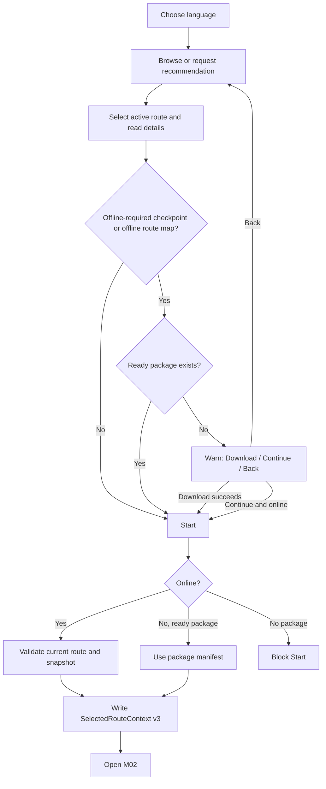
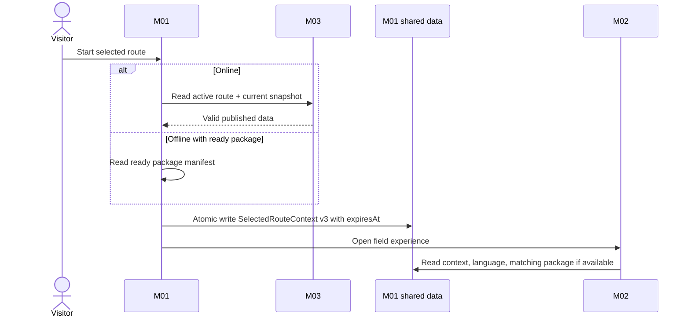
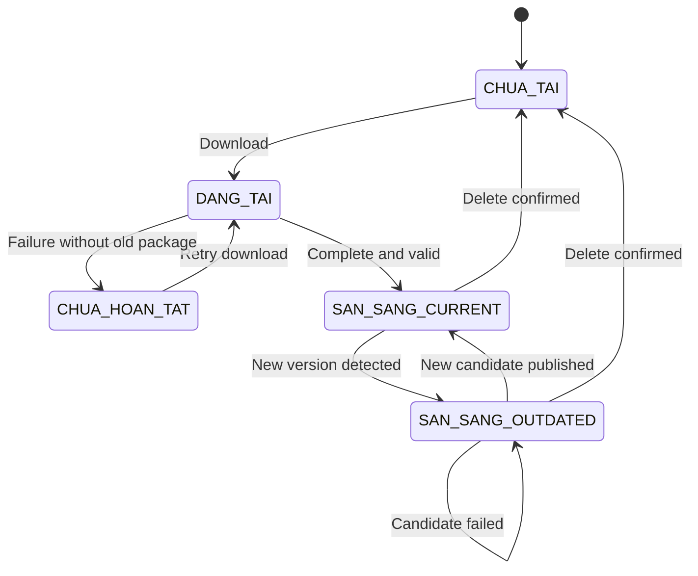
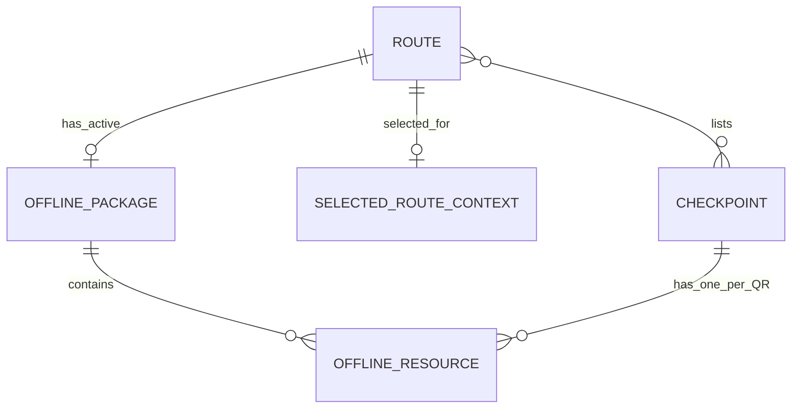

# Spec Document: M01 — Route Planning & Preparation

## 0. Document Metadata

| Field | Value |
|---|---|
| Module | M01 — Route Planning & Preparation |
| Version | 3.2 |
| Status | MVP implementation baseline — aligned to M03 v3.7 and M02 v3.3 |
| Supersedes | 3.1 (previous repository baseline: 2.0) |
| Last updated | 2026-10-28 |
| Primary consumers | Visitor web app, M02 |
| Upstream system | M03 |

This specification is self-contained and is the implementation source of truth for M01. UI mockups, physical API/database schemas and deployment details may refine implementation but must not change the behavior or contracts defined here without updating this document. Where M01 consumes a contract produced by M03, the M03 specification (v3.7) is the producer baseline and this document mirrors its shape.

## 1. Purpose & Scope

### 1.1 Purpose

M01 lets a visitor choose a language and route, read what a route offers, receive deterministic recommendations, prepare bilingual offline content and create a one-use handoff from which M02 starts a field session.

### 1.2 In Scope

- Select and change Vietnamese/English language.
- Browse active routes as cards and open route details (images, descriptions, starting point, requirements, safety warning).
- Recommend all routes matching three selected tag groups.
- Detect whether a route needs an offline package (it has `OFFLINE_REQUIRED` checkpoints or an offline route map).
- Download, inspect, update and delete offline packages, including the essential route texts saved with them.
- Show an estimated package size when M03 provides one.
- Warn and let the visitor continue without a package when online.
- Start online from the current published snapshot.
- Start offline from an already-ready package.
- Publish `LanguagePreference`, `SelectedRouteContext v3` and ready `OfflinePackage` data for M02.

### 1.3 Out of Scope

- Route/checkpoint/content/QR administration.
- QR scanning, check-in, session progress and visit history.
- AI scoring or ranking recommendations.
- GPS navigation or real-time maps.
- Offline audio/video.
- Offline route cover and gallery images (they are available online only; the route map is offline only when M03 marks it as needed offline).
- Cross-device package synchronization or recovery after browser data deletion.
- Real-time warnings to sessions already running offline.

### 1.4 Dependencies & External Relationships

| Direction | Contract | Responsibility |
|---|---|---|
| M03 → M01 | Published Route projection | Active route metadata, images, information texts, tags and journey summary. |
| M03 → M01 | `JourneySnapshot` | Immutable full journey for a route version, per-QR offline content, optional offline route map and optional size estimate. |
| M01 → M02 | `LanguagePreference` | Current `vi` or `en`. |
| M01 → M02 | `SelectedRouteContext v3` | One-use, expiring handoff plus full journey manifest. |
| M01 → M02 | Active `OfflinePackage` | Ready package, possibly outdated. |

M01 never writes M03-owned data. M02 never writes M01-owned data.

## 2. Actors

| Actor | Type | M01 responsibilities |
|---|---|---|
| Visitor | Primary | Chooses language/route, reads route information, enters recommendation criteria, manages packages and starts a route. |
| M01 system | System | Filters routes, prepares packages and creates handoffs. |
| M03 | External system | Publishes routes and immutable snapshots. |
| M02 | External system | Consumes handoff, language and package data. |
| Park Management | Stakeholder | Owns content/recommendation policy and field safety measures. |

## 3. User Scenarios & Acceptance Criteria

### US-M01-01 — Choose language

1. Given no language has been selected, when the visitor enters the app through its normal entry, then M01 requires `vi` or `en` before continuing. Entering through a public QR link (M02 BR-M02-024) never shows this step: the device language is used (Vietnamese when the device language is Vietnamese, otherwise English) until the visitor switches.
2. Given a language is selected, when the visitor changes it offline, then bundled UI and locally available content switch language without changing package state.
3. The VI/EN language control is available on every visitor screen, including the M02 QR link page, and every change updates `LanguagePreference` at once.

### US-M01-02 — Browse and recommend routes

1. Given published data is available, when the visitor opens the catalog, then only routes with `status = HOAT_DONG` and a valid `activeContentVersion` appear, each as a card showing thumbnail, localized name and short description, distance, duration, difficulty, number of checkpoints and a mark when an offline package is needed.
2. Given one valid value from each recommendation group, when recommendation runs, then every returned route contains all three selected tags.
3. Given no route matches, then an empty result is shown without weakening the criteria.
4. Given a card image cannot be loaded, then a neutral placeholder is shown and the card stays usable.

### US-M01-03 — Prepare offline content

1. Given a route needs an offline package (it has `OFFLINE_REQUIRED` checkpoints or an offline route map) and has no ready package, when the visitor proceeds, then M01 explains which content may be unavailable by naming the checkpoints in the visitor's language, shows the estimated size labelled as an estimate when M03 provides one or "size not available" when it does not, and offers Download, Continue without download or Go back.
2. Given download succeeds completely, then the package becomes `SAN_SANG + CURRENT` and keeps the essential route texts together with the time they were saved.
3. Given an update fails, then the previously-ready package remains usable as `SAN_SANG + OUTDATED`.
4. Given the size estimate is absent, then Download remains available.
5. The offline decision and the ready package state say, in one line, that without network check-in works with the Scan button in the app, because the phone camera may not open the app without network.

### US-M01-04 — Start a route

1. Given the device is online, when Start is selected, then M01 validates the route and creates a handoff from the current snapshot.
2. Given the device is offline and a package is `SAN_SANG`, when Start is selected, then M01 creates a handoff from that package's manifest.
3. Given the device is offline and no package is `SAN_SANG`, then Start is blocked.
4. Each successful Start creates a new `handoffId` whose `expiresAt` is 24 hours after `authorizedAt`; Start again replaces the previous context.

### US-M01-05 — Route becomes unavailable

1. After a successful source refresh reports a route closed (`TAM_DONG`) or archived (`LUU_TRU`), it disappears from new choices. M03 never physically deletes a published route, so a route that was published stays in the projection with its current status.
2. The current context for that route becomes `REVOKED`; M01 does not need to know whether M02 already consumed it.
3. A session already created from that context is not deleted or terminated by M01.

### US-M01-06 — View route details

1. Given a route is selected, then the details show the gallery (the first image is the cover), full description, starting point and how to get there, distance, duration, difficulty, highlights and the checkpoint names in visiting order in the chosen language, and, when present, participation requirements, preparation, best time, the route map and the safety warning, which is shown prominently.
2. Given an optional field is absent, then it is not shown and no placeholder text appears in its place.
3. Given the device is offline and a package is ready, then the details show the saved essential texts (name, safety warning, starting point, participation requirements) with a notice such as "Thông tin được lưu lúc [thời điểm], có thể không phải bản mới nhất", and images that are not saved show a neutral placeholder.
4. Given the device is online and a source read succeeds, then the shown details and the saved essential texts are refreshed.

## 4. Functional Flows

### 4.1 Overall M01 Usage Flow

### 4.2 Route Discovery & Recommendation

- Catalog input is the published Route projection from M03; it carries everything needed for cards and details.
- Recommendation input requires exactly one `timeTag`, `groupTag` and `experienceTag`.
- Matching is set containment across all three groups. A route's `timeTags` always holds exactly one value, derived by M03 from the route's expected duration; M01 matches it as given and never recomputes it.
- Results are not scored, sorted by relevance or capped by business rules.
- A zero-result outcome offers criterion changes or catalog return.

### 4.3 Offline Preparation

1. Read the selected route and current `JourneySnapshot`.
2. Identify all `OFFLINE_REQUIRED` checkpoints and whether the snapshot carries an offline route map.
3. Download the complete snapshot manifest, the offline resources of every QR of those checkpoints, and the offline route map image when present.
4. Save the essential route texts (name, starting point, participation requirements, safety warning) with the time they were read.
5. Validate bilingual text and every declared image.
6. Publish the candidate package only after validation succeeds.

### 4.4 Resource Management & Lazy Update

- Available actions: View, Download and Delete.
- M01 checks for a newer version when a packaged route is opened/selected and source access succeeds.
- A newer package is prepared separately; the active package remains readable.
- Success switches the active package; failure discards the candidate and keeps the old package.
- The saved essential texts are refreshed independently of the package version: after a successful source read they are replaced atomically; if the refresh fails the old texts and their saved time stay.
- Route information changes do not create a new `contentVersion`, so the package version alone never tells whether the route texts are current.
- Only one package operation per route may run at a time; MVP has no Cancel action.

### 4.5 Start Route & Handoff

Online Start uses the current published snapshot. Offline Start uses a ready package manifest. In both cases M01 writes the complete context atomically before opening M02, with `expiresAt` set to 24 hours after `authorizedAt`. Failure does not partially replace the previous context.

### 4.6 Language Preference Flow

Language may change at any time. The preference controls UI and the `vi/en` content branch; it does not create a new package or session.

### 4.7 Sequence Diagrams

### 4.8 OfflinePackage State Machine

`status` and `versionStatus` are separate fields; combined labels above are diagram shorthand.

## 5. Functional Requirements

### 5.1 FR Summary

`Behavioral baseline` below states whether the behavior belongs to this complete specification. Release priority is owned exclusively by `MVP-Scope.md`.

| ID | Requirement | Behavioral baseline |
|---|---|---|
| FR-M01-001 | Manage language preference. | Required |
| FR-M01-002 | Browse available routes. | Required |
| FR-M01-003 | View route information. | Required |
| FR-M01-004 | Generate deterministic recommendations. | Required |
| FR-M01-005 | Evaluate offline preparation need. | Required |
| FR-M01-006 | Support the offline preparation decision. | Required |
| FR-M01-007 | Download an offline package. | Required |
| FR-M01-008 | Validate and publish an offline package. | Required |
| FR-M01-009 | Manage offline resources. | Required |
| FR-M01-010 | Lazily update an offline package. | Required |
| FR-M01-011 | Process online/offline Start. | Required |
| FR-M01-012 | Create `SelectedRouteContext v3`. | Required |
| FR-M01-013 | Publish shared data for M02. | Required |
| FR-M01-014 | Keep essential route texts for offline viewing. | Required |

### 5.2 Detailed Functional Requirements

| ID | Trigger / input | Required behavior | Failure behavior |
|---|---|---|---|
| FR-M01-001 | Select/change `vi` or `en` on any visitor screen, including the M02 QR link page | Persist and publish current preference; update available UI/content immediately. The normal entry asks for a language when none is stored; the QR link entry uses the device language without asking. | Reject unsupported value. |
| FR-M01-002 | Open/refresh catalog | Show only `HOAT_DONG` routes with a valid published snapshot, each as a card: thumbnail, localized name and short description, distance, duration, difficulty, checkpoint count and an offline-needed mark. | Keep last local view when offline; do not claim it is current. An image that cannot load shows a neutral placeholder. |
| FR-M01-003 | Select route | Show localized name, full description, starting point and how to get there, distance, duration, difficulty, gallery (first image is the cover), highlights, the checkpoint names in order, and, when present, participation requirements, preparation, best time, route map and the safety warning (prominent). | Do not synthesize missing public fields; hide absent optional fields. When offline, show the saved essential texts (FR-M01-014) and placeholders for images. |
| FR-M01-004 | Three valid criteria | Return all active routes matching all three tags; support zero results. | Invalid/missing input prevents matching. |
| FR-M01-005 | Select route | The route needs an offline package when `hasOfflineRequiredCheckpoint` or `hasOfflineRouteMap` is `true`; inspect package readiness/version. | Treat unreadable package as not ready. If the downloaded snapshot disagrees with the flags, follow the snapshot. |
| FR-M01-006 | Package missing | Offer Download, Continue without download or Back, naming the checkpoints whose content may be unavailable and showing the estimated size (labelled as an estimate) when `estimatedOfflineSizeBytes` is present or "size not available" when it is absent; Continue still obeys Start guards. State that without network check-in works with the Scan button in the app. | No implicit choice; an absent estimate never blocks Download. |
| FR-M01-007 | Download requested online | Fetch the current immutable snapshot, the offline resources of every QR of its offline-required checkpoints, the offline route map when present, and the essential route texts. | Do not publish partial data. |
| FR-M01-008 | Candidate download completes | Validate manifest, bilingual text of every QR resource, declared images, the offline route map (when present) and the essential texts; atomically publish as ready. | Discard candidate; keep old ready package if present. |
| FR-M01-009 | View/Download/Delete | Show route/version/readiness and when the essential texts were saved; require confirmation for delete. | Repeated action must not create concurrent work. |
| FR-M01-010 | Packaged route opened online | Compare versions and prepare a newer candidate without hiding old package; independently refresh the saved essential texts after a successful source read. | Preserve old ready package as outdated; keep the old essential texts and their saved time if the refresh fails. |
| FR-M01-011 | Start selected | Online: validate current route/snapshot. Offline: require ready package and use its manifest. | Block Start when neither source nor ready package can supply a manifest. |
| FR-M01-012 | Start validation succeeds | Generate new UUID handoff, set `expiresAt` to `authorizedAt` plus 24 hours and atomically write complete v3 context. | Keep previous context unchanged on failure. |
| FR-M01-013 | Shared value changes | Publish language independently; expose only ready active package; expose complete context only. | Never expose staging/partial values. |
| FR-M01-014 | Package becomes ready, or a source read succeeds | Keep the essential route texts (name, starting point, participation requirements, safety warning) with the time they were saved; when shown from the saved copy, state when they were saved and that they may not be the latest. | If the saved texts are missing, open the route with the information available and make no claim that it is current. |

### 5.3 Input / Output Contracts

Contract presence uses these terms: **Required** means the field and a value are present; **Optional** means the field may be absent; **Conditional** means the stated condition determines presence. These are logical contract rules, not physical database nullability. All `DateTime` values are UTC. `String` identifiers are opaque logical identifiers and do not imply a physical key format.

#### Published Route input

This is the Published Route projection produced by M03; its shape is identical to M03 v3.7. It exists only for routes that have been published at least once.

| Field path | Logical type | Presence | Constraints |
|---|---|---|---|
| `routeId` | String | Required | Stable route identity. |
| `status` | Enum(`HOAT_DONG`, `TAM_DONG`, `LUU_TRU`) | Required | Only `HOAT_DONG` is selectable. |
| `name` | Object | Required | Contains both language branches. |
| `name.vi` | String | Required | Non-empty; at most 100 characters. |
| `name.en` | String | Required | Non-empty; at most 100 characters. |
| `shortDescription` | Object | Required | Card text; both language branches. |
| `shortDescription.vi` | String | Required | Non-empty; at most 160 characters. |
| `shortDescription.en` | String | Required | Non-empty; at most 160 characters. |
| `description` | Object | Required | Full description for the detail page; both language branches. |
| `description.vi` | String | Required | Non-empty; at most 2000 characters. |
| `description.en` | String | Required | Non-empty; at most 2000 characters. |
| `startingPoint` | Object | Required | Starting point and how to get there. |
| `startingPoint.vi` | String | Required | Non-empty; at most 500 characters. |
| `startingPoint.en` | String | Required | Non-empty; at most 500 characters. |
| `thumbnail` | Object | Required | Card image. |
| `thumbnail.sourceRef` | String | Required | Public image resource reference. |
| `gallery` | Array&lt;Object&gt; | Required | May be empty; at most 8 items; ordered; the first item is the cover. |
| `gallery[].sourceRef` | String | Required | Required for every array item; public image resource reference. |
| `gallery[].caption` | Object | Optional | Both-or-none language branches. |
| `gallery[].caption.vi` | String | Conditional | Required when `caption` is present; at most 200 characters. |
| `gallery[].caption.en` | String | Conditional | Required when `caption` is present; at most 200 characters. |
| `routeMap` | Object | Optional | Static route-map image; not navigation. |
| `routeMap.sourceRef` | String | Conditional | Required when `routeMap` is present. |
| `routeMap.caption` | Object | Optional | Both-or-none language branches (`vi`, `en`, at most 200 characters each). |
| `participationRequirements` | Object | Optional | Both-or-none `vi`/`en`; at most 300 characters each. |
| `preparation` | Object | Optional | Both-or-none `vi`/`en`; at most 500 characters each. |
| `bestTime` | Object | Optional | Both-or-none `vi`/`en`; at most 200 characters each. |
| `safetyWarning` | Object | Optional | Both-or-none: absent entirely, or both language fields are present; at most 500 characters each. |
| `safetyWarning.vi` | String | Conditional | Required when `safetyWarning` is present. |
| `safetyWarning.en` | String | Conditional | Required when `safetyWarning` is present. |
| `highlights` | Array&lt;Object&gt; | Required | May be empty; at most 5 items. |
| `highlights[].vi` | String | Required | Required for every array item; non-empty; at most 80 characters. |
| `highlights[].en` | String | Required | Required for every array item; non-empty; at most 80 characters. |
| `distanceKm` | Decimal | Required | Greater than `0` and at most 100, with at most one decimal place. |
| `durationMin` | Integer | Required | Greater than `0` and at most 1440; expected duration. |
| `difficulty` | Enum(`NHE`, `TRUNG_BINH`, `KHO`) | Required | — |
| `timeTags` | Array&lt;Enum(`TIME_NGAN`, `TIME_VUA`, `TIME_DAI`)&gt; | Required | Exactly one value, derived by M03 from `durationMin`. |
| `groupTags` | Array&lt;Enum(`GROUP_CA_NHAN_NGUOI_LON`, `GROUP_GIA_DINH_CO_TRE`, `GROUP_CAN_DE_DANG`)&gt; | Required | At least one allowed value; values are distinct. |
| `experienceTags` | Array&lt;Enum(`INTEREST_THIEN_NHIEN_CHUP_ANH`, `INTEREST_TIM_HIEU`, `INTEREST_KHAM_PHA`)&gt; | Required | At least one allowed value; values are distinct. |
| `checkpointCount` | Integer | Required | Number of active checkpoints in the active snapshot; `>= 0`. |
| `hasOfflineRequiredCheckpoint` | Boolean | Required | `true` when the active snapshot contains at least one `OFFLINE_REQUIRED` checkpoint. |
| `hasOfflineRouteMap` | Boolean | Required | `true` when the active snapshot contains an `offlineRouteMap`. |
| `checkpointSummaries` | Array&lt;Object&gt; | Required | Active checkpoints of the active snapshot, ordered by `sequence`; may be empty only when status is not `HOAT_DONG`. |
| `checkpointSummaries[].checkpointId` | String | Required | Required for every array item. |
| `checkpointSummaries[].sequence` | Integer | Required | Required for every array item. |
| `checkpointSummaries[].checkpointName` | Object | Required | Required for every array item; `vi` and `en` both Required, non-empty. |
| `activeContentVersion` | Integer | Required | Identifies the `DA_CONG_BO` snapshot of the same route that is currently active. |

Only `HOAT_DONG` with a non-null `activeContentVersion` is selectable. Other states are consumed only to remove a route from new selection and revoke a not-yet-consumed current handoff when closure is discovered. A route may close automatically in M03 when its last active checkpoint closes; M01 treats this like any other closure.

Allowed recommendation values:

- `timeTags`: `TIME_NGAN` (≤ 90 minutes), `TIME_VUA` (> 90–180 minutes), `TIME_DAI` (> 180 minutes).
- `groupTags`: `GROUP_CA_NHAN_NGUOI_LON`, `GROUP_GIA_DINH_CO_TRE`, `GROUP_CAN_DE_DANG` (for visitors who need an easy route).
- `experienceTags`: `INTEREST_THIEN_NHIEN_CHUP_ANH`, `INTEREST_TIM_HIEU`, `INTEREST_KHAM_PHA`.

#### JourneySnapshot input

This is the immutable snapshot produced by M03; its shape is identical to M03 v3.7. It carries journey data only, plus the route-map image when M03 marks it as needed offline. Audio and video never appear in it.

| Field path | Logical type | Presence | Constraints |
|---|---|---|---|
| `routeId` | String | Required | Stable route identity. |
| `contentVersion` | Integer | Required | Identifies one immutable version within `routeId`; starts at `1` and increases by exactly `1` per published snapshot. |
| `status` | Enum(`DA_CONG_BO`) | Required | Published snapshots are immutable. |
| `publishedAt` | DateTime | Required | UTC. |
| `previousContentVersion` | Integer | Optional | Absent for version `1`; otherwise `contentVersion - 1` of the same route. |
| `estimatedOfflineSizeBytes` | Integer | Optional | Estimated size of what is downloaded for offline use. An estimate, not the final on-device size; M01 must tolerate its absence. |
| `offlineRouteMap` | Object | Optional | Present only when the route map is marked as needed without network. |
| `offlineRouteMap.sourceRef` | String | Conditional | Required when `offlineRouteMap` is present; public image resource reference. |
| `offlineRouteMap.caption` | Object | Optional | Both-or-none language branches. |
| `offlineRouteMap.caption.vi` | String | Conditional | Required when `caption` is present; at most 200 characters. |
| `offlineRouteMap.caption.en` | String | Conditional | Required when `caption` is present; at most 200 characters. |
| `checkpoints` | Array&lt;Object&gt; | Required | Contains every and only active checkpoint; IDs and sequences are unique. May be empty only when the route is not `HOAT_DONG`; M01 never selects such a route. |
| `checkpoints[].checkpointId` | String | Required | Stable checkpoint identity. |
| `checkpoints[].sequence` | Integer | Required | Unique within the snapshot. It is the checkpoint's 1-based position in the route's checkpoint list; gaps appear where a listed checkpoint is not active. |
| `checkpoints[].checkpointName` | Object | Required | Frozen display name for this version; both language branches. |
| `checkpoints[].checkpointName.vi` | String | Required | Non-empty. |
| `checkpoints[].checkpointName.en` | String | Required | Non-empty. |
| `checkpoints[].connectivityMode` | Enum(`ONLINE_AVAILABLE`, `OFFLINE_REQUIRED`) | Required | — |
| `checkpoints[].qrIdentifiers` | Array&lt;String&gt; | Required | Non-empty; active identifiers only. |
| `checkpoints[].offlineResources` | Array&lt;Object&gt; | Conditional | Required only for `OFFLINE_REQUIRED`; absent for `ONLINE_AVAILABLE`. Contains exactly one item for every identifier in `qrIdentifiers`. |
| `checkpoints[].offlineResources[].qrIdentifier` | String | Conditional | Required for every array item; unique within the snapshot; references an identifier of the same checkpoint. |
| `checkpoints[].offlineResources[].objectName` | Object | Conditional | Required for every array item; `vi` and `en` both Required, non-empty. |
| `checkpoints[].offlineResources[].localizedContent` | Object | Conditional | Required for every array item. |
| `checkpoints[].offlineResources[].localizedContent.vi` | Object | Conditional | Required for every array item. |
| `checkpoints[].offlineResources[].localizedContent.vi.introductionText` | String | Conditional | Required for every array item; non-empty. |
| `checkpoints[].offlineResources[].localizedContent.en` | Object | Conditional | Required for every array item. |
| `checkpoints[].offlineResources[].localizedContent.en.introductionText` | String | Conditional | Required for every array item; non-empty. |
| `checkpoints[].offlineResources[].staticImages` | Array&lt;String&gt; | Conditional | Required for every array item; may be empty. Each item is a declared image resource reference of that QR object. |

The array contains every active checkpoint. `offlineResources` is required only for `OFFLINE_REQUIRED` and holds each QR object's own content, not content shared by the checkpoint. Different routes may list the same checkpoint; M01 only ever sees the snapshot of the selected route.

#### LanguagePreference output

| Field path | Logical type | Presence | Constraints |
|---|---|---|---|
| `languageCode` | Enum(`vi`, `en`) | Required | Current singleton preference; replacement does not change package or session state. |

#### SelectedRouteContext v3 output

| Field path | Logical type | Presence | Constraints |
|---|---|---|---|
| `contractVersion` | Integer | Required | Exactly `3`. |
| `handoffId` | UUID | Required | Globally unique and used for at most one M02 session. |
| `routeId` | String | Required | Equals `routeJourneyManifest.routeId`. |
| `authorizedAt` | DateTime | Required | UTC. |
| `expiresAt` | DateTime | Required | UTC; exactly `authorizedAt` plus 24 hours. |
| `authorizationStatus` | Enum(`AUTHORIZED`, `REVOKED`) | Required | New successful Start writes `AUTHORIZED`; later discovered closure may set `REVOKED`. |
| `routeJourneyManifest` | Object | Required | Complete journey-only manifest, written atomically. |
| `routeJourneyManifest.routeId` | String | Required | Equals outer `routeId`. |
| `routeJourneyManifest.contentVersion` | Integer | Required | Source snapshot/package version. |
| `routeJourneyManifest.checkpoints` | Array&lt;Object&gt; | Required | Complete frozen checkpoint list for the selected version. |
| `routeJourneyManifest.checkpoints[].checkpointId` | String | Required | Stable checkpoint identity; unique in the manifest. |
| `routeJourneyManifest.checkpoints[].sequence` | Integer | Required | Unique in the manifest; gaps are allowed. |
| `routeJourneyManifest.checkpoints[].checkpointName` | Object | Required | Frozen display name; `vi` and `en` both Required, non-empty. |
| `routeJourneyManifest.checkpoints[].connectivityMode` | Enum(`ONLINE_AVAILABLE`, `OFFLINE_REQUIRED`) | Required | Copied without reclassification. |
| `routeJourneyManifest.checkpoints[].qrIdentifiers` | Array&lt;String&gt; | Required | Non-empty active identifier set from the selected snapshot/package. |

The handoff contains journey metadata only. Offline text/images remain in `OfflinePackage.resources` rather than being duplicated into the context. `expiresAt` is never extended by M01: a context whose `expiresAt` has passed cannot start an M02 session (M02 rejects it), and the visitor starts again from M01 to obtain a new handoff. Raising the version from 2 to 3 does not by itself expire older contexts; version 2 contexts are not valid for M02.

#### OfflinePackage output

| Field path | Logical type | Presence | Constraints |
|---|---|---|---|
| `routeId` | String | Required | Package covers exactly one route. |
| `contentVersion` | Integer | Required | Package covers exactly one journey version. |
| `status` | Enum(`CHUA_TAI`, `DANG_TAI`, `SAN_SANG`, `CHUA_HOAN_TAT`) | Required | Only `SAN_SANG` is exposed to M02. `CHUA_TAI` may be represented by no persisted package. |
| `versionStatus` | Enum(`CURRENT`, `OUTDATED`) | Conditional | Required only when `status = SAN_SANG`. |
| `manifest` | Object | Required | Exact shape below; full journey metadata for the package version. |
| `manifest.routeId` | String | Required | Equals package `routeId`. |
| `manifest.contentVersion` | Integer | Required | Equals package `contentVersion`. |
| `manifest.checkpoints` | Array&lt;Object&gt; | Required | Complete checkpoint list for the package version. |
| `manifest.checkpoints[].checkpointId` | String | Required | Stable identity; unique in the manifest. |
| `manifest.checkpoints[].sequence` | Integer | Required | Unique in the manifest; gaps are allowed. |
| `manifest.checkpoints[].checkpointName` | Object | Required | Frozen display name; `vi` and `en` both Required, non-empty. |
| `manifest.checkpoints[].connectivityMode` | Enum(`ONLINE_AVAILABLE`, `OFFLINE_REQUIRED`) | Required | — |
| `manifest.checkpoints[].qrIdentifiers` | Array&lt;String&gt; | Required | Non-empty active identifiers from the source snapshot. |
| `resources` | Array&lt;Object&gt; | Required | Contains exactly one resource object for every QR identifier of every `OFFLINE_REQUIRED` checkpoint and none for `ONLINE_AVAILABLE`; may be empty only when the manifest has no offline-required checkpoint. |
| `resources[].qrIdentifier` | String | Required | Logical lookup key; unique within the package and equal to an identifier in `manifest`. |
| `resources[].checkpointId` | String | Required | References the `OFFLINE_REQUIRED` checkpoint in `manifest` that holds the QR. |
| `resources[].objectName` | Object | Required | `vi` and `en` both Required, non-empty. |
| `resources[].localizedContent` | Object | Required | Contains both language branches. |
| `resources[].localizedContent.vi` | Object | Required | — |
| `resources[].localizedContent.vi.introductionText` | String | Required | Non-empty. |
| `resources[].localizedContent.en` | Object | Required | — |
| `resources[].localizedContent.en.introductionText` | String | Required | Non-empty. |
| `resources[].staticImages` | Array&lt;String&gt; | Required | May be empty. Each item is a declared image resource reference whose bytes are present in the ready package. |
| `offlineRouteMap` | Object | Optional | Present only when the source snapshot carries `offlineRouteMap`. |
| `offlineRouteMap.sourceRef` | String | Conditional | Required when present; a declared image reference whose bytes are present in the ready package. |
| `offlineRouteMap.caption` | Object | Optional | Both-or-none `vi`/`en`; at most 200 characters each. |
| `routeEssentials` | Object | Required | M01-owned point-in-time copy of route texts; M03 does not version them. Present in every ready package. |
| `routeEssentials.capturedAt` | DateTime | Required | UTC; when the texts were last read from M03. |
| `routeEssentials.name` | Object | Required | `vi` and `en` both Required, non-empty. |
| `routeEssentials.startingPoint` | Object | Required | `vi` and `en` both Required, non-empty. |
| `routeEssentials.participationRequirements` | Object | Optional | Both-or-none `vi`/`en`. |
| `routeEssentials.safetyWarning` | Object | Optional | Both-or-none `vi`/`en`. |
| `downloadedAt` | DateTime | Optional | UTC; present when a completed download time is available. |

`JourneySnapshot` is the M03 source. `OfflinePackage.manifest` and `SelectedRouteContext v3.routeJourneyManifest` are value projections of the same route/version/checkpoint metadata, not new M03-owned entities. `OfflinePackage.resources[]` is the M01-owned local copy of each snapshot `offlineResources[]` item; the canonical entity name is `OfflineResource`. `OfflinePackage.offlineRouteMap` is the local copy of the snapshot's `offlineRouteMap`. `routeEssentials` is copied from the Published Route projection when the package is made and whenever a later source read succeeds; it holds text only, never images.

### 5.4 Validation

| Area | Validation |
|---|---|
| Route | Active status, published version, bilingual name/short description/description/starting point, thumbnail present, positive distance/duration, exactly one time tag, at least one allowed value in each other tag group, both-or-none optional texts. |
| Snapshot | Published, version matches route, all checkpoint IDs/sequence unique, bilingual checkpoint names, QR arrays non-empty. |
| Offline resource | Only offline-required checkpoints; exactly one resource per QR identifier of each such checkpoint; both languages present; every declared image readable. |
| Offline route map | When the snapshot carries it, the declared image is readable and stored. |
| Essential texts | Name and starting point present in both languages; optional texts both-or-none; saved time recorded. |
| Package | Manifest/resource version consistency; publish only complete candidate (resources, images, offline route map when present, essential texts). |
| Online Start | Latest successful source response confirms active route and complete snapshot. |
| Offline Start | Package is `SAN_SANG`; use that package's route/version/manifest. |
| Handoff | UUID, route equals manifest route, `expiresAt` equals `authorizedAt` plus 24 hours, complete atomic value. |

#### Existing Edge Cases

- Browser reports online but source request fails: treat source as unavailable.
- Package is ready but outdated: allow use and display warning when known.
- Route closes while device is offline: local package may still start; field safety is handled outside the app.
- Route has no offline-required checkpoint and no offline route map: no package required for online Start.
- Declared image is missing (a QR resource image or the offline route map): package cannot become ready.
- No image is declared: package may still become ready.
- Storage failure: discard candidate and preserve existing ready package.
- Browser data deleted: local preference/context/package may be lost.
- Size estimate absent: Download stays available and the screen says the size is not available.
- Essential texts cannot be refreshed: keep the previous texts and their saved time.
- Handoff past `expiresAt`: M02 rejects it; the visitor starts again from M01.
- Snapshot disagrees with the Published Route flags: the snapshot is authoritative.

### 5.5 Business Rules

| ID | Rule |
|---|---|
| BR-M01-001 | Only `vi` and `en` are supported; language changes do not change package state. M01 is the only writer of `LanguagePreference`; its language control is reused on every visitor screen, including the M02 QR link page, where the device language applies until a choice is stored. |
| BR-M01-002 | Catalog and recommendations only use routes active with a published version. |
| BR-M01-003 | Recommendation matches all three tag groups, returns 0..N routes and never auto-relaxes criteria. |
| BR-M01-004 | A package covers one route/version, the full manifest, one resource for every QR of every offline-required checkpoint, the offline route map when the snapshot carries one, and the essential route texts. |
| BR-M01-005 | Package completeness and version freshness are separate concerns. |
| BR-M01-006 | An old ready package stays usable while a new candidate is prepared or fails. |
| BR-M01-007 | The visitor may continue without download while online after explicit warning. |
| BR-M01-008 | Online Start uses current published source; offline Start requires a ready package. |
| BR-M01-009 | Each successful Start creates a new one-use handoff; Start again replaces context. |
| BR-M01-010 | M01 does not own or modify M02 progress/session state. |
| BR-M01-011 | Route closure discovered by M01 blocks new Start and marks the current context `REVOKED`; a session already created from it continues independently. |
| BR-M01-012 | A route needs an offline package when `hasOfflineRequiredCheckpoint` or `hasOfflineRouteMap` is `true`. The flags allow an early decision; the downloaded snapshot is authoritative. |
| BR-M01-013 | Route cover and gallery images are online only. The route map is available offline only when the snapshot carries `offlineRouteMap`. Audio and video are never saved offline. |
| BR-M01-014 | Essential route texts have no version number. M01 shows when they were saved, refreshes them after a successful source read, and never claims they are current when shown from the saved copy. |
| BR-M01-015 | The handoff `expiresAt` is exactly 24 hours after `authorizedAt`. M01 never extends it and does not change `authorizationStatus` when time passes; expiry is enforced by M02. |
| BR-M01-016 | The estimated package size is optional information. Its absence or inaccuracy never blocks or changes Download. |

## 6. Key Entities

### 6.1 Domain Model

A checkpoint is created and published once in M03 and may be listed by several routes, each with its own order; a route lists one or more checkpoints. In M01 a checkpoint is only ever seen as part of the selected route's snapshot. The offline route map and the route essentials are values embedded in `OfflinePackage`, with no identity of their own (§6.4); they are therefore not drawn as entities.

### 6.2 Entity Definitions

| Entity | Key attributes | Owner |
|---|---|---|
| Route | Canonical published fields in §5.3 | M03; M01 reads |
| Checkpoint | `checkpointId`, `sequence` (position in this route's list), bilingual `checkpointName`, `connectivityMode`, `qrIdentifiers[]`; the earlier term `QRCheckpoint` refers to this snapshot projection and is not a separate entity | M03; snapshot copied by M01 |
| RecommendationContext | One value from each tag group | M01 |
| SelectedRouteContext | v3 handoff, expiry and manifest | M01 |
| OfflinePackage | Route/version, readiness/freshness, manifest/resources, optional offline route map, route essentials | M01 |
| OfflineResource | `qrIdentifier`, `checkpointId`, bilingual object name and introduction, images (one per QR of an offline-required checkpoint) | M01 local copy; source M03 |
| OfflineRouteMap (embedded value, not an entity) | Declared image reference, local image bytes, optional bilingual caption; embedded in `OfflinePackage` | M01 local copy; source M03 snapshot |
| RouteEssentials (embedded value, not an entity) | Bilingual name, starting point, optional participation requirements and safety warning, `capturedAt`; embedded in `OfflinePackage` | M01 local copy; source M03 Published Route projection (not versioned) |
| LanguagePreference | `languageCode`: Enum(`vi`, `en`) | M01 |

### 6.3 Entity Operation Matrix

| Entity | Create/Update | Read | Delete |
|---|---|---|---|
| Route / Checkpoint | M03 | M01, M02 through contracts | M03 lifecycle |
| LanguagePreference | M01 | M01, M02 | Browser data lifecycle |
| SelectedRouteContext | M01 Start/revoke | M01, M02 | Replaced by later Start/browser lifecycle |
| OfflinePackage (with resources, offline route map, route essentials) | M01 | M01, M02 (route essentials are read by M01 only) | Visitor-confirmed delete/browser lifecycle |

### 6.4 Logical Persistence Constraints

These constraints are required regardless of the physical browser/database design:

- `LanguagePreference` is a singleton in one local application profile.
- `SelectedRouteContext` stores one current context; every new Start replaces it atomically. `handoffId` is globally unique, and `expiresAt` equals `authorizedAt` plus 24 hours.
- `(routeId, contentVersion)` uniquely identifies an offline package version.
- A route has at most one active `SAN_SANG` package; a candidate/staging version is never exposed as active.
- `(routeId, contentVersion, qrIdentifier)` uniquely identifies an offline resource; `qrIdentifier` is unique within a package.
- A package has at most one offline route map and exactly one route-essentials value; both are published atomically with the package and deleted with it. Refreshing the essentials replaces the value atomically and never leaves a ready package without essentials.
- `CHUA_TAI` may be represented by absence of a persisted package rather than a stored row.
- Deleting a package cascades to its local resources, offline route map, route essentials and candidate data, but never deletes `SelectedRouteContext` or M02 data.

## 7. Screens Involved

| Screen | Required behavior |
|---|---|
| Language selection | Select `vi/en`. |
| Language control | VI/EN switch shown on every visitor screen, including the M02 QR link page. |
| Route catalog | Browse active routes as cards (thumbnail, name, short description, distance, duration, difficulty, checkpoint count, offline-needed mark) and open recommendation. |
| Route details | Show gallery, full description, starting point, participation requirements, preparation, best time, highlights, route map, prominent safety warning and the checkpoint names in order; show offline need/package state and Start. Offline: show the saved essential texts with their saved time. |
| Recommendation | Capture three criteria and display 0..N results. |
| Offline decision | Name the checkpoints whose content may be unavailable, show the estimated size (labelled as an estimate) or that it is not available, say that without network check-in works with the Scan button in the app, and offer Download, continue without download or return. |
| Resource management | View package status/version, when the essential texts were saved, whether an offline route map is included, download/update and delete. |

Exact layout, component design and navigation polish are separate UI design concerns.

## 8. Success Criteria

| ID | Criterion |
|---|---|
| SC-M01-001 | Every selectable route is active and backed by a published snapshot. |
| SC-M01-002 | Every recommendation result matches all three chosen tag groups. |
| SC-M01-003 | A package is exposed as ready only when complete for its manifest. |
| SC-M01-004 | Update failure never removes the previous ready package. |
| SC-M01-005 | Every successful Start writes one complete v3 context with a new UUID handoff and an expiry 24 hours after authorization. |
| SC-M01-006 | Offline Start succeeds only from a ready package; otherwise it is blocked. |
| SC-M01-007 | A package is ready only when every QR of every offline-required checkpoint, the offline route map (when carried) and the essential texts are complete. |
| SC-M01-008 | Offline, the route details show the saved essential texts with the time they were saved and never claim they are current. |
| SC-M01-009 | Download is never blocked by a missing size estimate. |
| SC-M01-010 | A route that needs no package (no offline-required checkpoint and no offline route map) can start online without any package. |

## 9. Assumptions & Constraints

### 9.1 Business Assumptions

- Routes are day trips.
- M03 maintains valid tags and published content, and derives the time tag from the route's expected duration.
- Park Management decides which route maps are needed without network; M03 only records that choice.
- Park operations provide physical safety controls for closures not received by offline devices.

### 9.2 Business / Product Constraints

- No ranking/AI recommendation.
- No forced package download.
- No real-time closure guarantee for offline devices.
- No cross-device local data synchronization.
- The visitor app is used in the browser; installing it on the iPhone home screen is not promoted in the MVP, because an installed app on iOS does not receive links opened from the camera and keeps separate data.
- Saved route texts are a point-in-time copy and may be out of date when shown offline.

### 9.3 Approved Technical Constraints

- UI translations and app shell must be locally available for offline language switching. Once a browser has opened the app, the cached app shell also serves the public QR link page `/q/{qrIdentifier}` without network (M02 BR-M02-025).
- Business package data must support atomic candidate-to-active publication.
- Declared offline images (QR images and the offline route map) require actual local bytes, not only remote URLs.
- Source availability is proven by a successful request, not a browser online flag alone.
- Guest access to M03 data is read-only and enforced server-side.

Specific browser storage, table/index and API choices belong to technical design.

## 10. Resolved Decisions & Deferred Design Work

### 10.1 Resolved Decisions

- Full journey snapshot includes both connectivity modes.
- Offline package contains that full manifest, the offline resources of every QR of offline-required checkpoints, and only the optional offline route map and the route essential texts beyond that.
- Offline content is per QR, not per checkpoint.
- Offline Start is allowed only from a ready package.
- Ready outdated packages remain usable.
- One handoff creates at most one M02 session and is valid for 24 hours; `SelectedRouteContext` is version 3.
- Route cover and gallery images are online only; the route map is offline only when M03 marks it.
- Essential route texts (name, starting point, participation requirements, safety warning) are saved as text with their saved time.
- The size estimate is optional and never blocks Download.
- A route needs a package when it has an offline-required checkpoint or an offline route map.
- Snapshot retention is current + previous + versions replaced less than 30 days ago.

### 10.2 Deferred Design Work

- Wireframes and accessibility details.
- Physical API paths and error codes.
- Browser storage schema, quotas and cleanup implementation.
- Telemetry/observability implementation.

None of these may redefine the business contracts or state transitions above.

## 11. Internal Consistency & Coverage

### 11.1 FR → Flow / Entity Coverage

| FR group | Flow sections | Primary entities |
|---|---|---|
| FR-001 | §4.6 | LanguagePreference |
| FR-002…004 | §4.2 | Route, RecommendationContext |
| FR-005…008 | §4.3, §4.8 | JourneySnapshot, OfflinePackage (with embedded OfflineRouteMap and RouteEssentials), OfflineResource |
| FR-009…010 | §4.4, §4.8 | OfflinePackage |
| FR-011…013 | §4.5, §4.7 | SelectedRouteContext, OfflinePackage, LanguagePreference |
| FR-014 | §4.3, §4.4 | OfflinePackage (embedded RouteEssentials) |

### 11.2 Cross-Module Contract Checks

| Contract | Producer guarantee | Consumer expectation |
|---|---|---|
| Published Route | M03 exposes only complete published route projections in the shape of M03 v3.7. The projection may carry `HOAT_DONG`, `TAM_DONG`, or `LUU_TRU`; only `HOAT_DONG` with a non-null `activeContentVersion` is selectable by M01. | M01 does not repair incomplete public data and hides absent optional fields. |
| JourneySnapshot | M03 includes all active checkpoints, one conditional offline resource per QR of offline-required checkpoints, the optional offline route map and the optional size estimate, with consecutive version numbers per route. | M01 copies it without reconstructing the journey and tolerates a missing estimate. |
| SelectedRouteContext v3 | M01 writes a complete atomic one-use handoff with an `expiresAt` 24 hours after `authorizedAt`. | M02 validates version 3/status/uniqueness/expiry before creating a session and rejects version 2. |
| OfflinePackage | M01 exposes only active `SAN_SANG` data. | M02 never reads staging/partial packages and reads offline content per QR. |
| Route essentials | M01-owned point-in-time copy of route texts. | Not a contract with M03 or M02; never presented as current when shown offline. |
| LanguagePreference at QR link entry | M01 language control, reused on the M02 QR link page. | M02 uses the stored preference or, when none exists, the device language; M01 stays the only writer. |

M03 v3.5, v3.6 and v3.7 change no contract consumed by M01. M03 v3.6 prints QR codes as public links that M02 serves; M01 supports that entry with its language control and its cached app shell (§12).

### 11.3 Completion Checklist

- [x] Scope and out-of-scope are explicit.
- [x] Online and offline Start paths are specified.
- [x] Full snapshot and package subset contracts are defined (per-QR resources, optional offline route map, optional size estimate).
- [x] Package completeness/freshness state is unambiguous.
- [x] Route cards, details and saved essential texts are specified.
- [x] Handoff version 3 and its 24-hour expiry are specified.
- [x] FRs, entities, screens and success criteria are internally linked.
- [x] No external requirements document is needed to implement M01.
- [x] Published Route and JourneySnapshot inputs mirror the M03 v3.7 producer contracts.
- [x] M02 v3.3 aligned to `SelectedRouteContext v3`, per-QR offline resources and the live QR lookup result.

### 11.4 US → FR → BR → SC Traceability

| User story | FR | BR | SC |
|---|---|---|---|
| US-M01-01 Choose language | FR-M01-001 | BR-M01-001 | — |
| US-M01-02 Browse and recommend routes | FR-M01-002, 003, 004 | BR-M01-002, 003 | SC-M01-001, 002 |
| US-M01-03 Prepare offline content | FR-M01-005 to 010 | BR-M01-004 to 007, 012, 013, 016 | SC-M01-003, 004, 007, 009, 010 |
| US-M01-04 Start a route | FR-M01-011, 012, 013 | BR-M01-008, 009, 010, 015 | SC-M01-005, 006 |
| US-M01-05 Route becomes unavailable | FR-M01-002, 011, 012 | BR-M01-011 | — |
| US-M01-06 View route details | FR-M01-003, 014 | BR-M01-013, 014 | SC-M01-008 |

## 12. Change Notes

| Version | Date | Changes |
|---|---|---|
| 3.2 (clarification 2) | 2026-10-28 | §5.3 Published Route input: the range of `distanceKm` (at most 100, one decimal place) and `durationMin` (at most 1440) and distinct tag values mirror M03 v3.7 (clarification 3). The M01 consumer behavior and the contract shape are unchanged. |
| 3.2 (clarification) | 2026-10-28 | §6.1, §6.2, §11.1: OfflineRouteMap and RouteEssentials are stated as values embedded in `OfflinePackage`, not entities; the ER no longer draws them (matches §6.4; Entity Dictionary HC-005). Clarification only; no behavior or contract change. |
| 3.2 (editorial) | 2026-10-28 | References updated to M03 v3.7 and M02 v3.3. M03 v3.7 adds the spoken language of audio/video in the M03 → M02 live content contract; Published Route and JourneySnapshot are unchanged and audio/video never enters a snapshot, so M01 behavior and contracts do not change. |
| 3.2 | 2026-10-27 | Aligned to M03 v3.6 and M02 v3.2 (public QR link opened from the phone camera). US-M01-01: the QR link entry never blocks on language; the device language applies until the visitor switches; the language control is on every visitor screen (FR-M01-001, BR-M01-001, new screen row). US-M01-03 item 5 and FR-M01-006: the offline decision tells visitors to use the in-app Scan button without network. §9.3: the cached app shell serves the QR link page offline. §9.2: iPhone home-screen installation not promoted. US → FR → BR → SC traceability table (§11.4). No contract shape change. |
| 3.1 | 2026-10-27 | Aligned to M03 v3.5. Producer references updated from M03 v3.4 to v3.5 (no contract shape change). JourneySnapshot input mirrors M03 exactly: `contentVersion` starts at `1` and increases by `1`; `previousContentVersion` is absent for version `1` and otherwise `contentVersion - 1`; `sequence` is the 1-based list position; `offlineRouteMap.caption` branches are at most 200 characters (also in `OfflinePackage.offlineRouteMap.caption`). US-M01-05 no longer refers to deleted routes, because M03 never physically deletes a published route. The domain model shows that routes and checkpoints are many-to-many (a checkpoint is shared by several routes). Status refers to M02 v3.1. |
| 3.0 | 2026-10-23 | Baseline supplied for the V2 rebaseline (supersedes repository version 2.0). |
