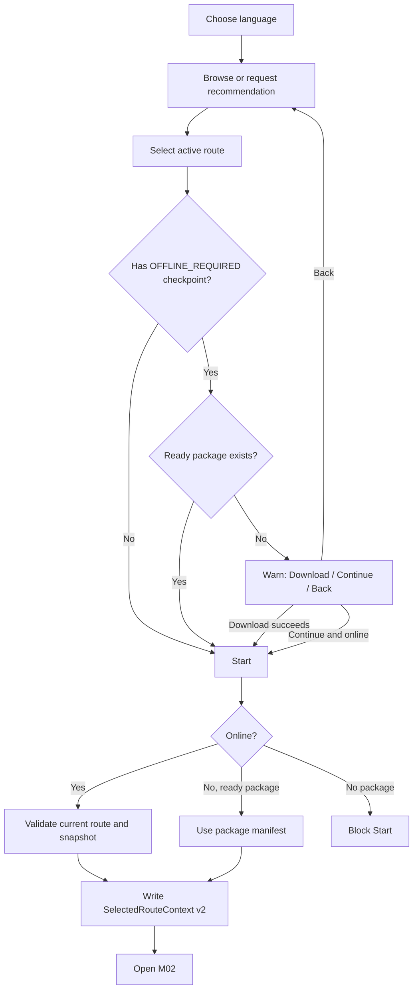
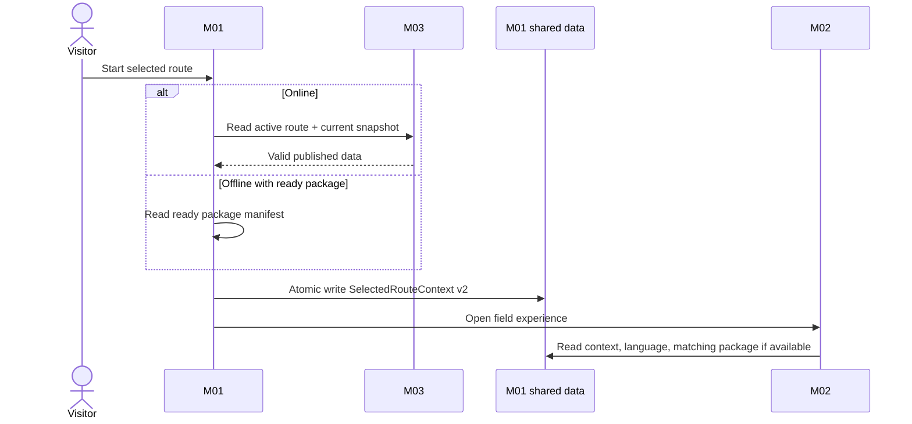
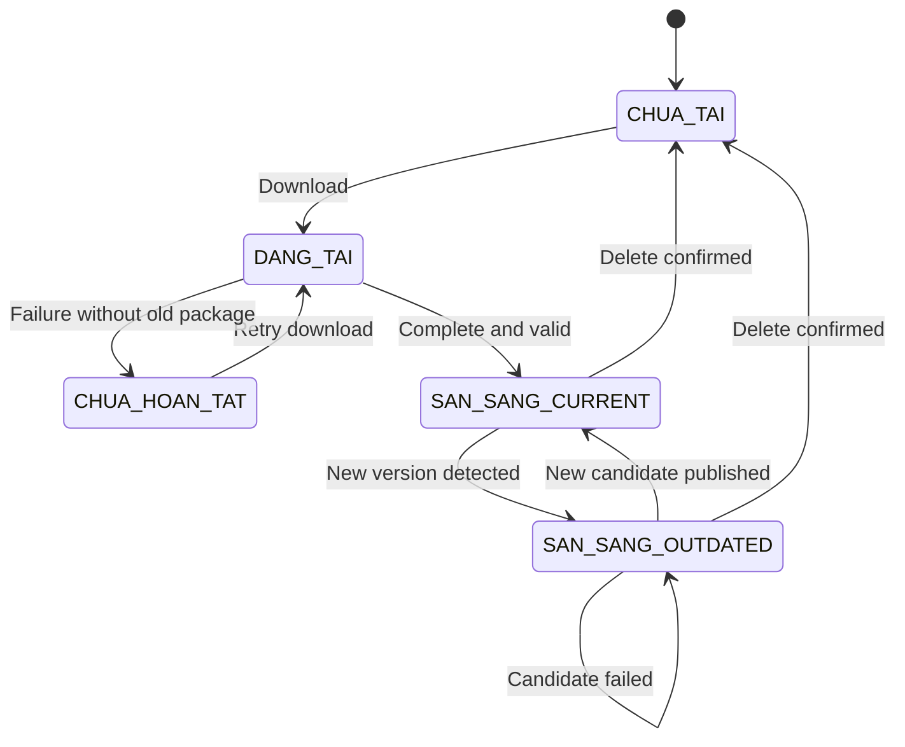
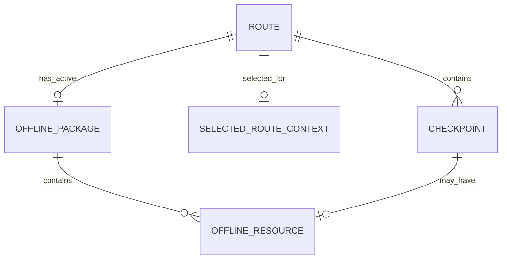

# Spec Document: M01 — Route Planning & Preparation

## 0. Document Metadata

| Field | Value |
|---|---|
| Module | M01 — Route Planning & Preparation |
| Version | 2.0 |
| Status | MVP implementation baseline |
| Last updated | 2026-09-27 |
| Primary consumers | Visitor web app, M02 |
| Upstream system | M03 |

This specification is self-contained and is the implementation source of truth for M01. UI mockups, physical API/database schemas and deployment details may refine implementation but must not change the behavior or contracts defined here without updating this document.

## 1. Purpose & Scope

### 1.1 Purpose

M01 lets a visitor choose a language and route, receive deterministic recommendations, prepare bilingual offline content and create a one-use handoff from which M02 starts a field session.

### 1.2 In Scope

- Select and change Vietnamese/English language.
- Browse active routes and route details.
- Recommend all routes matching three selected tag groups.
- Detect whether a route has `OFFLINE_REQUIRED` checkpoints.
- Download, inspect, update and delete offline packages.
- Warn and let the visitor continue without a package when online.
- Start online from the current published snapshot.
- Start offline from an already-ready package.
- Publish `LanguagePreference`, `SelectedRouteContext v2` and ready `OfflinePackage` data for M02.

### 1.3 Out of Scope

- Route/content/QR administration.
- QR scanning, check-in, session progress and visit history.
- AI scoring or ranking recommendations.
- GPS navigation or real-time maps.
- Offline audio/video.
- Cross-device package synchronization or recovery after browser data deletion.
- Real-time warnings to sessions already running offline.

### 1.4 Dependencies & External Relationships

| Direction | Contract | Responsibility |
|---|---|---|
| M03 → M01 | Published Route projection | Active route metadata and tags. |
| M03 → M01 | `JourneySnapshot` | Immutable full journey for a route version. |
| M01 → M02 | `LanguagePreference` | Current `vi` or `en`. |
| M01 → M02 | `SelectedRouteContext v2` | One-use handoff plus full journey manifest. |
| M01 → M02 | Active `OfflinePackage` | Ready package, possibly outdated. |

M01 never writes M03-owned data. M02 never writes M01-owned data.

## 2. Actors

| Actor | Type | M01 responsibilities |
|---|---|---|
| Visitor | Primary | Chooses language/route, enters recommendation criteria, manages packages and starts a route. |
| M01 system | System | Filters routes, prepares packages and creates handoffs. |
| M03 | External system | Publishes routes and immutable snapshots. |
| M02 | External system | Consumes handoff, language and package data. |
| Park Management | Stakeholder | Owns content/recommendation policy and field safety measures. |

## 3. User Scenarios & Acceptance Criteria

### US-M01-01 — Choose language

1. Given no language has been selected, when the visitor enters the app, then M01 requires `vi` or `en` before continuing.
2. Given a language is selected, when the visitor changes it offline, then bundled UI and locally available content switch language without changing package state.

### US-M01-02 — Browse and recommend routes

1. Given published data is available, when the visitor opens the catalog, then only routes with `status = HOAT_DONG` and a valid `activeContentVersion` appear.
2. Given one valid value from each recommendation group, when recommendation runs, then every returned route contains all three selected tags.
3. Given no route matches, then an empty result is shown without weakening the criteria.

### US-M01-03 — Prepare offline content

1. Given a route contains `OFFLINE_REQUIRED` checkpoints and has no ready package, when the visitor proceeds, then M01 explains which content may be unavailable and offers Download, Continue without download or Go back.
2. Given download succeeds completely, then the package becomes `SAN_SANG + CURRENT`.
3. Given an update fails, then the previously-ready package remains usable as `SAN_SANG + OUTDATED`.

### US-M01-04 — Start a route

1. Given the device is online, when Start is selected, then M01 validates the route and creates a handoff from the current snapshot.
2. Given the device is offline and a package is `SAN_SANG`, when Start is selected, then M01 creates a handoff from that package's manifest.
3. Given the device is offline and no package is `SAN_SANG`, then Start is blocked.
4. Each successful Start creates a new `handoffId`; Start again replaces the previous context.

### US-M01-05 — Route becomes unavailable

1. After a successful source refresh reports a route closed, archived or deleted, it disappears from new choices.
2. The current context for that route becomes `REVOKED`; M01 does not need to know whether M02 already consumed it.
3. A session already created from that context is not deleted or terminated by M01.

## 4. Functional Flows

### 4.1 Overall M01 Usage Flow

### 4.2 Route Discovery & Recommendation

- Catalog input is the published Route projection from M03.
- Recommendation input requires exactly one `timeTag`, `groupTag` and `experienceTag`.
- Matching is set containment across all three groups.
- Results are not scored, sorted by relevance or capped by business rules.
- A zero-result outcome offers criterion changes or catalog return.

### 4.3 Offline Preparation

1. Read the selected route and current `JourneySnapshot`.
2. Identify all `OFFLINE_REQUIRED` checkpoints.
3. Download the complete snapshot manifest and the offline resources for that subset.
4. Validate bilingual text and every declared image.
5. Publish the candidate package only after validation succeeds.

### 4.4 Resource Management & Lazy Update

- Available actions: View, Download and Delete.
- M01 checks for a newer version when a packaged route is opened/selected and source access succeeds.
- A newer package is prepared separately; the active package remains readable.
- Success switches the active package; failure discards the candidate and keeps the old package.
- Only one package operation per route may run at a time; MVP has no Cancel action.

### 4.5 Start Route & Handoff

Online Start uses the current published snapshot. Offline Start uses a ready package manifest. In both cases M01 writes the complete context atomically before opening M02. Failure does not partially replace the previous context.

### 4.6 Language Preference Flow

Language may change at any time. The preference controls UI and the `vi/en` content branch; it does not create a new package or session.

### 4.7 Sequence Diagrams

### 4.8 OfflinePackage State Machine

`status` and `versionStatus` are separate fields; combined labels above are diagram shorthand.

## 5. Functional Requirements

### 5.1 FR Summary

`Behavioral baseline` below states whether the behavior belongs to this complete specification. Release priority is owned exclusively by `MVP-Scope.md`.

| ID | Requirement | Behavioral baseline |
|---|---|---|
| FR-M01-001 | Manage language preference. | Required |
| FR-M01-002 | Browse available routes. | Required |
| FR-M01-003 | View route information. | Required |
| FR-M01-004 | Generate deterministic recommendations. | Required |
| FR-M01-005 | Evaluate offline preparation need. | Required |
| FR-M01-006 | Support the offline preparation decision. | Required |
| FR-M01-007 | Download an offline package. | Required |
| FR-M01-008 | Validate and publish an offline package. | Required |
| FR-M01-009 | Manage offline resources. | Required |
| FR-M01-010 | Lazily update an offline package. | Required |
| FR-M01-011 | Process online/offline Start. | Required |
| FR-M01-012 | Create `SelectedRouteContext v2`. | Required |
| FR-M01-013 | Publish shared data for M02. | Required |

### 5.2 Detailed Functional Requirements

| ID | Trigger / input | Required behavior | Failure behavior |
|---|---|---|---|
| FR-M01-001 | Select/change `vi` or `en` | Persist and publish current preference; update available UI/content immediately. | Reject unsupported value. |
| FR-M01-002 | Open/refresh catalog | Show only active routes with a valid published snapshot. | Keep last local view when offline; do not claim it is current. |
| FR-M01-003 | Select route | Show localized name/description, distance, duration, difficulty and optional warning. | Do not synthesize missing public fields. |
| FR-M01-004 | Three valid criteria | Return all active routes matching all three tags; support zero results. | Invalid/missing input prevents matching. |
| FR-M01-005 | Select route | Count offline-required checkpoints and inspect package readiness/version. | Treat unreadable package as not ready. |
| FR-M01-006 | Package missing | Offer Download, Continue without download or Back; Continue still obeys Start guards. | No implicit choice. |
| FR-M01-007 | Download requested online | Fetch the current immutable snapshot and all required offline resources. | Do not publish partial data. |
| FR-M01-008 | Candidate download completes | Validate manifest, bilingual text and declared images; atomically publish as ready. | Discard candidate; keep old ready package if present. |
| FR-M01-009 | View/Download/Delete | Show route/version/readiness; require confirmation for delete. | Repeated action must not create concurrent work. |
| FR-M01-010 | Packaged route opened online | Compare versions and prepare a newer candidate without hiding old package. | Preserve old ready package as outdated. |
| FR-M01-011 | Start selected | Online: validate current route/snapshot. Offline: require ready package and use its manifest. | Block Start when neither source nor ready package can supply a manifest. |
| FR-M01-012 | Start validation succeeds | Generate new UUID handoff and atomically write complete v2 context. | Keep previous context unchanged on failure. |
| FR-M01-013 | Shared value changes | Publish language independently; expose only ready active package; expose complete context only. | Never expose staging/partial values. |

### 5.3 Input / Output Contracts

Contract presence uses these terms: **Required** means the field and a value are present; **Optional** means the field may be absent; **Conditional** means the stated condition determines presence. These are logical contract rules, not physical database nullability. All `DateTime` values are UTC. `String` identifiers are opaque logical identifiers and do not imply a physical key format.

#### Published Route input

| Field path | Logical type | Presence | Constraints |
|---|---|---|---|
| `routeId` | String | Required | Stable route identity. |
| `status` | Enum(`HOAT_DONG`, `TAM_DONG`, `LUU_TRU`) | Required | Only `HOAT_DONG` is selectable. |
| `name` | Object | Required | Contains both language branches. |
| `name.vi` | String | Required | Non-empty for published data. |
| `name.en` | String | Required | Non-empty for published data. |
| `description` | Object | Required | Contains both language branches. |
| `description.vi` | String | Required | Non-empty for published data. |
| `description.en` | String | Required | Non-empty for published data. |
| `safetyWarning` | Object | Optional | Both-or-none: absent entirely, or both language fields are present. |
| `safetyWarning.vi` | String | Conditional | Required when `safetyWarning` is present. |
| `safetyWarning.en` | String | Conditional | Required when `safetyWarning` is present. |
| `distanceKm` | Decimal | Required | Greater than `0`. |
| `durationMin` | Integer | Required | Greater than `0`. |
| `difficulty` | Enum(`NHE`, `TRUNG_BINH`, `KHO`) | Required | — |
| `timeTags` | Array&lt;Enum(`TIME_NGAN`, `TIME_VUA`, `TIME_DAI`)&gt; | Required | At least one allowed value. |
| `groupTags` | Array&lt;Enum(`GROUP_CA_NHAN_NGUOI_LON`, `GROUP_GIA_DINH_CO_TRE`, `GROUP_CAN_DE_DANG`)&gt; | Required | At least one allowed value. |
| `experienceTags` | Array&lt;Enum(`INTEREST_THIEN_NHIEN_CHUP_ANH`, `INTEREST_TIM_HIEU`, `INTEREST_KHAM_PHA`)&gt; | Required | At least one allowed value. |
| `activeContentVersion` | Integer | Conditional | Required when `status = HOAT_DONG`; when present, identifies a `DA_CONG_BO` snapshot of the same route. |

Only `HOAT_DONG` with non-null `activeContentVersion` is selectable. Other states are consumed only to remove a route from new selection and revoke a not-yet-consumed current handoff when closure is discovered.

Allowed recommendation values:

- `timeTags`: `TIME_NGAN` (≤ 90 minutes), `TIME_VUA` (> 90–180 minutes), `TIME_DAI` (> 180 minutes).
- `groupTags`: `GROUP_CA_NHAN_NGUOI_LON`, `GROUP_GIA_DINH_CO_TRE`, `GROUP_CAN_DE_DANG`.
- `experienceTags`: `INTEREST_THIEN_NHIEN_CHUP_ANH`, `INTEREST_TIM_HIEU`, `INTEREST_KHAM_PHA`.

#### JourneySnapshot input

| Field path | Logical type | Presence | Constraints |
|---|---|---|---|
| `routeId` | String | Required | Stable route identity. |
| `contentVersion` | Integer | Required | Identifies one immutable version within `routeId`. |
| `status` | Enum(`DA_CONG_BO`) | Required | Published snapshots are immutable. |
| `publishedAt` | DateTime | Required | UTC. |
| `previousContentVersion` | Integer | Optional | When present, identifies the preceding snapshot of the same route. |
| `checkpoints` | Array&lt;Object&gt; | Required | Contains every and only active checkpoint; IDs and sequences are unique. |
| `checkpoints[].checkpointId` | String | Required | Stable checkpoint identity. |
| `checkpoints[].sequence` | Integer | Required | Unique within the snapshot. |
| `checkpoints[].checkpointName` | String | Required | Frozen display name for this version. |
| `checkpoints[].connectivityMode` | Enum(`ONLINE_AVAILABLE`, `OFFLINE_REQUIRED`) | Required | — |
| `checkpoints[].qrIdentifiers` | Array&lt;String&gt; | Required | Non-empty; active identifiers only. |
| `checkpoints[].offlineResource` | Object | Conditional | Required only for `OFFLINE_REQUIRED`; absent for `ONLINE_AVAILABLE`. |
| `checkpoints[].offlineResource.localizedContent` | Object | Conditional | Required with `offlineResource`. |
| `checkpoints[].offlineResource.localizedContent.vi` | Object | Conditional | Required with `offlineResource`. |
| `checkpoints[].offlineResource.localizedContent.vi.introductionText` | String | Conditional | Required with `offlineResource`; non-empty. |
| `checkpoints[].offlineResource.localizedContent.en` | Object | Conditional | Required with `offlineResource`. |
| `checkpoints[].offlineResource.localizedContent.en.introductionText` | String | Conditional | Required with `offlineResource`; non-empty. |
| `checkpoints[].offlineResource.staticImages` | Array&lt;String&gt; | Conditional | Required with `offlineResource`; may be empty. Each item is a declared image resource reference. |

The array contains every active checkpoint. `offlineResource` is required only for `OFFLINE_REQUIRED`.

#### LanguagePreference output

| Field path | Logical type | Presence | Constraints |
|---|---|---|---|
| `languageCode` | Enum(`vi`, `en`) | Required | Current singleton preference; replacement does not change package or session state. |

#### SelectedRouteContext v2 output

| Field path | Logical type | Presence | Constraints |
|---|---|---|---|
| `contractVersion` | Integer | Required | Exactly `2`. |
| `handoffId` | UUID | Required | Globally unique and used for at most one M02 session. |
| `routeId` | String | Required | Equals `routeJourneyManifest.routeId`. |
| `authorizedAt` | DateTime | Required | UTC. |
| `authorizationStatus` | Enum(`AUTHORIZED`, `REVOKED`) | Required | New successful Start writes `AUTHORIZED`; later discovered closure may set `REVOKED`. |
| `routeJourneyManifest` | Object | Required | Complete journey-only manifest, written atomically. |
| `routeJourneyManifest.routeId` | String | Required | Equals outer `routeId`. |
| `routeJourneyManifest.contentVersion` | Integer | Required | Source snapshot/package version. |
| `routeJourneyManifest.checkpoints` | Array&lt;Object&gt; | Required | Complete frozen checkpoint list for the selected version. |
| `routeJourneyManifest.checkpoints[].checkpointId` | String | Required | Stable checkpoint identity; unique in the manifest. |
| `routeJourneyManifest.checkpoints[].sequence` | Integer | Required | Unique in the manifest. |
| `routeJourneyManifest.checkpoints[].checkpointName` | String | Required | Frozen display name. |
| `routeJourneyManifest.checkpoints[].connectivityMode` | Enum(`ONLINE_AVAILABLE`, `OFFLINE_REQUIRED`) | Required | Copied without reclassification. |
| `routeJourneyManifest.checkpoints[].qrIdentifiers` | Array&lt;String&gt; | Required | Non-empty active identifier set from the selected snapshot/package. |

The handoff contains journey metadata only. Offline text/images remain in `OfflinePackage.resources` rather than being duplicated into the context.

#### OfflinePackage output

| Field path | Logical type | Presence | Constraints |
|---|---|---|---|
| `routeId` | String | Required | Package covers exactly one route. |
| `contentVersion` | Integer | Required | Package covers exactly one journey version. |
| `status` | Enum(`CHUA_TAI`, `DANG_TAI`, `SAN_SANG`, `CHUA_HOAN_TAT`) | Required | Only `SAN_SANG` is exposed to M02. `CHUA_TAI` may be represented by no persisted package. |
| `versionStatus` | Enum(`CURRENT`, `OUTDATED`) | Conditional | Required only when `status = SAN_SANG`. |
| `manifest` | Object | Required | Exact shape below; full journey metadata for the package version. |
| `manifest.routeId` | String | Required | Equals package `routeId`. |
| `manifest.contentVersion` | Integer | Required | Equals package `contentVersion`. |
| `manifest.checkpoints` | Array&lt;Object&gt; | Required | Complete checkpoint list for the package version. |
| `manifest.checkpoints[].checkpointId` | String | Required | Stable identity; unique in the manifest. |
| `manifest.checkpoints[].sequence` | Integer | Required | Unique in the manifest. |
| `manifest.checkpoints[].checkpointName` | String | Required | Frozen display name. |
| `manifest.checkpoints[].connectivityMode` | Enum(`ONLINE_AVAILABLE`, `OFFLINE_REQUIRED`) | Required | — |
| `manifest.checkpoints[].qrIdentifiers` | Array&lt;String&gt; | Required | Non-empty active identifiers from the source snapshot. |
| `resources` | Array&lt;Object&gt; | Required | Contains exactly one resource object for every `OFFLINE_REQUIRED` checkpoint and none for `ONLINE_AVAILABLE`; may be empty only when the manifest has no offline-required checkpoint. |
| `resources[].checkpointId` | String | Required | Embedded field and logical lookup key; unique within the package and references a checkpoint in `manifest`. |
| `resources[].localizedContent` | Object | Required | Contains both language branches. |
| `resources[].localizedContent.vi` | Object | Required | — |
| `resources[].localizedContent.vi.introductionText` | String | Required | Non-empty. |
| `resources[].localizedContent.en` | Object | Required | — |
| `resources[].localizedContent.en.introductionText` | String | Required | Non-empty. |
| `resources[].staticImages` | Array&lt;String&gt; | Required | May be empty. Each item is a declared image resource reference whose bytes are present in the ready package. |
| `downloadedAt` | DateTime | Optional | UTC; present when a completed download time is available. |

`JourneySnapshot` is the M03 source. `OfflinePackage.manifest` and `SelectedRouteContext v2.routeJourneyManifest` are value projections of the same route/version/checkpoint metadata, not new M03-owned entities. `OfflinePackage.resources[]` is the M01-owned local copy of each snapshot `offlineResource`; the canonical entity name is `OfflineResource`.

### 5.4 Validation

| Area | Validation |
|---|---|
| Route | Active status, published version, bilingual fields, positive distance/duration and at least one allowed value in each tag group. |
| Snapshot | Published, version matches route, all checkpoint IDs/sequence unique, QR arrays non-empty. |
| Offline resource | Only offline-required checkpoints; both languages present; every declared image readable. |
| Package | Manifest/resource version consistency; publish only complete candidate. |
| Online Start | Latest successful source response confirms active route and complete snapshot. |
| Offline Start | Package is `SAN_SANG`; use that package's route/version/manifest. |
| Handoff | UUID, route equals manifest route, complete atomic value. |

#### Existing Edge Cases

- Browser reports online but source request fails: treat source as unavailable.
- Package is ready but outdated: allow use and display warning when known.
- Route closes while device is offline: local package may still start; field safety is handled outside the app.
- Route has no offline checkpoints: no package required for online Start.
- Declared image is missing: package cannot become ready.
- No image is declared: package may still become ready.
- Storage failure: discard candidate and preserve existing ready package.
- Browser data deleted: local preference/context/package may be lost.

### 5.5 Business Rules

| ID | Rule |
|---|---|
| BR-M01-001 | Only `vi` and `en` are supported; language changes do not change package state. |
| BR-M01-002 | Catalog and recommendations only use routes active with a published version. |
| BR-M01-003 | Recommendation matches all three tag groups, returns 0..N routes and never auto-relaxes criteria. |
| BR-M01-004 | A package covers one route/version, the full manifest and all offline-required resources. |
| BR-M01-005 | Package completeness and version freshness are separate concerns. |
| BR-M01-006 | An old ready package stays usable while a new candidate is prepared or fails. |
| BR-M01-007 | The visitor may continue without download while online after explicit warning. |
| BR-M01-008 | Online Start uses current published source; offline Start requires a ready package. |
| BR-M01-009 | Each successful Start creates a new one-use handoff; Start again replaces context. |
| BR-M01-010 | M01 does not own or modify M02 progress/session state. |
| BR-M01-011 | Route closure discovered by M01 blocks new Start and marks the current context `REVOKED`; a session already created from it continues independently. |

## 6. Key Entities

### 6.1 Domain Model

### 6.2 Entity Definitions

| Entity | Key attributes | Owner |
|---|---|---|
| Route | Canonical published fields in §5.3 | M03; M01 reads |
| Checkpoint | `checkpointId`, `sequence`, `checkpointName`, `connectivityMode`, `qrIdentifiers[]`; the earlier term `QRCheckpoint` refers to this snapshot projection and is not a separate entity | M03; snapshot copied by M01 |
| RecommendationContext | One value from each tag group | M01 |
| SelectedRouteContext | v2 handoff and manifest | M01 |
| OfflinePackage | Route/version, readiness/freshness, manifest/resources | M01 |
| OfflineResource | `checkpointId`, bilingual introduction and images | M01 local copy; source M03 |
| LanguagePreference | `languageCode`: Enum(`vi`, `en`) | M01 |

### 6.3 Entity Operation Matrix

| Entity | Create/Update | Read | Delete |
|---|---|---|---|
| Route / Checkpoint | M03 | M01, M02 through contracts | M03 lifecycle |
| LanguagePreference | M01 | M01, M02 | Browser data lifecycle |
| SelectedRouteContext | M01 Start/revoke | M01, M02 | Replaced by later Start/browser lifecycle |
| OfflinePackage | M01 | M01, M02 | Visitor-confirmed delete/browser lifecycle |

### 6.4 Logical Persistence Constraints

These constraints are required regardless of the physical browser/database design:

- `LanguagePreference` is a singleton in one local application profile.
- `SelectedRouteContext` stores one current context; every new Start replaces it atomically. `handoffId` is globally unique.
- `(routeId, contentVersion)` uniquely identifies an offline package version.
- A route has at most one active `SAN_SANG` package; a candidate/staging version is never exposed as active.
- `(routeId, contentVersion, checkpointId)` uniquely identifies an offline resource.
- `CHUA_TAI` may be represented by absence of a persisted package rather than a stored row.
- Deleting a package cascades to its local resources/candidate data, but never deletes `SelectedRouteContext` or M02 data.

## 7. Screens Involved

| Screen | Required behavior |
|---|---|
| Language selection | Select `vi/en`. |
| Route catalog | Browse active routes and open recommendation. |
| Route details | Show route information, offline need/package state and Start. |
| Recommendation | Capture three criteria and display 0..N results. |
| Offline decision | Download, continue without download or return. |
| Resource management | View package status/version, download/update and delete. |

Exact layout, component design and navigation polish are separate UI design concerns.

## 8. Success Criteria

| ID | Criterion |
|---|---|
| SC-M01-001 | Every selectable route is active and backed by a published snapshot. |
| SC-M01-002 | Every recommendation result matches all three chosen tag groups. |
| SC-M01-003 | A package is exposed as ready only when complete for its manifest. |
| SC-M01-004 | Update failure never removes the previous ready package. |
| SC-M01-005 | Every successful Start writes one complete v2 context with a new UUID handoff. |
| SC-M01-006 | Offline Start succeeds only from a ready package; otherwise it is blocked. |

## 9. Assumptions & Constraints

### 9.1 Business Assumptions

- Routes are day trips.
- M03 maintains valid tags and published content.
- Park operations provide physical safety controls for closures not received by offline devices.

### 9.2 Business / Product Constraints

- No ranking/AI recommendation.
- No forced package download.
- No real-time closure guarantee for offline devices.
- No cross-device local data synchronization.

### 9.3 Approved Technical Constraints

- UI translations and app shell must be locally available for offline language switching.
- Business package data must support atomic candidate-to-active publication.
- Declared offline images require actual local bytes, not only remote URLs.
- Source availability is proven by a successful request, not a browser online flag alone.
- Guest access to M03 data is read-only and enforced server-side.

Specific browser storage, table/index and API choices belong to technical design.

## 10. Resolved Decisions & Deferred Design Work

### 10.1 Resolved Decisions

- Full journey snapshot includes both connectivity modes.
- Offline package contains that full manifest plus only the offline resource subset.
- Offline Start is allowed only from a ready package.
- Ready outdated packages remain usable.
- One handoff creates at most one M02 session.
- Snapshot retention is current + previous + versions replaced less than 30 days ago.

### 10.2 Deferred Design Work

- Wireframes and accessibility details.
- Physical API paths and error codes.
- Browser storage schema, quotas and cleanup implementation.
- Telemetry/observability implementation.

None of these may redefine the business contracts or state transitions above.

## 11. Internal Consistency & Coverage

### 11.1 FR → Flow / Entity Coverage

| FR group | Flow sections | Primary entities |
|---|---|---|
| FR-001 | §4.6 | LanguagePreference |
| FR-002…004 | §4.2 | Route, RecommendationContext |
| FR-005…008 | §4.3, §4.8 | JourneySnapshot, OfflinePackage, OfflineResource |
| FR-009…010 | §4.4, §4.8 | OfflinePackage |
| FR-011…013 | §4.5, §4.7 | SelectedRouteContext, OfflinePackage, LanguagePreference |

### 11.2 Cross-Module Contract Checks

| Contract | Producer guarantee | Consumer expectation |
|---|---|---|
| Published Route | M03 exposes only complete published route projections. The projection may carry `HOAT_DONG`, `TAM_DONG`, or `LUU_TRU`; only `HOAT_DONG` with a non-null `activeContentVersion` is selectable by M01. | M01 does not repair incomplete public data. |
| JourneySnapshot | M03 includes all active checkpoints and conditional offline resources. | M01 copies it without reconstructing the journey. |
| SelectedRouteContext v2 | M01 writes a complete atomic one-use handoff. | M02 validates version/status/uniqueness before creating a session. |
| OfflinePackage | M01 exposes only active `SAN_SANG` data. | M02 never reads staging/partial packages. |

### 11.3 Completion Checklist

- [x] Scope and out-of-scope are explicit.
- [x] Online and offline Start paths are specified.
- [x] Full snapshot and package subset contracts are defined.
- [x] Package completeness/freshness state is unambiguous.
- [x] FRs, entities, screens and success criteria are internally linked.
- [x] No external requirements document is needed to implement M01.
