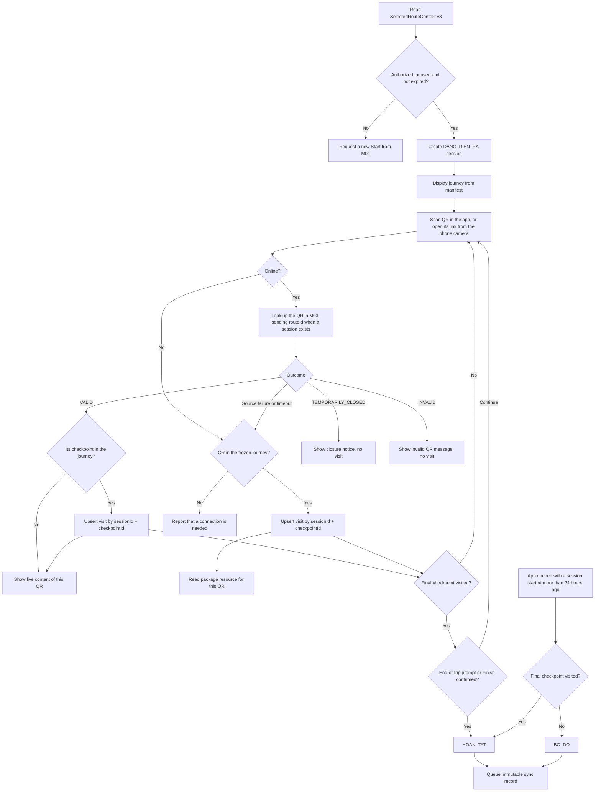
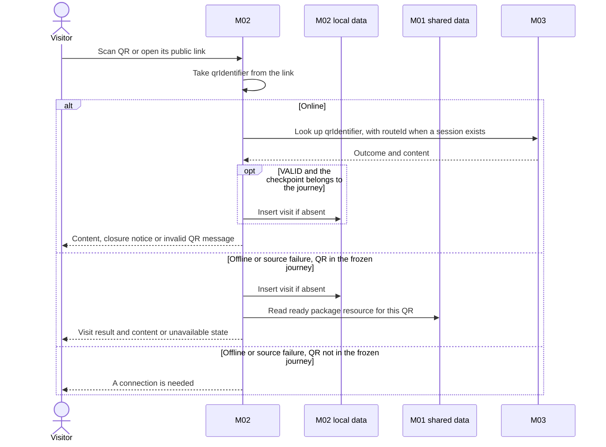
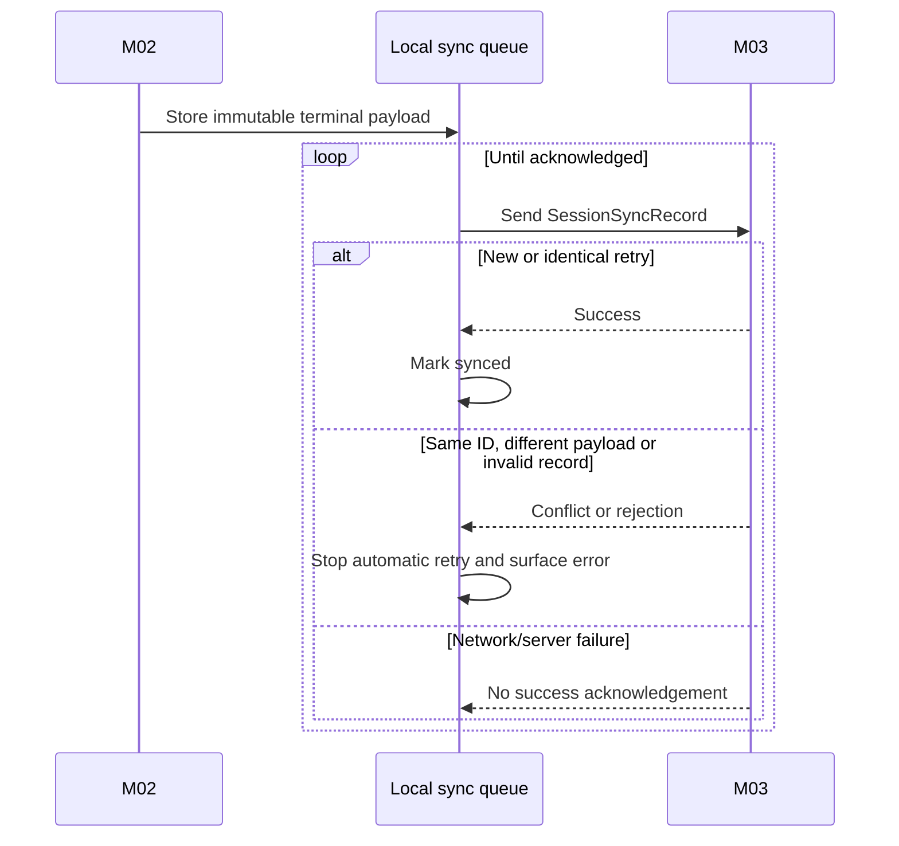
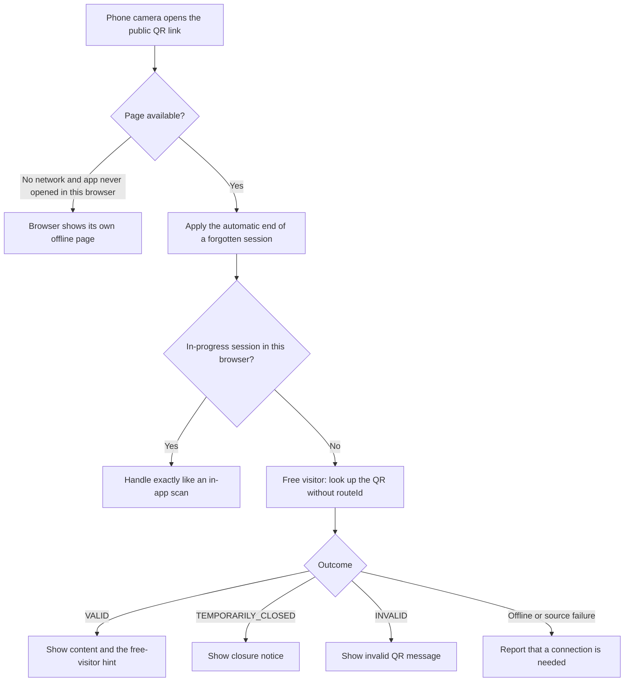
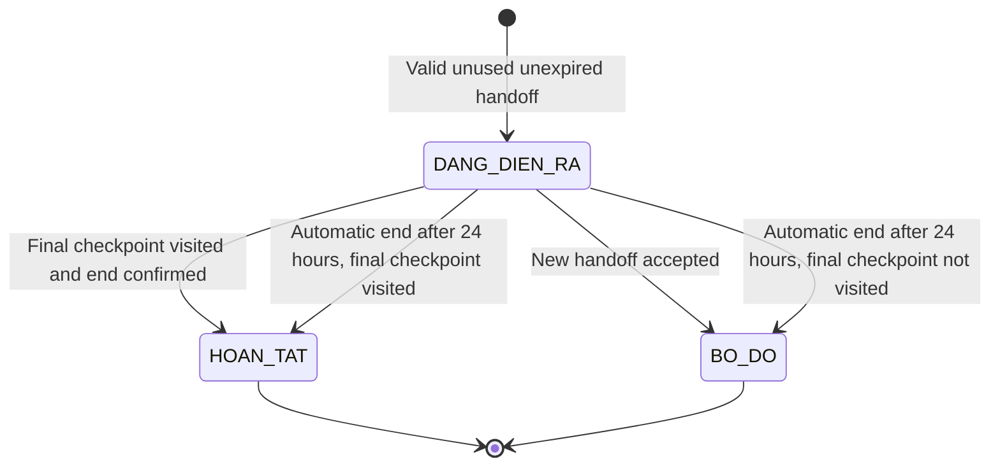

# Spec Document: M02 — Field Quest Experience

| Field | Value |
|---|---|
| Module | M02 — Field Quest Experience |
| Version | 3.3 |
| Status | MVP implementation baseline — aligned to M03 v3.7 and M01 v3.2 |
| Supersedes | 3.2 (previous repository baseline: 2.0) |
| Last updated | 2026-10-29 |
| Inputs | M01 handoff/language/package; M03 live QR lookup |
| Output | Terminal anonymous `SessionSyncRecord` to M03 |

This specification is self-contained and is the implementation source of truth for M02. Where M02 consumes a contract produced by M01 or M03, the producer specification (M01 v3.2, M03 v3.7) is the baseline and this document mirrors its shape.

## 1. Purpose and scope

M02 creates a field session from a route handoff, records QR-based checkpoint visits, shows the content of the QR that was scanned from the correct online/offline source, tells the visitor when an area is temporarily closed, preserves progress locally and synchronizes an anonymous terminal record for operations reporting.

In scope:

- Create one session from a valid, unused, unexpired handoff.
- Display the fixed linear journey from the handoff manifest.
- Scan any QR with the in-app scanner, or open its public link with the phone's own camera, and resolve it to a checkpoint of the journey through the online lookup or, offline, through the frozen journey.
- Record idempotent visits for checkpoints in the current journey.
- Allow visits in any order.
- Look up every scanned QR in M03 when online and show the content of that QR, or a closure notice, or an invalid-QR message.
- Read the content of that QR from the ready package when offline or when the lookup fails.
- Restore an in-progress session after app reload.
- Complete at the final checkpoint (Finish or the end-of-trip prompt), abandon when a new handoff starts, and end a forgotten session automatically after 24 hours.
- Retry terminal-session synchronization.
- Let a free visitor, including someone who never opened the app before, open a QR from the phone camera for information without creating progress.

Out of scope:

- Route selection/recommendation and offline package management.
- Route/checkpoint/content/QR administration.
- GPS/geofence validation, proof that the visitor is physically present, or enforced checkpoint order.
- Per-QR progress or per-QR reporting (progress is per checkpoint).
- Hints, scoring, achievements or hidden-message gameplay.
- Visitor accounts or cross-device progress.
- Real-time closure warnings for a session already in progress or for an offline device.

Dependencies:

- M01 provides `LanguagePreference`, `SelectedRouteContext v3` and the active ready `OfflinePackage` if one exists.
- M03 provides live QR lookup for any QR (both connectivity modes, inside or outside the journey) and receives terminal session records.
- The handoff manifest is the only source used to construct a session journey.

## 2. Actors

| Actor | Type | Responsibility |
|---|---|---|
| Web-app visitor | Primary | Starts/resumes a session, scans QR, views progress/content and ends the session. |
| Free visitor | Primary | Scans QR to view live information; has no session/progress/reporting data. |
| M02 system | System | Owns sessions/visits, content-source selection, closure notices and synchronization. |
| M01 | External | Publishes handoff, language and ready package. |
| M03 | External | Resolves live QR/content and ingests terminal records. |

## 3. User scenarios and acceptance criteria

### US-M02-01 — Start and restore a field session

1. Given an `AUTHORIZED` v3 context with a valid manifest, an unused handoff and a time before `expiresAt`, when the visitor starts, then M02 creates one `DANG_DIEN_RA` session with a globally unique UUID `sessionId`.
2. Given that handoff already created a session, is `REVOKED` or has passed `expiresAt`, then no new session is created and the visitor is asked to start again from M01.
3. Given a version 2 context, then it is rejected with a clear message and is not converted silently.
4. Given an in-progress session exists after reload, then the same session and visits are restored. The expiry of a handoff never ends a session that was already created from it; a session ends automatically only under BR-M02-022.

### US-M02-02 — Scan and check in

1. Given a scan is accepted for a checkpoint of the journey (BR-M02-005), when that checkpoint is first scanned, then one visit is recorded before the content is shown.
2. Scanning another QR of the same checkpoint does not create another visit, but shows the content of that other QR.
3. A valid checkpoint may be visited in any order.
4. Content failure never rolls back a recorded visit. An online `INVALID` or `TEMPORARILY_CLOSED` answer records no visit.
5. A recorded visit is shown as a scanned QR (for example "Đã quét QR"), never as proof that the visitor reached the place.
6. Given a QR code that M03 added to a journey checkpoint after the session started (a visit point published later) and that is therefore not in the frozen journey, when it is scanned online and the lookup answers `VALID` with a checkpoint of the journey, then the visit of that checkpoint is recorded before the content is shown, exactly as for a journey QR (BR-M02-020). Offline, such a code first needs a connection.

### US-M02-03 — Read the content of the scanned QR

1. The content shown is that of the scanned QR (one visit point): the name of the object, its introduction, images and, where it has them, audio/video. It is never content shared by the whole checkpoint.
2. While online, M02 asks M03 about the scanned QR for both connectivity modes. When the answer is `VALID`, M02 shows the returned content, which is the most current.
3. While offline, or when the lookup fails, an `OFFLINE_REQUIRED` checkpoint reads bilingual text/images from the ready package resource keyed by `qrIdentifier`; an `ONLINE_AVAILABLE` checkpoint has no offline content and shows an unavailable message.
4. Audio/video exists only for `ONLINE_AVAILABLE` checkpoints and plays only after explicit visitor action. Only the files spoken in the current language, plus the files without speech, are shown; switching VI/EN switches them at once (BR-M02-026). Media controls appear only when the content shown carries audio/video: M03 never returns audio/video for an `OFFLINE_REQUIRED` checkpoint, and package content never contains any.
5. Missing content shows an unavailable message while retaining the visit. If the package has no resource for the scanned QR and the device is online, M02 asks M03 for that QR only and never changes the package; if offline, it shows "Chưa có nội dung offline cho điểm này". A missing resource is not an invalid QR.

### US-M02-04 — Scan outside the journey

1. A QR whose checkpoint is not in the current journey may display live M03 content (`VALID`) but never creates a visit or changes the route.
2. An `INVALID` answer shows "Mã không còn hiệu lực hoặc không tồn tại".
3. A `TEMPORARILY_CLOSED` answer shows the closure notice and no content.
4. Network failure is reported as connectivity failure, not as invalid QR. Offline, a QR that is not in the frozen journey cannot be checked and the visitor is told a connection is needed.

### US-M02-05 — Complete or abandon a session

1. The Finish action becomes available after the checkpoint with the largest `sequence` is visited.
2. Visitor confirmation changes the session to `HOAN_TAT` even if earlier checkpoints were skipped.
3. A valid new handoff while a session is running creates the replacement session and changes the old session to `BO_DO` as one logical operation; failure to create the replacement leaves the old session running.
4. When the visit of the final checkpoint is recorded for the first time, M02 immediately asks "Bạn đã quét điểm cuối. Kết thúc chuyến đi?" with [Kết thúc] and [Đi tiếp]. [Kết thúc] changes the session to `HOAN_TAT`; [Đi tiếp] keeps the session running and the Finish action stays available (BR-M02-021).
5. When the app is opened or brought back to the screen and the in-progress session started more than 24 hours ago, M02 ends it without any visitor action: `HOAN_TAT` if the final checkpoint was visited, otherwise `BO_DO`. `endedAt` is the latest `checkedInAt` of the session, or `startedAt` when nothing was scanned; the record is queued for synchronization and the visitor sees a short notice (BR-M02-022).

### US-M02-06 — Synchronize terminal data

1. Only `HOAN_TAT` or `BO_DO` sessions are synchronized.
2. Retrying the same `sessionId` with identical business data is successful and creates no duplicate.
3. Sending different business data with the same `sessionId` is rejected as a conflict.
4. Failed/offline synchronization remains queued for a later attempt.
5. A record that M03 rejects as invalid stops automatic retry and surfaces the error, like a conflict.

### US-M02-07 — Free visitor scan

A free visitor, scanning with the in-app scanner or opening the code's public link from the phone camera without an in-progress session in that browser, can view live content for a valid QR (no route is sent) but creates no `PlaySession`, `CheckpointVisit` or `SessionSyncRecord`, and every result shows the free-visitor hint. A closed checkpoint shows the closure notice and an `INVALID` answer shows the invalid-QR message.

### US-M02-08 — Scan a QR in a closed area

1. Given the device is online and the scanned QR belongs to a checkpoint of the journey, when M03 answers `TEMPORARILY_CLOSED`, then M02 records no visit, shows no visit content and shows the closure notice: "Khu vực này đang tạm đóng. Vui lòng dừng lại hoặc quay về theo hướng dẫn của Ban Quản lý." (English: "This area is temporarily closed. Please stop here or return as directed by Park Management.").
2. The notice is the same whether the closed scope is the checkpoint or the whole route. M03 also answers `TEMPORARILY_CLOSED` (scope `ROUTE`) when the session's route has been archived since the trip started.
3. A QR outside the journey, or scanned by a free visitor, shows the same notice and records nothing.
4. Offline, M02 cannot know of a closure and shows no notice; field safety is handled outside the app.

### US-M02-09 — Open a QR from the phone camera

1. Given anyone scans a printed code with the phone's own camera while online, when the browser opens its public link `/q/{qrIdentifier}`, then the visitor web app shows that visit point without any earlier step: no language screen, no route choice (BR-M02-024).
2. Given no language was ever chosen in that browser, then the content uses the device language (Vietnamese when the device language is Vietnamese, otherwise English), and a VI/EN switch on the page changes it at once and keeps the choice.
3. Given an in-progress session exists in the same browser, then the link is handled exactly like a scan with the in-app scanner (visit, closure notice, end-of-trip prompt).
4. Given no in-progress session exists in that browser, then the page works in free-visitor mode, shows a one-line hint that this scan is not recorded in a trip with a link to the route catalog, and never creates a session.
5. Given the device is offline, then the page opens only if this browser opened the app before; it then behaves like an offline in-app scan. Otherwise the browser shows its own offline page, which the app cannot change (BR-M02-025).

## 4. Flows

### 4.1 Usage flow

### 4.2 Sequence for QR check-in

A visit is recorded online only for a `VALID` answer, and offline only for a QR in the frozen journey (BR-M02-005).

### 4.3 Sequence for session sync

### 4.4 Public QR link entry flow

Language on this page follows BR-M02-024: the stored preference, otherwise the device language, with a VI/EN switch.

## 5. Functional requirements

`Behavioral baseline` below states whether the behavior belongs to this complete specification. Release priority is owned exclusively by `MVP-Scope.md`.

| ID | Requirement | Behavioral baseline |
|---|---|---|
| FR-M02-001 | Validate v3 context and create a session from an unused, unexpired `AUTHORIZED` handoff; reject version 2 and expired handoffs with a clear message. | Required |
| FR-M02-002 | Enforce at most one `DANG_DIEN_RA` session per browser on a device. | Required |
| FR-M02-003 | Generate globally unique UUID `sessionId` and enforce unique `sourceHandoffId`. | Required |
| FR-M02-004 | Copy the complete handoff manifest into immutable session journey data. | Required |
| FR-M02-005 | Restore the active session and visits after reload/offline use. | Required |
| FR-M02-006 | Take `qrIdentifier` from the scanned public QR link and resolve it to `checkpointId` through the online lookup result or, offline, through the frozen journey (BR-M02-005). | Required |
| FR-M02-007 | Record one visit per `(sessionId, checkpointId)` for an accepted scan (BR-M02-005), before the content is shown. | Required |
| FR-M02-008 | Accept journey check-ins in any order and mark visited checkpoints. | Required |
| FR-M02-009 | Re-scan (the same QR or another QR of the checkpoint) displays that QR's content and the original visit time without inserting a duplicate. | Required |
| FR-M02-010 | Read offline content from the matching ready package resource keyed by `qrIdentifier` when the device is offline or the lookup fails. | Required |
| FR-M02-011 | Look up the scanned QR in M03 whenever online, show the returned content of that QR, and play media on demand. | Required |
| FR-M02-012 | Handle QR outside journey without recording progress. | Required |
| FR-M02-013 | Distinguish `INVALID` and `TEMPORARILY_CLOSED` outcomes from connectivity/source failure. | Required |
| FR-M02-014 | Apply current `LanguagePreference` to available content, including which audio/video files are shown. | Required |
| FR-M02-015 | Enable Finish after the highest-sequence checkpoint is visited. | Required |
| FR-M02-016 | Complete on confirmation; do not require every earlier checkpoint. | Required |
| FR-M02-017 | Atomically create the replacement session and change the previous active session to `BO_DO` when a new handoff is accepted. | Required |
| FR-M02-018 | Persist terminal immutable sync data and retry until acknowledged, conflicted or rejected. | Required |
| FR-M02-019 | Prevent free visitors from producing progress/report data. | Required |
| FR-M02-020 | Never write M01/M03-owned source data. | Required |
| FR-M02-021 | Show the closure notice for a `TEMPORARILY_CLOSED` answer, record no visit and never show visit content. | Required |
| FR-M02-022 | Record the visit for a QR that is not in the frozen journey when the online lookup answers `VALID` with a `checkpointId` of the frozen journey; never change the frozen journey. | Required |
| FR-M02-023 | Ask the visitor to end the trip as soon as the final checkpoint's visit is first recorded. | Required |
| FR-M02-024 | End an in-progress session automatically when the app is opened more than 24 hours after the session started, as `HOAN_TAT` if the final checkpoint was visited and otherwise `BO_DO`, and queue it for synchronization. | Required |
| FR-M02-025 | Serve the public QR link page `/q/{qrIdentifier}` opened from a phone camera: no blocking step, language from the stored preference or the device, session handling as an in-app scan when an in-progress session exists in the same browser, otherwise free-visitor mode. | Required |
| FR-M02-026 | Accept in the in-app scanner only codes that are a public QR link of the current environment (`QR_PUBLIC_BASE_URL`) and take `qrIdentifier` from it; any other content shows the invalid-QR message without a lookup. | Required |

### 5.1 Input / Output contract

Contract presence uses these terms: **Required** means the field and a value are present; **Optional** means the field may be absent; **Conditional** means the stated condition determines presence. These are logical contract rules, not physical database nullability. All `DateTime` values are UTC. `String` identifiers are opaque logical identifiers.

#### SelectedRouteContext v3 input

This is the same payload produced by M01; M02 does not redefine or extend it.

| Field path | Logical type | Presence | Constraints |
|---|---|---|---|
| `contractVersion` | Integer | Required | Exactly `3`; any other value (including `2`) is rejected with a clear message and never converted. |
| `handoffId` | UUID | Required | Globally unique and used for at most one M02 session. |
| `routeId` | String | Required | Equals `routeJourneyManifest.routeId`. |
| `authorizedAt` | DateTime | Required | UTC. |
| `expiresAt` | DateTime | Required | UTC; `authorizedAt` plus 24 hours. A session may be created only before this time, compared with the device clock; it never ends an existing session. |
| `authorizationStatus` | Enum(`AUTHORIZED`, `REVOKED`) | Required | Only `AUTHORIZED`, unused and unexpired may create a session. |
| `routeJourneyManifest` | Object | Required | Complete journey-only manifest. |
| `routeJourneyManifest.routeId` | String | Required | Equals outer `routeId`. |
| `routeJourneyManifest.contentVersion` | Integer | Required | Source snapshot/package version. |
| `routeJourneyManifest.checkpoints` | Array&lt;Object&gt; | Required | Complete checkpoint list for the selected version. |
| `routeJourneyManifest.checkpoints[].checkpointId` | String | Required | Stable identity; unique in the manifest. |
| `routeJourneyManifest.checkpoints[].sequence` | Integer | Required | Unique in the manifest; gaps are allowed. |
| `routeJourneyManifest.checkpoints[].checkpointName` | Object | Required | Frozen display name; `vi` and `en` both Required, non-empty. |
| `routeJourneyManifest.checkpoints[].connectivityMode` | Enum(`ONLINE_AVAILABLE`, `OFFLINE_REQUIRED`) | Required | — |
| `routeJourneyManifest.checkpoints[].qrIdentifiers` | Array&lt;String&gt; | Required | Non-empty active identifier set from the source version. |

#### Content inputs

`LanguagePreference` is the same logical payload produced by M01.

| Field path | Logical type | Presence | Constraints |
|---|---|---|---|
| `languageCode` | Enum(`vi`, `en`) | Required | Current singleton preference; M02 reads but never writes it. |

`OfflinePackage` is the same logical payload produced by M01. M02 may consume it only when `status = SAN_SANG`; it never reads staging or partial values. M02 uses `manifest` and `resources`; it ignores the M01-only embedded values `offlineRouteMap` and `routeEssentials`.

| Field path | Logical type | Presence | Constraints |
|---|---|---|---|
| `routeId` | String | Required | Package covers exactly one route. |
| `contentVersion` | Integer | Required | Package covers exactly one journey version. |
| `status` | Enum(`CHUA_TAI`, `DANG_TAI`, `SAN_SANG`, `CHUA_HOAN_TAT`) | Required | M02 accepts only `SAN_SANG`. |
| `versionStatus` | Enum(`CURRENT`, `OUTDATED`) | Conditional | Required only when `status = SAN_SANG`. |
| `manifest` | Object | Required | Exact journey-manifest shape below. |
| `manifest.routeId` | String | Required | Equals package `routeId`. |
| `manifest.contentVersion` | Integer | Required | Equals package `contentVersion`. |
| `manifest.checkpoints` | Array&lt;Object&gt; | Required | Complete checkpoint list for the package version. |
| `manifest.checkpoints[].checkpointId` | String | Required | Stable identity; unique in the manifest. |
| `manifest.checkpoints[].sequence` | Integer | Required | Unique in the manifest; gaps are allowed. |
| `manifest.checkpoints[].checkpointName` | Object | Required | Frozen display name; `vi` and `en` both Required, non-empty. |
| `manifest.checkpoints[].connectivityMode` | Enum(`ONLINE_AVAILABLE`, `OFFLINE_REQUIRED`) | Required | — |
| `manifest.checkpoints[].qrIdentifiers` | Array&lt;String&gt; | Required | Non-empty active identifiers from the package source version. |
| `resources` | Array&lt;Object&gt; | Required | Contains exactly one resource object for every QR identifier of every `OFFLINE_REQUIRED` checkpoint and none for `ONLINE_AVAILABLE`; may be empty only when the manifest has no offline-required checkpoint. Lookup uses the embedded `qrIdentifier`. |
| `resources[].qrIdentifier` | String | Required | Unique package lookup key; equals an identifier in `manifest`. |
| `resources[].checkpointId` | String | Required | References the `OFFLINE_REQUIRED` checkpoint in `manifest` that holds the QR. |
| `resources[].objectName` | Object | Required | `vi` and `en` both Required, non-empty. |
| `resources[].localizedContent` | Object | Required | Contains both language branches. |
| `resources[].localizedContent.vi` | Object | Required | — |
| `resources[].localizedContent.vi.introductionText` | String | Required | Non-empty. |
| `resources[].localizedContent.en` | Object | Required | — |
| `resources[].localizedContent.en.introductionText` | String | Required | Non-empty. |
| `resources[].staticImages` | Array&lt;String&gt; | Required | May be empty; every item identifies image bytes present in the package. |
| `downloadedAt` | DateTime | Optional | UTC. |

A package may be older than the session manifest. M02 may use an existing resource for the same QR identifier, must show the outdated warning when known, and when that QR has no resource in the package it shows content unavailable (offline) or asks M03 for that QR only (online). `OfflineStationContent` is a read-only M02 view of one M01 `OfflinePackage.resources[]`/`OfflineResource` value (one QR object), not a separate persisted entity.

#### Live QR lookup

`LiveQrLookupResult` and `LiveStationContent` are the canonical names in M02 for the M03 live QR lookup transport payloads; M02 never persists them.

Lookup request sent by M02:

| Field path | Logical type | Presence | Constraints |
|---|---|---|---|
| `qrIdentifier` | String | Required | The last path segment of the scanned public QR link `{QR_PUBLIC_BASE_URL}/q/{qrIdentifier}` (M03 BR-M03-B04); M03 matches it exactly after trimming surrounding whitespace. |
| `routeId` | String | Optional | The route of the current session; sent whenever a session exists and never by a free visitor. M03 does not check that the route lists the checkpoint. |

Lookup result:

| Field path | Logical type | Presence | Constraints |
|---|---|---|---|
| `outcome` | Enum(`VALID`, `TEMPORARILY_CLOSED`, `INVALID`) | Required | `INVALID` covers an unknown, unpublished or revoked QR and areas that are not public. |
| `content` | Object (`LiveStationContent`) | Conditional | Present only when `outcome = VALID`. |
| `closedScope` | Enum(`ROUTE`, `CHECKPOINT`) | Conditional | Present only when `outcome = TEMPORARILY_CLOSED`; M02 shows the same notice for both values. |

A source failure is not an outcome value: it is a distinct failure that M02 treats as connectivity failure, never as `INVALID`.

| Field path | Logical type | Presence | Constraints |
|---|---|---|---|
| `qrIdentifier` | String | Required | Active public QR identity used for this lookup. |
| `checkpointId` | String | Required | Stable identity of the checkpoint containing the QR. M02 also uses it to record the visit of a QR that is not in the frozen journey (BR-M02-020). |
| `checkpointName` | Object | Required | Current published area name; `vi` and `en` both Required, non-empty. |
| `connectivityMode` | Enum(`ONLINE_AVAILABLE`, `OFFLINE_REQUIRED`) | Required | Current public classification. |
| `objectName` | Object | Required | Name of the thing this QR is attached to; `vi` and `en` both Required, non-empty. |
| `localizedContent` | Object | Required | This QR's published introduction in both languages. |
| `localizedContent.vi` | Object | Required | — |
| `localizedContent.vi.introductionText` | String | Required | Non-empty. |
| `localizedContent.en` | Object | Required | — |
| `localizedContent.en.introductionText` | String | Required | Non-empty. |
| `staticImages` | Array&lt;String&gt; | Required | May be empty; items are public image resource references of this QR. |
| `mediaResources` | Array&lt;Object&gt; | Required | May be empty; always empty for `OFFLINE_REQUIRED` checkpoints; audio/video play only on explicit visitor action. |
| `mediaResources[].type` | Enum(`AUDIO`, `VIDEO`) | Required | Required for every array item. |
| `mediaResources[].sourceRef` | String | Required | Required for every array item; public media resource reference. |
| `mediaResources[].spokenLanguage` | Enum(`vi`, `en`, `NONE`) | Required | Required for every array item; the language spoken in the file, `NONE` when it has no speech. M02 shows only the files of the current language plus `NONE` (BR-M02-026). |

The result carries no route identifier; M02 knows the route from its own session.

#### SessionSyncRecord output

| Field path | Logical type | Presence | Constraints |
|---|---|---|---|
| `sessionId` | UUID | Required | Globally unique; immutable record identity. |
| `routeId` | String | Required | Route frozen in the session. |
| `contentVersion` | Integer | Required | Frozen journey version. |
| `startedAt` | DateTime | Required | UTC. |
| `endedAt` | DateTime | Required | UTC; not earlier than `startedAt`. |
| `status` | Enum(`HOAN_TAT`, `BO_DO`) | Required | Terminal status only. |
| `visitedCheckpoints` | Array&lt;Object&gt; | Required | May be empty for an abandoned session; checkpoint IDs are unique within the session. |
| `visitedCheckpoints[].checkpointId` | String | Required | Required for every array item; stable checkpoint identity. |
| `visitedCheckpoints[].checkpointName` | String | Required | Required for every array item; the Vietnamese name, taken from the `vi` branch of the frozen `checkpointName`, as a plain string. |
| `visitedCheckpoints[].sequence` | Integer | Required | Required for every array item; historical sequence from the frozen journey. |
| `visitedCheckpoints[].checkedInAt` | DateTime | Required | Required for every array item; UTC and within the session interval. |

The terminal payload is frozen when the session ends. It contains no name, account, device identifier, GPS location or other visitor PII. Its shape is unchanged from the previous version; M03 additionally checks that the route and the journey version exist. Every visit belongs to a frozen-journey checkpoint, so its `checkpointName` and `sequence` come from the frozen journey; M03 rejects a record whose visited checkpoints do not match the snapshot of `(routeId, contentVersion)`, which values copied from the frozen journey always do.

#### Fixed visitor messages

These texts are fixed by M02 (the closure notice is not supplied by M03).

| Situation | Vietnamese | English |
|---|---|---|
| `TEMPORARILY_CLOSED` | Khu vực này đang tạm đóng. Vui lòng dừng lại hoặc quay về theo hướng dẫn của Ban Quản lý. | This area is temporarily closed. Please stop here or return as directed by Park Management. |
| `INVALID` | Mã không còn hiệu lực hoặc không tồn tại. | This QR code is no longer valid or does not exist. |
| No offline resource for the QR | Chưa có nội dung offline cho điểm này. | No offline content is available for this point. |
| Source failure (QR in journey) | Chưa tải được nội dung mới. Đang dùng nội dung đã lưu nếu có. | The latest content could not be loaded. Saved content is shown if available. |
| Offline or source failure (QR not in the frozen journey) | Cần có kết nối mạng để kiểm tra mã QR này. | A connection is needed to check this QR code. |
| End-of-trip prompt (buttons: Kết thúc / Đi tiếp) | Bạn đã quét điểm cuối. Kết thúc chuyến đi? | You have scanned the last point. End the trip? (buttons: End / Continue) |
| Session ended automatically, final checkpoint visited | Chuyến đi trước đã tự kết thúc và được ghi là hoàn thành. | Your previous trip was ended automatically and recorded as completed. |
| Session ended automatically, final checkpoint not visited | Chuyến đi trước đã tự kết thúc vì đã quá 24 giờ. | Your previous trip was ended automatically because more than 24 hours have passed. |
| Free-visitor hint (any scan without a session, in-app or from the phone camera) | Bạn đang xem tự do, lượt quét này không được ghi vào chuyến đi. Muốn ghi lại hành trình, hãy chọn tuyến. | You are browsing freely; this scan is not recorded in a trip. To record your trip, choose a route. |
| Camera cannot be used in the in-app scanner (permission denied or no camera) | Không dùng được camera. Hãy cho phép truy cập camera hoặc quét mã bằng ứng dụng máy ảnh của điện thoại. | The camera cannot be used. Allow camera access, or scan the code with your phone's own camera app. |
| Session start hint | Trong chuyến đi, hãy quét bằng nút Quét trong ứng dụng để lượt ghé được ghi lại. | During your trip, scan with the Scan button in the app so that your visits are recorded. |

### 5.2 Business rules

| ID | Rule |
|---|---|
| BR-M02-001 | One authorized, unused and unexpired handoff creates at most one session. |
| BR-M02-002 | Each browser on a device has at most one in-progress session, because session data is stored by that browser; another browser on the same device does not see it (BR-M02-024). Two tabs of the same browser share that one stored session: a change made in one tab is seen by the other on its next read, and the one-session rule holds. |
| BR-M02-003 | The copied manifest is the fixed journey for the life of a session. |
| BR-M02-004 | Visits are unique by session and checkpoint, not QR. |
| BR-M02-005 | **Recording a visit.** A scan records a visit only when it is accepted: online, when the lookup answers `VALID` and the QR's checkpoint belongs to the frozen journey (through the frozen identifiers or the returned `checkpointId`, BR-M02-020); offline or when the lookup fails, when the QR is in the frozen journey. An online `TEMPORARILY_CLOSED` or `INVALID` answer records nothing. A lookup that gives no answer within `LOOKUP_TIMEOUT_SECONDS` (provisional: 8 seconds) counts as a lookup failure. The visit is recorded before the content is shown, and a content failure never removes it. A visit means a QR was scanned; it is not proof of presence and is never worded as such. |
| BR-M02-006 | Journey order is not enforced; `sequence` determines display order and the final checkpoint only. `sequence` may have gaps; the numbers shown to the visitor count the ordered list continuously. |
| BR-M02-007 | Completion (`HOAN_TAT`) means the final checkpoint was visited and either the visitor confirmed the end (Finish or the end-of-trip prompt, BR-M02-021) or the session was ended automatically (BR-M02-022). It never requires 100% checkpoint coverage. |
| BR-M02-008 | A QR whose checkpoint is not in the journey never creates progress or changes route. A QR is outside the journey when it is not in the frozen identifiers and the lookup does not resolve it to a journey checkpoint (BR-M02-020). |
| BR-M02-009 | Content is per QR. While online, M02 shows the content returned by M03 for the scanned QR when the outcome is `VALID`, for both connectivity modes; the package content for that QR is used only when the device is offline or the lookup fails. Content for a QR outside the journey always comes from M03. |
| BR-M02-010 | Terminal session business data is immutable. |
| BR-M02-011 | Identical sync retry is idempotent; changed payload for the same ID is a conflict; a record that M03 rejects as invalid stops automatic retry like a conflict. The visitor can see the sync state, but no visitor action retries, edits or removes a record in `CONFLICT`. |
| BR-M02-012 | Free visitors never produce session/reporting data. |
| BR-M02-013 | Replacing a running session is all-or-nothing: a failed new-session creation does not abandon the old session. |
| BR-M02-014 | Scanning any QR shows the content of that QR. Scanning several QR of one checkpoint shows each one's own content while counting a single visit. |
| BR-M02-015 | A `TEMPORARILY_CLOSED` answer shows the fixed closure notice instead of content, for both scopes; no visit is recorded. Offline, no closure can be known and none is shown. |
| BR-M02-016 | Audio/video exist only for `ONLINE_AVAILABLE` checkpoints and play only online on explicit visitor action. Media controls appear only when the content shown carries `mediaResources`; M03 never returns audio/video for an `OFFLINE_REQUIRED` checkpoint and package content never contains any, so an offline-required checkpoint never shows media controls. |
| BR-M02-017 | A handoff is usable only at version 3, while `AUTHORIZED`, unused and before `expiresAt`. Expiry applies only to creating a session, never to a session already created; ending a session automatically is a separate rule (BR-M02-022). |
| BR-M02-018 | A missing offline resource is not an invalid QR. When online M02 asks M03 for that QR only and never changes the package; when offline it shows the fixed "no offline content" message; when online but the lookup fails, it behaves as offline. |
| BR-M02-019 | M02 sends `routeId` in a lookup only when a session exists. Free visitors send none. |
| BR-M02-020 | **Codes added after the session started.** The frozen journey keeps the QR identifiers of the handoff version, so a code that M03 added to a journey checkpoint later (a visit point published after the trip started, possibly installed to replace an old code that is then revoked) is not in it. When such a code is scanned online and the lookup answers `VALID` with a `checkpointId` that belongs to the frozen journey, M02 records the visit of that checkpoint (once per checkpoint, with the scanned `qrIdentifier` and the frozen name and `sequence`) before showing the content. The frozen journey itself never changes. Offline, or when the lookup fails, such a code cannot be resolved and shows the connection-needed message. |
| BR-M02-021 | **End-of-trip prompt.** When the visit of the final checkpoint (the journey checkpoint with the largest `sequence`) is recorded for the first time in a session, M02 shows the end-of-trip prompt once. [Kết thúc] has the same effect as confirming Finish; [Đi tiếp] changes nothing and the Finish action stays available until the session ends. The prompt is not shown again for later scans of that checkpoint. |
| BR-M02-022 | **Automatic end of a forgotten session.** Each time the app is opened or brought back to the screen (a page load, or the page becoming visible again; the check is repeatable and harmless), before any handoff is processed, M02 checks the in-progress session. If more than 24 hours have passed since its `startedAt` (device clock), M02 ends it as `HOAN_TAT` when the final checkpoint was visited and as `BO_DO` otherwise, sets `endedAt` to the latest `checkedInAt` of the session or to `startedAt` when no visit exists, builds and queues the terminal `SessionSyncRecord` exactly like any other terminal session, and shows the matching notice of §5.1. A session that is never opened again on that device is never ended or synchronized; this is accepted for the MVP. |
| BR-M02-023 | **Public QR link.** Every printed code is the link `{QR_PUBLIC_BASE_URL}/q/{qrIdentifier}` (M03 BR-M03-B04). M02 takes `qrIdentifier` from the last path segment, both in the in-app scanner and on the link page. Content that is not such a link, or a link whose base is not the current environment's `QR_PUBLIC_BASE_URL`, is an invalid QR for the in-app scanner and is answered with the invalid-QR message without a lookup. When the camera cannot be used (permission denied or none), the in-app scanner shows the fixed camera message of §5.1 and the visitor can scan with the phone's own camera app instead (BR-M02-024). |
| BR-M02-024 | **QR link page.** Opening `/q/{qrIdentifier}` first applies BR-M02-022, then: when an in-progress session exists in the same browser, the scan is handled exactly like an in-app scan; otherwise the page is in free-visitor mode (no `routeId` sent, nothing recorded) with the free-visitor hint. It never creates a session and never asks for a route or a language first. Language is the stored `LanguagePreference`, or, when none exists, Vietnamese if the device language is Vietnamese and English otherwise; the VI/EN switch on the page is the M01 language control, so M01 stays the only writer of `LanguagePreference`. A session in another browser or in an installed app that the camera does not open is not visible; this limit is accepted. |
| BR-M02-025 | **QR link offline.** The link page opens without network only when this browser opened the app before, so that the M01 app shell is cached; it then behaves like an offline in-app scan (frozen journey and package for a session, connection-needed message otherwise). When the browser never opened the app, it shows its own offline page; the app cannot change this. Only the in-app scanner is guaranteed offline. |
| BR-M02-026 | **Language of audio/video.** Among the `mediaResources` of the content shown, M02 lists only the files whose `spokenLanguage` equals the current `LanguagePreference`, plus the files with `NONE`, in the order received. Switching VI/EN changes the listed files at once and stops a file that is no longer listed. When no file matches, no media control is shown. Images are the same in both languages. |

## 6. Key entities

These are logical records and views. They do not prescribe IndexedDB object stores, keys or indexes.

### 6.1 PlaySession

| Field path | Logical type | Presence | Constraints |
|---|---|---|---|
| `sessionId` | UUID | Required | Globally unique identity. |
| `sourceHandoffId` | UUID | Required | Unique; one handoff creates at most one session. |
| `routeId` | String | Required | Copied from the accepted handoff. |
| `contentVersion` | Integer | Required | Copied from the accepted manifest. |
| `journeyCheckpoints` | Array&lt;Object&gt; | Required | Exact frozen representation in §6.3; immutable after creation. |
| `status` | Enum(`DANG_DIEN_RA`, `HOAN_TAT`, `BO_DO`) | Required | Transitions only as defined below. |
| `startedAt` | DateTime | Required | UTC. |
| `endedAt` | DateTime | Conditional | Required for `HOAN_TAT` or `BO_DO`; absent while `DANG_DIEN_RA`. For an automatic end it is the latest `checkedInAt`, or `startedAt` when no visit exists (BR-M02-022). |

### 6.2 CheckpointVisit

| Field path | Logical type | Presence | Constraints |
|---|---|---|---|
| `sessionId` | UUID | Required | References the owning local PlaySession logically. |
| `checkpointId` | String | Required | Together with `sessionId`, identifies one visit; always a checkpoint of the frozen journey. |
| `qrIdentifier` | String | Required | QR observed for the first accepted check-in; it may be a code added after the session started and therefore absent from the frozen journey (BR-M02-020). Visit uniqueness is not based on this value. |
| `checkedInAt` | DateTime | Required | UTC; first value is immutable. It records when a QR was scanned, not that the visitor was present. |

### 6.3 Frozen journey representation

`PlaySession.journeyCheckpoints` is a value copy of `SelectedRouteContext v3.routeJourneyManifest.checkpoints`, not a new M03 entity.

| Field path | Logical type | Presence | Constraints |
|---|---|---|---|
| `journeyCheckpoints[].checkpointId` | String | Required | Unique within the session journey. |
| `journeyCheckpoints[].sequence` | Integer | Required | Unique within the session journey; gaps are allowed. |
| `journeyCheckpoints[].checkpointName` | Object | Required | Frozen historical label; `vi` and `en` both Required, non-empty. The visitor sees the branch of the current `LanguagePreference`. |
| `journeyCheckpoints[].connectivityMode` | Enum(`ONLINE_AVAILABLE`, `OFFLINE_REQUIRED`) | Required | Frozen classification. |
| `journeyCheckpoints[].qrIdentifiers` | Array&lt;String&gt; | Required | Non-empty frozen identifier set. Codes added later are resolved through the lookup (BR-M02-020) and are never added here. |

`RouteJourneyMap` is the ordered read-only view of this array. It is not a separately persisted entity.

### 6.4 Pending sync queue

The local sync queue is an Array&lt;Object&gt; of `PendingSyncItem` values.

| Field path | Logical type | Presence | Constraints |
|---|---|---|---|
| `PendingSyncItem.sessionId` | UUID | Required | At most one queue item per terminal session. |
| `PendingSyncItem.record` | Object | Required | Exact immutable `SessionSyncRecord` from §5.1; its `checkpointName` values are the Vietnamese strings taken from the frozen names. |
| `PendingSyncItem.syncStatus` | Enum(`PENDING`, `SYNCED`, `CONFLICT`) | Required | Network/server failure remains `PENDING`; identical acknowledgement becomes `SYNCED`; a changed-payload conflict or an invalid-record rejection becomes `CONFLICT` and stops automatic retry. |

`OfflineStationContent` is the read-only alias/view defined in §5.1. `LiveQrLookupResult` and `LiveStationContent` are transport views returned by M03. None of these names introduces another M02-owned persisted content entity.

Logical persistence constraints:

- `PlaySession.sessionId` is the primary UUID identity; `sourceHandoffId` is unique.
- Local storage enforces at most one `DANG_DIEN_RA` session per browser. No device identifier is added to synchronized data.
- `(sessionId, checkpointId)` is the `CheckpointVisit` identity; first `checkedInAt` is immutable; `checkpointId` always belongs to the session's frozen journey.
- Journey checkpoints are owned by the session snapshot and cannot be changed after session creation.
- A terminal sync payload has a one-to-one relationship with its session and is immutable after creation.
- Deleting browser data may remove local sessions/visits/queue records; MVP has no remote recovery.

PlaySession states:

## 7. Screens involved

| Screen | Required behavior |
|---|---|
| Session start | Validate version 3, authorization, unused and expiry; create/restore the session; show a clear message for a version 2, expired, used or revoked handoff; show the notice when a forgotten session was ended automatically; show the session start hint about the in-app scanner. |
| Journey map | Ordered checkpoints with continuous display numbers, checkpoint names in the chosen language and visited state, labelled as scanned QR rather than arrival. |
| QR scan/result | Scan, validation outcome, check-in feedback (also for a code added after the session started), the closure notice, the invalid-QR message and the connection messages of §5.1. |
| Checkpoint content | The content of the scanned QR: checkpoint name, object name, introduction, images; audio/video controls only when the content shown carries audio/video; unavailable states. |
| Session completion | Visit summary, Finish confirmation and the end-of-trip prompt shown when the final checkpoint is first visited. |
| QR link page | Public page `/q/{qrIdentifier}` opened from a phone camera: content of the scanned QR, VI/EN switch, closure notice, invalid-QR and connection messages, and the free-visitor hint with a link to the route catalog when no session exists. |

Free-visitor QR entry may reuse QR result/content screens without session controls.

## 8. Success criteria

| ID | Criterion |
|---|---|
| SC-M02-001 | Reusing a handoff never creates a second session. |
| SC-M02-002 | Scanning multiple QR for one checkpoint creates one visit. |
| SC-M02-003 | Reload/offline use does not lose a recorded visit. |
| SC-M02-004 | Content failure does not undo valid check-in. |
| SC-M02-005 | Completion and visit coverage are distinguishable in data/reporting. |
| SC-M02-006 | Repeated identical sync creates no duplicate session or visit. |
| SC-M02-007 | Synchronized payload contains no visitor PII. |
| SC-M02-008 | Scanning two different QR of one checkpoint shows two different contents and records one visit. |
| SC-M02-009 | A QR in a temporarily closed checkpoint or route never shows visit content, and an online `TEMPORARILY_CLOSED` or `INVALID` answer never records a visit. |
| SC-M02-010 | An expired or version 2 handoff never creates a session, and an existing session is never ended by handoff expiry. |
| SC-M02-011 | Audio/video controls never appear for an offline-required checkpoint or for package content. |
| SC-M02-012 | A missing offline resource is never reported as an invalid QR. |
| SC-M02-013 | No screen words a visit as proof that the visitor was physically at the place: a visit is labelled only "Đã quét QR" / "Scanned", and no fixed message or label states or implies arrival or presence (for example "đã đến", "có mặt", "arrived"). |
| SC-M02-014 | While online, a code added later to a journey checkpoint records that checkpoint's visit once, so a code change during a trip never prevents Finish when the device is online. |
| SC-M02-015 | Recording the final checkpoint's visit always shows the end-of-trip prompt once. |
| SC-M02-016 | After the app is opened, no session older than 24 hours stays in progress; it becomes `HOAN_TAT` or `BO_DO` by the rule of BR-M02-022 and is synchronized like any terminal session. |
| SC-M02-017 | A printed code scanned with a phone's own camera while online always opens the visit point, with no language or route step first (except where the phone cannot open the link in the browser, for example an app installed on the iPhone home screen; BR-M02-024, §9). |
| SC-M02-018 | Opening a QR link never creates a session; it records a visit only when an in-progress session exists in the same browser and the scan is accepted. |
| SC-M02-019 | Switching VI/EN changes the text and the audio/video shown at once; images and files without speech stay. |

## 9. Assumptions

- Routes are single-day and linear with one highest-sequence final checkpoint.
- M03 marks `ONLINE_AVAILABLE` only after field verification; M02 has no offline fallback for a misclassified point.
- Browser/camera capabilities and permissions are available.
- In the MVP the visitor app is used in the browser; installing it to the iPhone home screen is not promoted, because an installed app on iOS does not receive links opened from the camera and keeps separate data.
- The device clock is accurate enough to compare with `expiresAt` and with the 24-hour automatic end.
- `LOOKUP_TIMEOUT_SECONDS` = 8 is a provisional value that must be validated on real devices in the field; the project owner is responsible for that validation before the first real release.
- A visitor who forgets to end a trip usually opens the app again later on the same device; a session that is never reopened is not reported.
- Offline devices may not know a route/checkpoint has just closed; field safety measures remain necessary.
- Local data may be lost if browser data is cleared.
- A damaged code is reprinted with the same identifier (M03 BR-M03-E07). A code added to a journey checkpoint after the trip started is resolved only online; offline, the visitor needs a connection to check in with it.

## 10. Resolved decisions

- `sessionId` and `handoffId` use UUIDs.
- One handoff creates at most one session and is valid for 24 hours; `SelectedRouteContext` is version 3 and version 2 is rejected without conversion.
- Final-checkpoint completion does not require all previous checkpoints.
- Terminal records are immutable and conflict on changed retry.
- Sync carries `contentVersion`, the Vietnamese `checkpointName` string and `sequence` for stable historical reporting.
- QR invalidity is distinct from network failure and from a temporary closure.
- Content belongs to the scanned QR, not to the checkpoint.
- While online, M02 shows the lookup content for both connectivity modes; package content is the fallback when offline or on lookup failure.
- A visit is recorded only for an accepted scan: online `VALID`, or offline with a QR of the frozen journey; a temporary closure shows a fixed notice and records nothing; a visit is a scanned QR, not proof of presence.
- Audio/video exist only for online-capable checkpoints; visitors see the files of their language plus those without speech.
- A missing offline resource asks M03 for that QR only when online and never changes the package.
- A code added after the session started is resolved through the online lookup's `checkpointId`; the frozen journey is never changed.
- Printed codes are public links; the phone's own camera opens a page that needs no earlier step; sessions are recognized only in the same browser; only the in-app scanner is guaranteed offline.
- The end-of-trip prompt appears when the final checkpoint is first visited; a forgotten session ends automatically 24 hours after it started, as completed when the final checkpoint was visited, otherwise abandoned. There is no separate "stop trip" button.
- No guest account or device identifier is introduced.
- Page-open performance and the size of local storage are not behavioral requirements of this specification; they are left to technical design.

## 11. Internal consistency and cross-module contracts

| Contract | M02 validation/behavior |
|---|---|
| M01 context | Version 3, authorized, route matches manifest, unused UUID handoff, not expired; version 2 and expired handoffs are rejected with a clear message. |
| M01 package | Read only active ready resources, per QR; never read staging/partial data; ignore `offlineRouteMap` and `routeEssentials`. |
| M03 snapshot heritage | Journey checkpoint IDs, order (with gaps), bilingual names, modes and QR arrays remain fixed within session. Codes activated later by M03 are resolved through the live lookup, never added to the frozen journey. |
| M03 live QR lookup | Request carries `qrIdentifier` and, when a session exists, `routeId`. Result is `VALID` (with the scanned QR's content), `TEMPORARILY_CLOSED` (no content) or `INVALID`; source failure is not invalid QR. The result carries no route identifier. `content.checkpointId` resolves codes that are not in the frozen journey (BR-M02-020). A visit is recorded online only for `VALID` (BR-M02-005). `mediaResources[].spokenLanguage` selects the audio/video shown (BR-M02-026). |
| M03 session ingest | Send exactly one immutable terminal business payload, with the Vietnamese checkpoint name string; retry identically until acknowledged, conflicted or rejected. A session ended automatically (BR-M02-022) produces an ordinary terminal record with the same shape. M03 checks each visited checkpoint against the snapshot; values copied from the frozen journey always match. |
| M03 printed QR link | The code is `{QR_PUBLIC_BASE_URL}/q/{qrIdentifier}` (M03 BR-M03-B04); M02 serves the link page and takes the identifier from the link (BR-M02-023 to 025). |
| M01 language and app shell | The VI/EN switch on the link page is the M01 language control (M01 v3.2); the M01 app shell serves the link page offline once the browser has opened the app. |

### Traceability (US → FR → BR → SC)

| User story | FR | BR | SC |
|---|---|---|---|
| US-M02-01 Start and restore a session | FR-M02-001 to 005 | BR-M02-001, 002, 003, 017 | SC-M02-001, 003, 010 |
| US-M02-02 Scan and check in | FR-M02-006 to 009, 022 | BR-M02-004, 005, 006, 014, 020 | SC-M02-002, 008, 013, 014 |
| US-M02-03 Read the content of the scanned QR | FR-M02-010, 011, 014 | BR-M02-009, 016, 018, 026 | SC-M02-004, 011, 012, 019 |
| US-M02-04 Scan outside the journey | FR-M02-012, 013 | BR-M02-008 | — |
| US-M02-05 Complete or abandon a session | FR-M02-015, 016, 017, 023, 024 | BR-M02-007, 013, 021, 022 | SC-M02-005, 015, 016 |
| US-M02-06 Synchronize terminal data | FR-M02-018 | BR-M02-010, 011 | SC-M02-006, 007 |
| US-M02-07 Free visitor scan | FR-M02-019 | BR-M02-012, 019 | SC-M02-018 |
| US-M02-08 Scan a QR in a closed area | FR-M02-021 | BR-M02-015 | SC-M02-009 |
| US-M02-09 Open a QR from the phone camera | FR-M02-025, 026 | BR-M02-023, 024, 025 | SC-M02-017, 018 |
| Cross-cutting | FR-M02-020 | — | — |

## Completion checklist

- [x] Scope, actors and failure states are explicit.
- [x] Handoff (version 3, expiry), journey, per-QR content and sync contracts are complete.
- [x] Identity/uniqueness and terminal lifecycle rules are defined.
- [x] Completion semantics, the end-of-trip prompt, the automatic end of forgotten sessions and out-of-order visits are unambiguous.
- [x] Lookup outcomes, closure notice and fixed visitor messages are defined.
- [x] Codes added after the session started are resolved without changing the frozen journey.
- [x] Public QR link page, free-visitor mode from the phone camera, the single visit rule and the offline limits are specified.
- [x] Privacy boundary is explicit.
- [x] Aligned to M01 v3.2 and M03 v3.7.
- [x] No external requirements document is needed to implement M02.

## 12. Change notes

| Version | Date | Changes |
|---|---|---|
| 3.3 (clarification) | 2026-10-29 | Review-checklist decisions: the end-of-trip prompt says "đã quét điểm cuối" instead of "đã đến điểm cuối" so that no text implies presence (BR-M02-005, SC-M02-013); new fixed camera message and rule (BR-M02-023); two tabs share one session (BR-M02-002); no visitor action on a `CONFLICT` record (BR-M02-011); online lookup failure behaves as offline (BR-M02-018); what counts as "opened or brought back" (BR-M02-022); SC-M02-013 and SC-M02-017 made verifiable; project owner validates `LOOKUP_TIMEOUT_SECONDS`; performance left to design. No contract change. |
| 3.3 | 2026-10-28 | Aligned to M03 v3.7. Language of audio/video: `LiveStationContent.mediaResources[].spokenLanguage` (`vi` / `en` / `NONE`); new BR-M02-026 and SC-M02-019; US-M02-03 item 4 and FR-M02-014 updated; only the files of the current language plus those without speech are shown, and switching VI/EN switches them at once. |
| 3.2 | 2026-10-27 | Aligned to M03 v3.6 and M01 v3.2. Public QR link from the phone camera: new US-M02-09, FR-M02-025/026, BR-M02-023 to 025, SC-M02-017/018, flow §4.4, QR link page screen, free-visitor and session start hints; lookup `qrIdentifier` comes from the link. Single visit rule (BL-01, BL-04): a visit is recorded only for an online `VALID` answer or, offline/on lookup failure, for a QR of the frozen journey; an online `TEMPORARILY_CLOSED` or `INVALID` answer records nothing (BR-M02-005, 015, 020, 021, FR-M02-006, 007, 021, US-M02-02, 08, SC-M02-009, flows §4.1/§4.2). Wording follows the removal of QR identity replacement in M03 (codes are "added later"). iPhone home-screen installation not promoted. Analysis fixes: lookup timeout `LOOKUP_TIMEOUT_SECONDS` (BR-M02-005, §4.1, §9); one in-progress session per browser (FR-M02-002, BR-M02-002, §6.4); link base must match the current environment (BR-M02-023, FR-M02-026); free-visitor hint on every free scan (US-M02-07, §5.1); stale "replaced" wording removed from the lookup result; US → FR → BR → SC traceability table in §11. |
| 3.1 | 2026-10-27 | Aligned to M01 v3.1 and M03 v3.5. New BR-M02-020, FR-M02-022, SC-M02-014 and US-M02-02 item 6: a code that M03 activated after the session started (QR identity replacement, later-published visit point) and that the online lookup resolves to a journey checkpoint records the visit, so a replacement during a trip no longer blocks check-in or Finish while online; FR-M02-006, BR-M02-008, CheckpointVisit and the flows updated accordingly. Media controls follow the content shown (BR-M02-016, US-M02-03, SC-M02-011), which removes an ambiguity when a checkpoint's mode changes after the session started. `OfflinePackage.resources` wording mirrors M01 exactly. No contract shape change. User story IDs follow the M01/M03 pattern: US-1…US-8 became US-M02-01…US-M02-08 with the same meaning, and the P1/P2 labels were removed because release priority belongs to `MVP-Scope.md`. A route archived during a trip is answered as temporarily closed by M03 v3.5 (US-M02-08). Forgotten sessions: end-of-trip prompt when the final checkpoint is first visited and automatic end 24 hours after the start (US-M02-05 items 4-5, FR-M02-023/024, BR-M02-021/022, SC-M02-015/016, new visitor messages); BR-M02-007 now counts an automatic end with the final checkpoint visited as completion. |
| 3.0 | 2026-10-23 | Baseline supplied for the V2 rebaseline (supersedes repository version 2.0). |
