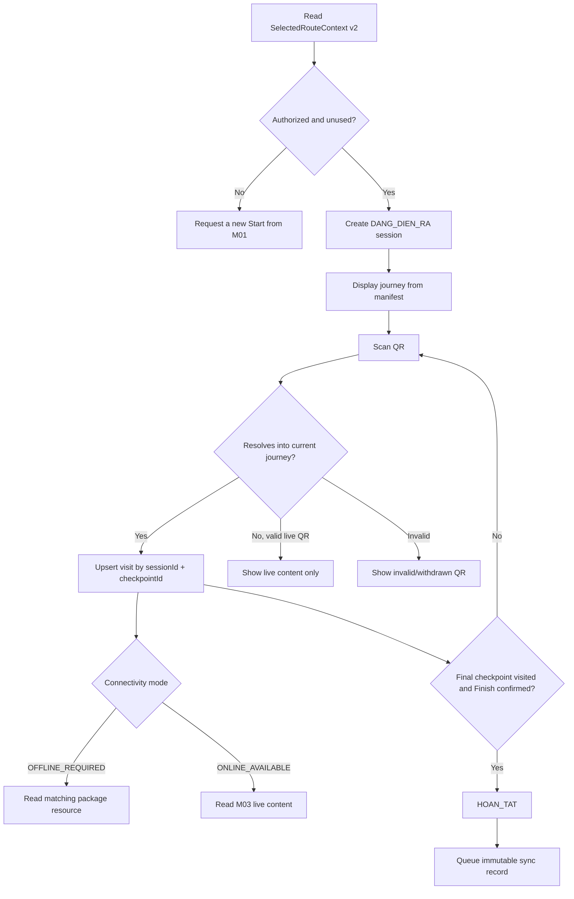
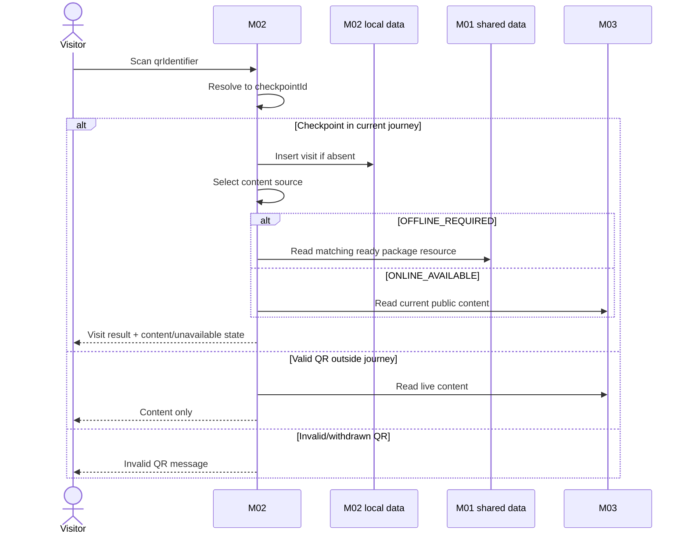
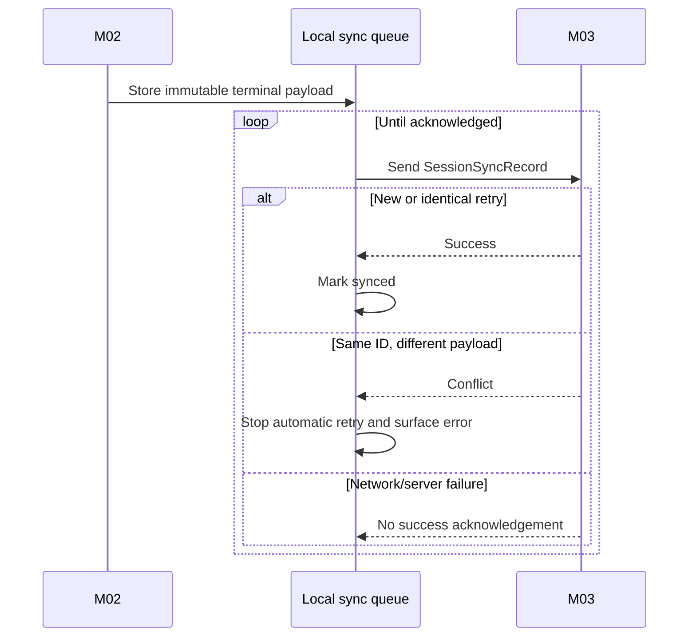
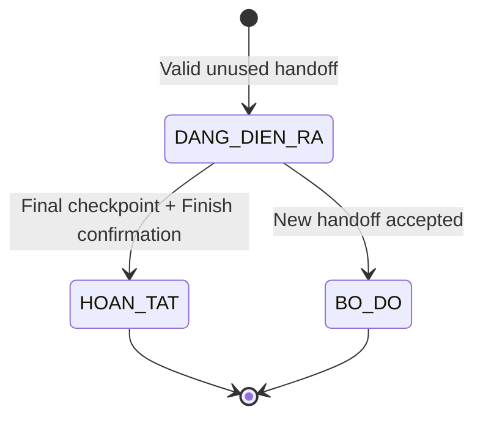

# Spec Document: M02 — Field Quest Experience

| Field | Value |
|---|---|
| Module | M02 — Field Quest Experience |
| Version | 2.0 |
| Status | MVP implementation baseline |
| Last updated | 2026-09-27 |
| Inputs | M01 handoff/language/package; M03 live content/QR lookup |
| Output | Terminal anonymous `SessionSyncRecord` to M03 |

This specification is self-contained and is the implementation source of truth for M02.

## 1. Purpose and scope

M02 creates a field session from a route handoff, records QR-based checkpoint visits, displays content from the correct online/offline source, preserves progress locally and synchronizes an anonymous terminal record for operations reporting.

In scope:

- Create one session from a valid unused handoff.
- Display the fixed linear journey from the handoff manifest.
- Scan any QR and resolve it to a checkpoint.
- Record idempotent visits for checkpoints in the current journey.
- Allow visits in any order.
- Display offline or online content according to connectivity mode.
- Restore an in-progress session after app reload.
- Complete at the final checkpoint or abandon when a new handoff starts.
- Retry terminal-session synchronization.
- Let a free visitor scan a QR for information without creating progress.

Out of scope:

- Route selection/recommendation and offline package management.
- Route/content/QR administration.
- GPS/geofence validation or enforced checkpoint order.
- Hints, scoring, achievements or hidden-message gameplay.
- Visitor accounts or cross-device progress.
- Real-time closure warnings for a session already in progress.

Dependencies:

- M01 provides `LanguagePreference`, `SelectedRouteContext v2` and the active ready `OfflinePackage` if one exists.
- M03 provides live content for `ONLINE_AVAILABLE`, QR lookup outside the journey and receives terminal session records.
- The handoff manifest is the only source used to construct a session journey.

## 2. Actors

| Actor | Type | Responsibility |
|---|---|---|
| Web-app visitor | Primary | Starts/resumes a session, scans QR, views progress/content and ends the session. |
| Free visitor | Primary | Scans QR to view live information; has no session/progress/reporting data. |
| M02 system | System | Owns sessions/visits, content-source selection and synchronization. |
| M01 | External | Publishes handoff, language and ready package. |
| M03 | External | Resolves live QR/content and ingests terminal records. |

## 3. User scenarios and acceptance criteria

### US-1 (P1): Start and restore a field session

1. Given an `AUTHORIZED` v2 context with a valid manifest and unused handoff, when the visitor starts, then M02 creates one `DANG_DIEN_RA` session with a globally unique UUID `sessionId`.
2. Given that handoff already created a session or is `REVOKED`, then no new session is created.
3. Given an in-progress session exists after reload, then the same session and visits are restored.

### US-2 (P1): Scan and check in

1. Given a QR resolves to a checkpoint in the journey, when first scanned, then one visit is recorded before content loading.
2. Scanning another QR of the same checkpoint does not create another visit.
3. A valid checkpoint may be visited in any order.
4. Content failure never rolls back a valid visit.

### US-3 (P1): Read checkpoint content

1. An `OFFLINE_REQUIRED` checkpoint reads bilingual text/images from a ready package resource keyed by `checkpointId`.
2. An `ONLINE_AVAILABLE` checkpoint reads current public text/images/media from M03.
3. Audio/video plays only after explicit visitor action.
4. Missing content shows an unavailable message while retaining the visit.

### US-4 (P2): Scan outside the journey

1. A QR that resolves outside the current journey may display live M03 content but never creates a visit or changes the route.
2. A non-existent/withdrawn QR shows “Mã không còn hiệu lực hoặc không tồn tại”.
3. Network failure is reported as connectivity failure, not as invalid QR.

### US-5 (P1): Complete or abandon a session

1. The Finish action becomes available after the checkpoint with the largest `sequence` is visited.
2. Visitor confirmation changes the session to `HOAN_TAT` even if earlier checkpoints were skipped.
3. A valid new handoff while a session is running creates the replacement session and changes the old session to `BO_DO` as one logical operation; failure to create the replacement leaves the old session running.

### US-6 (P2): Synchronize terminal data

1. Only `HOAN_TAT` or `BO_DO` sessions are synchronized.
2. Retrying the same `sessionId` with identical business data is successful and creates no duplicate.
3. Sending different business data with the same `sessionId` is rejected as a conflict.
4. Failed/offline synchronization remains queued for a later attempt.

### US-7 (P2): Free visitor scan

A free visitor can view live content for a valid QR but creates no `PlaySession`, `CheckpointVisit` or `SessionSyncRecord`.

## 4. Flows

### 4.1 Usage flow

### 4.2 Sequence for QR check-in

### 4.3 Sequence for session sync

## 5. Functional requirements

`Behavioral baseline` below states whether the behavior belongs to this complete specification. Release priority is owned exclusively by `MVP-Scope.md`.

| ID | Requirement | Behavioral baseline |
|---|---|---|
| FR-M02-001 | Validate v2 context and create a session from an unused `AUTHORIZED` handoff. | Required |
| FR-M02-002 | Enforce at most one `DANG_DIEN_RA` session per device. | Required |
| FR-M02-003 | Generate globally unique UUID `sessionId` and enforce unique `sourceHandoffId`. | Required |
| FR-M02-004 | Copy the complete handoff manifest into immutable session journey data. | Required |
| FR-M02-005 | Restore the active session and visits after reload/offline use. | Required |
| FR-M02-006 | Resolve `qrIdentifier` to `checkpointId`. | Required |
| FR-M02-007 | Record one visit per `(sessionId, checkpointId)` before content loading. | Required |
| FR-M02-008 | Accept journey check-ins in any order and mark visited checkpoints. | Required |
| FR-M02-009 | Re-scan displays original visit time without inserting a duplicate. | Required |
| FR-M02-010 | Read offline content from the matching ready package when available. | Required |
| FR-M02-011 | Read online/live content from M03 and play media on demand. | Required |
| FR-M02-012 | Handle QR outside journey without recording progress. | Required |
| FR-M02-013 | Distinguish invalid QR from connectivity/source failure. | Required |
| FR-M02-014 | Apply current `LanguagePreference` to available content. | Required |
| FR-M02-015 | Enable Finish after the highest-sequence checkpoint is visited. | Required |
| FR-M02-016 | Complete on confirmation; do not require every earlier checkpoint. | Required |
| FR-M02-017 | Atomically create the replacement session and change the previous active session to `BO_DO` when a new handoff is accepted. | Required |
| FR-M02-018 | Persist terminal immutable sync data and retry until acknowledged/conflicted. | Required |
| FR-M02-019 | Prevent free visitors from producing progress/report data. | Required |
| FR-M02-020 | Never write M01/M03-owned source data. | Required |

### 5.1 Input / Output contract

Contract presence uses these terms: **Required** means the field and a value are present; **Optional** means the field may be absent; **Conditional** means the stated condition determines presence. These are logical contract rules, not physical database nullability. All `DateTime` values are UTC. `String` identifiers are opaque logical identifiers.

#### SelectedRouteContext v2 input

This is the same payload produced by M01; M02 does not redefine or extend it.

| Field path | Logical type | Presence | Constraints |
|---|---|---|---|
| `contractVersion` | Integer | Required | Exactly `2`. |
| `handoffId` | UUID | Required | Globally unique and used for at most one M02 session. |
| `routeId` | String | Required | Equals `routeJourneyManifest.routeId`. |
| `authorizedAt` | DateTime | Required | UTC. |
| `authorizationStatus` | Enum(`AUTHORIZED`, `REVOKED`) | Required | Only `AUTHORIZED` and unused may create a session. |
| `routeJourneyManifest` | Object | Required | Complete journey-only manifest. |
| `routeJourneyManifest.routeId` | String | Required | Equals outer `routeId`. |
| `routeJourneyManifest.contentVersion` | Integer | Required | Source snapshot/package version. |
| `routeJourneyManifest.checkpoints` | Array&lt;Object&gt; | Required | Complete checkpoint list for the selected version. |
| `routeJourneyManifest.checkpoints[].checkpointId` | String | Required | Stable identity; unique in the manifest. |
| `routeJourneyManifest.checkpoints[].sequence` | Integer | Required | Unique in the manifest. |
| `routeJourneyManifest.checkpoints[].checkpointName` | String | Required | Frozen display name. |
| `routeJourneyManifest.checkpoints[].connectivityMode` | Enum(`ONLINE_AVAILABLE`, `OFFLINE_REQUIRED`) | Required | — |
| `routeJourneyManifest.checkpoints[].qrIdentifiers` | Array&lt;String&gt; | Required | Non-empty active identifier set from the source version. |

#### Content inputs

`LanguagePreference` is the same logical payload produced by M01.

| Field path | Logical type | Presence | Constraints |
|---|---|---|---|
| `languageCode` | Enum(`vi`, `en`) | Required | Current singleton preference; M02 reads but never writes it. |

`OfflinePackage` is the same logical payload produced by M01. M02 may consume it only when `status = SAN_SANG`; it never reads staging or partial values.

| Field path | Logical type | Presence | Constraints |
|---|---|---|---|
| `routeId` | String | Required | Package covers exactly one route. |
| `contentVersion` | Integer | Required | Package covers exactly one journey version. |
| `status` | Enum(`CHUA_TAI`, `DANG_TAI`, `SAN_SANG`, `CHUA_HOAN_TAT`) | Required | M02 accepts only `SAN_SANG`. |
| `versionStatus` | Enum(`CURRENT`, `OUTDATED`) | Conditional | Required only when `status = SAN_SANG`. |
| `manifest` | Object | Required | Exact journey-manifest shape below. |
| `manifest.routeId` | String | Required | Equals package `routeId`. |
| `manifest.contentVersion` | Integer | Required | Equals package `contentVersion`. |
| `manifest.checkpoints` | Array&lt;Object&gt; | Required | Complete checkpoint list for the package version. |
| `manifest.checkpoints[].checkpointId` | String | Required | Stable identity; unique in the manifest. |
| `manifest.checkpoints[].sequence` | Integer | Required | Unique in the manifest. |
| `manifest.checkpoints[].checkpointName` | String | Required | Frozen display name. |
| `manifest.checkpoints[].connectivityMode` | Enum(`ONLINE_AVAILABLE`, `OFFLINE_REQUIRED`) | Required | — |
| `manifest.checkpoints[].qrIdentifiers` | Array&lt;String&gt; | Required | Non-empty active identifiers from the package source version. |
| `resources` | Array&lt;Object&gt; | Required | One resource for each packaged `OFFLINE_REQUIRED` checkpoint; lookup uses embedded `checkpointId`. |
| `resources[].checkpointId` | String | Required | Unique package lookup key; references a checkpoint in `manifest`. |
| `resources[].localizedContent` | Object | Required | Contains both language branches. |
| `resources[].localizedContent.vi` | Object | Required | — |
| `resources[].localizedContent.vi.introductionText` | String | Required | Non-empty. |
| `resources[].localizedContent.en` | Object | Required | — |
| `resources[].localizedContent.en.introductionText` | String | Required | Non-empty. |
| `resources[].staticImages` | Array&lt;String&gt; | Required | May be empty; every item identifies image bytes present in the package. |
| `downloadedAt` | DateTime | Optional | UTC. |

A package may be older than the session manifest. M02 may use an existing resource for the same stable checkpoint ID, must show the outdated warning when known, and shows content unavailable when that checkpoint has no resource in the package. `OfflineStationContent` is a read-only M02 view of one M01 `OfflinePackage.resources[]`/`OfflineResource` value, not a separate persisted entity.

`LiveStationContent` is the canonical name in M02 for the M03 **Live QR/content** transport payload.

| Field path | Logical type | Presence | Constraints |
|---|---|---|---|
| `qrIdentifier` | String | Required | Active public QR identity used for this lookup. |
| `checkpointId` | String | Required | Stable checkpoint identity. |
| `checkpointName` | String | Required | Current published display name. |
| `connectivityMode` | Enum(`ONLINE_AVAILABLE`, `OFFLINE_REQUIRED`) | Required | Current public classification. |
| `localizedContent` | Object | Required | Contains both published language branches. |
| `localizedContent.vi` | Object | Required | — |
| `localizedContent.vi.introductionText` | String | Required | Non-empty. |
| `localizedContent.en` | Object | Required | — |
| `localizedContent.en.introductionText` | String | Required | Non-empty. |
| `staticImages` | Array&lt;String&gt; | Required | May be empty; items are public image resource references. |
| `mediaResources` | Array&lt;Object&gt; | Required | May be empty; audio/video are played only on explicit visitor action. |
| `mediaResources[].type` | Enum(`AUDIO`, `VIDEO`) | Required | Required for every array item. |
| `mediaResources[].sourceRef` | String | Required | Required for every array item; public media resource reference. |

#### SessionSyncRecord output

| Field path | Logical type | Presence | Constraints |
|---|---|---|---|
| `sessionId` | UUID | Required | Globally unique; immutable record identity. |
| `routeId` | String | Required | Route frozen in the session. |
| `contentVersion` | Integer | Required | Frozen journey version. |
| `startedAt` | DateTime | Required | UTC. |
| `endedAt` | DateTime | Required | UTC; not earlier than `startedAt`. |
| `status` | Enum(`HOAN_TAT`, `BO_DO`) | Required | Terminal status only. |
| `visitedCheckpoints` | Array&lt;Object&gt; | Required | May be empty for an abandoned session; checkpoint IDs are unique within the session. |
| `visitedCheckpoints[].checkpointId` | String | Required | Required for every array item; stable checkpoint identity. |
| `visitedCheckpoints[].checkpointName` | String | Required | Required for every array item; historical label from the frozen journey. |
| `visitedCheckpoints[].sequence` | Integer | Required | Required for every array item; historical sequence from the frozen journey. |
| `visitedCheckpoints[].checkedInAt` | DateTime | Required | Required for every array item; UTC and within the session interval. |

The terminal payload is frozen when the session ends. It contains no name, account, device identifier, GPS location or other visitor PII.

### 5.2 Business rules

| ID | Rule |
|---|---|
| BR-M02-001 | One authorized unused handoff creates at most one session. |
| BR-M02-002 | A device has at most one in-progress session. |
| BR-M02-003 | The copied manifest is the fixed journey for the life of a session. |
| BR-M02-004 | Visits are unique by session and checkpoint, not QR. |
| BR-M02-005 | Valid check-in is independent of content availability. |
| BR-M02-006 | Journey order is not enforced; `sequence` determines display and the final checkpoint only. |
| BR-M02-007 | Completion means final checkpoint reached and Finish confirmed, not 100% checkpoint coverage. |
| BR-M02-008 | QR outside journey never creates progress or changes route. |
| BR-M02-009 | Offline content comes from M01; online/outside-journey content comes from M03. |
| BR-M02-010 | Terminal session business data is immutable. |
| BR-M02-011 | Identical sync retry is idempotent; changed payload for the same ID is a conflict. |
| BR-M02-012 | Free visitors never produce session/reporting data. |
| BR-M02-013 | Replacing a running session is all-or-nothing: a failed new-session creation does not abandon the old session. |

## 6. Key entities

These are logical records and views. They do not prescribe IndexedDB object stores, keys or indexes.

### 6.1 PlaySession

| Field path | Logical type | Presence | Constraints |
|---|---|---|---|
| `sessionId` | UUID | Required | Globally unique identity. |
| `sourceHandoffId` | UUID | Required | Unique; one handoff creates at most one session. |
| `routeId` | String | Required | Copied from the accepted handoff. |
| `contentVersion` | Integer | Required | Copied from the accepted manifest. |
| `journeyCheckpoints` | Array&lt;Object&gt; | Required | Exact frozen representation in §6.3; immutable after creation. |
| `status` | Enum(`DANG_DIEN_RA`, `HOAN_TAT`, `BO_DO`) | Required | Transitions only as defined below. |
| `startedAt` | DateTime | Required | UTC. |
| `endedAt` | DateTime | Conditional | Required for `HOAN_TAT` or `BO_DO`; absent while `DANG_DIEN_RA`. |

### 6.2 CheckpointVisit

| Field path | Logical type | Presence | Constraints |
|---|---|---|---|
| `sessionId` | UUID | Required | References the owning local PlaySession logically. |
| `checkpointId` | String | Required | Together with `sessionId`, identifies one visit. |
| `qrIdentifier` | String | Required | QR observed for the first valid check-in; visit uniqueness is not based on this value. |
| `checkedInAt` | DateTime | Required | UTC; first value is immutable. |

### 6.3 Frozen journey representation

`PlaySession.journeyCheckpoints` is a value copy of `SelectedRouteContext v2.routeJourneyManifest.checkpoints`, not a new M03 entity.

| Field path | Logical type | Presence | Constraints |
|---|---|---|---|
| `journeyCheckpoints[].checkpointId` | String | Required | Unique within the session journey. |
| `journeyCheckpoints[].sequence` | Integer | Required | Unique within the session journey. |
| `journeyCheckpoints[].checkpointName` | String | Required | Frozen historical label. |
| `journeyCheckpoints[].connectivityMode` | Enum(`ONLINE_AVAILABLE`, `OFFLINE_REQUIRED`) | Required | Frozen classification. |
| `journeyCheckpoints[].qrIdentifiers` | Array&lt;String&gt; | Required | Non-empty frozen identifier set. |

`RouteJourneyMap` is the ordered read-only view of this array. It is not a separately persisted entity.

### 6.4 Pending sync queue

The local sync queue is an Array&lt;Object&gt; of `PendingSyncItem` values.

| Field path | Logical type | Presence | Constraints |
|---|---|---|---|
| `PendingSyncItem.sessionId` | UUID | Required | At most one queue item per terminal session. |
| `PendingSyncItem.record` | Object | Required | Exact immutable `SessionSyncRecord` from §5.1. |
| `PendingSyncItem.syncStatus` | Enum(`PENDING`, `SYNCED`, `CONFLICT`) | Required | Network/server failure remains `PENDING`; identical acknowledgement becomes `SYNCED`; changed-payload conflict becomes `CONFLICT` and stops automatic retry. |

`OfflineStationContent` is the read-only alias/view defined in §5.1. `LiveStationContent` is a transport view returned by M03. Neither name introduces another M02-owned persisted content entity.

Logical persistence constraints:

- `PlaySession.sessionId` is the primary UUID identity; `sourceHandoffId` is unique.
- Local storage enforces at most one `DANG_DIEN_RA` session. No device identifier is added to synchronized data.
- `(sessionId, checkpointId)` is the `CheckpointVisit` identity; first `checkedInAt` is immutable.
- Journey checkpoints are owned by the session snapshot and cannot be changed after session creation.
- A terminal sync payload has a one-to-one relationship with its session and is immutable after creation.
- Deleting browser data may remove local sessions/visits/queue records; MVP has no remote recovery.

PlaySession states:

## 7. Screens involved

| Screen | Required behavior |
|---|---|
| Session start | Validate handoff and create/restore session. |
| Journey map | Ordered checkpoints and visited state. |
| QR scan/result | Scan, validation outcome and check-in feedback. |
| Checkpoint content | Offline/live content and optional media controls. |
| Session completion | Visit summary and Finish confirmation. |

Free-visitor QR entry may reuse QR result/content screens without session controls.

## 8. Success criteria

| ID | Criterion |
|---|---|
| SC-M02-001 | Reusing a handoff never creates a second session. |
| SC-M02-002 | Scanning multiple QR for one checkpoint creates one visit. |
| SC-M02-003 | Reload/offline use does not lose a recorded visit. |
| SC-M02-004 | Content failure does not undo valid check-in. |
| SC-M02-005 | Completion and visit coverage are distinguishable in data/reporting. |
| SC-M02-006 | Repeated identical sync creates no duplicate session or visit. |
| SC-M02-007 | Synchronized payload contains no visitor PII. |

## 9. Assumptions

- Routes are single-day and linear with one highest-sequence final checkpoint.
- M03 marks `ONLINE_AVAILABLE` only after field verification; M02 has no offline fallback for a misclassified point.
- Browser/camera capabilities and permissions are available.
- Offline devices may not know a route/checkpoint has just closed; field safety measures remain necessary.
- Local data may be lost if browser data is cleared.

## 10. Resolved decisions

- `sessionId` and `handoffId` use UUIDs.
- One handoff creates at most one session.
- Final-checkpoint completion does not require all previous checkpoints.
- Terminal records are immutable and conflict on changed retry.
- Sync carries `contentVersion`, `checkpointName` and `sequence` for stable historical reporting.
- QR invalidity is distinct from network failure.
- No guest account or device identifier is introduced.

## 11. Internal consistency and cross-module contracts

| Contract | M02 validation/behavior |
|---|---|
| M01 context | Version 2, authorized, route matches manifest, unused UUID handoff. |
| M01 package | Read only active ready resources; never read staging/partial data. |
| M03 snapshot heritage | Journey checkpoint IDs, order, names, modes and QR arrays remain fixed within session. |
| M03 live content | Read for online checkpoints and QR outside journey; source failure is not invalid QR. |
| M03 session ingest | Send exactly one immutable terminal business payload; retry identically until acknowledged. |

## Completion checklist

- [x] Scope, actors and failure states are explicit.
- [x] Handoff, journey, content and sync contracts are complete.
- [x] Identity/uniqueness and terminal lifecycle rules are defined.
- [x] Completion semantics and out-of-order visits are unambiguous.
- [x] Privacy boundary is explicit.
- [x] No external requirements document is needed to implement M02.
