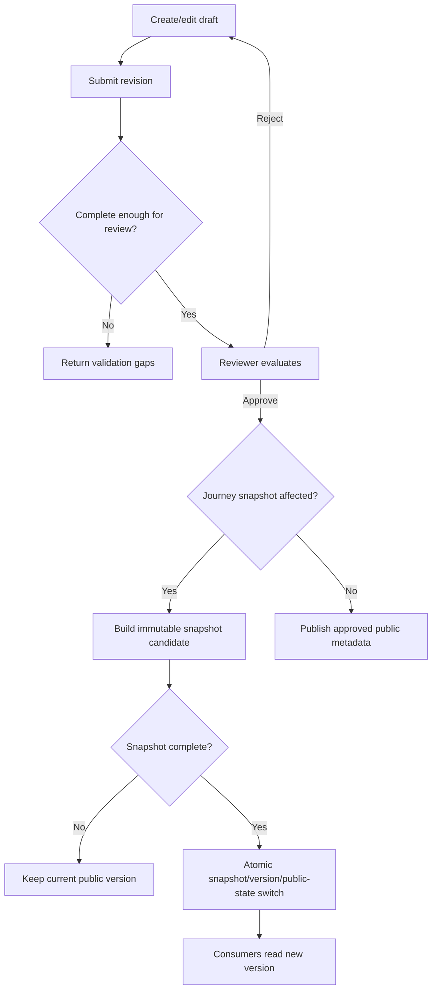
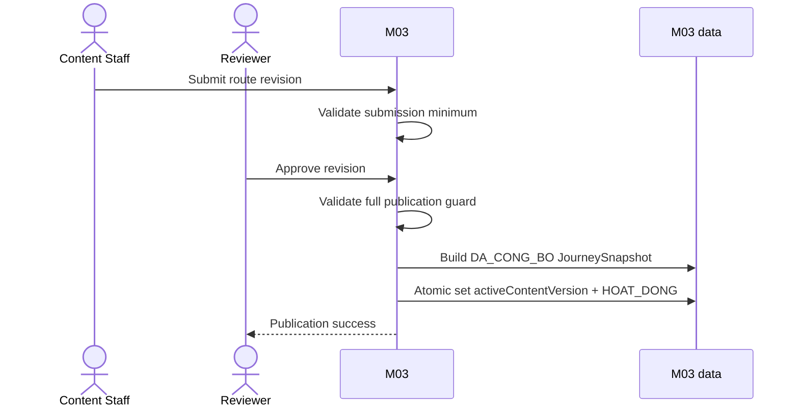
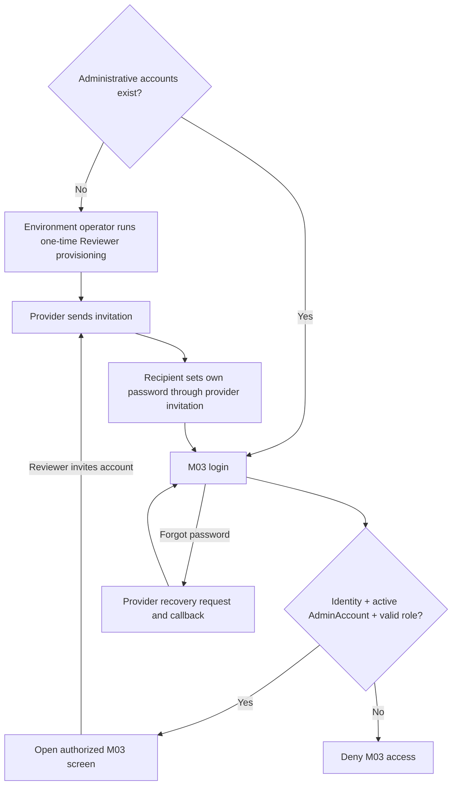
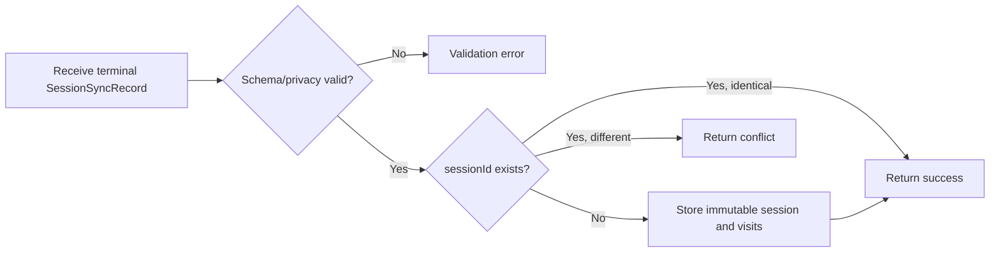

# Spec Document: M03 — Operations & Content Administration

| Field | Value |
|---|---|
| Module | M03 — Operations & Content Administration |
| Version | 2.0 |
| Status | MVP implementation baseline |
| Last updated | 2026-09-29 |
| Consumers | M01 route/snapshot; M02 live content/QR lookup |
| Producer input | M02 terminal anonymous sessions |

This specification is self-contained and is the implementation source of truth for M03.

## 1. Purpose and scope

M03 lets park staff create, review and publish route content, operate route/checkpoint availability, publish immutable journey snapshots, manage fixed-role administrative access and view basic anonymous usage reports.

In scope:

- Route, checkpoint, QR, bilingual content and media administration.
- Three recommendation-tag groups and connectivity classification.
- Draft/review/publish workflow with separation of duties.
- Emergency close and controlled reopen.
- Immutable full-journey snapshots for M01/M02.
- Live content and QR lookup for M02.
- Terminal session ingestion and two operational reports.
- Two-role administrative account management, authenticated entry, invitation and password recovery.

Out of scope:

- Offline administration/draft synchronization.
- Custom roles or temporary delegation.
- GPS navigation/geofence/check-in validation.
- Real-time alerts to sessions already running.
- Advanced analytics, real-time dashboards and file export.
- Visitor reporting of QR installation errors.
- Physical deletion of published audit/history data.

Canonical contract names in this spec are logical names. Physical table/column names and mapping conventions belong to database design and must not change contract meaning.

## 2. Actors

| Actor | Role | Responsibilities |
|---|---|---|
| Content Staff | `CONTENT_STAFF` | Create/edit/submit data, close route/checkpoint, view reports. |
| Reviewer | `REVIEWER` | Review other users' revisions, close/reopen, manage admin accounts, view reports. |
| M03 system | System | Validate, publish atomically, build snapshots, enforce authorization/concurrency and ingest/report sessions. |
| M01 | Consumer | Reads active route projection and published snapshots. |
| M02 | Consumer/producer | Reads live content/QR lookup and sends terminal anonymous sessions. |
| Park Management | Stakeholder | Owns policy, field verification and physical safety response. |
| Environment operator | Operational actor | Provisions the initial Reviewer through a server-side environment procedure; has no M03 business UI role. |

### 2.1 Permission matrix

| Capability | CONTENT_STAFF | REVIEWER |
|---|---:|---:|
| Create/edit route, checkpoint, QR, content, media | Yes | Yes |
| Submit revision | Yes | Yes |
| Approve/reject another user's revision | No | Yes |
| Close route/checkpoint with reason | Yes | Yes |
| Reopen after safety confirmation | No | Yes |
| View RPT-01/RPT-02 | Yes | Yes |
| Invite/change/deactivate admin account | No | Yes |

Authorization is enforced server-side. The approver must differ from the revision submitter, not necessarily from the original entity creator.

## 3. User scenarios and acceptance criteria

### US-M03-01 — Publish a route

1. Staff may save an incomplete draft.
2. Submission is blocked until minimum draft fields and one checkpoint exist.
3. Approval is blocked until bilingual route fields, valid tags and at least one publishable checkpoint are complete.
4. First publication atomically publishes the snapshot, sets `activeContentVersion` and changes route to `HOAT_DONG`.
5. Any publication failure leaves the route in `CHO_DUYET` without partial public data.

### US-M03-02 — Revise published data

1. Editing public data creates a revision; current public data remains unchanged while review is pending.
2. A stale administrative save is rejected and requires reload; MVP does not auto-merge.
3. A journey-affecting approved revision builds a new snapshot and switches active version atomically.

### US-M03-03 — Manage checkpoint and QR

1. An active checkpoint has bilingual published content and at least one active QR.
2. Reprinting preserves `qrIdentifier`.
3. Identity replacement creates a new active QR, retires the old one and requires Reviewer approval.
4. A change that would leave an active checkpoint with zero active QR is blocked.

### US-M03-04 — Close and reopen

1. Either administrative role may close with a reason.
2. Closing is an emergency operation that does not enter the normal review queue; it completes only when the public state and, for a checkpoint, replacement snapshot are published atomically.
3. If no active checkpoints remain, the route becomes `TAM_DONG`; otherwise it remains active unless separately closed for safety.
4. Only a Reviewer may reopen after safety confirmation and completeness validation.
5. No action attempts to stop or notify an already-running M02 session.

### US-M03-05 — Manage administrative access

1. M03 has no public sign-up. An administrator enters through the M03 login screen using an identity managed by the authentication provider.
2. Every protected request validates both the authenticated identity and an active `AdminAccount` with role `CONTENT_STAFF` or `REVIEWER`; a valid provider identity alone grants no M03 access.
3. Only Reviewers invite, change role, reactivate or deactivate an account.
4. A Reviewer invitation supplies a unique normalized email and one fixed role. The provider creates/sends the credential invitation and M03 creates a matching `INVITATION_PENDING` account; the recipient sets their own password through the provider invitation flow before the account can become active and sign in.
5. An expired or invalid invitation does not create access. A Reviewer may retry the invitation for the same pending account without creating a duplicate `AdminAccount`.
6. Existing administrators recover their own password through the provider flow started from M03 login. The recovery response does not reveal whether an email exists; a valid callback permits setting a new password and then returning to login.
7. Password recovery never creates an `AdminAccount`, changes its role/status or bypasses server authorization. A deactivated account remains denied after credential recovery.
8. Attempts to deactivate or demote the last active Reviewer are blocked transactionally.
9. The first Reviewer for each environment is created by a server-side provisioning procedure controlled by the environment operator. It is allowed only when the environment has no administrative account, creates exactly one `INVITATION_PENDING` `REVIEWER` account linked to a provider invitation, is idempotent for the same normalized email, and is unavailable from the browser or public API. It becomes active only after the provider identity completes and matches the pending account.
10. After first access, the initial Reviewer invites at least one backup Reviewer. Ordinary password recovery does not rerun initial provisioning.

### US-M03-06 — Ingest sessions and report

1. Only anonymous terminal `HOAN_TAT`/`BO_DO` records are accepted.
2. First payload for a UUID creates the record; an identical retry succeeds idempotently.
3. A different payload for an existing `sessionId` is rejected as conflict.
4. RPT-01 and RPT-02 use `endedAt` and `Asia/Ho_Chi_Minh`; reports are not real-time.

## 4. Flows

### 4.1 Usage flow

### 4.2 Sequence for first publication

### 4.3 Administrative access flow

Initial provisioning, invitation and password recovery are distinct flows. Provisioning is server-side and only bootstraps an empty environment; invitation is a Reviewer action; password recovery only changes the current user's provider credential.

### 4.4 Session ingest flow

## 5. Functional requirements

`Behavioral baseline` below states whether the behavior belongs to this complete specification. Release priority is owned exclusively by `MVP-Scope.md`.

| ID | Requirement | Behavioral baseline |
|---|---|---|
| FR-M03-001 | Create/update route drafts with bilingual metadata, tags and lifecycle status. | Required |
| FR-M03-002 | Create/update checkpoints with stable ID, unique route sequence and connectivity mode. | Required |
| FR-M03-003 | Manage multiple QR identifiers per checkpoint. | Required |
| FR-M03-004 | Manage bilingual checkpoint-content revisions and published media. | Required |
| FR-M03-005 | Validate submission and publication completeness. | Required |
| FR-M03-006 | Enforce submitter/approver separation and server-side permissions. | Required |
| FR-M03-007 | Reject stale administrative writes without auto-merge. | Required |
| FR-M03-008 | Publish first route state and snapshot atomically. | Required |
| FR-M03-009 | Publish new immutable snapshot for every journey-affecting change. | Required |
| FR-M03-010 | Retain required snapshot versions without M01 acknowledgement. | Required |
| FR-M03-011 | Close/reopen route/checkpoint according to role and deterministic route outcome. | Required |
| FR-M03-012 | Resolve active public QR to checkpoint and live content. | Required |
| FR-M03-013 | Authenticate administrative access; manage invitation, password recovery and two fixed application roles; bootstrap and preserve an active Reviewer. | Required |
| FR-M03-014 | Ingest immutable terminal anonymous session records idempotently. | Required |
| FR-M03-015 | Provide RPT-01 sessions by route/status/date. | Required |
| FR-M03-016 | Provide RPT-02 unique checkpoint visits by route/date. | Required |

### 5.1 Input / Output contract

Contract presence uses these terms: **Required** means the field and a value are present; **Optional** means the field may be absent; **Conditional** means the stated condition determines presence. These are logical contract rules, not physical database nullability. All `DateTime` values are UTC. `String` identifiers are opaque logical identifiers.

#### Published Route projection

This is the exact payload consumed by M01 as **Published Route input**.

| Field path | Logical type | Presence | Constraints |
|---|---|---|---|
| `routeId` | String | Required | Stable route identity. |
| `status` | Enum(`HOAT_DONG`, `TAM_DONG`, `LUU_TRU`) | Required | Only `HOAT_DONG` is selectable. |
| `name` | Object | Required | Contains both language branches. |
| `name.vi` | String | Required | Non-empty. |
| `name.en` | String | Required | Non-empty. |
| `description` | Object | Required | Contains both language branches. |
| `description.vi` | String | Required | Non-empty. |
| `description.en` | String | Required | Non-empty. |
| `safetyWarning` | Object | Optional | Both-or-none: absent entirely, or both language fields are present. |
| `safetyWarning.vi` | String | Conditional | Required when `safetyWarning` is present. |
| `safetyWarning.en` | String | Conditional | Required when `safetyWarning` is present. |
| `distanceKm` | Decimal | Required | Greater than `0`. |
| `durationMin` | Integer | Required | Greater than `0`. |
| `difficulty` | Enum(`NHE`, `TRUNG_BINH`, `KHO`) | Required | — |
| `timeTags` | Array&lt;Enum(`TIME_NGAN`, `TIME_VUA`, `TIME_DAI`)&gt; | Required | At least one allowed value. |
| `groupTags` | Array&lt;Enum(`GROUP_CA_NHAN_NGUOI_LON`, `GROUP_GIA_DINH_CO_TRE`, `GROUP_CAN_DE_DANG`)&gt; | Required | At least one allowed value. |
| `experienceTags` | Array&lt;Enum(`INTEREST_THIEN_NHIEN_CHUP_ANH`, `INTEREST_TIM_HIEU`, `INTEREST_KHAM_PHA`)&gt; | Required | At least one allowed value. |
| `activeContentVersion` | Integer | Conditional | Required when `status = HOAT_DONG`; when present, references a `DA_CONG_BO` snapshot of the same route. |

Only `HOAT_DONG` with non-null published version is selectable by M01.

Allowed enums:

- `difficulty`: `NHE`, `TRUNG_BINH`, `KHO`.
- `timeTags`: `TIME_NGAN` (≤ 90 minutes), `TIME_VUA` (> 90–180 minutes), `TIME_DAI` (> 180 minutes).
- `groupTags`: `GROUP_CA_NHAN_NGUOI_LON`, `GROUP_GIA_DINH_CO_TRE`, `GROUP_CAN_DE_DANG`.
- `experienceTags`: `INTEREST_THIEN_NHIEN_CHUP_ANH`, `INTEREST_TIM_HIEU`, `INTEREST_KHAM_PHA`.

Before publication, `name` and `description` must contain both `vi/en`; `safetyWarning` is either absent in both languages or present in both.

#### JourneySnapshot output

This is the exact payload consumed by M01. Its journey metadata is projected into M01 package/handoff manifests and then copied into the M02 frozen journey.

| Field path | Logical type | Presence | Constraints |
|---|---|---|---|
| `routeId` | String | Required | Stable route identity. |
| `contentVersion` | Integer | Required | Identifies one immutable version within `routeId`. |
| `status` | Enum(`DA_CONG_BO`) | Required | Published snapshots are immutable. |
| `publishedAt` | DateTime | Required | UTC. |
| `previousContentVersion` | Integer | Optional | When present, references the preceding snapshot of the same route. |
| `checkpoints` | Array&lt;Object&gt; | Required | Contains every and only active checkpoint; IDs and sequences are unique. |
| `checkpoints[].checkpointId` | String | Required | Stable checkpoint identity. |
| `checkpoints[].sequence` | Integer | Required | Unique within the snapshot. |
| `checkpoints[].checkpointName` | String | Required | Frozen display name for this version. |
| `checkpoints[].connectivityMode` | Enum(`ONLINE_AVAILABLE`, `OFFLINE_REQUIRED`) | Required | — |
| `checkpoints[].qrIdentifiers` | Array&lt;String&gt; | Required | Non-empty; active identifiers only. |
| `checkpoints[].offlineResource` | Object | Conditional | Required only for `OFFLINE_REQUIRED`; absent for `ONLINE_AVAILABLE`. |
| `checkpoints[].offlineResource.localizedContent` | Object | Conditional | Required with `offlineResource`. |
| `checkpoints[].offlineResource.localizedContent.vi` | Object | Conditional | Required with `offlineResource`. |
| `checkpoints[].offlineResource.localizedContent.vi.introductionText` | String | Conditional | Required with `offlineResource`; non-empty. |
| `checkpoints[].offlineResource.localizedContent.en` | Object | Conditional | Required with `offlineResource`. |
| `checkpoints[].offlineResource.localizedContent.en.introductionText` | String | Conditional | Required with `offlineResource`; non-empty. |
| `checkpoints[].offlineResource.staticImages` | Array&lt;String&gt; | Conditional | Required with `offlineResource`; may be empty. Items are public image resource references. |

All and only active checkpoints are included. `offlineResource` is required only for `OFFLINE_REQUIRED`.

#### LiveStationContent output

`LiveStationContent` is the canonical logical contract name. M03 produces it through live QR/content lookup and M02 consumes it under the same name.

| Field path | Logical type | Presence | Constraints |
|---|---|---|---|
| `qrIdentifier` | String | Required | Active public QR identity used for this lookup. |
| `checkpointId` | String | Required | Stable checkpoint identity. |
| `checkpointName` | String | Required | Current published display name. |
| `connectivityMode` | Enum(`ONLINE_AVAILABLE`, `OFFLINE_REQUIRED`) | Required | Current public classification. |
| `localizedContent` | Object | Required | Contains both published language branches. |
| `localizedContent.vi` | Object | Required | — |
| `localizedContent.vi.introductionText` | String | Required | Non-empty. |
| `localizedContent.en` | Object | Required | — |
| `localizedContent.en.introductionText` | String | Required | Non-empty. |
| `staticImages` | Array&lt;String&gt; | Required | May be empty; items are public image resource references. |
| `mediaResources` | Array&lt;Object&gt; | Required | May be empty. |
| `mediaResources[].type` | Enum(`AUDIO`, `VIDEO`) | Required | Required for every array item. |
| `mediaResources[].sourceRef` | String | Required | Required for every array item; public media resource reference. |

Only active QR/checkpoint and published content may be returned as valid live data.

#### SessionSyncRecord input

This is the exact payload produced by M02.

| Field path | Logical type | Presence | Constraints |
|---|---|---|---|
| `sessionId` | UUID | Required | Globally unique; immutable record identity. |
| `routeId` | String | Required | Route frozen in the session. |
| `contentVersion` | Integer | Required | Frozen journey version. |
| `startedAt` | DateTime | Required | UTC. |
| `endedAt` | DateTime | Required | UTC; not earlier than `startedAt`. |
| `status` | Enum(`HOAN_TAT`, `BO_DO`) | Required | Terminal status only. |
| `visitedCheckpoints` | Array&lt;Object&gt; | Required | May be empty for an abandoned session; checkpoint IDs are unique within the session. |
| `visitedCheckpoints[].checkpointId` | String | Required | Required for every array item; stable checkpoint identity. |
| `visitedCheckpoints[].checkpointName` | String | Required | Required for every array item; historical label from the frozen journey. |
| `visitedCheckpoints[].sequence` | Integer | Required | Required for every array item; historical sequence from the frozen journey. |
| `visitedCheckpoints[].checkedInAt` | DateTime | Required | Required for every array item; UTC and within the session interval. |

Required validation:

- `endedAt >= startedAt`.
- Checkpoints unique within the session.
- Visit timestamp falls within the session interval.
- No visitor PII/device/GPS fields.
- Existing `sessionId` accepts only the same normalized business payload; transport formatting and field order are ignored.

#### Report outputs

Both reports use this input contract:

| Field path | Logical type | Presence | Constraints |
|---|---|---|---|
| `routeId` | String | Optional | When present, filters to one stable route identity. |
| `fromDate` | Date | Optional | Supplied together with `toDate`; `fromDate <= toDate`. If the pair is absent, use the most recent 30 days. |
| `toDate` | Date | Optional | Supplied together with `fromDate`; inclusive reporting date boundary. |

RPT-01 output:

| Field path | Logical type | Presence | Constraints |
|---|---|---|---|
| `totalSessionCount` | Integer | Required | Count of unique synchronized terminal sessions; `>= 0`. |
| `completedCount` | Integer | Required | Count where `status = HOAN_TAT`; `>= 0`. |
| `completedRate` | Decimal | Required | `completedCount / totalSessionCount`; range `0..1`; `0` when total is zero. |
| `abandonedCount` | Integer | Required | Count where `status = BO_DO`; `>= 0`. |
| `abandonedRate` | Decimal | Required | `abandonedCount / totalSessionCount`; range `0..1`; `0` when total is zero. |
| `lastSuccessfulIngestionAt` | DateTime | Optional | UTC; absent when no successful ingestion has occurred. |

RPT-02 output:

| Field path | Logical type | Presence | Constraints |
|---|---|---|---|
| `items` | Array&lt;Object&gt; | Required | May be empty. One item per `(routeId, checkpointId)`. |
| `items[].routeId` | String | Required | Required for every array item; stable grouping route identity. |
| `items[].checkpointId` | String | Required | Required for every array item; stable checkpoint grouping key. |
| `items[].checkpointName` | String | Required | Required for every array item; label from the record with latest `endedAt` in the selected period. |
| `items[].sequence` | Integer | Required | Required for every array item; sequence from the same latest-ended record. |
| `items[].uniqueSessionCount` | Integer | Required | Required for every array item; number of unique synchronized sessions visiting the checkpoint; `>= 0`. |
| `lastSuccessfulIngestionAt` | DateTime | Optional | UTC; absent when no successful ingestion has occurred. |

Both reports convert UTC timestamps to `Asia/Ho_Chi_Minh` for date filtering/grouping. Unsynchronized sessions are explicitly outside the result.

### 5.2 Business rules

| ID | Rule |
|---|---|
| BR-M03-001 | Drafts may be incomplete; public data changes only after successful approval/publication. |
| BR-M03-002 | Approver differs from revision submitter. |
| BR-M03-003 | Every public checkpoint has active QR and bilingual published content. |
| BR-M03-004 | First publication atomically publishes snapshot, active version and route state. |
| BR-M03-005 | Published snapshots are immutable and contain all active checkpoints. |
| BR-M03-006 | Any journey field change creates a new snapshot: membership/status, sequence, name, connectivity, QR set or offline resource. |
| BR-M03-007 | Route metadata outside the snapshot may publish without changing content version. |
| BR-M03-008 | Keep current, previous and snapshots replaced less than 30 days ago. |
| BR-M03-009 | Reprint preserves QR identity; replacement creates new identity and retires old. |
| BR-M03-010 | Active checkpoint cannot be left without an active QR. |
| BR-M03-011 | Closing checkpoint removes it from new journeys; route auto-closes only when no active checkpoint remains. |
| BR-M03-012 | Only Reviewer reopens; running sessions are not interrupted/notified. |
| BR-M03-013 | `ONLINE_AVAILABLE` requires field verification; GPS metadata is not used for check-in/navigation. |
| BR-M03-014 | Stale writes are rejected; no automatic merge. |
| BR-M03-015 | Only Reviewer manages accounts; last active Reviewer is protected. |
| BR-M03-016 | Terminal session is immutable; identical retry succeeds, changed retry conflicts. |
| BR-M03-017 | Reports filter/group by `endedAt` using `Asia/Ho_Chi_Minh` and contain synchronized data only. |
| BR-M03-018 | Provider identity and M03 authorization are separate: access requires an authenticated identity plus an active application account with a fixed role. |
| BR-M03-019 | Initial Reviewer provisioning is server-side, one-time for an empty environment and idempotent for the same normalized email; it creates an `INVITATION_PENDING` account, not an active session or password-recovery path. Exception approved 2026-10-10: only the environment operator CLI targeting shared Preview `eypzuhxwokothtcpdbmn` may reserve one real Reviewer alongside its three unchanged ACTIVE synthetic seed accounts. Exact seed state and absence of real identities are checked before reservation; account/audit reservation is serialized before provider invitation. Only explicit retry for that same pending email is allowed; the durable reservation prevents another email or a second Reviewer through this exception. Provider invitation identity must be linked in credential-free audit before normal invitation completion can activate the account. No browser/public API/service-role grant exposes this operator path, and Production is not an eligible target. Standard empty-environment bootstrap, provider verification, role authorization and last-active-Reviewer protection remain unchanged. |
| BR-M03-020 | Invitation and password recovery are provider-managed credential flows; neither may assign or change an application role. |

## 6. Key entities

These are logical attributes only. They do not prescribe tables, columns, keys, indexes or security-policy syntax. Draft fields marked Conditional may be absent while the entity is incomplete, but must be present when the stated submit/publication guard applies.

### 6.1 Route

| Field path | Logical type | Presence | Constraints |
|---|---|---|---|
| `routeId` | String | Required | Stable identity; never changes. |
| `status` | Enum(`NHAP`, `CHO_DUYET`, `HOAT_DONG`, `TAM_DONG`, `LUU_TRU`) | Required | Lifecycle below. |
| `name.vi` | String | Conditional | May be absent in incomplete draft; required and non-empty for publication. |
| `name.en` | String | Conditional | May be absent in incomplete draft; required and non-empty for publication. |
| `description.vi` | String | Conditional | May be absent in incomplete draft; required and non-empty for publication. |
| `description.en` | String | Conditional | May be absent in incomplete draft; required and non-empty for publication. |
| `safetyWarning.vi` | String | Conditional | Both-or-none with `safetyWarning.en`. |
| `safetyWarning.en` | String | Conditional | Both-or-none with `safetyWarning.vi`. |
| `distanceKm` | Decimal | Conditional | Required for publication; greater than `0`. |
| `durationMin` | Integer | Conditional | Required for publication; greater than `0`. |
| `difficulty` | Enum(`NHE`, `TRUNG_BINH`, `KHO`) | Conditional | Required for publication. |
| `timeTags` | Array&lt;Enum(`TIME_NGAN`, `TIME_VUA`, `TIME_DAI`)&gt; | Conditional | Required and non-empty for publication. |
| `groupTags` | Array&lt;Enum(`GROUP_CA_NHAN_NGUOI_LON`, `GROUP_GIA_DINH_CO_TRE`, `GROUP_CAN_DE_DANG`)&gt; | Conditional | Required and non-empty for publication. |
| `experienceTags` | Array&lt;Enum(`INTEREST_THIEN_NHIEN_CHUP_ANH`, `INTEREST_TIM_HIEU`, `INTEREST_KHAM_PHA`)&gt; | Conditional | Required and non-empty for publication. |
| `activeContentVersion` | Integer | Conditional | Required for `HOAT_DONG`; references a published snapshot of the same route. |
| `concurrencyRevision` | Integer | Required | Submitted value must match stored value for mutation; stale writes are rejected. |

### 6.2 Checkpoint and QRCode

| Entity | Field path | Logical type | Presence | Constraints |
|---|---|---|---|---|
| Checkpoint | `checkpointId` | String | Required | Stable identity. The M01 term `QRCheckpoint` is an earlier name for the published checkpoint projection, not another entity. |
| Checkpoint | `routeId` | String | Required | Belongs to exactly one Route. |
| Checkpoint | `checkpointName` | String | Conditional | Required and non-empty before activation/publication. |
| Checkpoint | `sequence` | Integer | Conditional | Required before activation; unique by route for non-archived checkpoints. |
| Checkpoint | `connectivityMode` | Enum(`ONLINE_AVAILABLE`, `OFFLINE_REQUIRED`) | Conditional | Required before activation. |
| Checkpoint | `fieldVerificationConfirmed` | Boolean | Conditional | Required and `true` before setting `ONLINE_AVAILABLE`; not a GPS field. |
| Checkpoint | `status` | Enum(`NHAP`, `HOAT_DONG`, `TAM_DONG`, `LUU_TRU`) | Required | Lifecycle below. |
| Checkpoint | `concurrencyRevision` | Integer | Required | Used for stale-write rejection. |
| QRCode | `qrIdentifier` | String | Required | Globally unique stable identity. |
| QRCode | `checkpointId` | String | Required | Belongs to exactly one Checkpoint. |
| QRCode | `installationLabel` | String | Required | Operational placement description; not visitor content. |
| QRCode | `status` | Enum(`HOAT_DONG`, `DA_THAY`, `THU_HOI`) | Required | `DA_THAY` and `THU_HOI` are terminal. |
| QRCode | `replacementReason` | String | Conditional | Required when identity replacement is submitted. |

### 6.3 CheckpointContent and Media

| Entity | Field path | Logical type | Presence | Constraints |
|---|---|---|---|---|
| CheckpointContent | `checkpointId` | String | Required | Identifies the owning Checkpoint. |
| CheckpointContent | `languageCode` | Enum(`vi`, `en`) | Required | One revision stream per checkpoint/language. |
| CheckpointContent | `revision` | Integer | Required | Identifies the revision within its stream. |
| CheckpointContent | `introductionText` | String | Conditional | May be absent in incomplete draft; required and non-empty for submission/publication. |
| CheckpointContent | `status` | Enum(`NHAP`, `CHO_DUYET`, `DA_DUYET`, `PHAT_HANH`, `LUU_TRU`) | Required | Lifecycle below; at most one `PHAT_HANH` per language. |
| CheckpointContent | `submittedByUserId` | String | Conditional | Required after submission. |
| CheckpointContent | `approvedByUserId` | String | Conditional | Required after approval; must differ from submitter. |
| CheckpointContent | `reviewReason` | String | Conditional | Required when a submitted revision is rejected. |
| CheckpointContent | `concurrencyRevision` | Integer | Required | Used for stale-write rejection. |
| Media | `mediaId` | UUID | Required | Stable logical identity of the Media entity. |
| Media | `sourceRef` | String | Required | Resource/storage reference; not the Media identity. |
| Media | `checkpointId` | String | Required | Identifies the owning Checkpoint. |
| Media | `type` | Enum(`IMAGE`, `AUDIO`, `VIDEO`) | Required | Offline resources include images only. |
| Media | `usageRightsConfirmed` | Boolean | Required | Must be `true` before publication. |
| Media | `isPublished` | Boolean | Required | Only published media appears in public output. |
| Media | `concurrencyRevision` | Integer | Required | Used for stale-write rejection. |

### 6.4 JourneySnapshot, AdminAccount, SessionRecord and AuditRecord

`JourneySnapshot` is the immutable entity whose complete logical fields are defined in §5.1; its identity is `(routeId, contentVersion)`. The table below defines the remaining entity fields and the M03 persistence extension of the transport record.

| Entity | Field path | Logical type | Presence | Constraints |
|---|---|---|---|---|
| AdminAccount | `userId` | String | Conditional | Present after a matching provider identity is linked; stable when present. |
| AdminAccount | `email` | String | Required | Normalized before comparison; unique system-wide. |
| AdminAccount | `role` | Enum(`CONTENT_STAFF`, `REVIEWER`) | Required | Fixed application role. |
| AdminAccount | `status` | Enum(`INVITATION_PENDING`, `ACTIVE`, `DEACTIVATED`) | Required | Lifecycle below. |
| AdminAccount | `createdAt` | DateTime | Required | UTC. |
| AdminAccount | `updatedAt` | DateTime | Required | UTC. |
| AdminAccount | `concurrencyRevision` | Integer | Required | Used for stale-write and last-active-Reviewer protection. |
| SessionRecord | `sessionId` | UUID | Required | Identity copied from the accepted `SessionSyncRecord`; globally unique. |
| SessionRecord | `routeId` | String | Required | Copied without business transformation. |
| SessionRecord | `contentVersion` | Integer | Required | Copied without business transformation. |
| SessionRecord | `startedAt` | DateTime | Required | UTC; copied without business transformation. |
| SessionRecord | `endedAt` | DateTime | Required | UTC; copied without business transformation. |
| SessionRecord | `status` | Enum(`HOAN_TAT`, `BO_DO`) | Required | Copied terminal status. |
| SessionRecord | `visitedCheckpoints` | Array&lt;Object&gt; | Required | Immutable child values copied from the accepted payload. |
| SessionRecord | `visitedCheckpoints[].checkpointId` | String | Required | Required for every array item; unique within the session. |
| SessionRecord | `visitedCheckpoints[].checkpointName` | String | Required | Required for every array item; historical label. |
| SessionRecord | `visitedCheckpoints[].sequence` | Integer | Required | Required for every array item; historical sequence. |
| SessionRecord | `visitedCheckpoints[].checkedInAt` | DateTime | Required | Required for every array item; UTC and within the session interval. |
| SessionRecord | `ingestedAt` | DateTime | Required | UTC receipt time owned by M03; not part of the M02 transport payload. |
| AuditRecord | `auditId` | String | Required | Stable audit-record identity. |
| AuditRecord | `actorUserId` | String | Conditional | Required for authenticated administrative actions; a server-side provisioning outcome may have no authenticated actor. |
| AuditRecord | `action` | String | Required | Administrative/provisioning action name. |
| AuditRecord | `entityType` | String | Required | Logical affected entity type. |
| AuditRecord | `entityId` | String | Required | Logical affected entity identity. |
| AuditRecord | `revision` | Integer | Optional | Present when the action concerns a revisioned value. |
| AuditRecord | `beforeState` | Object | Optional | Must not contain credential or token values. |
| AuditRecord | `afterState` | Object | Optional | Must not contain credential or token values. |
| AuditRecord | `occurredAt` | DateTime | Required | UTC; append-only record time. |

Mutable administrative entities carry a concurrency revision. Public route/checkpoint/content views expose only approved current data.

Logical persistence constraints:

- `routeId`, `checkpointId`, `qrIdentifier`, `contentVersion`, `userId` and `sessionId` are stable identities; `qrIdentifier`, admin email and `sessionId` are unique system-wide.
- Checkpoint belongs to exactly one route; `(routeId, sequence)` is unique for non-archived checkpoints.
- QRCode belongs to exactly one checkpoint; an active checkpoint must retain at least one active QR.
- Content revision belongs to one `(checkpointId, languageCode)` stream; at most one `PHAT_HANH` revision exists per language at a time.
- JourneySnapshot is unique by `(routeId, contentVersion)`; `previousContentVersion` references the preceding route snapshot when present.
- Route `activeContentVersion` references a `DA_CONG_BO` snapshot of the same route.
- SessionRecord is identified by `sessionId`; child visits are unique by `(sessionId, checkpointId)` and are deleted/retained with the immutable session according to one retention policy.
- AdminAccount role is restricted to `CONTENT_STAFF | REVIEWER`; the last-active-Reviewer rule must be enforced transactionally.
- Admin email is normalized before uniqueness checks. Invitation/bootstrap creates `INVITATION_PENDING`; only a completed, matching provider identity may transition that account to `ACTIVE`. The one-time provisioning operation is rejected after any `AdminAccount` exists; repeating the same pending bootstrap request is idempotent.
- Audit records are append-only. Published snapshots and terminal sessions are immutable.
- **CL-S4-001 — snapshot predecessor:** each JourneySnapshot has zero or one same-Route predecessor; one predecessor may be referenced by zero or many successor snapshots. There is no inverse uniqueness constraint on `(routeId, previousContentVersion)`. This association records ancestry, not permission to activate multiple versions: publication remains atomic and a Route still has at most one active published version. The model does not impose a one-to-one chain across snapshot build/publication attempts.
- **DEC-S6-002 — MVP retention:** M03 provides no hard-delete or automatic purge operation for its nine canonical entities in MVP. Persisted records are retained; archive, replacement and deactivation use the declared lifecycle states. SessionRecord retains its embedded visits together with the record. Snapshot retention therefore satisfies BR-M03-008 without a purge schedule. This decision does not change M01 package deletion or the browser-local data lifecycle in M01/M02.

Lifecycle states:

| Entity | Allowed transitions |
|---|---|
| Route | `NHAP → CHO_DUYET → HOAT_DONG → TAM_DONG → LUU_TRU`; reject returns `CHO_DUYET → NHAP`; Reviewer reopen allows `TAM_DONG → HOAT_DONG`. |
| Checkpoint | `NHAP → HOAT_DONG → TAM_DONG → LUU_TRU`; Reviewer reopen allows `TAM_DONG → HOAT_DONG`. |
| QRCode | Created as `HOAT_DONG`; may become terminal `DA_THAY` or `THU_HOI`. |
| Content revision | `NHAP → CHO_DUYET → DA_DUYET → PHAT_HANH → LUU_TRU`; rejection returns to `NHAP`; editing published content creates a new `NHAP` revision. |
| JourneySnapshot | `DANG_TAO → DA_CONG_BO`; published state is immutable. |
| AdminAccount | `INVITATION_PENDING → ACTIVE ↔ DEACTIVATED`; retrying invitation keeps `INVITATION_PENDING`. A provider credential recovery does not change this lifecycle. |

`LUU_TRU`, `DA_THAY` and `THU_HOI` are terminal in MVP.

## 7. Success criteria

| ID | Criterion |
|---|---|
| SC-M03-001 | No route becomes selectable without bilingual metadata, valid tags, a publishable checkpoint and a published snapshot. |
| SC-M03-002 | Consumer never sees partial new snapshot/public state. |
| SC-M03-003 | Every journey-affecting publication creates a new version and leaves old snapshot unchanged. |
| SC-M03-004 | QR replacement never leaves an active checkpoint without a working identifier. |
| SC-M03-005 | Stale save never overwrites newer administrative data. |
| SC-M03-006 | Closing a checkpoint deterministically updates new journeys and route outcome. |
| SC-M03-007 | Identical session retry never duplicates a session or visit; changed retry is rejected. |
| SC-M03-008 | Last active Reviewer cannot be removed or demoted. |
| SC-M03-009 | A provider identity without a matching active application account cannot access any protected M03 operation. |
| SC-M03-010 | An empty environment can obtain exactly one initial Reviewer without exposing provisioning through the browser/public API. |
| SC-M03-011 | Invitation or password recovery never grants or changes an application role. |

## 8. Screens involved

| Screen | Required behavior |
|---|---|
| Administrative login | Email/password provider login, forgot-password entry, session/error state and post-login role/status authorization. |
| Invitation and password recovery | Complete provider invitation; request and complete self-service password recovery; return to login without assigning application role. |
| Route administration | Search/filter routes; create/edit; close/reopen entry points. |
| Route/checkpoint editor | Bilingual route fields, tags, ordered checkpoints and connectivity. |
| QR/content workspace | QR lifecycle, bilingual content revisions and media. |
| Review/publication | Validation gaps, diff/revision identity, approve/reject and publication result. |
| Operations reports | RPT-01/RPT-02 filters, totals and last-updated notice. |
| User/role management | Invite, fixed role, activation/deactivation and last-Reviewer guard. |

The login and credential screens are mandatory M03 entry/support screens even though Supabase Auth executes the credential lifecycle. Initial Reviewer provisioning has no browser screen.

## 9. Assumptions

- At least two suitable people can support independent review and backup Reviewer access; the initial Reviewer is responsible for inviting the backup Reviewer after first access.
- Park operations can field-verify connectivity and deploy physical safety controls.
- Routes are day trips and checkpoint order changes infrequently.
- Authentication provider handles password storage, invitation tokens, recovery tokens and authenticated sessions; M03 handles application role and active status.
- An offline visitor may continue using an older self-contained package after its source snapshot retention expires.

## 10. Resolved MVP decisions

- Canonical logical names are independent of physical database names.
- One full-journey snapshot serves both journey handoff and offline package creation.
- Snapshot includes both connectivity modes; only offline-required points embed offline resources.
- Any manifest-field change increments `contentVersion`.
- First publication and checkpoint closure/reopen are atomic with their replacement snapshot where applicable.
- Closure does not notify or interrupt running sessions.
- Two fixed roles; no custom permission/delegation.
- No public sign-up. Initial Reviewer access is provisioned once per environment through a server-side operation; later accounts are invitation-only.
- Password recovery is self-service through the authentication provider and never changes M03 role/status.
- Terminal sync is immutable and conflict-detecting.
- Reports use session-carried checkpoint name/sequence, so snapshot retention need not be indefinite.

## 11. Internal consistency and cross-module contracts

| Mapping | Canonical relationship and guarantee |
|---|---|
| M03 Published Route → M01 Published Route input | One transport shape defined identically in both specs; M01 is read-only. `activeContentVersion` and JourneySnapshot `contentVersion` use the same Integer logical type. |
| M03 JourneySnapshot → M01 JourneySnapshot input | One immutable producer payload; full active journey, unique IDs/sequences, active QR arrays and conditional offline resources. |
| M03 JourneySnapshot → M01 `OfflinePackage.manifest` | M01 copies the route/version/checkpoint metadata value fields; the package manifest is not another M03 entity. Snapshot `offlineResource` values become M01-owned local `OfflineResource` values under `OfflinePackage.resources`. |
| M03 JourneySnapshot → M01 `SelectedRouteContext.routeJourneyManifest` → M02 frozen journey | Each step copies the same journey metadata value fields. M02 freezes `checkpoints` as `PlaySession.journeyCheckpoints`; `RouteJourneyMap` is a read-only view, not another entity. |
| M01 LanguagePreference → M02 input | One `{ languageCode: Enum(vi, en) }` contract shape; M02 reads it without mutating the M01-owned singleton. |
| M01 SelectedRouteContext v2 → M02 input | One contract shape; M02 reads it without mutating M01 data. |
| M01 OfflinePackage → M02 input | One contract shape; M02 consumes only active `SAN_SANG` data. `OfflineStationContent` is an M02 view of `OfflineResource`, not a duplicate persisted entity. |
| M03 LiveStationContent → M02 LiveStationContent | One live transport contract shape. Validity uses current active public state; source failure remains distinguishable from invalid QR. |
| M02 SessionSyncRecord → M03 input | One immutable transport shape with historical labels/order and no PII. |
| M03 SessionSyncRecord input → M03 SessionRecord | `SessionSyncRecord` is the transport contract. `SessionRecord` is the persisted M03 entity containing the accepted business fields plus M03-owned `ingestedAt`; the names do not denote the same entity. |
| Closure | New published reads change atomically; existing local sessions/packages are not mutated remotely. |
| Authentication provider ↔ M03 | Provider owns identity, password, invitation/recovery token and session; M03 owns `AdminAccount` role/status and authorizes every protected request. |

## Completion checklist

- [x] Scope, roles and authorization are explicit.
- [x] Publication guards and atomicity are specified.
- [x] Full snapshot schema and version triggers are complete.
- [x] QR/content/account/session lifecycles, initial Reviewer provisioning, invitation and password recovery are defined.
- [x] Reporting date, timezone, deduplication and history fields are defined.
- [x] Failure/conflict paths are specified.
- [x] No external requirements document is needed to implement M03.
