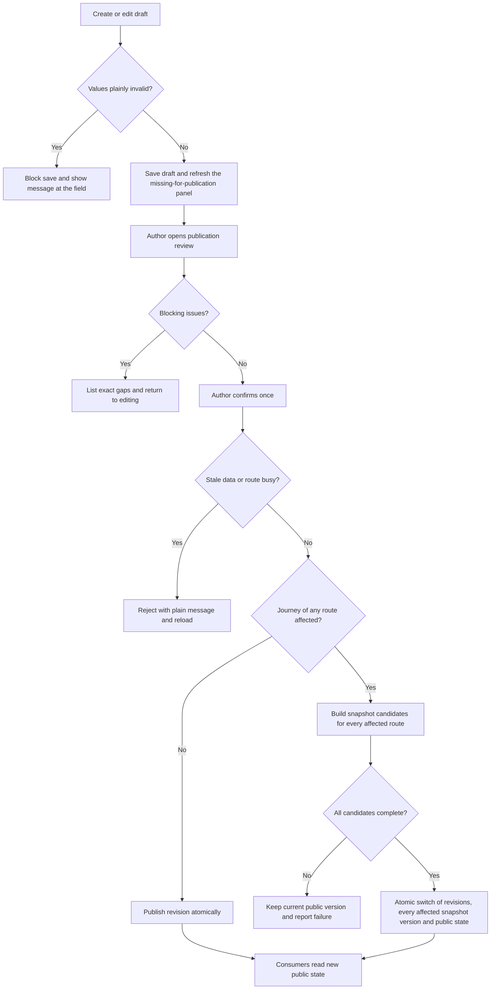
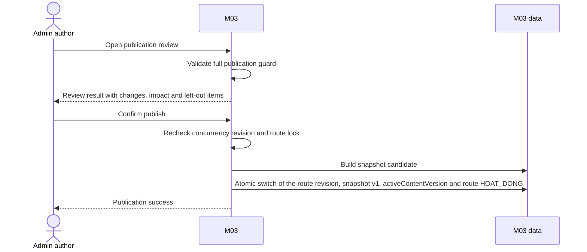
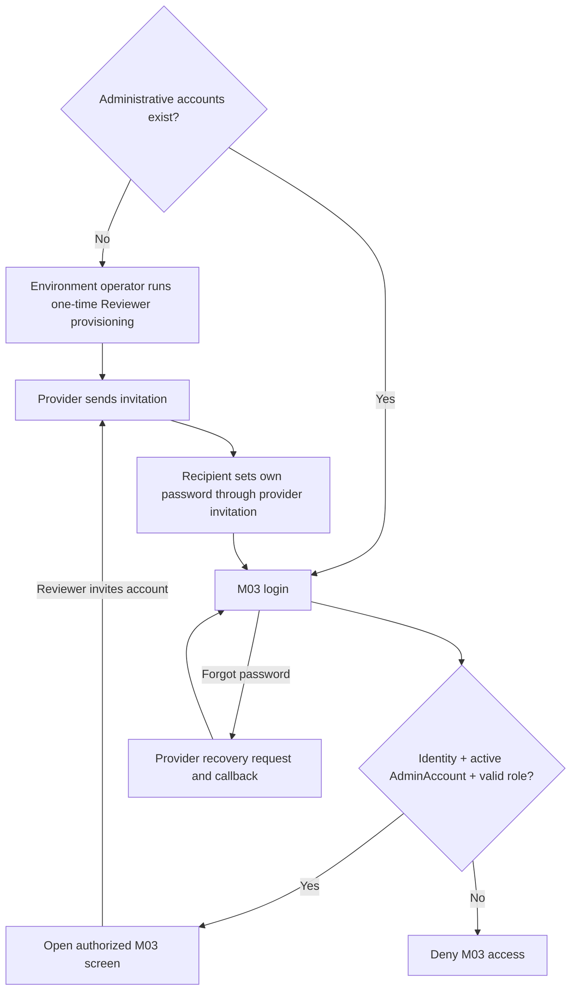
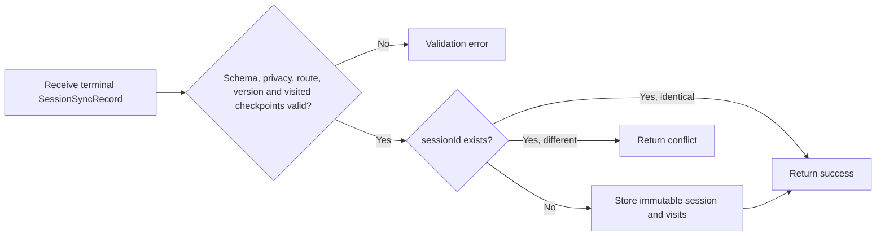
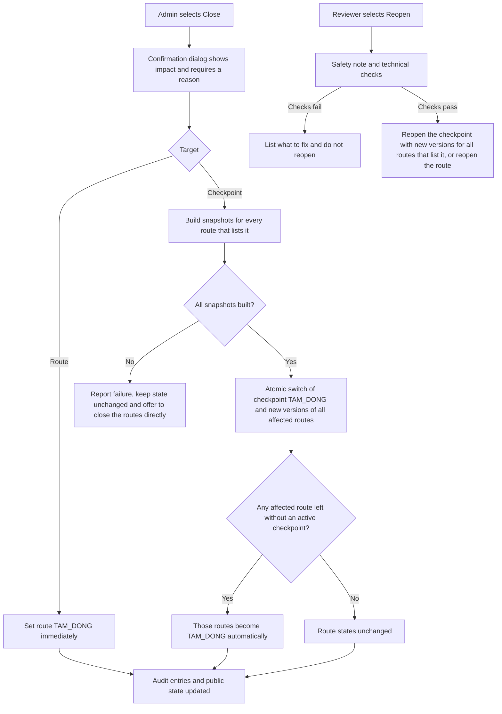
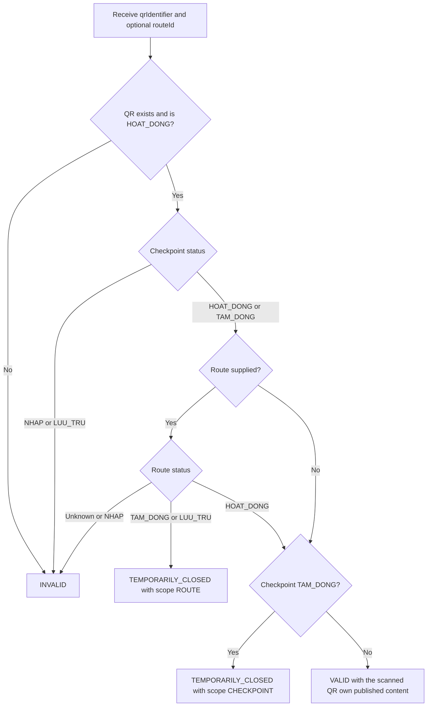
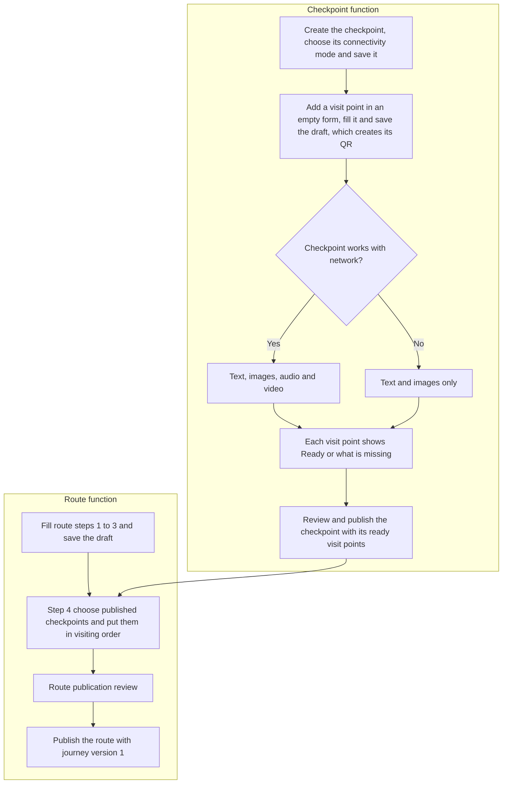

# Spec Document: M03 — Operations & Content Administration

| Field | Value |
|---|---|
| Module | M03 — Operations & Content Administration |
| Version | 3.6 |
| Status | MVP implementation baseline — aligned with M01 v3.2 and M02 v3.2 (see §11) |
| Supersedes | 3.5 (previous repository baseline: 2.0) |
| Last updated | 2026-10-27 |
| Consumers | M01 route/snapshot; M02 live content/QR lookup |
| Producer input | M02 terminal anonymous sessions |

This specification is self-contained and is the implementation source of truth for M03. M03 is the producer of the Published Route, JourneySnapshot and Live QR lookup contracts. Where this version changes those contracts, M01 and M02 must be aligned to this document (§11). All administrative UI text and messages are Vietnamese in plain everyday language.

## 1. Purpose and scope

M03 lets park staff create and publish route content, operate route/checkpoint availability, publish immutable journey snapshots, manage fixed-role administrative access and view basic anonymous usage reports. Any administrator may publish their own work after a mandatory review screen; there is no second-person approval queue. Visitor content belongs to individual QR objects (the tree, animal, place or other thing a visitor scans), not to the checkpoint area that contains them. Checkpoints form a shared library: a checkpoint is created, filled and published once and can be listed by many routes; each route chooses its checkpoints and their order.

In scope:

- Route administration: bilingual information, images, participation requirements, safety warning, starting point, recommendation tags, system-derived values, and the ordered choice of published checkpoints.
- Checkpoint (area) library: checkpoints created and published once, independently of any route, each with a bilingual name and a connectivity classification, and listed by any number of routes.
- QR-object administration: system-generated identifiers, a permanent public QR link that a phone's own camera can open, printable code images, per-QR bilingual content, images and optional audio/video.
- Draft → publication review → self-publish workflow, one pending draft per item, version history, restore and discard.
- Emergency close, controlled reopen and archive.
- Immutable full-journey snapshots for M01/M02 with an offline-size ceiling and an optional size estimate.
- An optional route-map image that an administrator can mark as needed without network; it is then carried in the journey snapshot.
- Live QR lookup for M02 with distinct valid / temporarily closed / invalid outcomes.
- Terminal session ingestion and two operational reports.
- Two-role administrative account management, authenticated entry, invitation and password recovery.
- Audit log and per-item change history.
- Plain-language administrative UI: display names for every state, a fixed catalog of Vietnamese messages, and no raw technical data on screen.

Out of scope:

- Offline administration/draft synchronization.
- Custom roles, finer permissions or temporary delegation.
- A review queue or mandatory second-person approval.
- GPS navigation/geofence/check-in validation.
- Real-time alerts to sessions already running; guaranteeing that an offline visitor learns of a closure.
- Advanced analytics, real-time dashboards, file export and per-QR reporting.
- A structured emergency-contact field or a contact directory. Any phone number a route needs is written by staff in the route's own text fields.
- Visitor reporting of QR installation errors.
- Physical deletion of any persisted record.

Canonical contract names in this spec are logical names. Physical table/column names and mapping conventions belong to database design and must not change contract meaning.

### 1.1 Glossary

| Term | Meaning |
|---|---|
| Route | A day-trip itinerary visitors can select in M01. |
| Checkpoint | A real-world area that contains one or more visit points (QR objects). Created, filled and published on its own in a shared library; any number of routes may list it. It has a bilingual name and a connectivity mode, but no order (the order belongs to each route) and no visitor introduction text of its own. |
| Route checkpoint list | The ordered list of published checkpoints a route chooses. Its order is the visiting order of that route. |
| QR object (visit point) | One QR code attached to one specific thing (tree, animal, place...). It owns the visitor content shown when it is scanned. Staff see it as an "điểm tham quan". |
| Revision | One version of the editable content of a route, checkpoint or QR object. |
| Published version | The revision with status `PHAT_HANH`; the only version the public sees. |
| Pending draft | The single `NHAP` revision of an item that is being edited. |
| Publication unit | The set of changes published by one confirmation (BR-M03-F04). |
| Journey snapshot / journey version | An immutable picture of one route's active journey, identified by `(routeId, contentVersion)`. |
| Self-publish | The person who wrote the draft publishes it. |

## 2. Actors

| Actor | Role | Responsibilities |
|---|---|---|
| Content Staff | `CONTENT_STAFF` | Create/edit/publish drafts, discard, restore, close route/checkpoint, revoke/reprint QR, view reports and item history. |
| Reviewer | `REVIEWER` | Everything Content Staff can do, plus reopen, archive, manage admin accounts and view the system-wide audit log. |
| M03 system | System | Generate identifiers, validate, derive values, publish atomically, build snapshots, enforce authorization/concurrency, write audit, ingest/report sessions. |
| M01 | Consumer | Reads the Published Route projection and published snapshots. |
| M02 | Consumer/producer | Reads live QR lookup and sends terminal anonymous sessions. |
| Park Management | Stakeholder | Owns policy, field verification and physical safety response, including warning people already on the trail. |
| Environment operator | Operational actor | Provisions the initial Reviewer through a server-side environment procedure; has no M03 business UI role. |

### 2.1 Permission matrix

| Capability | CONTENT_STAFF | REVIEWER |
|---|---:|---:|
| Create/edit route, checkpoint, QR object, content, media, internal notes | Yes | Yes |
| Publish through the review screen (including own drafts) | Yes | Yes |
| Discard never-published items and pending drafts; restore a previous published version | Yes | Yes |
| Close route/checkpoint with reason; revoke QR; reprint QR | Yes | Yes |
| Reopen a closed route/checkpoint | No | Yes |
| Archive route/checkpoint | No | Yes |
| View RPT-01/RPT-02 and per-item history | Yes | Yes |
| View system-wide audit log | No | Yes |
| Invite/change/deactivate/reactivate admin account | No | Yes |

Authorization is enforced server-side. There is no submitter/approver separation: a user may publish a draft they wrote. The compensating controls are the mandatory publication review, version restore and the audit trail (BR-M03-A05).

## 3. User scenarios and acceptance criteria

### US-M03-01 — Create and publish a route

1. Staff may save a draft at any time as long as the values entered are not plainly invalid (BR-M03-L01). Missing content never blocks saving.
2. The editor continuously shows a "missing for publication" panel; each line jumps to the field to fix.
3. The route identifier is generated by the system; no screen has an input for it.
4. In step 4 the author chooses which checkpoints the route has, in visiting order. The choice comes from the library of published checkpoints, which already contain their visit points and content. The author drags to reorder and can open the checkpoint function to create a new checkpoint and return. Each row shows the checkpoint name, its mode, its number of visit points and the other routes that already use it.
5. Publishing opens a mandatory review screen showing the changes, the impact, listed checkpoints that are closed and so not part of the journey, and the estimated offline package size.
6. When every publication condition (BR-M03-C04, BR-M03-T04) is met, the author confirms once. No second person is required.
7. First publication atomically publishes the route, its journey version 1 and the `HOAT_DONG` state. It never publishes a checkpoint.
8. Any publication failure leaves all public data unchanged and tells the author what happened in plain language.

### US-M03-02 — Revise published data

1. Editing published data (a route, a checkpoint or a visit point) creates, or continues, a single pending draft shared by all administrators. The published version stays unchanged until the draft is published.
2. A stale save or stale publish is rejected with a plain message naming who changed the item and when; the user reloads; nothing is auto-merged; text the user typed stays on screen.
3. Publishing shows the review screen, which names every affected route. A change that alters the journey of one or more routes builds a new snapshot for each of them and switches all of them together with the change; a change that alters no journey creates no new version.
4. Changing a published route's checkpoint list or order is a route change: it goes through the review screen and creates a new journey version for that route only.
5. Earlier published versions are kept. Any administrator may restore one as a new pending draft, which must go through review again.
6. A pending draft can be discarded without affecting the published version.

### US-M03-03 — Create and manage checkpoints and visit points

1. A checkpoint is a real area created on its own in the checkpoint function. It holds one or more visit points (each with its own QR code), belongs to no route, and any number of routes may list it.
2. The author chooses the connectivity mode explicitly. For "Cần tải trước" the visit points take text and images only; for "Dùng được khi có mạng" they also take audio and video. The mode is stored on the checkpoint and the form of its visit points follows it.
3. Each visit point has its own name, introduction, images and, where allowed, audio/video. Scanning a QR returns that visit point's content only, never content shared by the whole checkpoint.
4. Every visit point and checkpoint shows "Sẵn sàng" or "Chưa đủ: ...". Publishing the checkpoint goes through the review screen: the checkpoint and its ready visit points become active together; visit points that are not ready stay as drafts and are listed.
5. After publication, each new visit point is published on its own.
6. Editing a published checkpoint or visit point can change several routes; the review screen names every affected route.
7. An active checkpoint always has at least one active visit point.
8. Reprinting preserves the QR identifier and content; it is the answer to a damaged or faded code. There is no QR identity replacement in the MVP: to give a thing a new code, staff add a new visit point for it, install its code, then revoke the old one (BR-M03-E08 retired).
9. Revoking an active QR is blocked if it is the last active QR of an active checkpoint.
10. The printable image of a code can be downloaded at any time; while the visit point is not published the screen warns that scanning it will report an invalid code.
11. A checkpoint can be archived only by a Reviewer, only while closed, and only when no non-archived route lists it.
12. Visit points can be added only after the checkpoint has been saved with a connectivity mode chosen. "Thêm điểm tham quan" opens an empty form; the visit point and its QR identifier are created at the first save of that form (BR-M03-E15).
13. After each save the visit point list updates at once, the item just saved is highlighted, and the editor states which visit point is being edited and whether the draft or the published version is on screen (BR-M03-E16).
14. Several files can be selected in one action; each file is checked and uploaded on its own, and the files uploaded successfully are kept when others fail (BR-M03-E14).
15. Before publishing, the author can preview a visit point's draft as visitors would see it, in both languages (BR-M03-F12).
16. Every printed code is a permanent public web link containing the QR identifier, so that anyone can scan it with the phone's own camera and open the visit point in the visitor web app, without having opened the app before (BR-M03-B04). The printable image follows fixed print settings and, for a checkpoint that needs downloading beforehand, carries a short bilingual warning (BR-M03-B05).

### US-M03-04 — Close and reopen

1. Either role may close a route or a checkpoint. A confirmation dialog states the consequences and requires a reason; for a checkpoint it names every route that lists it and says which routes will close automatically.
2. Closing is an emergency operation: it needs no review screen and takes effect when it completes. Closing a checkpoint completes only when the checkpoint state and the replacement snapshots of all affected routes are published atomically.
3. A route with no active checkpoint left becomes `TAM_DONG` automatically. A route never reopens automatically, even when a checkpoint is later reopened.
4. Only a Reviewer may reopen, after a safety confirmation note and technical checks.
5. No action attempts to stop or notify an already-running M02 session. The system cannot guarantee an immediate warning to people who are offline; Park Management handles on-site warnings.
6. If closing a checkpoint cannot complete, the system reports the failure, leaves the state unchanged and never reports false success; the message offers to close the affected routes directly instead.
7. While online, a lookup of a QR inside a closed checkpoint or route returns `TEMPORARILY_CLOSED` and no visit content, so M02 can tell the visitor to stop or follow Park Management's instructions.

### US-M03-05 — Manage administrative access

1. M03 has no public sign-up. An administrator enters through the M03 login screen using an identity managed by the authentication provider.
2. Every protected request validates both the authenticated identity and an active `AdminAccount` with role `CONTENT_STAFF` or `REVIEWER`; a valid provider identity alone grants no M03 access.
3. Only Reviewers invite, change role, reactivate or deactivate an account.
4. A Reviewer invitation supplies a unique normalized email and one fixed role. The provider creates/sends the credential invitation and M03 creates a matching `INVITATION_PENDING` account; the recipient sets their own password through the provider invitation flow before the account can become active and sign in.
5. An expired or invalid invitation does not create access. A Reviewer may retry the invitation for the same pending account without creating a duplicate `AdminAccount`.
6. Existing administrators recover their own password through the provider flow started from M03 login. The recovery response does not reveal whether an email exists; a valid callback permits setting a new password and then returning to login.
7. Password recovery never creates an `AdminAccount`, changes its role/status or bypasses server authorization. A deactivated account remains denied after credential recovery.
8. Attempts to deactivate or demote the last active Reviewer are blocked transactionally.
9. The first Reviewer for each environment is created by a server-side provisioning procedure controlled by the environment operator. It is allowed only when the environment has no administrative account, creates exactly one `INVITATION_PENDING` `REVIEWER` account linked to a provider invitation, is idempotent for the same normalized email, and is unavailable from the browser or public API. It becomes active only after the provider identity completes and matches the pending account.
10. After first access, the initial Reviewer invites at least one backup Reviewer. Ordinary password recovery does not rerun initial provisioning.

### US-M03-06 — Ingest sessions and report

1. Only anonymous terminal `HOAN_TAT`/`BO_DO` records are accepted.
2. First payload for a UUID creates the record; an identical retry succeeds idempotently.
3. A different payload for an existing `sessionId` is rejected as conflict.
4. RPT-01 and RPT-02 use `endedAt` and `Asia/Ho_Chi_Minh`; reports are not real-time.
5. A payload whose `routeId` is unknown to M03, or whose `contentVersion` is not a published snapshot version of that route, is rejected as invalid.
6. Sessions of routes in any status (including `TAM_DONG` and `LUU_TRU`) are accepted.
7. The report page states, as short plain notes, when the figures were last updated, that only finished trips sent to the system are counted and are not real-time, and that a visit is a QR scan, not proof of presence (BR-M03-J08).

### US-M03-07 — [Removed in v3.4] Emergency-contact directory

Removed together with BR-M03-C13 and FR-M03-017. The ID is retired and is not reused.

### US-M03-08 — History, restore and audit

1. Every route, checkpoint and QR object shows its published history.
2. Any administrator may restore a previous published version as a new pending draft (blocked while a pending draft exists); it is published through the normal review.
3. Any administrator may discard a pending draft.
4. Every administrative action is audited with who, when, what, before/after values, result and reason where required; self-published changes are flagged.
5. Reviewers can view a system-wide audit log.

### US-M03-09 — Clear validation feedback

1. Problems appear immediately under the relevant field, in plain Vietnamese that uses the label shown in the UI and says how to fix the problem.
2. A problem that would block publication but is already detectable at save time is reported at save time.
3. A "missing for publication" panel is always visible; each line jumps to the field.
4. A failed save never loses what the user typed.
5. A stale save shows who changed the item and when, and offers a Reload action.
6. One "Lưu bản nháp" saves everything in the form, in both languages and with its media list, or nothing; "Đã lưu bản nháp" appears only when all of it is saved (BR-M03-F11).

## 4. Flows

### 4.1 Usage flow

### 4.2 Sequence for first publication

### 4.3 Administrative access flow

Initial provisioning, invitation and password recovery are distinct flows. Provisioning is server-side and only bootstraps an empty environment; invitation is a Reviewer action; password recovery only changes the current user's provider credential.

### 4.4 Session ingest flow

### 4.5 Closure and reopen flow

### 4.6 Live QR lookup flow

If M03 cannot reach a conclusion (source failure), it signals a failure that M02 can distinguish from `INVALID`; it never answers `INVALID` for a QR it could not check.

### 4.7 Checkpoint and route creation flow

A checkpoint is created and published once and can then be chosen by any number of routes. Publishing a route never publishes a checkpoint (BR-M03-C17). Visit points can be added only after the checkpoint has been saved with a connectivity mode (BR-M03-E15).

## 5. Functional requirements

`Behavioral baseline` below states whether the behavior belongs to this complete specification. Release priority is owned exclusively by `MVP-Scope.md`.

| ID | Requirement | Behavioral baseline |
|---|---|---|
| FR-M03-001 | Create/update route drafts: bilingual information, images, participation requirements, safety warning, starting point, two selectable tag groups, system-derived time tag/checkpoint count/offline flags, the choice to include the route map in the offline package, and the ordered choice of published checkpoints. | Required |
| FR-M03-002 | Create/update checkpoints independently of routes, in a shared library: system-generated identity, bilingual name, unique Vietnamese name and connectivity mode; one checkpoint may be listed by many routes. | Required |
| FR-M03-003 | Manage multiple QR objects per checkpoint with system-generated unguessable identifiers, a permanent public QR link encoded in a downloadable printable code image. | Required |
| FR-M03-004 | Manage per-QR bilingual content (object name, introduction), images and, only for checkpoints that work with network, optional audio/video with size/count limits and usage-rights confirmation. | Required |
| FR-M03-005 | Validate at two levels (save-time and publication-time) with field-level plain-language messages and a "missing for publication" panel. | Required |
| FR-M03-006 | Provide the mandatory publication review screen; allow any administrator to publish; enforce role permissions server-side. | Required |
| FR-M03-007 | Maintain revisions: one pending draft per item, version history, restore, discard draft; reject stale writes without auto-merge; serialize operations on each connected set of routes and checkpoints. | Required |
| FR-M03-008 | Publish a route's first state atomically with journey version 1; publish a checkpoint with its ready visit points independently of routes. | Required |
| FR-M03-009 | Publish new immutable snapshots for every route affected by a change, switching all of them together; sequential version numbers per route, an offline-size ceiling and an optional offline size estimate. | Required |
| FR-M03-010 | Retain snapshot versions without M01 acknowledgement. | Required |
| FR-M03-011 | Close, reopen and archive routes and checkpoints; closing or reopening a checkpoint applies to every route that lists it; deterministic route outcomes; atomic snapshot switches; revoke and reprint QR. | Required |
| FR-M03-012 | Resolve a QR (with an optional route) to a live outcome `VALID` / `TEMPORARILY_CLOSED` / `INVALID` with the scanned QR's own content, and signal source failure separately. | Required |
| FR-M03-013 | Authenticate administrative access; manage invitation, password recovery and two fixed application roles; bootstrap and preserve an active Reviewer. | Required |
| FR-M03-014 | Ingest immutable terminal anonymous session records idempotently, validating route and version. | Required |
| FR-M03-015 | Provide RPT-01 sessions by route/status/date. | Required |
| FR-M03-016 | Provide RPT-02 unique checkpoint visits by route/date. | Required |
| FR-M03-017 | [Removed in v3.4] Emergency-contact directory and route contact selection. The ID is retired and is not reused. | Removed |
| FR-M03-018 | Record an append-only audit log and expose per-item history and a Reviewer system-wide log. | Required |
| FR-M03-019 | Show staff only plain Vietnamese: display names for every state, messages from a fixed catalog, and never raw data or technical codes. | Required |

### 5.1 Input / Output contract

Contract presence uses these terms: **Required** means the field and a value are present; **Optional** means the field may be absent; **Conditional** means the stated condition determines presence. These are logical contract rules, not physical database nullability. All `DateTime` values are UTC. `String` identifiers are opaque logical identifiers generated by M03.

#### Published Route projection

This is the exact payload consumed by M01 as **Published Route input**. It exists only for routes that have been published at least once; routes never published (`NHAP`, or discarded straight to `LUU_TRU`) are absent. All text fields hold the published version.

| Field path | Logical type | Presence | Constraints |
|---|---|---|---|
| `routeId` | String | Required | Stable route identity. |
| `status` | Enum(`HOAT_DONG`, `TAM_DONG`, `LUU_TRU`) | Required | Only `HOAT_DONG` is selectable. |
| `name` | Object | Required | Contains both language branches. |
| `name.vi` | String | Required | Non-empty; at most 100 characters. |
| `name.en` | String | Required | Non-empty; at most 100 characters. |
| `shortDescription` | Object | Required | Card text; both language branches. |
| `shortDescription.vi` | String | Required | Non-empty; at most 160 characters. |
| `shortDescription.en` | String | Required | Non-empty; at most 160 characters. |
| `description` | Object | Required | Full description for the detail page; both language branches. |
| `description.vi` | String | Required | Non-empty; at most 2000 characters. |
| `description.en` | String | Required | Non-empty; at most 2000 characters. |
| `startingPoint` | Object | Required | Starting point and how to get there. |
| `startingPoint.vi` | String | Required | Non-empty; at most 500 characters. |
| `startingPoint.en` | String | Required | Non-empty; at most 500 characters. |
| `thumbnail` | Object | Required | Card image. |
| `thumbnail.sourceRef` | String | Required | Public image resource reference. |
| `gallery` | Array&lt;Object&gt; | Required | May be empty; at most 8 items; ordered; the first item is the cover. |
| `gallery[].sourceRef` | String | Required | Required for every array item; public image resource reference. |
| `gallery[].caption` | Object | Optional | Both-or-none language branches. |
| `gallery[].caption.vi` | String | Conditional | Required when `caption` is present; at most 200 characters. |
| `gallery[].caption.en` | String | Conditional | Required when `caption` is present; at most 200 characters. |
| `routeMap` | Object | Optional | Static route-map image; not navigation. |
| `routeMap.sourceRef` | String | Conditional | Required when `routeMap` is present. |
| `routeMap.caption` | Object | Optional | Both-or-none language branches (`vi`, `en`, at most 200 characters each). |
| `participationRequirements` | Object | Optional | Both-or-none `vi`/`en`; at most 300 characters each. |
| `preparation` | Object | Optional | Both-or-none `vi`/`en`; at most 500 characters each. |
| `bestTime` | Object | Optional | Both-or-none `vi`/`en`; at most 200 characters each. |
| `safetyWarning` | Object | Optional | Both-or-none: absent entirely, or both language fields are present; at most 500 characters each. |
| `safetyWarning.vi` | String | Conditional | Required when `safetyWarning` is present. |
| `safetyWarning.en` | String | Conditional | Required when `safetyWarning` is present. |
| `highlights` | Array&lt;Object&gt; | Required | May be empty; at most 5 items. |
| `highlights[].vi` | String | Required | Required for every array item; non-empty; at most 80 characters. |
| `highlights[].en` | String | Required | Required for every array item; non-empty; at most 80 characters. |
| `distanceKm` | Decimal | Required | Greater than `0`. |
| `durationMin` | Integer | Required | Greater than `0`; expected duration. |
| `difficulty` | Enum(`NHE`, `TRUNG_BINH`, `KHO`) | Required | — |
| `timeTags` | Array&lt;Enum(`TIME_NGAN`, `TIME_VUA`, `TIME_DAI`)&gt; | Required | Exactly one value, derived by M03 from `durationMin` (BR-M03-C11); never entered by staff. |
| `groupTags` | Array&lt;Enum(`GROUP_CA_NHAN_NGUOI_LON`, `GROUP_GIA_DINH_CO_TRE`, `GROUP_CAN_DE_DANG`)&gt; | Required | At least one allowed value. |
| `experienceTags` | Array&lt;Enum(`INTEREST_THIEN_NHIEN_CHUP_ANH`, `INTEREST_TIM_HIEU`, `INTEREST_KHAM_PHA`)&gt; | Required | At least one allowed value. |
| `checkpointCount` | Integer | Required | Number of active checkpoints in the active snapshot; `>= 0`. |
| `hasOfflineRequiredCheckpoint` | Boolean | Required | `true` when the active snapshot contains at least one `OFFLINE_REQUIRED` checkpoint. |
| `hasOfflineRouteMap` | Boolean | Required | `true` when the active snapshot contains an `offlineRouteMap` (BR-M03-C16). |
| `checkpointSummaries` | Array&lt;Object&gt; | Required | Active checkpoints of the active snapshot, ordered by `sequence`; may be empty only when status is not `HOAT_DONG`. |
| `checkpointSummaries[].checkpointId` | String | Required | Required for every array item. |
| `checkpointSummaries[].sequence` | Integer | Required | Required for every array item. |
| `checkpointSummaries[].checkpointName` | Object | Required | Required for every array item; `vi` and `en` both Required, non-empty. |
| `activeContentVersion` | Integer | Required | References the `DA_CONG_BO` snapshot of the same route that is currently active. |

Only `HOAT_DONG` with a non-null published version is selectable by M01.

Allowed enums and their administrative display labels (messages shown to staff use the label, never the code):

- `difficulty`: `NHE` "Nhẹ", `TRUNG_BINH` "Trung bình", `KHO` "Khó".
- `timeTags` (derived): `TIME_NGAN` "Ngắn" (≤ 90 minutes), `TIME_VUA` "Vừa" (> 90–180 minutes), `TIME_DAI` "Dài" (> 180 minutes).
- `groupTags`: `GROUP_CA_NHAN_NGUOI_LON` "Cá nhân/người lớn", `GROUP_GIA_DINH_CO_TRE` "Gia đình có trẻ nhỏ", `GROUP_CAN_DE_DANG` "Cần đi dễ dàng" (for visitors who need an easy route).
- `experienceTags`: `INTEREST_THIEN_NHIEN_CHUP_ANH` "Thiên nhiên, chụp ảnh", `INTEREST_TIM_HIEU` "Tìm hiểu", `INTEREST_KHAM_PHA` "Khám phá".

Before publication, every both-language field must contain both `vi` and `en`; every both-or-none field is either complete in both languages or absent in both.

#### JourneySnapshot output

This is the exact payload consumed by M01. Its journey metadata is projected into M01 package/handoff manifests and then copied into the M02 frozen journey. It carries journey data only (plus the route-map image when it is marked as needed offline); other route information comes from the Published Route projection. Audio and video never appear in a snapshot.

| Field path | Logical type | Presence | Constraints |
|---|---|---|---|
| `routeId` | String | Required | Stable route identity. |
| `contentVersion` | Integer | Required | Identifies one immutable version within `routeId`; starts at `1` and increases by exactly `1` per published snapshot. |
| `status` | Enum(`DA_CONG_BO`) | Required | Published snapshots are immutable. |
| `publishedAt` | DateTime | Required | UTC. |
| `previousContentVersion` | Integer | Optional | Absent for version `1`; otherwise `contentVersion - 1` of the same route. |
| `estimatedOfflineSizeBytes` | Integer | Optional | Estimated size of what is downloaded for offline use (BR-M03-G10). An estimate, not the final on-device size. Consumers must tolerate its absence. |
| `offlineRouteMap` | Object | Optional | Present only when the route's published content marks the route map as needed without network (BR-M03-C16). |
| `offlineRouteMap.sourceRef` | String | Conditional | Required when `offlineRouteMap` is present; public image resource reference. |
| `offlineRouteMap.caption` | Object | Optional | Both-or-none language branches. |
| `offlineRouteMap.caption.vi` | String | Conditional | Required when `caption` is present; at most 200 characters. |
| `offlineRouteMap.caption.en` | String | Conditional | Required when `caption` is present; at most 200 characters. |
| `checkpoints` | Array&lt;Object&gt; | Required | Contains every and only active checkpoint; IDs and sequences are unique. May be empty only when the route is not `HOAT_DONG` (for example after its last active checkpoint closed); M01 never selects such a route. |
| `checkpoints[].checkpointId` | String | Required | Stable checkpoint identity. |
| `checkpoints[].sequence` | Integer | Required | Unique within the snapshot. It is the checkpoint's 1-based position in the route's checkpoint list; gaps appear where a listed checkpoint is not active. |
| `checkpoints[].checkpointName` | Object | Required | Frozen display name for this version; both language branches. |
| `checkpoints[].checkpointName.vi` | String | Required | Non-empty. |
| `checkpoints[].checkpointName.en` | String | Required | Non-empty. |
| `checkpoints[].connectivityMode` | Enum(`ONLINE_AVAILABLE`, `OFFLINE_REQUIRED`) | Required | — |
| `checkpoints[].qrIdentifiers` | Array&lt;String&gt; | Required | Non-empty; active identifiers only. |
| `checkpoints[].offlineResources` | Array&lt;Object&gt; | Conditional | Required only for `OFFLINE_REQUIRED`; absent for `ONLINE_AVAILABLE`. Contains exactly one item for every identifier in `qrIdentifiers`. |
| `checkpoints[].offlineResources[].qrIdentifier` | String | Conditional | Required for every array item; unique within the snapshot; references an identifier of the same checkpoint. |
| `checkpoints[].offlineResources[].objectName` | Object | Conditional | Required for every array item; `vi` and `en` both Required, non-empty. |
| `checkpoints[].offlineResources[].localizedContent` | Object | Conditional | Required for every array item. |
| `checkpoints[].offlineResources[].localizedContent.vi` | Object | Conditional | Required for every array item. |
| `checkpoints[].offlineResources[].localizedContent.vi.introductionText` | String | Conditional | Required for every array item; non-empty. |
| `checkpoints[].offlineResources[].localizedContent.en` | Object | Conditional | Required for every array item. |
| `checkpoints[].offlineResources[].localizedContent.en.introductionText` | String | Conditional | Required for every array item; non-empty. |
| `checkpoints[].offlineResources[].staticImages` | Array&lt;String&gt; | Conditional | Required for every array item; may be empty. Items are public image resource references of that QR object. |

All and only active checkpoints are included. An active checkpoint always has at least one active QR. `offlineResources` is required only for `OFFLINE_REQUIRED` and holds that QR object's own content, not content shared by the checkpoint.

`estimatedOfflineSizeBytes` covers only what is downloaded for offline use: the images of QR objects in `OFFLINE_REQUIRED` checkpoints, the offline route map and the UTF-8 byte size of the offline texts. It never counts audio, video or the rest of the route's media library. It is optional for consumers: when it is absent M01 must still allow the download and tell the visitor that the size is not available.

#### Live QR lookup output

M03 produces `LiveQrLookupResult` through live QR lookup; M02 consumes it. The lookup uses current published public data, never a snapshot.

Lookup input:

| Field path | Logical type | Presence | Constraints |
|---|---|---|---|
| `qrIdentifier` | String | Required | The identifier taken by the caller from the scanned public QR link (BR-M03-B04); matched exactly after trimming surrounding whitespace. |
| `routeId` | String | Optional | The route the caller is on. Free visitors send none. M03 does not check that this route lists the checkpoint. |

| Field path | Logical type | Presence | Constraints |
|---|---|---|---|
| `outcome` | Enum(`VALID`, `TEMPORARILY_CLOSED`, `INVALID`) | Required | Evaluated by BR-M03-I02. |
| `content` | Object (`LiveStationContent`) | Conditional | Present only when `outcome = VALID`. |
| `closedScope` | Enum(`ROUTE`, `CHECKPOINT`) | Conditional | Present only when `outcome = TEMPORARILY_CLOSED`. |

A source failure is not an outcome value: it is a distinct failure signal that M02 can tell apart from `INVALID`.

`LiveStationContent` is the canonical logical contract name for the content of one scanned QR object.

| Field path | Logical type | Presence | Constraints |
|---|---|---|---|
| `qrIdentifier` | String | Required | Active public QR identity used for this lookup. |
| `checkpointId` | String | Required | Stable identity of the checkpoint containing the QR. |
| `checkpointName` | Object | Required | Current published area name; `vi` and `en` both Required, non-empty. |
| `connectivityMode` | Enum(`ONLINE_AVAILABLE`, `OFFLINE_REQUIRED`) | Required | Current public classification of the checkpoint. |
| `objectName` | Object | Required | Name of the thing this QR is attached to; `vi` and `en` both Required, non-empty. |
| `localizedContent` | Object | Required | This QR object's published introduction in both languages. |
| `localizedContent.vi` | Object | Required | — |
| `localizedContent.vi.introductionText` | String | Required | Non-empty. |
| `localizedContent.en` | Object | Required | — |
| `localizedContent.en.introductionText` | String | Required | Non-empty. |
| `staticImages` | Array&lt;String&gt; | Required | May be empty; items are public image resource references of this QR object. |
| `mediaResources` | Array&lt;Object&gt; | Required | May be empty; always empty for `OFFLINE_REQUIRED` checkpoints; audio/video exist only for `ONLINE_AVAILABLE` checkpoints. |
| `mediaResources[].type` | Enum(`AUDIO`, `VIDEO`) | Required | Required for every array item. |
| `mediaResources[].sourceRef` | String | Required | Required for every array item; public media resource reference. |

Only active QR/checkpoint/route and published content may be returned as valid live data.

#### SessionSyncRecord input

This is the exact payload produced by M02. Its shape is unchanged from v2.0; only the acceptance validation grew.

| Field path | Logical type | Presence | Constraints |
|---|---|---|---|
| `sessionId` | UUID | Required | Globally unique across all routes; immutable record identity. |
| `routeId` | String | Required | Route frozen in the session; must identify a route known to M03. |
| `contentVersion` | Integer | Required | Frozen journey version; must be a published snapshot version of `routeId`. |
| `startedAt` | DateTime | Required | UTC. |
| `endedAt` | DateTime | Required | UTC; not earlier than `startedAt`. |
| `status` | Enum(`HOAN_TAT`, `BO_DO`) | Required | Terminal status only. |
| `visitedCheckpoints` | Array&lt;Object&gt; | Required | May be empty for an abandoned session; checkpoint IDs are unique within the session. |
| `visitedCheckpoints[].checkpointId` | String | Required | Required for every array item; stable checkpoint identity. |
| `visitedCheckpoints[].checkpointName` | String | Required | Required for every array item; the Vietnamese name (`checkpointName.vi`) from the frozen journey, as a plain string. |
| `visitedCheckpoints[].sequence` | Integer | Required | Required for every array item; historical sequence from the frozen journey. |
| `visitedCheckpoints[].checkedInAt` | DateTime | Required | Required for every array item; UTC and within the session interval. |

Required validation:

- `endedAt >= startedAt`.
- Checkpoints unique within the session.
- Visit timestamp falls within the session interval.
- No visitor PII/device/GPS fields.
- `routeId` identifies a known route and `contentVersion` is a published snapshot version of it, whatever the route's current status.
- Every `visitedCheckpoints[].checkpointId` is a checkpoint of that snapshot, with `checkpointName` equal to its `checkpointName.vi` and `sequence` equal to its `sequence`.
- Existing `sessionId` accepts only the same normalized business payload; transport formatting and field order are ignored.

#### Report outputs

Both reports use this input contract:

| Field path | Logical type | Presence | Constraints |
|---|---|---|---|
| `routeId` | String | Optional | When present, filters to one stable route identity. |
| `fromDate` | Date | Optional | Supplied together with `toDate`; `fromDate <= toDate`. If the pair is absent, use the most recent 30 days. |
| `toDate` | Date | Optional | Supplied together with `fromDate`; inclusive reporting date boundary. |

RPT-01 output:

| Field path | Logical type | Presence | Constraints |
|---|---|---|---|
| `totalSessionCount` | Integer | Required | Count of unique synchronized terminal sessions; `>= 0`. |
| `completedCount` | Integer | Required | Count where `status = HOAN_TAT`; `>= 0`. |
| `completedRate` | Decimal | Required | `completedCount / totalSessionCount`; range `0..1`; `0` when total is zero. |
| `abandonedCount` | Integer | Required | Count where `status = BO_DO`; `>= 0`. |
| `abandonedRate` | Decimal | Required | `abandonedCount / totalSessionCount`; range `0..1`; `0` when total is zero. |
| `lastSuccessfulIngestionAt` | DateTime | Optional | UTC; absent when no successful ingestion has occurred. |

RPT-02 output:

| Field path | Logical type | Presence | Constraints |
|---|---|---|---|
| `items` | Array&lt;Object&gt; | Required | May be empty. One item per `(routeId, checkpointId)`. |
| `items[].routeId` | String | Required | Required for every array item; stable grouping route identity. |
| `items[].checkpointId` | String | Required | Required for every array item; stable checkpoint grouping key. |
| `items[].checkpointName` | String | Required | Required for every array item; label from the record with latest `endedAt` in the selected period. |
| `items[].sequence` | Integer | Required | Required for every array item; sequence from the same latest-ended record. |
| `items[].uniqueSessionCount` | Integer | Required | Required for every array item; number of unique synchronized sessions visiting the checkpoint; `>= 0`. |
| `lastSuccessfulIngestionAt` | DateTime | Optional | UTC; absent when no successful ingestion has occurred. |

Both reports convert UTC timestamps to `Asia/Ho_Chi_Minh` for date filtering/grouping. Unsynchronized sessions are explicitly outside the result. Reports are at checkpoint level; there is no per-QR report. A visit means a QR scan recorded by the visitor's app; it is not proof that the visitor was physically at the location. M02 records a visit only when the scan was accepted (`VALID`) or could not be checked (offline or lookup failure), so a visit at a checkpoint closed at scan time can come only from a scan that could not be checked; the session record carries no closure flag.

#### Administrative contracts (logical)

These two shapes are produced by M03 for the administrative UI.

`ValidationIssue` — one problem shown to staff.

| Field path | Logical type | Presence | Constraints |
|---|---|---|---|
| `severity` | Enum(`BLOCKS_SAVE`, `BLOCKS_PUBLISH`) | Required | `BLOCKS_SAVE` only for plainly invalid values (BR-M03-L01). |
| `fieldLabel` | String | Required | The label shown in the editor, in Vietnamese (for example "Cảnh báo an toàn"); never an internal field name. |
| `message` | String | Required | Plain Vietnamese sentence from the message catalog (§5.6) saying what is wrong and how to fix it. |
| `messageKey` | String | Required | Key of the catalog entry (§5.6) that produced the message; used by the UI and tests, never displayed. |
| `targetItemType` | Enum(`ROUTE`, `CHECKPOINT`, `QRCODE`) | Required | Item that owns the field. |
| `targetItemId` | String | Required | Identity of that item. |
| `targetFieldKey` | String | Required | Internal key used only to focus the field; never displayed. |

`PublicationReview` — result of opening the review screen.

| Field path | Logical type | Presence | Constraints |
|---|---|---|---|
| `unitType` | Enum(`ROUTE_FIRST_PUBLICATION`, `ROUTE_INFORMATION`, `CHECKPOINT_FIRST_PUBLICATION`, `CHECKPOINT_REVISION`, `QR_OBJECT`) | Required | Publication unit (BR-M03-F04). |
| `blockingIssues` | Array&lt;ValidationIssue&gt; | Required | Empty when publishable. |
| `changes` | Array&lt;Object&gt; | Required | Each item: `fieldLabel`, `before`, `after` (plain text or summary). |
| `sensitiveChanges` | Array&lt;Object&gt; | Required | Subset of `changes` on safety warning, participation requirements and the offline route-map tick, to be highlighted. |
| `affectedRoutes` | Array&lt;Object&gt; | Required | Every route whose journey this publication may change; empty for a checkpoint's first publication. |
| `affectedRoutes[].routeId` | String | Required | Required for every array item; used only to link to the route. |
| `affectedRoutes[].routeName` | String | Required | Required for every array item; the Vietnamese route name shown to staff. |
| `affectedRoutes[].routeStatus` | Enum(`HOAT_DONG`, `TAM_DONG`) | Required | Required for every array item. |
| `affectedRoutes[].createsNewJourneyVersion` | Boolean | Required | Required for every array item; whether this route gets a new snapshot version. |
| `affectedRoutes[].estimatedOfflineSizeBytes` | Integer | Required | Required for every array item; estimate for the route's resulting snapshot (BR-M03-G10). |
| `affectedRoutes[].closesAutomatically` | Boolean | Required | Required for every array item; `true` when the operation would leave the route without an active checkpoint (closing only). |
| `leftOutCheckpoints` | Array&lt;Object&gt; | Required | For a route unit: listed checkpoints that are not part of the journey (for example closed ones), each with name and reason. |
| `leftOutQrObjects` | Array&lt;Object&gt; | Required | For a checkpoint unit: visit points that are not ready and stay as drafts, each with name and what is missing. |
| `impactNotes` | Array&lt;String&gt; | Required | Plain-language consequences, for example the routes affected, that offline packages already downloaded become outdated and that running sessions are not changed. |
| `noSafetyWarningConfirmationRequired` | Boolean | Required | `true` when the confirmation checkbox must be shown (BR-M03-C09). |
| `reviewedConcurrencyRevision` | Integer | Required | Must be sent back on confirmation; a mismatch makes the confirmation stale. |

### 5.2 Business rules

Rules are grouped by theme. IDs are `BR-M03-<group letter><number>`. Groups appear in reading order (A, B, C, T, D, X, then E to L), not in alphabetical order. Numeric values are provisional configuration constants listed in §5.3. "Vietnamese UI text" means the administrative UI language.

#### 5.2.A Roles and access

| ID | Rule |
|---|---|
| BR-M03-A01 | There are exactly two fixed application roles: `REVIEWER` (general manager) and `CONTENT_STAFF`. There is no public sign-up. A Reviewer grants access by inviting a person with one role (BR-M03-K01); "granting a Content Staff member rights" means inviting that person, or changing the role, to `CONTENT_STAFF`. There are no finer permissions, custom roles or temporary delegation. |
| BR-M03-A02 | Both roles may: create and edit routes, checkpoints, QR objects, content, media and internal notes; publish through the review screen, including their own drafts; discard items that were never published and pending drafts; restore a previous published version; close a route or checkpoint; revoke a QR object; reprint a QR code; view RPT-01/RPT-02 and the change history of any item. |
| BR-M03-A03 | Only `REVIEWER` may: reopen a closed route or checkpoint; archive a route or checkpoint; invite, change role, deactivate or reactivate admin accounts; view the system-wide audit log. These actions are hard to undo or have physical consequences. |
| BR-M03-A04 | Authorization is enforced server-side on every protected request. Access requires an authenticated provider identity and an `ACTIVE` `AdminAccount` with a fixed role (BR-M03-K05). |
| BR-M03-A05 | There is no "approver must differ from submitter" rule, no review queue and no `CHO_DUYET` state. The compensating controls are the mandatory publication review (BR-M03-F02), version restore (BR-M03-F07) and the audit trail (BR-M03-F08, BR-M03-F09). |

#### 5.2.B Identifiers

| ID | Rule |
|---|---|
| BR-M03-B01 | `routeId`, `checkpointId` and `qrIdentifier` are generated by the system at the moment the record is created. No screen or API accepts them as input. They are immutable and never reused, even after the record is discarded, archived or revoked. `revisionId`, `mediaId` and `auditId` are likewise system-generated. |
| BR-M03-B02 | `qrIdentifier` is random and unguessable: at least 16 URL-safe alphanumeric characters from a cryptographically secure random source, carrying no meaning (no name, order or route/checkpoint information). It is unique system-wide. The printed QR code encodes the public QR link of BR-M03-B04, whose last path segment is exactly this string. After creating a QR object, M03 offers a downloadable printable image of the code at any time. While the QR object is not `HOAT_DONG`, the screen shows the warning MSG-QR-PRINT-UNPUBLISHED so that nobody installs an unpublished code unknowingly. |
| BR-M03-B03 | Because users never type identifiers, a "duplicate identifier" error cannot reach the user. If a generated value collides, the system silently generates another. |
| BR-M03-B04 | **Public QR link.** Every printed code encodes the HTTPS link `{QR_PUBLIC_BASE_URL}/q/{qrIdentifier}` and nothing else: no language, route, version or tracking parameter. A phone's own camera opens this link in the browser, and the visitor web app shows that visit point; the visitor-side behavior belongs to M02. `QR_PUBLIC_BASE_URL` is environment configuration, not a business value. The link is permanent for the life of the printed code: the `/q/{qrIdentifier}` path pattern never changes, the Production base URL is a domain owned by the project and kept for as long as codes are installed, and if that domain ever changes the old links keep redirecting to the new one. The link carries no state: whether the code is valid, closed or revoked is decided by the live lookup at scan time (BR-M03-I02). Codes generated in any non-Production environment are never installed in the field. |
| BR-M03-B05 | **Printable image.** M03 offers the code image as SVG and as PNG of at least `QR_PRINT_PNG_MIN_PX` pixels, encoded with error-correction level `QR_PRINT_ERROR_CORRECTION` and a quiet zone of `QR_PRINT_QUIET_ZONE_MODULES` modules; the download screen states that the printed code must be at least `QR_PRINT_MIN_SIZE_CM` wide. Under the code the image shows "Mã …{6 ký tự}" (BR-M03-E16). For a visit point of an `OFFLINE_REQUIRED` checkpoint it also shows the line "Khu vực không có sóng — hãy tải dữ liệu tuyến trước khi đến / No signal here — download the route data before you come". An image generated in a non-Production environment also shows "BẢN THỬ — KHÔNG DÁN RA THỰC ĐỊA". When a checkpoint's connectivity mode is published with a change, the review screen shows MSG-REPRINT-MODE-CHANGED, because the printed line depends on the mode; reprinting keeps the identifier (BR-M03-E07). |

#### 5.2.C Route

| ID | Rule |
|---|---|
| BR-M03-C01 | **Lifecycle.** `NHAP → HOAT_DONG → TAM_DONG → LUU_TRU`. A route that was never published may be discarded directly `NHAP → LUU_TRU` by either role with a reason. Discarding or archiving a route never affects the checkpoints it lists. `LUU_TRU` is terminal and read-only. There is no `CHO_DUYET` state. |
| BR-M03-C02 | **Editor fields.** The route editor collects the fields below in four steps. "Required to publish" is checked at publication (BR-M03-C04), never when saving a draft. Limits are in §5.3; field definitions are in §6.1.1. Step 1 "Route card" fields appear on the M01 catalog card; step 2 "Route details" fields appear on the M01 detail page. See the table after this list. |
| BR-M03-C03 | A draft can always be saved while the values entered are not plainly invalid (BR-M03-L01). Missing content never blocks saving; it only blocks publication. |
| BR-M03-C04 | **First publication conditions.** All must hold: (1) every required field in BR-M03-C02 is complete, in both languages where the field is bilingual; (2) every both-or-none field is complete in both languages or empty in both; (3) the checkpoint list contains at least one active checkpoint (BR-M03-T04); (4) every image used has usage rights confirmed; (5) the tag combination is not contradictory (BR-M03-C12); (6) the estimated offline package size does not exceed the ceiling (BR-M03-G10); (7) the safety warning is filled, or the no-warning confirmation is given (BR-M03-C09). If anything is missing, M03 lists each gap (BR-M03-L03) and publishes nothing. |
| BR-M03-C05 | Visitors see nothing of a route before its first publication. When a published route is edited, the published version stays visible until the edit is published. |
| BR-M03-C06 | **Bilingual rule.** Every optional bilingual field (participation requirements, preparation, best time, safety warning, image captions, route-map caption) is either complete in both languages or empty in both. A highlight item needs both languages. A field with only one language can be saved as a draft but blocks publication, and the message appears at once under the field (for example "Cảnh báo an toàn: còn thiếu bản tiếng Anh"). |
| BR-M03-C07 | **Different purposes.** Under each field the UI shows a short hint so authors do not mix content: *Yêu cầu và điều kiện tham gia* — who can go and the conditions (fitness, guide or registration needed, time or area limits); *Cần chuẩn bị* — items and clothing; *Thời điểm phù hợp* — suggested season or part of day, not permitted hours; *Cảnh báo an toàn* — risks and precautions while the route stays open; closing is a separate action. |
| BR-M03-C08 | A safety warning never replaces closing. If a stretch or checkpoint is no longer safe to visit, staff must use Close. The UI states this under the safety-warning field. |
| BR-M03-C09 | **No-warning confirmation.** If `safetyWarning` is empty, the review screen shows the checkbox "Tôi xác nhận tuyến không có cảnh báo an toàn cần nêu" and publication is blocked until it is ticked. The tick is stored in the revision content as `noSafetyWarningConfirmed`, is copied into later drafts, and is reset to `false` whenever a safety warning is entered, so removing a warning later requires the tick again. The checkbox is shown only when the field is empty and the stored confirmation is `false`. |
| BR-M03-C10 | The review screen highlights every change to the safety warning, the participation requirements and the offline route-map tick, because there is no second reviewer. |
| BR-M03-C11 | **Derived values.** The time tag is computed from `durationMin`: up to and including 90 minutes `TIME_NGAN`; above 90 up to and including 180 `TIME_VUA`; above 180 `TIME_DAI`. It is a classification for recommendation, not a claim about any visitor's actual time, and `durationMin` is the duration expected per Park Management guidance. Staff cannot select it. The checkpoint count, the offline-required flag, the offline-route-map flag and the checkpoint name list are computed from the active journey snapshot (draft or never-activated checkpoints are not counted) and change exactly when the snapshot version changes. |
| BR-M03-C12 | **Tags.** At least one group tag and at least one experience tag are required; both groups allow several values. No new tag groups in MVP. Tags must reflect the real character of the route, not be used to appear in more recommendation results — this is a UI guideline that the system cannot verify. The system blocks a contradictory combination **when saving a draft**: `difficulty = KHO` cannot be combined with `GROUP_GIA_DINH_CO_TRE` or `GROUP_CAN_DE_DANG`. Message example: "Tuyến độ khó Khó không thể gắn nhãn Gia đình có trẻ nhỏ. Hãy đổi độ khó hoặc bỏ nhãn." |
| BR-M03-C13 | **[REMOVED in v3.4]** Emergency-contact directory and the route's emergency-contact field. The directory, the contact selection on routes and every rule that depended on them were removed. The ID is retired and is not reused. |
| BR-M03-C14 | **Route images.** The thumbnail is required; the detail gallery holds 0 to 8 images, the first being the cover, each with an optional caption; the route map holds 0 or 1 image with an optional caption. Every image is at most 2 MB and must have usage rights confirmed before the revision that uses it is published. Uploading gallery images follows BR-M03-E14. |
| BR-M03-C15 | Route information changes (any field of BR-M03-C02) do not create a new journey version, with one exception: changes to the offline route map (BR-M03-C16). They are effective after publication. These texts have no version number of their own, so a copy that M01 stores for offline use is a point-in-time copy made at download time and M03 cannot update it. M01 can select only routes that are `HOAT_DONG` with a valid active journey version. |
| BR-M03-C16 | **Offline route map.** Either role may tick "Sơ đồ này cần để định hướng khi không có mạng" for a route; Park Management decides whether the map is needed for orientation in the field. The tick is stored in the route content as `offlineRouteMapRequired` (default `false`) and can be set only while a route-map image exists; if the image is removed while the tick is set, M03 clears the tick at save time and tells the author ("Đã bỏ chọn 'dùng sơ đồ offline' vì tuyến không còn sơ đồ."). When the published content has the tick set, the route-map image and its caption are carried in the journey snapshot as `offlineRouteMap`, count toward the offline size estimate and ceiling (BR-M03-G10), and any change to the tick, the image or the caption creates a new journey version (BR-M03-G04). The review screen highlights changes to the tick (BR-M03-C10). Route maps without the tick are shown online only. |
| BR-M03-C17 | **Checkpoints before routes.** A route's journey is built from checkpoints that already exist and are published (BR-M03-D05). Publishing a route never publishes a checkpoint or a visit point. A route can be created and saved as a draft at any time, but its checkpoint list can contain only `HOAT_DONG` checkpoints (BR-M03-T01). |

BR-M03-C02 editor fields:

| Step | Field | Languages | Required to publish | Shown in M01 |
|---|---|---|---|---|
| 1 Route card | Thumbnail image (1) | — | Yes | Card |
| 1 Route card | Route name | vi + en | Yes | Card, detail |
| 1 Route card | Short description (highlights what is special; not a repeat of the name) | vi + en | Yes | Card |
| 1 Route card | Distance (km), expected duration (minutes), difficulty | — | Yes | Card, detail |
| 2 Route details | Full description | vi + en | Yes | Detail |
| 2 Route details | Starting point and how to get there | vi + en | Yes | Detail |
| 2 Route details | Participation requirements | vi + en | No | Detail |
| 2 Route details | Preparation | vi + en | No | Detail |
| 2 Route details | Best time | vi + en | No | Detail |
| 2 Route details | Safety warning | vi + en | No (but see BR-M03-C09) | Detail, prominent |
| 2 Route details | Detail images (0–8, optional captions) | captions vi + en | No | Detail |
| 2 Route details | Route map image (0–1, optional caption) | caption vi + en | No | Detail |
| 2 Route details | Tick "Sơ đồ này cần để định hướng khi không có mạng" (available only when a route map exists; default off) | — | No | Offline package |
| 2 Route details | Highlights (0–5 items) | vi + en | No | Detail |
| 3 Tags | Group tags (at least 1) and experience tags (at least 1) | — | Yes | Recommendation, detail |
| 4 Checkpoints | Choice of published checkpoints and their visiting order (groups T and D) | — | At least one active checkpoint | Detail (names) |

System-derived and not entered: time tag, checkpoint count, offline-required flag, offline-route-map flag, checkpoint name list.

#### 5.2.T Route: choosing and ordering checkpoints

| ID | Rule |
|---|---|
| BR-M03-T01 | **Selection list.** In step 4 of the route editor the author chooses checkpoints from a searchable list that contains only `HOAT_DONG` checkpoints. Each row shows the checkpoint name, its mode (display name), its number of visit points and the other routes that already list it. The author can open "Tạo điểm dừng mới" to create a checkpoint in the checkpoint function and return; the new checkpoint can be chosen only after it has been published. A list item must reference a checkpoint that is `HOAT_DONG` when the item is added. |
| BR-M03-T02 | **Order.** The order belongs to the route. The author arranges the chosen checkpoints by drag and drop; the position in the list is the checkpoint's `sequence` in that route's journey. A closed (`TAM_DONG`) checkpoint keeps its position in the list but is not part of the journey, so reopening it puts it back in its place. Visitors see numbers counted continuously over the active checkpoints. The last checkpoint of a journey is the active checkpoint with the largest position. Different routes may order the same checkpoints differently. |
| BR-M03-T03 | Adding, removing and reordering checkpoints are edits of the route's draft revision (`checkpointList`) and take effect only when the route is published. |
| BR-M03-T04 | **Publication condition.** In addition to BR-M03-C04, the checkpoint list must contain at least one active checkpoint. A listed checkpoint that is closed does not count and is named on the review screen. |
| BR-M03-T05 | **An active route keeps an active checkpoint.** A route in `HOAT_DONG` always has at least one active checkpoint in its list. A route publication (including a restore) that would leave none is blocked with MSG-ROUTE-LAST-CHECKPOINT. When the closure of a checkpoint removes the last active checkpoint of an active route, that route is closed automatically (BR-M03-H02). |
| BR-M03-T06 | After first publication, any change of the list, the order or the route information goes through the review screen (BR-M03-F02). A change of the list, the order or the offline route map creates a new journey version for this route only (BR-M03-G04). |
| BR-M03-T07 | Closing, reopening and archiving a route follow BR-M03-H01, H03, H07, H08 and H09. Archiving a route does not affect its checkpoints, which stay in the library and in other routes. |
| BR-M03-T08 | The checkpoint count, the offline-required flag, the offline-route-map flag and the checkpoint name list shown for a route are computed from the route's active journey snapshot (BR-M03-C11). |
| BR-M03-T09 | A checkpoint appears at most once in a route's list; a second attempt is blocked at save with MSG-CHECKPOINT-DUPLICATE. Removing a checkpoint from a draft list is always allowed (the last-active-checkpoint rule applies at publication, BR-M03-T05). |

#### 5.2.D Checkpoint library

| ID | Rule |
|---|---|
| BR-M03-D01 | **Definition.** A checkpoint is a real-world area that contains one or more visit points (QR objects). It is created, filled and published in the checkpoint function, independently of any route, and any number of routes may list it. It has a Vietnamese/English name (at most 100 characters each), a connectivity mode and an internal location note (optional, at most 300 characters, never shown to visitors). It has no order (the order belongs to each route's list) and no introduction text of its own; visitor content lives in the visit points. Its identifier is system-generated (BR-M03-B01). |
| BR-M03-D02 | **Connectivity.** The mode is stored on the checkpoint, has no default and must be chosen explicitly. It decides what the visit points of that checkpoint may contain: `OFFLINE_REQUIRED` — text and images only; `ONLINE_AVAILABLE` — text, images, audio and video. `OFFLINE_REQUIRED` needs no confirmation. `ONLINE_AVAILABLE` may be chosen only after the author ticks "đã khảo sát thực địa, có sóng ổn định"; M03 records who confirmed and when. Changing the mode away from `ONLINE_AVAILABLE` clears the confirmation, so it must be ticked again later. Changing from `ONLINE_AVAILABLE` to `OFFLINE_REQUIRED` is blocked at save while any visit point of the checkpoint (published or pending draft) holds audio or video; the message (MSG-MODE-HAS-AV) names the files to remove. The other direction is always allowed. GPS metadata is never used for check-in or navigation. Visit points can be added only once a mode has been saved (BR-M03-E15). |
| BR-M03-D03 | **Unique name.** No two non-archived checkpoints have the same Vietnamese name (compared ignoring case and surrounding spaces), so that the selection list is unambiguous. A duplicate blocks saving with MSG-CHECKPOINT-NAME-TAKEN. |
| BR-M03-D04 | **Ready checkpoint.** A checkpoint is ready for publication when: (1) it has a Vietnamese and an English name; (2) it has a connectivity mode (with the confirmation for `ONLINE_AVAILABLE`); (3) it has at least one ready visit point (BR-M03-E05); (4) for `OFFLINE_REQUIRED`, at publication M03 verifies that every image of its ready visit points is stored, readable and will be included in snapshots. The check runs on stored data, not on what is typed on screen. Readiness concerns content only; being closed is a separate state. |
| BR-M03-D05 | **Publishing a checkpoint (first publication)** goes through the review screen (BR-M03-F02). The checkpoint and every ready visit point become `HOAT_DONG` together; visit points that are not ready stay `NHAP` as drafts and are listed on the review screen with what each is missing. It never creates a journey version because no route lists the checkpoint yet. From the moment it is published, scanning its QR codes works in live lookup, but the checkpoint is part of no journey until a route lists it. |
| BR-M03-D06 | **Later publications.** After first publication each publication applies to one item: the checkpoint's information (name, mode), or one visit point (BR-M03-E13, BR-M03-F04). Each item has at most one pending draft shared by all administrators; history, restore and discard follow BR-M03-F06, F07 and F10. |
| BR-M03-D07 | Visit points, their content, media, readiness, reprint and revoke follow group E. An active checkpoint always keeps at least one active visit point (BR-M03-E11). |
| BR-M03-D08 | Closing, reopening and archiving a checkpoint: closing follows BR-M03-H01, H02 and H04; reopening follows BR-M03-H06; archiving follows BR-M03-D10. |
| BR-M03-D09 | Discarding a checkpoint that was never published: either role, reason required; the checkpoint becomes `LUU_TRU` and its `NHAP` visit points become `THU_HOI`. |
| BR-M03-D10 | **Archiving a checkpoint:** Reviewer only; the checkpoint must be `TAM_DONG`; and no non-archived route lists it (neither in its published list nor in a pending draft list). Otherwise the action is blocked with MSG-CHECKPOINT-IN-USE naming the routes. It is terminal and cannot be undone; its visit points become `THU_HOI`. Because a closed checkpoint has already left every journey, archiving creates no journey version. |
| BR-M03-D11 | The name and the connectivity mode are edited through revisions and published (BR-M03-F04). The location note is an internal field saved with the checkpoint form (BR-M03-F11) with a stale-write check; it needs no publication and creates no journey version. |
| BR-M03-D12 | No persisted record is ever physically deleted. |

#### 5.2.X Rules shared by routes and checkpoints

| ID | Rule |
|---|---|
| BR-M03-X01 | **Journey composition.** A route's journey is the route's listed checkpoints that are active, in list order, each with its published content (its `PHAT_HANH` revision and its active visit points). |
| BR-M03-X02 | **One change, all routes together.** A published change to a checkpoint (publication of its information or of visit points, closing, reopening, revoking) that alters the journey of one or more routes builds a replacement snapshot for each affected route (every `HOAT_DONG` or `TAM_DONG` route whose published list contains the checkpoint) and switches all of them, together with the change itself, in one atomic operation: all succeed or none does. Routes in `NHAP` or `LUU_TRU` are not affected, and a route whose snapshot would not change gets no new version. |
| BR-M03-X03 | **Affected routes are always visible.** Every review screen and closing/reopening dialog for a checkpoint or visit point names the affected routes and the consequence for each (for example "gói tải trước của du khách cần cập nhật", "tuyến sẽ tự đóng tạm"). If the resulting offline package of any affected route would exceed the ceiling, that route is named and the publication or reopening is blocked; closing and revoking are never blocked by the ceiling (BR-M03-G10). |
| BR-M03-X04 | Live lookup depends on the QR object, its checkpoint and, optionally, the route supplied by the caller (BR-M03-I01 to I06). |
| BR-M03-X05 | A checkpoint listed by two routes is counted separately in each route's reports; reports stay at checkpoint level (BR-M03-J05 to J07). |
| BR-M03-X06 | Every operation on a checkpoint writes an audit line that names the affected routes (BR-M03-F08). |
| BR-M03-X07 | Permissions are unchanged: both roles create, edit, publish and close checkpoints and routes; only Reviewers reopen, archive and manage accounts (BR-M03-A02, A03). |

#### 5.2.E QR objects and their content

| ID | Rule |
|---|---|
| BR-M03-E01 | Each QR object represents one specific thing (tree, animal, place...) and owns its content. Scanning a QR shows the content of that QR object. Visit progress is still counted per checkpoint, so scanning several QR objects of one checkpoint yields one visit. |
| BR-M03-E02 | A QR object has: an object name (vi/en), an introduction (vi/en), images (at most 5), audio/video (optional, at most 3 files in total, only when its checkpoint is `ONLINE_AVAILABLE`), and an internal installation note (optional, never shown to visitors). The QR form shows only the inputs its checkpoint mode allows. |
| BR-M03-E03 | The introduction of each language is 30 to 2000 characters, measured after trimming leading and trailing whitespace. The object name is at most 100 characters. |
| BR-M03-E04 | **Media.** Each image is at most 2 MB, each audio at most 5 MB, each video at most 30 MB. An upload over the limit is refused at once with a request to compress it. Every media file needs usage rights confirmed before the revision that uses it is published. Audio and video can be attached only to QR objects of `ONLINE_AVAILABLE` checkpoints (a file of this kind on a QR object of an `OFFLINE_REQUIRED` checkpoint is refused at save with MSG-AV-OFFLINE); they play only online and never enter an offline package. Only images of QR objects in `OFFLINE_REQUIRED` checkpoints, and the route map when it is marked as needed offline (BR-M03-C16), enter a journey snapshot. |
| BR-M03-E05 | **Lifecycle and readiness.** A new QR object starts `NHAP`, then `HOAT_DONG`, then `THU_HOI`. A QR object is **ready** when its object name and introduction are complete in both languages, its media are within limits, respect the checkpoint mode (BR-M03-D02) and have usage rights confirmed. A QR object becomes `HOAT_DONG` only by publication of a ready object. An active QR object has exactly one published revision. |
| BR-M03-E06 | **Editing a published QR object.** The edit creates a pending draft; the published content stays live until publication; the older version goes to history. If the checkpoint is `OFFLINE_REQUIRED` and active, publication creates a new journey version for every route that lists the checkpoint (BR-M03-X02). If it is `ONLINE_AVAILABLE`, the live lookup shows the new content at once and no journey version is created. |
| BR-M03-E07 | **Reprint** (damaged or faded code): either role. The identifier and content are unchanged; only an audit entry is written. |
| BR-M03-E08 | **[REMOVED in v3.6]** Two-step QR identity replacement. A damaged code is reprinted with the same identifier (BR-M03-E07); a thing that needs a new code gets a new visit point whose code is installed before the old one is revoked (BR-M03-E09, E13). The ID is retired and is not reused. |
| BR-M03-E09 | **Revoke** an active QR object (the thing no longer exists): either role, reason required; the object becomes `THU_HOI` and new journey versions are built for the routes that list the checkpoint (BR-M03-X02). Blocked if it is the last active QR object of an active checkpoint. |
| BR-M03-E10 | **Discard** a never-published QR object: either role; it becomes `THU_HOI`; reason optional. Its identifier is never reused. |
| BR-M03-E11 | An active checkpoint always has at least one active QR object. Any operation that would violate this is blocked with an explanation (for example "Hãy thêm QR khác hoặc đóng điểm dừng trước"). |
| BR-M03-E12 | A QR object cannot move to another checkpoint. To move a thing, create a new QR object and revoke the old one. |
| BR-M03-E13 | A QR object added to an active checkpoint starts `NHAP` and joins the journey only when it is published on its own (publication unit "QR object"); each such publication creates at most one new journey version per affected route. There is no batch publication of visit points in the MVP; only the checkpoint's first publication publishes all its ready visit points together (BR-M03-D05). |
| BR-M03-E14 | **Uploading several files.** Wherever several files are allowed (images and audio/video of a visit point, the route gallery), one selection may contain several files, and for a visit point it may mix images, audio and video as far as the checkpoint mode allows. Each file is checked on its own (type, size) and uploaded on its own, and shows its own state: "Đang tải", "Đã tải" or "Không tải được" with the reason from the message catalog. Files beyond the remaining allowed count are refused one by one with MSG-COUNT-IMAGES or MSG-COUNT-AV; audio or video for a visit point of an `OFFLINE_REQUIRED` checkpoint is refused with MSG-AV-OFFLINE. A failed file never removes files that were uploaded successfully. After a selection of more than one file, MSG-UPLOAD-SUMMARY reports the result. A successfully uploaded file becomes part of the draft only when the draft is saved (BR-M03-F11); until then it shows MSG-UPLOADED-NOT-SAVED. Usage rights are confirmed file by file; no single tick confirms several files. |
| BR-M03-E15 | **Adding a visit point.** "Thêm điểm tham quan" is available only after the checkpoint has been saved with a connectivity mode chosen; before that, pressing it shows MSG-MODE-REQUIRED-FIRST. It opens an empty form for a new visit point and creates nothing yet. The QR object, its `qrIdentifier` and its first draft revision are created together at the first successful "Lưu bản nháp" of that form; the save action stays disabled while the form is still empty. The form presents, in this order: object name (vi/en), introduction (vi/en), images, audio/video (only for `ONLINE_AVAILABLE`), installation note. After saving, the author stays in the form, and the printable code image is available from that first save (BR-M03-B02). |
| BR-M03-E16 | **Identifying visit points.** In the visit point list and in the editor, each visit point shows its Vietnamese name (or "Điểm tham quan chưa đặt tên {số}" while it has none, numbered in creation order within the checkpoint), its status display name, its readiness and the last six characters of its code as "Mã …{6 ký tự}". The printable code image shows the same six characters under the code (BR-M03-B05). After the first save of a new visit point, MSG-QR-CREATED appears with the action "Thêm điểm tham quan khác", and the item just saved is highlighted in the list. The editor heading names the visit point being edited ("Đang sửa: {tên}") and states which version is on screen: MSG-VERSION-DRAFT when a draft is shown, MSG-VERSION-PUBLISHED when the published version is shown. |

#### 5.2.F Publication, concurrency and history

| ID | Rule |
|---|---|
| BR-M03-F01 | There is no approval queue. The author selects "Xuất bản"; M03 validates fully; if anything is missing it lists the gaps and publishes nothing. |
| BR-M03-F02 | **Mandatory review screen** before every publication unit. It (a) compares the running version with the new one; (b) states the impact: which routes are affected and, for each, whether a new journey version is created and that offline packages already downloaded become outdated, which checkpoints or visit points are left out, the estimated offline size of each affected route, and that running sessions are not changed; (c) lets the author go back and edit; (d) publishes only after the author confirms once; (e) offers the visitor preview of every visit point in the unit (BR-M03-F12). The confirmation carries the concurrency revision that was reviewed; if the item changed in the meantime the confirmation is rejected as stale and the review reopens. A new journey version applies to trips started after publication; trips already running are never changed midway. Closing/reopening/archiving use confirmation dialogs, not this screen. |
| BR-M03-F03 | Publication is atomic: either everything succeeds or the public data is unchanged. When a change affects several routes, all of them switch together with the change (BR-M03-X02). Visitors, M01 and M02 never see a half-published state. |
| BR-M03-F04 | **Publication units.** One confirmation publishes one unit (table after this list). Checkpoints, visit points and routes are published independently of one another: a checkpoint is published before any route lists it, and publishing a route never publishes a checkpoint. |
| BR-M03-F05 | **One operation at a time on a connected set.** Publication, closure and reopen operations are serialized on a set: an operation on a checkpoint covers that checkpoint and every route that lists it; an operation on a route covers that route and the checkpoints it lists. Two operations whose sets share a checkpoint or a route cannot run at the same time. A second operation arriving meanwhile is rejected with MSG-ROUTE-BUSY naming the busy route or checkpoint, and is not queued. |
| BR-M03-F06 | **Concurrent editing.** Every published item has at most one pending draft, shared by all administrators. The draft is created at the first save of an edit; a second administrator opening the item sees the existing draft. Every mutable record has a `concurrencyRevision`; a write carrying an outdated value is rejected as stale and nothing is merged. The stale message names who changed the item and when and offers "Tải lại"; the text the user typed stays on screen for copying. There is no edit lock in MVP. |
| BR-M03-F07 | **Restore.** Each published item offers "Khôi phục bản đã xuất bản trước đó". It copies the chosen earlier published revision into a new pending draft, which goes through the review screen and publication as usual. It is blocked while a pending draft exists (the user must publish or discard that draft first). History is never deleted. Current rules apply at publication, so a restored revision that breaks a current limit is reported by validation. |
| BR-M03-F08 | **Audit.** Every administrative action writes exactly one audit line holding: actor, time, object, content before and after, result (success or failure), reason where required (close, reopen, archive, revoke, discard of a route or checkpoint). Ordinary content edits need no reason but are logged. If the publisher is also the last editor the line is flagged "tự xuất bản"; no second line is written. The log is append-only, never edited or deleted, never contains passwords or secrets, and is displayed in plain language without internal error codes. |
| BR-M03-F09 | Every administrator can see the change history of any item. Reviewers also have a system-wide audit log for oversight. |
| BR-M03-F10 | **Discard a pending draft** ("Bỏ thay đổi"): either role; the pending draft becomes `DA_BO`; the published version is untouched; an audit line is written. |
| BR-M03-F11 | **Save unit.** Every editor (route, checkpoint, visit point) has one "Lưu bản nháp" action. One save writes, in one atomic operation, everything in the form: both languages of every text, the ordered media list with each file's usage-rights tick, and the item's internal note. It carries one `concurrencyRevision`; either all of it is saved or nothing is. There is no separate save per language or per section and no automatic saving in MVP. Uploading a file is a separate earlier step (BR-M03-E14): an uploaded file that is not yet saved stays on screen when a save fails or is stale. MSG-SAVED appears only after the whole save succeeded. Leaving an editor with unsaved changes shows MSG-UNSAVED-CHANGES with the choice to stay or to leave. |
| BR-M03-F12 | **Preview as visitors see it.** For a visit point, the editor and the review screen offer "Xem trước như du khách". It shows the draft content as composed for visitors: checkpoint name, object name, introduction, images and, for `ONLINE_AVAILABLE`, audio/video, with a switch between Vietnamese and English and the fixed label MSG-PREVIEW-DRAFT. The preview is an M03 rendering of the draft: it writes nothing, does not use live lookup, does not change any contract with M02 and is never shown to visitors. |

BR-M03-F04 publication units:

| Unit | Applies to | What is published | New journey version? |
|---|---|---|---|
| Checkpoint first publication | Checkpoint in `NHAP` | The checkpoint revision and every ready visit point (they become `HOAT_DONG`); visit points that are not ready stay `NHAP` and are left out. At least one visit point must be ready. | No (no route lists the checkpoint yet) |
| Checkpoint information | Pending draft of a published checkpoint (name, connectivity mode) | The checkpoint revision. | For each route that lists it: yes if the checkpoint is active and its name or mode changed |
| QR object | A single `NHAP` QR object, or a pending draft of a published QR object, of a published checkpoint | That QR object's revision. | For each route that lists the checkpoint: yes if the checkpoint is active and (the QR object joins the journey, or the checkpoint is `OFFLINE_REQUIRED`); no for an `ONLINE_AVAILABLE` checkpoint edit |
| Route first publication | Route in `NHAP` | The route revision (information, offline route-map choice, checkpoint list and order), journey version 1, route becomes `HOAT_DONG`. Never publishes a checkpoint. | Yes (version 1) |
| Route information | Pending draft of an already published route (including a restored one) | The route revision: information, offline route-map choice, and the checkpoint list and its order. | Only for this route, and only if the snapshot changes (list or order change, or offline route-map change) |

Operations that are not publication units: close, reopen, archive, revoke, reprint, discard and internal-note edits. A route in `TAM_DONG` may still be edited and published, but publication never reopens it (BR-M03-H08). Archived items are read-only.

#### 5.2.G Journey snapshots

| ID | Rule |
|---|---|
| BR-M03-G01 | A journey snapshot is an immutable picture of a route's journey. M01 uses it for offline packages and M02 uses it to build the journey. Once published it is never modified. |
| BR-M03-G02 | **Content.** The active checkpoints of the route's checkpoint list, in list order, in both connectivity modes. Each has: Vietnamese/English name, `sequence` (its 1-based position in the route's list; gaps appear where a listed checkpoint is not active), connectivity mode and the list of active QR identifiers. An `OFFLINE_REQUIRED` checkpoint also carries, for every QR object, its object name, Vietnamese/English introduction and images. An `ONLINE_AVAILABLE` checkpoint carries only the identifier list. When the route's published content marks the route map as needed offline, the snapshot also carries that map image and caption as `offlineRouteMap`. The snapshot carries the optional `estimatedOfflineSizeBytes` (BR-M03-G10). No audio or video. |
| BR-M03-G03 | **Version numbers.** `contentVersion` is an integer: `1` at the first publication of a route, then `+1` for each new snapshot, never skipping or reusing a number. Each snapshot records the version just before it. A candidate under construction has no externally visible version number: the number is allocated inside the atomic switch, so failed or abandoned candidates consume no number. |
| BR-M03-G04 | **A new version of route R is created when** (and only when the resulting snapshot differs from R's active one): R's checkpoint list or order changes; a checkpoint listed by R is closed or reopened; the name or connectivity mode of an active listed checkpoint changes; a visit point of an active listed checkpoint joins or is revoked; the name, introduction or images of a visit point in an active listed `OFFLINE_REQUIRED` checkpoint change; R's offline route map is switched on or off or, while switched on, its image or caption changes (BR-M03-C16). |
| BR-M03-G05 | **No new version when:** route information changes other than the checkpoint list, the order and the offline route map; any content of a visit point in an `ONLINE_AVAILABLE` checkpoint changes; audio/video changes; internal notes change; a QR is reprinted; a closed checkpoint is archived (it left every journey when closed); a checkpoint is published for the first time (no route lists it yet). |
| BR-M03-G06 | The new snapshot, the route's `activeContentVersion` and the public state change together; when one change affects several routes, all of their snapshots switch together with the change (BR-M03-X02). A route's active snapshot always reflects exactly the current active checkpoints of its published list, whatever the route status. |
| BR-M03-G07 | If building the snapshot of any affected route fails, the whole operation fails: everything public stays unchanged for all routes, the author is told clearly (MSG-PUBLISH-FAILED or MSG-CLOSE-FAILED) and may try again, and the failure is audited. There is no automatic retry in the MVP. The time allowed for building is a performance target for later technical design, not fixed here. |
| BR-M03-G08 | M03 provides no hard delete for snapshots in MVP, so the requirement to keep the current snapshot, the previous one and every snapshot replaced less than 30 days ago is always met. M01 sends no acknowledgement. |
| BR-M03-G09 | M01 reads only published snapshots; a candidate under construction is never exposed. |
| BR-M03-G10 | **Offline size estimate and ceiling.** Estimated size = the sum of the file sizes of the distinct images referenced by QR objects of `OFFLINE_REQUIRED` checkpoints in the snapshot, plus the offline route-map image when present, plus the UTF-8 byte size of the offline texts (object names and introductions). Audio, video and media that are not downloaded for offline use are never counted, and texts that M01 stores for itself (such as route safety texts) are outside the estimate. It is an estimate, not the final size on the device. M03 computes it for every candidate snapshot because the ceiling check needs it, stores it as `estimatedOfflineSizeBytes` and publishes it as an optional contract field: consumers must tolerate its absence, and its absence never blocks a download. The review screen shows it. If an operation would create a snapshot above 50 MB for any route it affects, it is blocked and the message names that route and its heaviest images. The ceiling is not applied to closing a checkpoint or revoking a QR object, which can only reduce the size, so emergency closure is never blocked by it. 50 MB is provisional and must be validated on real devices. |

#### 5.2.H Closing, reopening and archiving

| ID | Rule |
|---|---|
| BR-M03-H01 | Closing a route or a checkpoint: either role; reason required; no review; effective when complete. Only `HOAT_DONG` items can be closed. The confirmation dialog states the consequence; for a checkpoint it names every route that lists it and the routes that will close automatically (MSG-CLOSE-AFFECTS-ROUTES, MSG-CLOSE-ROUTE-AUTO). |
| BR-M03-H02 | **Closing a checkpoint.** It leaves the journey of every route that lists it (`HOAT_DONG` or `TAM_DONG`). New journey versions for all those routes are created in the same atomic operation as the checkpoint's state change (BR-M03-X02). Its visit points become "closed" in live lookup. Each `HOAT_DONG` route left with no active checkpoint becomes `TAM_DONG` automatically, with an audit line (`closureSource = AUTO_NO_ACTIVE_CHECKPOINT`); other routes keep their state. |
| BR-M03-H03 | **Closing a route.** The public state becomes `TAM_DONG` immediately. No new journey version is needed and the active version is unchanged. M01 removes the route from new choices and, when online, issues no new trip start for it. |
| BR-M03-H04 | If closing a checkpoint does not complete (for example a snapshot cannot be built), the system shows a clear error, leaves every state unchanged, and the user must retry; it never reports false success. The error message (MSG-CLOSE-FAILED) offers "Đóng tạm các tuyến liên quan", which closes directly the routes that list the checkpoint (this needs no snapshot); the checkpoint itself stays active. |
| BR-M03-H05 | Closing never interrupts or notifies a running session. The system cannot guarantee an immediate warning to people who are offline; Park Management is responsible for on-site warnings. |
| BR-M03-H06 | **Reopening a checkpoint:** Reviewer only, with a safety-confirmation note. Before reopening M03 checks: at least one active visit point; name and content complete in both languages; for `ONLINE_AVAILABLE` the field-verification confirmation is still valid; images of an `OFFLINE_REQUIRED` checkpoint are stored; the offline size ceiling is not exceeded for any route that lists it. If a check fails the system lists what to fix and does not reopen. Reopening creates new journey versions for all routes that list the checkpoint, in the same atomic operation. Routes that closed automatically earlier do not reopen. |
| BR-M03-H07 | **Reopening a route:** Reviewer only, with a safety-confirmation note. Required: mandatory route fields still valid and at least one active checkpoint in its list. A route never reopens automatically, even when a checkpoint is reopened after the route auto-closed. |
| BR-M03-H08 | A route in `TAM_DONG` can still be edited and published, but publication does not reopen it. |
| BR-M03-H09 | **Archiving a route:** Reviewer only, and the route must be `TAM_DONG`. It is terminal; data stays for history and reports. Its checkpoints are untouched. Archiving a checkpoint is BR-M03-D10. |

#### 5.2.I Live QR lookup

| ID | Rule |
|---|---|
| BR-M03-I01 | **Request.** `qrIdentifier` (required, matched exactly after trimming surrounding whitespace) and `routeId` (optional: the route the caller is on; free visitors send none). The lookup uses current published public data, not snapshots. It answers for QR objects of both connectivity modes, whether or not the object is part of an offline package, and whether the caller scanned with the in-app scanner or opened the public QR link from a phone camera; the caller takes `qrIdentifier` from the link (BR-M03-B04). M03 does not check that the supplied route lists the checkpoint. |
| BR-M03-I02 | **Outcome evaluation, in this order.** (1) QR not found, or QR status not `HOAT_DONG` (`NHAP`, `THU_HOI`) → `INVALID`. (2) Checkpoint `NHAP` or `LUU_TRU` → `INVALID`. (3) Route supplied and unknown or `NHAP` → `INVALID`. (4) Route supplied and `TAM_DONG` or `LUU_TRU` → `TEMPORARILY_CLOSED` with scope `ROUTE` (also when the checkpoint is still active); an archived route was closed before it was archived (BR-M03-H09), so a visitor still on it gets the same safety notice instead of an invalid-code message. (5) Checkpoint `TAM_DONG` → `TEMPORARILY_CLOSED` with scope `CHECKPOINT`. (6) Otherwise `VALID`. A failure to check is signalled separately and is never reported as `INVALID`. |
| BR-M03-I03 | `VALID` returns the checkpoint name (vi/en), the connectivity mode, and the object name, introduction (vi/en), images, and audio/video (the latter only for `ONLINE_AVAILABLE` checkpoints) of the scanned visit point only. It carries no route data. |
| BR-M03-I04 | Only published content is returned; drafts never leak. `TEMPORARILY_CLOSED` returns no visit content, so that M02 can show safety guidance. The lookup writes no visitor data. |
| BR-M03-I05 | An offline package older than the active version cannot learn of later closures; when online, M01 starts trips from the latest snapshot, so closed checkpoints are not in new journeys. While online, M02 may ask M03 for any QR object, including objects missing from an older package and objects of `OFFLINE_REQUIRED` checkpoints, so that a closure warning takes priority over cached content. Missing offline content is not an invalid QR. The limit for offline devices is accepted; Park Management covers it on site. |
| BR-M03-I06 | Cross-module behavior: while online, M02 shows the content returned by a `VALID` lookup (the most current), and uses the package content only when the device is offline or the lookup fails. |

#### 5.2.J Session ingestion and reports

| ID | Rule |
|---|---|
| BR-M03-J01 | Only terminal session records (`HOAN_TAT` or `BO_DO`) are accepted, anonymous: no name, account, device identifier or GPS. |
| BR-M03-J02 | Validation on receipt: `endedAt >= startedAt`; checkpoints unique in the session; each visit time within the session interval; `routeId` and `contentVersion` identify a published snapshot of a known route; every visited checkpoint belongs to that snapshot, with `checkpointName` equal to the snapshot's `checkpointName.vi` and `sequence` equal to the snapshot's `sequence`. A record that fails any check is rejected as invalid and nothing is stored. |
| BR-M03-J03 | The first record for a `sessionId` is stored immutably. An identical retry succeeds without duplication. The same `sessionId` with different business content is rejected as a conflict and the first record is kept. Comparison uses normalized business content, ignoring field order and formatting. `sessionId` is unique across the whole system, not just within a route. |
| BR-M03-J04 | Sessions of routes in any status (`TAM_DONG`, `LUU_TRU` included) and of any published journey version are accepted. |
| BR-M03-J05 | Reports filter and group by `endedAt` in `Asia/Ho_Chi_Minh`, default last 30 days, `fromDate` and `toDate` supplied together. Only synchronized sessions count and the last successful ingestion time is shown. Both roles can view; no charts, export or real-time. |
| BR-M03-J06 | RPT-01: total sessions, count and rate of `HOAN_TAT`, count and rate of `BO_DO`; rates are `0` when there are no sessions. |
| BR-M03-J07 | RPT-02: per `(routeId, checkpointId)` the number of unique sessions that visited it. Grouping uses the checkpoint identity; the displayed name and `sequence` come from the session record with the latest `endedAt` in the period. Reports are at checkpoint level, not per QR. A visit is a QR scan recorded by the visitor's app, not proof of physical presence. M02 records a visit only when the scan was accepted (`VALID`) or could not be checked (offline or lookup failure). |
| BR-M03-J08 | **Report notes.** The report page shows its notes as plain one-line text, never as a banner or in a warning colour: under the title MSG-REPORT-UPDATED with `lastSuccessfulIngestionAt` in `Asia/Ho_Chi_Minh`, or MSG-REPORT-NO-DATA-YET when it is absent; directly below it MSG-REPORT-SCOPE; under the RPT-02 table MSG-REPORT-VISIT-MEANING. When the selected filters give no session, the table area shows MSG-REPORT-EMPTY. Only a failure to load the report uses a warning style, with MSG-GENERIC. |

#### 5.2.K Administrative accounts

| ID | Rule |
|---|---|
| BR-M03-K01 | Access is by Reviewer invitation: a normalized unique email and one fixed role. An expired or invalid invitation creates no access; a Reviewer may resend it for the same pending account without creating a duplicate. |
| BR-M03-K02 | Password recovery is self-service through the authentication provider. It does not reveal whether an email exists, never assigns or changes an application role or status, and a deactivated account stays denied afterwards. Invitation and password recovery are provider-managed credential flows and neither may assign or change an application role. |
| BR-M03-K03 | The last active Reviewer cannot be deactivated or demoted; the check is transactional. After first access the initial Reviewer invites at least one backup Reviewer. |
| BR-M03-K04 | Initial Reviewer provisioning is server-side, one-time for an empty environment and idempotent for the same normalized email; it creates an `INVITATION_PENDING` account, not an active session or password-recovery path. Any environment-specific exception to this rule is recorded in the environment configuration documentation, not in this specification. Such an exception is server-side only, is never exposed through the browser, a public API or a service-role grant, never applies to Production, and may not weaken provider verification, role authorization or last-active-Reviewer protection. |
| BR-M03-K05 | Provider identity and M03 authorization are separate: access requires an authenticated identity plus an active application account with a fixed role. |

#### 5.2.L Validation and messages

| ID | Rule |
|---|---|
| BR-M03-L01 | **Two levels.** When saving a draft, only plainly invalid values block saving: non-positive distance or duration, text longer than its limit, media over its size/count limit or of an unsupported type, a contradictory tag combination, a checkpoint listed twice in one route, a checkpoint name already used. Missing content never blocks saving. |
| BR-M03-L02 | Every problem appears at once under the field concerned, when the user leaves the field or presses save. A problem that will block publication and is already detectable at save time must be reported at save time, not left for publication. |
| BR-M03-L03 | A "Còn thiếu để xuất bản" panel is always visible; clicking a line jumps to the field. |
| BR-M03-L04 | Messages are in everyday Vietnamese, name the field by its UI label and say how to fix it. Internal names (for example `safetyWarning`) and phrases like "xung đột trạng thái" are forbidden. |
| BR-M03-L05 | When someone else saved first, the message reads like: "Chị Lan vừa sửa mục này lúc 14:05. Bấm Tải lại để xem bản mới nhất." The text being typed is kept on screen for copying. |
| BR-M03-L06 | A failed save never discards what the user typed. |
| BR-M03-L07 | A blocked operation states the specific reason and what to do. A busy route reads "Có thao tác khác đang chạy trên tuyến này, hãy thử lại sau ít phút." |
| BR-M03-L08 | The `ValidationIssue` contract (§5.1) is the only shape in which problems are reported to the UI. |
| BR-M03-L09 | **Audience.** Every administrative screen is written for park staff, not for machines: everyday Vietnamese, short sentences, the vocabulary of §5.4, no technical vocabulary. |
| BR-M03-L10 | **No raw data.** The UI never shows JSON or other raw data, field names, code names of states, HTTP status codes, stack traces, internal identifiers, internal URLs, or words such as null/undefined. The only exception is the last six characters of a QR code, shown so that staff can match a printed code with its visit point (BR-M03-E16). Technical details go to server logs only. An unexpected failure shows MSG-GENERIC and loses nothing the user typed. |
| BR-M03-L11 | **Display names.** Every state, role, mode and result shown to staff uses the display names of §5.4; the code names appear nowhere on screen, in history or in the audit views. |
| BR-M03-L12 | **Helper text policy.** A hint appears under a field only for the fixed list of §5.5, one short line each. No hint explains how the system works, repeats the field label, or becomes a paragraph or a long tooltip. Confirmation dialogs exist only for closing, reopening, archiving, revoking, publishing and leaving an editor with unsaved changes, and contain one sentence of consequence plus two buttons. |
| BR-M03-L13 | **Message catalog.** Every blocking condition, warning and notification uses an entry of §5.6 with its fixed wording. The UI selects the entry by `messageKey` and fills the placeholders in braces with plain values (names as shown in the UI, numbers with units, times as hh:mm, dates as dd/mm/yyyy). A missing entry falls back to MSG-GENERIC, never to raw text. |

### 5.3 Provisional limits

All values are provisional configuration constants that must be validated on the real interface and real devices; they are not confirmed business rules. Characters are counted after trimming leading and trailing whitespace.

| Parameter | Value | Applies to |
|---|---|---|
| `NAME_MAX_CHARS` | 100 | Route name, checkpoint name, QR object name (each language) |
| `ROUTE_SHORT_DESC_MAX_CHARS` | 160 | Route short description |
| `ROUTE_DESC_MAX_CHARS` | 2000 | Route full description |
| `ROUTE_START_MAX_CHARS` | 500 | Starting point and how to get there |
| `ROUTE_PARTICIPATION_MAX_CHARS` | 300 | Participation requirements |
| `ROUTE_PREPARATION_MAX_CHARS` | 500 | Preparation |
| `ROUTE_BEST_TIME_MAX_CHARS` | 200 | Best time |
| `ROUTE_SAFETY_WARNING_MAX_CHARS` | 500 | Safety warning |
| `ROUTE_HIGHLIGHTS_MAX_ITEMS` / `ROUTE_HIGHLIGHT_MAX_CHARS` | 5 / 80 | Highlights |
| `CAPTION_MAX_CHARS` | 200 | Image and map captions |
| `NOTE_MAX_CHARS` | 300 | Checkpoint location note, QR installation note |
| `QR_INTRO_MIN_CHARS` / `QR_INTRO_MAX_CHARS` | 30 / 2000 | QR object introduction (each language) |
| `ROUTE_GALLERY_MAX_IMAGES` | 8 | Detail images (thumbnail 1 and route map 0–1 are separate) |
| `QR_MAX_IMAGES` / `QR_MAX_AV_FILES` | 5 / 3 | Images / audio-video files per QR object |
| `IMAGE_MAX_MB` / `AUDIO_MAX_MB` / `VIDEO_MAX_MB` | 2 / 5 / 30 | Per file |
| `OFFLINE_PACKAGE_MAX_MB` | 50 | Estimated offline size per route journey |
| `QR_CODE_DISPLAY_SUFFIX_CHARS` | 6 | Characters of a QR code shown to staff (BR-M03-E16) |
| `QR_PUBLIC_BASE_URL` | Environment configuration | HTTPS base of the public QR link (BR-M03-B04); the Production value is permanent |
| `QR_PRINT_ERROR_CORRECTION` | Q | Error-correction level of the printable code (BR-M03-B05) |
| `QR_PRINT_PNG_MIN_PX` | 1024 | Minimum PNG width of the printable code |
| `QR_PRINT_QUIET_ZONE_MODULES` | 4 | Blank margin around the printable code |
| `QR_PRINT_MIN_SIZE_CM` | 3 | Minimum printed width stated on the download screen |
| Supported file types | JPEG, PNG, WebP; MP3, M4A; MP4 | Images; audio; video |

### 5.4 Display names and UI vocabulary

The administrative UI shows only the display names below. Code names never appear on screen, in messages, in history or in the audit views.

| Concept | Code | Display name |
|---|---|---|
| Route / checkpoint status | `NHAP` | Nháp |
| Route / checkpoint status | `HOAT_DONG` | Đang hoạt động |
| Route / checkpoint status | `TAM_DONG` | Tạm đóng |
| Route / checkpoint status | `LUU_TRU` | Đã lưu trữ |
| QR status | `NHAP` | Nháp |
| QR status | `HOAT_DONG` | Đang hoạt động |
| QR status | `THU_HOI` | Đã thu hồi |
| Readiness (derived, not stored) | ready / not ready | Sẵn sàng / Chưa đủ: {điều còn thiếu} |
| Revision status | `NHAP` | Bản nháp |
| Revision status | `PHAT_HANH` | Đã xuất bản |
| Revision status | `LUU_TRU` | Bản cũ |
| Revision status | `DA_BO` | Đã bỏ |
| Connectivity mode | `OFFLINE_REQUIRED` | Cần tải trước |
| Connectivity mode | `ONLINE_AVAILABLE` | Dùng được khi có mạng |
| Role | `REVIEWER` | Quản lý |
| Role | `CONTENT_STAFF` | Nhân viên nội dung |
| Account status | `INVITATION_PENDING` | Chờ nhận lời mời |
| Account status | `ACTIVE` | Đang hoạt động |
| Account status | `DEACTIVATED` | Đã khóa |
| Session status (reports) | `HOAN_TAT` | Hoàn thành |
| Session status (reports) | `BO_DO` | Bỏ dở |
| Action result (history, audit) | `SUCCESS` / `FAILURE` | Thành công / Không thành công |
| Closure source | `MANUAL` | Đóng thủ công |
| Closure source | `AUTO_NO_ACTIVE_CHECKPOINT` | Tự đóng vì không còn điểm dừng hoạt động |
| Media type | `IMAGE` / `AUDIO` / `VIDEO` | Ảnh / Âm thanh / Video |
| Upload state (per file, not stored) | uploading / uploaded / failed | Đang tải / Đã tải / Không tải được |
| Publication unit | `ROUTE_FIRST_PUBLICATION` | Xuất bản tuyến lần đầu |
| Publication unit | `ROUTE_INFORMATION` | Thông tin tuyến và danh sách điểm dừng |
| Publication unit | `CHECKPOINT_FIRST_PUBLICATION` | Xuất bản điểm dừng lần đầu |
| Publication unit | `CHECKPOINT_REVISION` | Thông tin điểm dừng |
| Publication unit | `QR_OBJECT` | Điểm tham quan (một mã QR) |

UI vocabulary:

| Concept | Words shown to staff |
|---|---|
| Route | Tuyến |
| Checkpoint | Điểm dừng |
| List of checkpoints of a route | Danh sách điểm dừng của tuyến |
| QR object | Điểm tham quan (kèm mã QR của nó) |
| Publish | Xuất bản |
| Close / reopen / archive | Đóng tạm / Mở lại / Lưu trữ |
| Revoke a QR | Thu hồi mã QR |
| Discard a never-published item | Hủy |
| Discard pending changes | Bỏ thay đổi |
| Restore | Khôi phục bản đã xuất bản trước đó |
| Save a draft | Lưu bản nháp |
| Preview | Xem trước như du khách |
| Session (in reports) | Chuyến đi |
| Impact of a new journey version | "gói tải trước của du khách cần cập nhật" |

Words never shown to staff: snapshot, journey version, contentVersion, revision, concurrency, payload, JSON, null, undefined, token, endpoint, status code, ingestion, ingest, "đồng bộ", "xung đột trạng thái", enum code names.

### 5.5 Helper text (the only hints allowed)

One short line under the field; nothing else gets a hint (BR-M03-L12).

| Field | Hint wording |
|---|---|
| Yêu cầu và điều kiện tham gia | Ai đi được và điều kiện để đi: thể lực, hướng dẫn viên, đăng ký trước, giờ hoặc khu vực giới hạn. |
| Cần chuẩn bị | Vật dụng và trang phục nên mang. |
| Thời điểm phù hợp | Gợi ý mùa hoặc buổi trong ngày, không phải giờ được phép đi. |
| Cảnh báo an toàn | Rủi ro và cách phòng tránh khi tuyến vẫn mở. Nếu có đoạn không còn an toàn, hãy dùng Đóng tạm. |
| Âm thanh/video của điểm dừng cần tải trước | Điểm dừng cần tải trước chỉ nhận chữ và ảnh. |

### 5.6 Message catalog

Fixed Vietnamese wording; `{...}` marks a placeholder filled with a plain value. Keys are internal and never shown.

| Key | When it is shown | Text |
|---|---|---|
| MSG-SAVED | Draft saved (the whole form, BR-M03-F11) | Đã lưu bản nháp. |
| MSG-PUBLISHED | Publication succeeded | Đã xuất bản. Du khách sẽ thấy nội dung mới. |
| MSG-LIMIT-TEXT | Text longer than its limit | {Tên ô} dài quá {tối đa} ký tự (hiện có {số}). Hãy rút gọn. |
| MSG-NUMBER-POSITIVE | Distance or duration not above 0 | {Tên ô} phải lớn hơn 0. |
| MSG-FILE-TOO-BIG | File over its size limit | {Loại tệp} "{tên tệp}" nặng {số} MB, tối đa {tối đa} MB. Hãy nén nhỏ hơn rồi tải lại. |
| MSG-FILE-TYPE | Unsupported file type | Tệp "{tên tệp}" không đúng định dạng. Chỉ nhận {danh sách định dạng}. |
| MSG-COUNT-IMAGES | Too many images (a visit point, or the route gallery) | {Tên điểm tham quan hoặc tên tuyến} đã đủ {tối đa} ảnh. Hãy xóa bớt ảnh trước khi thêm. |
| MSG-COUNT-AV | Too many audio/video files | {Tên điểm tham quan} đã đủ {tối đa} tệp âm thanh/video. Hãy xóa bớt trước khi thêm. |
| MSG-AV-OFFLINE | Audio/video added to an offline checkpoint | Điểm dừng "{tên}" là loại cần tải trước nên chỉ nhận chữ và ảnh. Âm thanh và video chỉ dùng cho điểm dừng có mạng. |
| MSG-MODE-HAS-AV | Switching to offline while audio/video exist | Chưa đổi được sang "Cần tải trước" vì còn âm thanh/video ở: {danh sách}. Hãy xóa chúng trước. |
| MSG-MODE-REQUIRED-FIRST | Adding a visit point before the checkpoint has a saved connectivity mode | Hãy chọn loại kết nối cho điểm dừng và lưu lại trước khi thêm điểm tham quan. |
| MSG-TAG-CONFLICT | Contradictory tags | Tuyến độ khó {độ khó} không thể gắn nhãn {nhãn}. Hãy đổi độ khó hoặc bỏ nhãn. |
| MSG-CHECKPOINT-NAME-TAKEN | Checkpoint name already used | Đã có điểm dừng tên "{tên}". Hãy dùng tên khác, hoặc chọn điểm dừng đó trong tuyến. |
| MSG-CHECKPOINT-DUPLICATE | A checkpoint added twice to a route | Điểm dừng "{tên}" đã có trong danh sách của tuyến. |
| MSG-MAP-TICK-CLEARED | Route map removed while the tick was set | Đã bỏ chọn "dùng sơ đồ khi không có mạng" vì tuyến không còn sơ đồ. |
| MSG-UPLOAD-SUMMARY | After a selection of several files; the second sentence only when some file failed | Đã tải {số}/{tổng} tệp. Chưa tải được: {danh sách}. |
| MSG-UPLOADED-NOT-SAVED | Uploaded file not yet saved into the draft | Đã tải lên — chưa lưu vào bản nháp. |
| MSG-QR-CREATED | First save of a new visit point | Đã thêm điểm tham quan "{tên}". |
| MSG-VERSION-DRAFT | Editor heading when a draft is on screen | Bản nháp — du khách chưa thấy. |
| MSG-VERSION-PUBLISHED | Editor heading when the published version is on screen | Đang hiển thị cho du khách. |
| MSG-PREVIEW-DRAFT | Label of the visitor preview | Bản xem trước — du khách chưa thấy nội dung này. |
| MSG-UNSAVED-CHANGES | Leaving an editor with unsaved changes | Bạn có thay đổi chưa lưu. Rời trang sẽ mất các thay đổi này. |
| MSG-MISSING-FIELD | Required field empty at publication | Còn thiếu: {tên ô}. |
| MSG-MISSING-LANGUAGE | Only one language present | {Tên ô}: còn thiếu bản {tiếng Việt / tiếng Anh}. |
| MSG-NO-ACTIVE-CHECKPOINT | Route list has no active checkpoint | Tuyến cần ít nhất một điểm dừng đang hoạt động trong danh sách thì mới xuất bản được. |
| MSG-ROUTE-LAST-CHECKPOINT | Publication would leave an active route without an active checkpoint | Không thể bỏ điểm dừng này vì tuyến sẽ không còn điểm dừng nào đang hoạt động. Hãy thêm điểm dừng khác hoặc đóng tạm tuyến trước. |
| MSG-CHECKPOINT-LEFT-OUT | Review screen notice (route) | Điểm dừng "{tên}" đang tạm đóng nên chưa nằm trong hành trình của tuyến. |
| MSG-QR-LEFT-OUT | Review screen notice (checkpoint) | Điểm tham quan "{tên}" chưa sẵn sàng: {điều còn thiếu}. Điểm này chưa được xuất bản lần này. |
| MSG-RIGHTS-NOT-CONFIRMED | Usage rights not confirmed | Hãy xác nhận quyền sử dụng cho "{tên tệp}" trước khi xuất bản. |
| MSG-ONLINE-NOT-VERIFIED | Field-verification tick missing | Hãy tick xác nhận đã khảo sát thực địa, có sóng ổn định, cho điểm dừng "{tên}". |
| MSG-SAFETY-CONFIRM | Safety warning empty and not confirmed | Hãy nhập cảnh báo an toàn, hoặc tick xác nhận tuyến không có cảnh báo an toàn cần nêu. |
| MSG-OFFLINE-TOO-BIG | Offline size over the ceiling for a route | Gói tải trước của tuyến "{tên tuyến}" sẽ nặng khoảng {số} MB, vượt mức {tối đa} MB. Ảnh nặng nhất: {danh sách}. Hãy nén hoặc bớt ảnh. |
| MSG-IMAGE-NOT-READABLE | Stored image cannot be read | Chưa đọc được ảnh "{tên tệp}" đã tải lên. Hãy tải lại ảnh này. |
| MSG-STALE | Stale save | {Tên người} vừa sửa mục này lúc {giờ}. Bấm Tải lại để xem bản mới nhất. Nội dung bạn đang gõ vẫn được giữ trên màn hình để bạn sao chép. |
| MSG-ROUTE-BUSY | Another operation running on the same route or checkpoint | Đang có thao tác khác chạy trên {tên tuyến hoặc điểm dừng}. Hãy thử lại sau ít phút. |
| MSG-AFFECTED-ROUTES | Review screen impact note | Thay đổi này ảnh hưởng {số} tuyến: {danh sách}. Gói tải trước của du khách ở các tuyến đó cần cập nhật. |
| MSG-PUBLISH-FAILED | Publication did not complete | Chưa xuất bản được. Những gì du khách đang thấy vẫn như cũ. Hãy thử lại sau ít phút. |
| MSG-DRAFT-EXISTS | Restore while a draft exists | Đang có bản nháp chưa xuất bản. Hãy xuất bản hoặc bỏ thay đổi trước, rồi mới khôi phục bản cũ. |
| MSG-LAST-QR | Revoking the last active QR | Không thể thu hồi mã QR cuối cùng của điểm dừng đang hoạt động. Hãy thêm mã QR khác hoặc đóng tạm điểm dừng trước. |
| MSG-CHECKPOINT-IN-USE | Archiving a checkpoint still listed | Chưa thể lưu trữ điểm dừng này vì tuyến {danh sách} vẫn có trong danh sách. Hãy bỏ điểm dừng khỏi các tuyến đó trước. |
| MSG-CLOSE-AFFECTS-ROUTES | Closing dialog for a checkpoint | Điểm dừng này có trong {số} tuyến: {danh sách}. |
| MSG-CLOSE-ROUTE-AUTO | Closing dialog when routes would run out of active checkpoints | Các tuyến sau sẽ tự đóng tạm vì hết điểm dừng hoạt động: {danh sách}. |
| MSG-CLOSE-FAILED | Closing did not complete | Chưa đóng được điểm dừng, mọi thứ vẫn như cũ. Hãy thử lại. Nếu khẩn cấp, bạn có thể bấm "Đóng tạm các tuyến liên quan". |
| MSG-REOPEN-BLOCKED | Reopen checks failed | Chưa mở lại được. Cần xử lý trước: {danh sách}. |
| MSG-REPRINT-MODE-CHANGED | Review screen when a checkpoint's connectivity mode changes | Loại kết nối của điểm dừng "{tên}" sẽ đổi. Sau khi xuất bản, hãy in lại mã QR của các điểm tham quan để dòng hướng dẫn trên tem đúng với thực tế. |
| MSG-QR-PRINT-UNPUBLISHED | Downloading the image of an unpublished QR | Điểm tham quan này chưa xuất bản. Nếu dán mã ra thực địa, người quét sẽ thấy mã không hợp lệ. |
| MSG-LAST-REVIEWER | Removing the last active manager | Không thể khóa hoặc hạ quyền người quản lý cuối cùng. |
| MSG-NO-PERMISSION | Action not allowed for the role | Bạn chưa có quyền làm việc này. Hãy nhờ quản lý. |
| MSG-REPORT-UPDATED | Report page, under the title | Số liệu tính đến {giờ} ngày {ngày}. |
| MSG-REPORT-NO-DATA-YET | Report page when no trip has ever been received | Chưa có chuyến đi nào được gửi về hệ thống. |
| MSG-REPORT-SCOPE | Report page, under the update line | Chỉ tính các chuyến đi đã kết thúc và đã gửi về hệ thống; số liệu không cập nhật tức thời. |
| MSG-REPORT-VISIT-MEANING | Under the RPT-02 table | Một lượt ghé là một lần quét mã QR, không chứng minh du khách đã có mặt tại chỗ. |
| MSG-REPORT-EMPTY | No trip in the selected period | Không có chuyến đi nào trong khoảng thời gian đã chọn. |
| MSG-GENERIC | Any unexpected failure | Có lỗi xảy ra. Nội dung bạn nhập vẫn được giữ. Hãy thử lại, nếu vẫn lỗi hãy báo quản lý. |

## 6. Key entities

These are logical attributes only. They do not prescribe tables, columns, keys, indexes or security-policy syntax. Fields marked Conditional may be absent while the item is a draft and must be present when the stated publication guard applies. Editable public content of a route, checkpoint or QR object lives in a **Revision** (§6.3); the entity itself holds identity, lifecycle state and internal operational fields. The public sees only the `PHAT_HANH` revision.

### 6.1 Route

| Field path | Logical type | Presence | Constraints |
|---|---|---|---|
| `routeId` | String | Required | System-generated; stable; never changes; never reused. |
| `status` | Enum(`NHAP`, `HOAT_DONG`, `TAM_DONG`, `LUU_TRU`) | Required | Lifecycle below. |
| `activeContentVersion` | Integer | Conditional | Required once the route has been published; references the highest `DA_CONG_BO` snapshot of the same route. Absent for a route never published. |
| `closureSource` | Enum(`MANUAL`, `AUTO_NO_ACTIVE_CHECKPOINT`) | Conditional | Required while `TAM_DONG`. |
| `closureReason` | String | Conditional | Required while `TAM_DONG`; internal, never exposed to visitors. |
| `closedAt` | DateTime | Conditional | Required while `TAM_DONG`; UTC. |
| `closedByUserId` | String | Conditional | Required while `TAM_DONG`; for an automatic closure, the user whose checkpoint closure triggered it. |
| `createdByUserId` | String | Required | — |
| `createdAt` / `updatedAt` | DateTime | Required | UTC. |
| `concurrencyRevision` | Integer | Required | Submitted value must match the stored value for any mutation; stale writes are rejected. |

#### 6.1.1 Route content (Revision payload, `subjectType = ROUTE`)

| Field path | Logical type | Presence | Constraints |
|---|---|---|---|
| `name.vi` / `name.en` | String | Conditional | May be absent in a draft; required, non-empty, within `NAME_MAX_CHARS` for publication. |
| `shortDescription.vi` / `.en` | String | Conditional | Required for publication; `ROUTE_SHORT_DESC_MAX_CHARS`. |
| `description.vi` / `.en` | String | Conditional | Required for publication; `ROUTE_DESC_MAX_CHARS`. |
| `startingPoint.vi` / `.en` | String | Conditional | Required for publication; `ROUTE_START_MAX_CHARS`. |
| `participationRequirements.vi` / `.en` | String | Optional | Both-or-none; `ROUTE_PARTICIPATION_MAX_CHARS`. |
| `preparation.vi` / `.en` | String | Optional | Both-or-none; `ROUTE_PREPARATION_MAX_CHARS`. |
| `bestTime.vi` / `.en` | String | Optional | Both-or-none; `ROUTE_BEST_TIME_MAX_CHARS`. |
| `safetyWarning.vi` / `.en` | String | Optional | Both-or-none; `ROUTE_SAFETY_WARNING_MAX_CHARS`. |
| `noSafetyWarningConfirmed` | Boolean | Required | Default `false`; must be `true` for publication when `safetyWarning` is absent; reset to `false` whenever a safety warning is entered (BR-M03-C09). |
| `distanceKm` | Decimal | Conditional | Required for publication; greater than `0`. |
| `durationMin` | Integer | Conditional | Required for publication; greater than `0`. |
| `difficulty` | Enum(`NHE`, `TRUNG_BINH`, `KHO`) | Conditional | Required for publication. |
| `groupTags` | Array&lt;Enum(`GROUP_CA_NHAN_NGUOI_LON`, `GROUP_GIA_DINH_CO_TRE`, `GROUP_CAN_DE_DANG`)&gt; | Conditional | Required and non-empty for publication; no contradiction with `difficulty` (BR-M03-C12), checked at save. |
| `experienceTags` | Array&lt;Enum(`INTEREST_THIEN_NHIEN_CHUP_ANH`, `INTEREST_TIM_HIEU`, `INTEREST_KHAM_PHA`)&gt; | Conditional | Required and non-empty for publication. |
| `thumbnailMediaId` | UUID | Conditional | Required for publication; references an `IMAGE` Media of this route. |
| `galleryItems` | Array&lt;Object&gt; | Optional | At most `ROUTE_GALLERY_MAX_IMAGES`; ordered; the first is the cover. |
| `galleryItems[].mediaId` | UUID | Required | Required for every array item; references an `IMAGE` Media of this route. |
| `galleryItems[].caption.vi` / `.en` | String | Optional | Both-or-none; `CAPTION_MAX_CHARS`. |
| `routeMapMediaId` | UUID | Optional | References an `IMAGE` Media of this route. |
| `routeMapCaption.vi` / `.en` | String | Optional | Both-or-none; allowed only with `routeMapMediaId`; `CAPTION_MAX_CHARS`. |
| `offlineRouteMapRequired` | Boolean | Required | Default `false`; may be `true` only while `routeMapMediaId` is present (BR-M03-C16). |
| `checkpointList` | Array&lt;Object&gt; | Conditional | Required, with at least one active checkpoint, for publication. Ordered: the order is the visiting order of this route. A checkpoint appears at most once. |
| `checkpointList[].checkpointId` | String | Required | Required for every array item; must reference a `HOAT_DONG` checkpoint when the item is added; the checkpoint may later become `TAM_DONG` but is never `LUU_TRU` while a non-archived route lists it. |
| `highlights` | Array&lt;Object&gt; | Optional | At most `ROUTE_HIGHLIGHTS_MAX_ITEMS`. |
| `highlights[].vi` / `.en` | String | Required | Required for every array item; non-empty; `ROUTE_HIGHLIGHT_MAX_CHARS`. |

The time tag, checkpoint count, offline-required flag and checkpoint name list are derived and are not part of the content.

### 6.2 Checkpoint and QRCode

| Entity | Field path | Logical type | Presence | Constraints |
|---|---|---|---|---|
| Checkpoint | `checkpointId` | String | Required | System-generated; stable; never reused. The M01 term `QRCheckpoint` is an earlier name for the published checkpoint projection, not another entity. |
| Checkpoint | `status` | Enum(`NHAP`, `HOAT_DONG`, `TAM_DONG`, `LUU_TRU`) | Required | Lifecycle below. |
| Checkpoint | `locationNote` | String | Optional | Internal area note, `NOTE_MAX_CHARS`; saved with the checkpoint form (BR-M03-F11); not part of a revision; never public. |
| Checkpoint | `closureReason` / `closedAt` / `closedByUserId` | String / DateTime / String | Conditional | Required while `TAM_DONG`; internal. |
| Checkpoint | `createdByUserId` / `createdAt` / `updatedAt` | String / DateTime | Required | UTC. |
| Checkpoint | `concurrencyRevision` | Integer | Required | Used for stale-write rejection. |
| QRCode | `qrIdentifier` | String | Required | System-generated per BR-M03-B02 at the first save of the visit point form (BR-M03-E15); globally unique; stable; never reused. The public QR link (BR-M03-B04) is derived from it and is not stored as a separate field. |
| QRCode | `checkpointId` | String | Required | Belongs to exactly one Checkpoint; never changes. |
| QRCode | `installationLabel` | String | Optional | Internal placement note, `NOTE_MAX_CHARS`; not visitor content; saved with the visit point form (BR-M03-F11). |
| QRCode | `status` | Enum(`NHAP`, `HOAT_DONG`, `THU_HOI`) | Required | `THU_HOI` is terminal. |
| QRCode | `statusReason` | String | Conditional | Required for `THU_HOI` by revoke; optional for a discarded draft. Replaces the old `replacementReason`. |
| QRCode | `createdByUserId` / `createdAt` / `updatedAt` | String / DateTime | Required | UTC. |
| QRCode | `concurrencyRevision` | Integer | Required | Used for stale-write rejection. |

#### 6.2.1 Checkpoint content (Revision payload, `subjectType = CHECKPOINT`)

| Field path | Logical type | Presence | Constraints |
|---|---|---|---|
| `checkpointName.vi` / `.en` | String | Conditional | Required, non-empty, within `NAME_MAX_CHARS` before activation/publication. |
| `connectivityMode` | Enum(`ONLINE_AVAILABLE`, `OFFLINE_REQUIRED`) | Conditional | Required before activation/publication, and saved before any visit point can be added (BR-M03-E15). |
| `fieldVerificationConfirmed` | Boolean | Conditional | Required and `true` when `connectivityMode = ONLINE_AVAILABLE`; cleared when the mode changes away; not a GPS field. |
| `fieldVerifiedByUserId` | String | Conditional | Set by M03 when the confirmation is ticked. |
| `fieldVerifiedAt` | DateTime | Conditional | Set by M03 when the confirmation is ticked; UTC. |

#### 6.2.2 QR object content (Revision payload, `subjectType = QRCODE`)

| Field path | Logical type | Presence | Constraints |
|---|---|---|---|
| `objectName.vi` / `.en` | String | Conditional | May be absent in a draft; required, non-empty, within `NAME_MAX_CHARS` for publication. |
| `introductionText.vi` / `.en` | String | Conditional | Required for publication; `QR_INTRO_MIN_CHARS` to `QR_INTRO_MAX_CHARS`. |
| `mediaItems` | Array&lt;Object&gt; | Optional | Ordered. At most `QR_MAX_IMAGES` images and `QR_MAX_AV_FILES` audio/video files in total; audio/video are allowed only when the QR object's checkpoint is `ONLINE_AVAILABLE`. |
| `mediaItems[].mediaId` | UUID | Required | Required for every array item; references a Media owned by the checkpoint of this QR object (`ownerType = CHECKPOINT`, `ownerId` = that `checkpointId`, `usage = QR_MEDIA`). |

### 6.3 Revision and Media

| Entity | Field path | Logical type | Presence | Constraints |
|---|---|---|---|---|
| Revision | `revisionId` | String | Required | System-generated. |
| Revision | `subjectType` | Enum(`ROUTE`, `CHECKPOINT`, `QRCODE`) | Required | Determines the shape of `content` (§6.1.1, §6.2.1, §6.2.2). |
| Revision | `subjectId` | String | Required | `routeId`, `checkpointId` or `qrIdentifier`. |
| Revision | `revisionNumber` | Integer | Required | Starts at `1` per subject; `+1` for each new revision; never reused. |
| Revision | `status` | Enum(`NHAP`, `PHAT_HANH`, `LUU_TRU`, `DA_BO`) | Required | Lifecycle below; at most one `NHAP` and at most one `PHAT_HANH` per subject. |
| Revision | `content` | Object | Required | Editable public content of the subject. Immutable once `PHAT_HANH`. |
| Revision | `basedOnRevisionNumber` | Integer | Optional | The published revision this draft was copied from; for a restore, the earlier revision restored. |
| Revision | `createdByUserId` / `createdAt` | String / DateTime | Required | UTC. |
| Revision | `lastEditedByUserId` / `lastEditedAt` | String / DateTime | Required | Used for the stale message and the "tự xuất bản" flag. |
| Revision | `publishedByUserId` / `publishedAt` | String / DateTime | Conditional | Required once published; UTC. |
| Revision | `selfPublished` | Boolean | Conditional | Required once published; `true` when the publisher equals `lastEditedByUserId`. |
| Revision | `concurrencyRevision` | Integer | Required | Used for stale-write rejection and review confirmation. |
| Media | `mediaId` | UUID | Required | System-generated logical identity. |
| Media | `ownerType` | Enum(`ROUTE`, `CHECKPOINT`) | Required | Route media (thumbnail, gallery, route map) belong to a route; media of visit points belong to a checkpoint. |
| Media | `ownerId` | String | Required | The `routeId` or `checkpointId` of the owner. |
| Media | `usage` | Enum(`ROUTE_THUMBNAIL`, `ROUTE_GALLERY`, `ROUTE_MAP`, `QR_MEDIA`) | Required | Route usages require `type = IMAGE` and `ownerType = ROUTE`; `QR_MEDIA` requires `ownerType = CHECKPOINT`. |
| Media | `type` | Enum(`IMAGE`, `AUDIO`, `VIDEO`) | Required | Offline resources include images only. |
| Media | `sourceRef` | String | Required | Resource/storage reference; not the Media identity. |
| Media | `mimeType` | String | Required | Must be a supported file type (§5.3). |
| Media | `fileSizeBytes` | Integer | Required | Greater than `0`; within the per-type limit. |
| Media | `usageRightsConfirmed` | Boolean | Required | Must be `true` before any revision referencing it is published; confirmed file by file (BR-M03-E14). |
| Media | `usageRightsConfirmedByUserId` / `usageRightsConfirmedAt` | String / DateTime | Conditional | Required when confirmed; UTC. |
| Media | `createdByUserId` / `createdAt` | String / DateTime | Required | UTC. |
| Media | `concurrencyRevision` | Integer | Required | Used for stale-write rejection. |

Media is retained after it stops being referenced, so earlier revisions can be restored and an uploaded file survives a failed save (BR-M03-F11). Public output includes only media referenced by a `PHAT_HANH` revision. Because a QR object never moves to another checkpoint (BR-M03-E12), media references copied by a restore (BR-M03-F07) always stay valid.

### 6.4 JourneySnapshot, AdminAccount, SessionRecord and AuditRecord

`JourneySnapshot` is the immutable entity whose complete logical fields are defined in §5.1; its identity is `(routeId, contentVersion)`. The table below defines the remaining entity fields and the M03 persistence extension of the transport record.

| Entity | Field path | Logical type | Presence | Constraints |
|---|---|---|---|---|
| AdminAccount | `userId` | String | Conditional | Present after a matching provider identity is linked; stable when present. |
| AdminAccount | `email` | String | Required | Normalized before comparison; unique system-wide. |
| AdminAccount | `role` | Enum(`CONTENT_STAFF`, `REVIEWER`) | Required | Fixed application role. |
| AdminAccount | `status` | Enum(`INVITATION_PENDING`, `ACTIVE`, `DEACTIVATED`) | Required | Lifecycle below. |
| AdminAccount | `createdAt` | DateTime | Required | UTC. |
| AdminAccount | `updatedAt` | DateTime | Required | UTC. |
| AdminAccount | `concurrencyRevision` | Integer | Required | Used for stale-write and last-active-Reviewer protection. |
| SessionRecord | `sessionId` | UUID | Required | Identity copied from the accepted `SessionSyncRecord`; globally unique. |
| SessionRecord | `routeId` | String | Required | Copied without business transformation. |
| SessionRecord | `contentVersion` | Integer | Required | Copied without business transformation. |
| SessionRecord | `startedAt` | DateTime | Required | UTC; copied without business transformation. |
| SessionRecord | `endedAt` | DateTime | Required | UTC; copied without business transformation. |
| SessionRecord | `status` | Enum(`HOAN_TAT`, `BO_DO`) | Required | Copied terminal status. |
| SessionRecord | `visitedCheckpoints` | Array&lt;Object&gt; | Required | Immutable child values copied from the accepted payload. |
| SessionRecord | `visitedCheckpoints[].checkpointId` | String | Required | Required for every array item; unique within the session. |
| SessionRecord | `visitedCheckpoints[].checkpointName` | String | Required | Required for every array item; historical Vietnamese label. |
| SessionRecord | `visitedCheckpoints[].sequence` | Integer | Required | Required for every array item; historical sequence. |
| SessionRecord | `visitedCheckpoints[].checkedInAt` | DateTime | Required | Required for every array item; UTC and within the session interval. |
| SessionRecord | `ingestedAt` | DateTime | Required | UTC receipt time owned by M03; not part of the M02 transport payload. |
| AuditRecord | `auditId` | String | Required | Stable audit-record identity. |
| AuditRecord | `actorUserId` | String | Conditional | Required for authenticated administrative actions; a server-side provisioning outcome may have no authenticated actor. |
| AuditRecord | `action` | String | Required | Administrative/provisioning action name. |
| AuditRecord | `entityType` | String | Required | Logical affected entity type. |
| AuditRecord | `entityId` | String | Required | Logical affected entity identity. |
| AuditRecord | `revision` | Integer | Optional | Present when the action concerns a revisioned value. |
| AuditRecord | `reason` | String | Conditional | Required for close, reopen, archive, revoke and discard of a route or checkpoint (BR-M03-F08). |
| AuditRecord | `outcome` | Enum(`SUCCESS`, `FAILURE`) | Required | Failed operations are logged too. |
| AuditRecord | `selfPublished` | Boolean | Conditional | Present on publication actions; `true` when publisher equals last editor. |
| AuditRecord | `beforeState` | Object | Optional | Must not contain credential or token values. |
| AuditRecord | `afterState` | Object | Optional | Must not contain credential or token values. |
| AuditRecord | `occurredAt` | DateTime | Required | UTC; append-only record time. |

Mutable administrative entities carry a concurrency revision. Public route/checkpoint/QR views expose only the `PHAT_HANH` revision.

Logical persistence constraints:

- `routeId`, `checkpointId`, `qrIdentifier`, `contentVersion`, `userId` and `sessionId` are stable identities; identifiers are system-generated, never reused; `qrIdentifier`, admin email and `sessionId` are unique system-wide.
- A checkpoint belongs to no route. A route lists checkpoints in its revision content (`checkpointList`); a checkpoint appears at most once in a route's list; the position in the list is the `sequence` of that checkpoint in the route's snapshots. No two non-archived checkpoints share the same Vietnamese name.
- QRCode belongs to exactly one checkpoint; an active checkpoint must retain at least one active QR. A QR object holding audio or video belongs to an `ONLINE_AVAILABLE` checkpoint. A QRCode exists only for a checkpoint that had a saved connectivity mode when the QRCode was created.
- `(subjectType, subjectId, revisionNumber)` is unique; each subject has at most one `NHAP` and at most one `PHAT_HANH` revision; a `PHAT_HANH` revision is immutable.
- A Media record may be referenced only by revisions of its owner: media of a route by revisions of that route; media of a checkpoint by revisions of the visit points of that checkpoint.
- JourneySnapshot is unique by `(routeId, contentVersion)`; `contentVersion` is consecutive per route starting at `1`; `previousContentVersion` references the preceding route snapshot when present.
- Route `activeContentVersion` references the highest `DA_CONG_BO` snapshot of the same route, and that snapshot lists exactly the currently active checkpoints of the route's published list, in list order, whatever the route status.
- The published or pending-draft list of a non-archived route never contains a `LUU_TRU` checkpoint; a checkpoint is archived only when no non-archived route lists it.
- The snapshots of all routes affected by one change switch together with that change or not at all.
- SessionRecord is identified by `sessionId`; child visits are unique by `(sessionId, checkpointId)` and are deleted/retained with the immutable session according to one retention policy.
- AdminAccount role is restricted to `CONTENT_STAFF | REVIEWER`; the last-active-Reviewer rule must be enforced transactionally.
- Admin email is normalized before uniqueness checks. Invitation/bootstrap creates `INVITATION_PENDING`; only a completed, matching provider identity may transition that account to `ACTIVE`. The one-time provisioning operation is rejected after any `AdminAccount` exists; repeating the same pending bootstrap request is idempotent.
- Audit records are append-only. Published snapshots and terminal sessions are immutable.
- **CL-S4-001 (revised) — snapshot predecessor:** because version numbers are allocated consecutively inside the atomic publication step (BR-M03-G03), each JourneySnapshot has zero or one same-route predecessor and the versions of a route form a single chain. A candidate under construction (`DANG_TAO`) is not an externally visible version and consumes no number. Publication remains atomic and a Route has at most one active published version.
- **DEC-S6-002 (revised) — MVP retention:** M03 provides no hard-delete or automatic purge operation for its nine canonical entities (Route, Checkpoint, QRCode, Revision, Media, JourneySnapshot, AdminAccount, SessionRecord, AuditRecord) in MVP. Persisted records are retained; archive, replacement, discard and deactivation use the declared lifecycle states. SessionRecord retains its embedded visits together with the record. Snapshot retention therefore satisfies BR-M03-G08 without a purge schedule. Transient snapshot candidates that failed to publish are not retained records. This decision does not change M01 package deletion or the browser-local data lifecycle in M01/M02.

Lifecycle states:

| Entity | Allowed transitions |
|---|---|
| Route | `NHAP → HOAT_DONG` (first publication); `NHAP → LUU_TRU` (discard); `HOAT_DONG → TAM_DONG` (close, or automatically when its last active listed checkpoint closes); Reviewer reopen `TAM_DONG → HOAT_DONG`; Reviewer archive `TAM_DONG → LUU_TRU`. A route never reopens automatically. There is no `CHO_DUYET`. |
| Checkpoint | `NHAP → HOAT_DONG` (its own publication, independent of routes); `NHAP → LUU_TRU` (discard); `HOAT_DONG → TAM_DONG` (close, affecting every route that lists it); Reviewer reopen `TAM_DONG → HOAT_DONG`; Reviewer archive `TAM_DONG → LUU_TRU` (only when no non-archived route lists it). |
| QRCode | Created as `NHAP` at the first save of the visit point form; `NHAP → HOAT_DONG` (publication); `NHAP → THU_HOI` (discard); `HOAT_DONG → THU_HOI` (revoke, or automatically when its checkpoint is archived). |
| Revision | `NHAP → PHAT_HANH` (publication; the previously published revision becomes `LUU_TRU` in the same operation); `NHAP → DA_BO` (pending draft discarded); `PHAT_HANH → LUU_TRU` (superseded). Restoring creates a new `NHAP` revision. |
| JourneySnapshot | `DANG_TAO → DA_CONG_BO`; published state is immutable. |
| AdminAccount | `INVITATION_PENDING → ACTIVE ↔ DEACTIVATED`; retrying invitation keeps `INVITATION_PENDING`. A provider credential recovery does not change this lifecycle. |

`LUU_TRU`, `THU_HOI` and `DA_BO` are terminal in MVP.

## 7. Success criteria

| ID | Criterion |
|---|---|
| SC-M03-001 | No route becomes selectable without bilingual metadata, required images and information, valid tags, at least one active checkpoint in its list and a published snapshot. |
| SC-M03-002 | Consumer never sees a partial new snapshot or public state. |
| SC-M03-003 | Every journey-affecting publication creates a new version numbered consecutively and leaves the old snapshot unchanged. |
| SC-M03-004 | Changing the code of a visit point never leaves an active checkpoint without a working identifier: the last active QR of an active checkpoint cannot be revoked. |
| SC-M03-005 | Stale save never overwrites newer administrative data. |
| SC-M03-006 | Closing a checkpoint deterministically updates the new journeys of every route that lists it and their outcomes; it is never blocked by the offline-size ceiling and never reports false success. |
| SC-M03-007 | Identical session retry never duplicates a session or visit; changed retry is rejected. |
| SC-M03-008 | Last active Reviewer cannot be removed or demoted. |
| SC-M03-009 | A provider identity without a matching active application account cannot access any protected M03 operation. |
| SC-M03-010 | An empty environment can obtain exactly one initial Reviewer without exposing provisioning through the browser/public API. |
| SC-M03-011 | Invitation or password recovery never grants or changes an application role. |
| SC-M03-012 | Scanning two different QR objects of the same checkpoint returns two different contents; a scan never returns content shared at checkpoint level. |
| SC-M03-013 | No administrator can type or change an identifier; identifiers are unique, unguessable and never reused. |
| SC-M03-014 | Any administrator can publish their own draft only through the review screen, and every publication is audited with actor and before/after values, flagged when self-published. |
| SC-M03-015 | The time tag always equals the tag derived from the duration, and contradictory tag combinations cannot be saved. |
| SC-M03-016 | Validation messages appear at the field in plain Vietnamese with no technical terms, and a failed save never loses typed text. |
| SC-M03-017 | Live lookup distinguishes `VALID`, `TEMPORARILY_CLOSED` and `INVALID`, and never reports a source failure as `INVALID`. |
| SC-M03-018 | [Removed in v3.4] Criterion retired with the emergency-contact directory. The ID is not reused. |
| SC-M03-019 | A route never reopens automatically. |
| SC-M03-020 | No publication or reopening creates a snapshot whose estimated offline size exceeds the ceiling (provisional 50 MB); closing a checkpoint and revoking a QR are exempt because they can only reduce the size (BR-M03-G10). |
| SC-M03-021 | Restoring an earlier version returns it as a pending draft that must pass review, and no history is lost. |
| SC-M03-022 | Switching a route's offline route map on or off, or changing the marked map, creates a new journey version; a route map that is not marked never enters a snapshot. |
| SC-M03-023 | A lookup of a QR in a closed checkpoint or route returns `TEMPORARILY_CLOSED` and no visit content. |
| SC-M03-024 | The snapshot size estimate never counts audio or video, and its absence never blocks a download. |
| SC-M03-025 | Audio and video are never attached to a QR object of an `OFFLINE_REQUIRED` checkpoint, and a checkpoint cannot be switched to offline while its QR objects hold audio or video. |
| SC-M03-026 | No screen shows JSON, field names, code names of states, status codes or internal identifiers (except the last six characters of a QR code); every message comes from the catalog. |
| SC-M03-027 | [Removed in v3.6] Criterion retired with the two-step QR identity replacement. The ID is not reused. |
| SC-M03-028 | A checkpoint is created and published once and can be listed by several routes; its content is never duplicated per route. |
| SC-M03-029 | One change to a shared checkpoint updates every route that lists it together, or none of them. |
| SC-M03-030 | A route in `HOAT_DONG` always has at least one active checkpoint in its list; otherwise it is closed. |
| SC-M03-031 | A checkpoint that a non-archived route lists cannot be archived. |
| SC-M03-032 | A visit point's draft can always be previewed as visitors would see it before publication, and the preview is never shown to visitors or mistaken for the published version. |
| SC-M03-033 | One "Lưu bản nháp" saves the whole form or nothing, and a failed upload or save never removes files that were uploaded successfully. |
| SC-M03-034 | A visit point can be added only to a saved checkpoint that has a connectivity mode, and no QR identifier is created before the first save of its form. |
| SC-M03-035 | The report page always states when the figures were last updated, that they are not real-time and that a visit is a QR scan, as plain one-line notes from the catalog. |
| SC-M03-036 | Every printed code opens the visitor web app at its public QR link when scanned with a phone's own camera, and the link stays valid for the life of the code. |
| SC-M03-037 | A code image generated outside Production is always marked as a test code, and a code of an offline-required checkpoint always carries the download warning. |
| SC-M03-038 | A session record whose visited checkpoints do not match the snapshot it names (identity, Vietnamese name or sequence) is rejected and never reaches a report. |

## 8. Screens involved

| Screen | Required behavior |
|---|---|
| Administrative login | Email/password provider login, forgot-password entry, session/error state and post-login role/status authorization. |
| Invitation and password recovery | Complete provider invitation; request and complete self-service password recovery; return to login without assigning application role. |
| Route administration | Search/filter routes; create/edit; close/reopen/archive entry points; status and pending-draft indicators. |
| Route editor | Steps 1–3 of BR-M03-C02 (card fields with thumbnail upload, detail fields with gallery/map upload and captions, the offline route-map tick, highlights, tags with the derived time tag read-only, hints, "missing for publication" panel) and step 4: a searchable list of published checkpoints to add, a drag-and-drop ordered list for this route, a link to create a new checkpoint. One "Lưu bản nháp" for the whole editor (BR-M03-F11); gallery upload of several files at once (BR-M03-E14). |
| Checkpoint library and editor | Searchable list of checkpoints (status, mode, number of visit points, routes using each); create/edit a checkpoint: bilingual name, connectivity mode with the field-verification tick (the mode decides which inputs its visit points offer), internal location note, list of visit points with name, status, readiness and the last six characters of each code (BR-M03-E16); "Thêm điểm tham quan" available once a mode is saved (BR-M03-E15); publish, close, reopen, archive entry points. |
| QR-object workspace | Heading naming the visit point and whether the draft or the published version is shown; per-QR object name and bilingual introduction, image upload and (only for checkpoints that work with network) audio/video upload of several files at once with a state per file, limits and a usage-rights tick per file (BR-M03-E14); installation note; one "Lưu bản nháp" for the whole form (BR-M03-F11); "Xem trước như du khách" (BR-M03-F12); downloadable printable code image (SVG/PNG, print size, offline warning line, test-environment mark, BR-M03-B05) with the unpublished warning; QR lifecycle actions (reprint, revoke, discard). |
| Publication review | Diff of running vs new version, impact notes naming every affected route, left-out items, estimated offline size per affected route, highlighted sensitive changes (including the offline route-map tick), no-safety-warning tick, visitor preview of each visit point in the unit, confirm/go back. |
| Close/reopen dialogs | Impact text (affected routes and routes that will close automatically), mandatory reason (close) or safety-confirmation note (reopen), technical check results, and "Đóng tạm các tuyến liên quan" when closing a checkpoint fails. |
| History and restore | Published history per item, restore as draft, discard pending draft. |
| Audit log | Reviewer-only system-wide log in plain language. |
| Operations reports | RPT-01/RPT-02 filters, totals, and the one-line notes of BR-M03-J08: last-updated time, counting scope and the meaning of a visit. |
| User/role management | Invite, fixed role, activation/deactivation and last-Reviewer guard. |

The login and credential screens are mandatory M03 entry/support screens even though the authentication provider executes the credential lifecycle. Initial Reviewer provisioning has no browser screen.

## 9. Assumptions

- At least one backup Reviewer exists besides the initial Reviewer; the initial Reviewer invites that backup after first access.
- Park operations can field-verify connectivity and deploy physical safety controls, including warning people already on the trail.
- Routes are day trips and checkpoint order changes infrequently.
- Authentication provider handles password storage, invitation tokens, recovery tokens and authenticated sessions; M03 handles application role and active status.
- An offline visitor may continue using an older self-contained package after its source snapshot retention expires.
- Accepted risk: because any administrator can publish their own work, a mistake can become public immediately. The mandatory review screen, version restore and audit trail are the controls.
- All limits in §5.3 are provisional and must be validated on the real interface and real devices.
- Park Management decides which route maps are needed for orientation without network; M03 only records the choice.
- Park staff understand that a checkpoint can be shared by several routes and that changing it changes every route that lists it.
- The same real area is represented by one checkpoint reused by routes, not duplicated.
- `GROUP_CAN_DE_DANG` means "suitable for visitors who need an easy route"; the contradictory-tag rule (BR-M03-C12) depends on this meaning.
- The public live lookup and the session intake are open to anyone without an account; abuse protection (for example rate limiting) is a technical guard decided in the architecture documents, and the MVP accepts that a forged but well-formed session record could reach a report.
- A permanent Production domain is secured before the first real code is printed; visitors scan most often with the phone's own camera, and both scanning ways lead to the same live lookup.
- The last six characters of a QR code are enough for staff to tell the codes of one checkpoint apart; codes are random (BR-M03-B02), so a clash within one checkpoint is unlikely but possible, and the name stays the primary label.

## 10. Resolved MVP decisions

- Canonical logical names are independent of physical database names.
- Visitor content belongs to the QR object; the checkpoint is an area with no introduction text.
- Identifiers are system-generated and unguessable; users never type them.
- No review queue or second-person approval; mandatory publication review, version restore and audit instead.
- Two fixed roles; Reviewer alone reopens, archives and manages accounts.
- Time tag is derived from duration; staff select only group and experience tags; contradictory combinations are blocked at save.
- One full-journey snapshot serves both journey handoff and offline package creation; it includes both connectivity modes and only offline-required checkpoints embed per-QR offline resources.
- A new version is created only when snapshot content changes; versions are consecutive without gaps.
- Audio and video are played online only and never enter an offline package or its size estimate.
- A route map enters the offline package only when an administrator marks it as needed offline; route cover/gallery images are online only.
- `estimatedOfflineSizeBytes` is an optional contract field; its absence never blocks M01.
- Audio and video belong only to QR objects of checkpoints that work with network; offline checkpoints take text and images only.
- The connectivity mode is stored on the checkpoint (no default) and decides what its visit points may contain; a checkpoint can be listed by many routes.
- There is no QR identity replacement in the MVP: a damaged code is reprinted with the same identifier; a new code is added as a new visit point and installed before the old one is revoked.
- Checkpoints (with their visit points) are created and published on their own in a shared library; a route chooses published checkpoints and their order.
- The order of checkpoints belongs to each route; a closed checkpoint keeps its place in the list but is not part of the journey.
- A checkpoint listed by a non-archived route cannot be archived, and an active route always keeps at least one active checkpoint.
- A change to a shared checkpoint updates all affected routes together or none.
- Live lookup takes an optional route; its result carries no route identifier. A supplied route that is closed or archived gives `TEMPORARILY_CLOSED`.
- Staff see plain Vietnamese only: display names for every state, a fixed message catalog and a fixed list of hints.
- Route first publication, and every change to a shared checkpoint, are atomic with the replacement snapshots of all affected routes.
- Closure does not notify or interrupt running sessions; the system cannot guarantee a warning to offline visitors.
- A route auto-closes only when no active checkpoint remains and never reopens automatically.
- No offline-size block on closing; a provisional 50 MB ceiling blocks growth above it.
- No public sign-up. Initial Reviewer access is provisioned once per environment through a server-side operation; later accounts are invitation-only. Environment-specific exceptions live in the environment documentation.
- Password recovery is self-service through the authentication provider and never changes M03 role/status.
- Terminal sync is immutable and conflict-detecting.
- Reports use session-carried checkpoint name/sequence, so snapshot retention need not be indefinite; reports are at checkpoint level.
- Validation is two-level, reported at the field in plain Vietnamese; save-detectable publication blockers are reported at save time.
- Media of visit points is owned by the checkpoint, not by any route.
- Several files can be uploaded in one selection; each file succeeds or fails on its own and usage rights are confirmed file by file.
- A visit point can be added only to a checkpoint saved with a connectivity mode; the QR record and identifier are created at the first save of its form.
- One "Lưu bản nháp" per editor saves the whole form atomically; there is no autosave.
- Staff can preview a visit point's draft as visitors would see it; the preview is an M03 rendering only.
- Staff see the last six characters of a QR code to match printed codes; no other identifier is shown.
- Report notes are plain one-line text from the message catalog.
- A printed code encodes the permanent public link `{QR_PUBLIC_BASE_URL}/q/{qrIdentifier}`, so that a phone's own camera opens the visitor web app; the live lookup contract is unchanged.
- Printable images use fixed provisional print settings; offline-required checkpoints carry a download warning; test-environment codes are marked and never installed.
- Free scanning works as soon as a checkpoint is published, without a route (BR-M03-D05); it creates no report data; the route-closure rule applies only when a route is supplied.
- MVP simplifications: no QR identity replacement, no batch publication of visit points, no "edited recently" warning and no automatic snapshot retry; stale writes are still rejected and restore, audit and snapshots are kept.
- A session record is accepted only when every visited checkpoint matches the snapshot it names.

## 11. Internal consistency and cross-module contracts

| Mapping | Canonical relationship and guarantee |
|---|---|
| M03 Published Route → M01 Published Route input | One transport shape defined identically in both specs; M01 is read-only. v3.0 adds card/detail fields, a derived single `timeTags` value, `checkpointCount`, `hasOfflineRequiredCheckpoint`, `checkpointSummaries` and `hasOfflineRouteMap`; `activeContentVersion` is always present in the projection. **M01 must adopt the new shape.** |
| M03 JourneySnapshot → M01 JourneySnapshot input | One immutable producer payload; full active journey, unique IDs/sequences, active QR arrays and conditional per-QR offline resources. v3.0 changes `checkpointName` to a bilingual object and replaces `offlineResource` by `offlineResources[]` (one per QR); v3.1 adds the optional `offlineRouteMap` and the optional `estimatedOfflineSizeBytes`. `sequence` is the checkpoint's position in the route's checkpoint list. **M01 must adopt the new shape.** |
| M03 JourneySnapshot → M01 `OfflinePackage.manifest` | M01 copies the route/version/checkpoint metadata value fields (names are bilingual objects); the package manifest is not another M03 entity. Snapshot `offlineResources` items become M01-owned local `OfflineResource` values keyed by `qrIdentifier` under `OfflinePackage.resources`; a snapshot `offlineRouteMap` becomes an M01-owned local image in the package. |
| M03 JourneySnapshot → M01 `SelectedRouteContext.routeJourneyManifest` → M02 frozen journey | Each step copies the same journey metadata value fields, including the bilingual `checkpointName`. M02 freezes `checkpoints` as `PlaySession.journeyCheckpoints`; `RouteJourneyMap` is a read-only view, not another entity. |
| M01 LanguagePreference → M02 input | Unchanged; one `{ languageCode: Enum(vi, en) }` contract shape. |
| M01 SelectedRouteContext → M02 input | Shape follows the manifest change above. M01 produces contract version 3 with a required `expiresAt` (authorization time plus 24 hours); M02 accepts only version 3 and rejects version 2 and expired handoffs with a clear message, without silent conversion. A handoff remains single-use. |
| M01 OfflinePackage → M02 input | M02 consumes only active `SAN_SANG` data; offline content is resolved per scanned QR (`qrIdentifier`), not per checkpoint. `OfflineStationContent` is an M02 view of one `OfflineResource`, not a duplicate persisted entity. |
| M03 `LiveQrLookupResult` / `LiveStationContent` → M02 | M02 sends `qrIdentifier` and, when on a route, that `routeId`. M03 returns `outcome` (`VALID`, `TEMPORARILY_CLOSED`, `INVALID`) with content only for `VALID` and no route identifier; source failure remains distinguishable from `INVALID`. While online M02 shows the lookup content and uses package content only when offline or the lookup fails. **M02 must adopt the request, the wrapper and the per-QR content.** Online, M02 records a visit only for a `VALID` answer, and uses `content.checkpointId` for a code added after its session started, because its frozen journey does not contain that code. |
| M02 SessionSyncRecord → M03 input | Unchanged shape: immutable, historical Vietnamese `checkpointName` string and `sequence`, no PII. M02 derives the string from the bilingual frozen name (`vi`). M03 additionally validates route, version and each visited checkpoint against that snapshot. |
| M03 SessionSyncRecord input → M03 SessionRecord | `SessionSyncRecord` is the transport contract. `SessionRecord` is the persisted M03 entity containing the accepted business fields plus M03-owned `ingestedAt`; the names do not denote the same entity. |
| Closure | A checkpoint closure or reopening reaches every route that lists it, atomically with their new snapshots; routes without an active checkpoint close automatically and never reopen automatically. Existing local sessions/packages are not mutated remotely; M03 cannot guarantee a warning to offline visitors. |
| Authentication provider ↔ M03 | Provider owns identity, password, invitation/recovery token and session; M03 owns `AdminAccount` role/status and authorizes every protected request. |
| M03 printed QR link → M02 visitor entry | The printed code is the public link `{QR_PUBLIC_BASE_URL}/q/{qrIdentifier}` (BR-M03-B04). The live lookup contract is unchanged: the caller still sends `qrIdentifier`. **M02 must adopt** an entry page at `/q/{qrIdentifier}` for links opened from a phone camera and an in-app scanner that reads the link; **M01 must adopt** language selection that does not block this entry and an app shell that can serve this page offline. Adopted in M01 v3.2 and M02 v3.2. |
| v3.5 administrative-UI changes | BR-M03-E14 to E16, F11, F12 and J08, the new messages and SC-M03-032 to 035 concern the M03 administrative UI only. No contract with M01 or M02 changes in v3.5. M01 v3.2 and M02 v3.2 are the aligned consumer versions. |

### 11.1 Traceability (US → FR → BR → SC)

| User story | FR | BR | SC |
|---|---|---|---|
| US-M03-01 Create and publish a route | FR-M03-001, 005, 006, 008 | C01–C17, T01–T09, F01–F04, G01–G03 | SC-M03-001, 002, 015, 022, 030 |
| US-M03-02 Revise published data | FR-M03-007, 009 | F02–F07, F10, X01–X03, G04–G07 | SC-M03-003, 005, 020, 021, 024, 029 |
| US-M03-03 Checkpoints and visit points | FR-M03-002, 003, 004 | B01–B05, D01–D12, E01–E16 (E08 retired), F11, F12 | SC-M03-004, 012, 013, 025, 028, 031–034, 036, 037 |
| US-M03-04 Close and reopen | FR-M03-011, 012 | H01–H09, I01–I06 | SC-M03-006, 017, 019, 023 |
| US-M03-05 Administrative access | FR-M03-013 | A01–A04, K01–K05 | SC-M03-008 to 011 |
| US-M03-06 Ingest sessions and report | FR-M03-014, 015, 016 | J01–J08 | SC-M03-007, 035, 038 |
| US-M03-07 (removed) | FR-M03-017 (removed) | C13 (removed) | SC-M03-018 (removed) |
| US-M03-08 History, restore and audit | FR-M03-007, 018 | A05, F07–F10 | SC-M03-014, 021 |
| US-M03-09 Clear validation feedback | FR-M03-005, 019 | L01–L13 | SC-M03-016, 026 |
| No user story | FR-M03-010 | G08 | — |

BR identifiers in this table omit the `BR-M03-` prefix.

## 12. Change notes

| Version | Date | Changes |
|---|---|---|
| 3.6 | 2026-10-27 | Public QR access from a phone's own camera (clarification CL-01 to CL-05, DEC-07, DEC-08). The printed code now encodes the permanent HTTPS link `{QR_PUBLIC_BASE_URL}/q/{qrIdentifier}` instead of the bare identifier (BR-M03-B02, new BR-M03-B04). Printable image settings, offline warning line, test-environment mark and reprint reminder on a mode change (new BR-M03-B05, §5.3 constants, MSG-REPRINT-MODE-CHANGED). Lookup input wording and BR-M03-I01 state that the caller takes the identifier from the link. New US-M03-03 item 16, SC-M03-036/037; FR-M03-003, §8, §9, §10 and §11 updated. DEC-01 to DEC-06 confirmed unchanged. Business-logic review (BL-01 to BL-11) for the MVP: report wording states that M02 records a visit only for an accepted or unchecked scan (BL-01, BL-04; BR-M03-J07, §5.1, §11); session records are checked against their snapshot (BL-05; BR-M03-J02, §5.1, §4.4, SC-M03-038); simplifications (BL-09): two-step QR identity replacement removed (BR-M03-E08 and SC-M03-027 retired, status `DA_THAY`, `replacesQrIdentifier`, `replacedByQrIdentifier`, flow §4.8 and MSG-REPLACE-ACTIVATE-CONFIRM removed), batch publication of visit points removed (`QR_OBJECTS_BATCH`), "edited recently" warning removed (MSG-RECENT-EDIT, `STALE_EDIT_NOTICE_WINDOW_MINUTES`), automatic snapshot retry removed (`SNAPSHOT_BUILD_MAX_RETRIES`, BR-M03-G07). BL-02, 03, 06, 07, 08, 10 and 11 accepted as MVP trade-offs without change. The live lookup contract shape is unchanged; M01 v3.2 and M02 v3.2 adopt the public QR link and the single visit rule (§11). Analysis fixes: SC-M03-020 states the closing/revoking exemption; assumption on open public endpoints (§9); US → FR → BR → SC traceability table (§11.1). |
| 3.5 | 2026-10-27 | Resolves review issues M03-ISSUE-01 to 06. (01) QR media references the Media owned by the checkpoint (§6.2.2, §6.3). (02) Multi-file upload, per-file state and per-file usage rights (BR-M03-E14). (03) Visit points are added only to a checkpoint saved with a connectivity mode; the QR is created at the first save of its form (BR-M03-E15). (04) Visit point identification with the last six code characters, creation feedback and visitor preview (BR-M03-E16, F12; exception in L10). (05) One atomic save unit per editor, no autosave, unsaved-changes dialog (BR-M03-F11; L12). (06) Report notes as plain one-line catalog messages (BR-M03-J08). Also: environment-specific provisioning exception moved out of BR-M03-K04 to the environment documentation; provider product name removed from §8; status aligned with M01/M02; wording fixes in §1 and FR-M03-003. New messages in §5.6; SC-M03-032 to 035. No cross-module contract change. Live lookup answers `TEMPORARILY_CLOSED` (scope `ROUTE`) instead of `INVALID` when the supplied route is archived (BR-M03-I02, §4.6). Status and §11 refer to the aligned consumers M01 v3.1 and M02 v3.1; §11 records that M02 uses `content.checkpointId` for codes activated after a session started. |
| 3.4 | 2026-10-20 | Baseline supplied for the V2 rebaseline (supersedes repository version 2.0). |

## Completion checklist

- [x] Scope, roles and authorization are explicit.
- [x] Identifier generation and QR-object content ownership are specified.
- [x] Route fields, images, derived values and tags are defined.
- [x] Checkpoint library, route checkpoint lists and all-routes-together atomic updates are specified.
- [x] Publication guards, review screen, publication units and atomicity are specified.
- [x] Revisions, history, restore, discard, concurrency and audit are defined.
- [x] Full snapshot schema, version numbering, triggers and the offline-size ceiling are complete.
- [x] Close/reopen/archive and live-lookup outcomes are deterministic.
- [x] Offline route map and optional size estimate are specified.
- [x] Audio/video restriction and the plain-language UI rules (display names, hints, message catalog) are specified.
- [x] Multi-file upload, visit point creation order, identification, visitor preview, save unit and report notes are specified.
- [x] Public QR link, its permanence and the printable image settings are specified.
- [x] QR/content/account/session lifecycles, initial Reviewer provisioning, invitation and password recovery are defined.
- [x] Reporting date, timezone, deduplication and history fields are defined.
- [x] Failure/conflict/validation paths and plain-language messages are specified.
- [x] M01 v3.2 and M02 v3.2 aligned to the contracts in §11.
- [x] No external requirements document is needed to implement M03.
