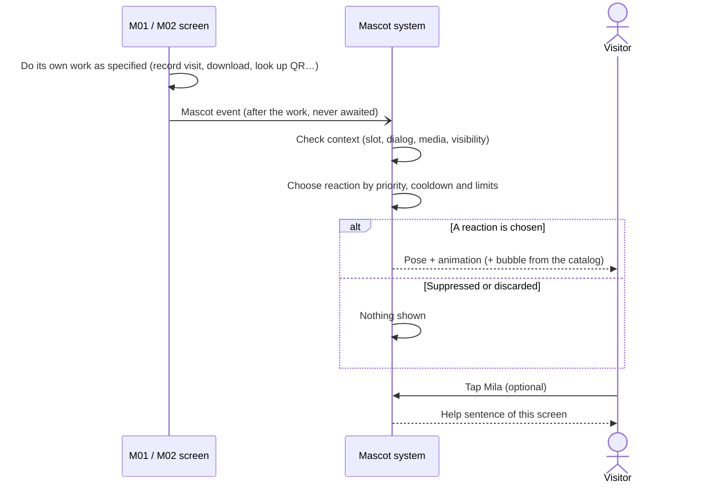

# Spec Document: Mascot — Mila, the Visitor Companion for M01 and M02

| Field | Value |
|---|---|
| Module | Mascot (cross-cutting visitor experience capability used by M01 and M02) |
| Version | 1.11 |
| Status | Behavioral baseline for the mascot capability (AGENTS.md §3.1). Implementation follows the approved change briefs CHG-MASCOT-2026-11-21-01, CHG-MASCOT-2026-11-22-02, CHG-MASCOT-2026-11-23-03, CHG-MASCOT-2026-11-23-04, CHG-MOTION-2026-11-24-01, CHG-MASCOT-2026-11-24-05, CHG-MASCOT-2026-11-25-06, CHG-MASCOT-2026-11-27-07, CHG-MASCOT-2026-11-27-08, CHG-MASCOT-2026-11-27-09, CHG-MASCOT-2026-11-28-10 and CHG-REC-2026-11-28-01. |
| Last updated | 2026-11-28 |
| Consumers | Visitor web app: M01 screens SCR-M01-001…004, M02 screens SCR-M02-001…004 |
| Depends on | spec-M01 v3.3 and spec-M02 v3.6 (check-in feedback may be presented by Mila, BR-MAS-24; end-of-trip prompt on SCR-M02-001, BR-M02-021) |
| Design input | docs/mascot/ (design package of 2026-11-20, updated 2026-11-21 and 2026-11-22) |
| MVP priority | Could (user decision 2026-11-21, OD-MAS-08; recorded in MVP-Scope.md §3.6) |

This specification describes one capability: **Mila**, an otter explorer character, accompanies the visitor on the M01 and M02 screens. Mila reacts to things that really happen in the app (a language is chosen, a QR scan is accepted, a download finishes, the network drops, the trip ends) with a pose, a short animation and, when useful, a short speech bubble. Mila never changes what the app does: it adds no step, blocks no action (except the one-time introduction overlay of US-MAS-01), stores nothing and replaces none of the fixed messages of spec-M01 or spec-M02. Where this document relies on a rule of spec-M01 or spec-M02, it cites that rule.

Business decisions made by the user are recorded in §10 with their dates.

## 1. Purpose and scope

Visitors currently receive correct but text-only feedback. The key field moment, a QR scan accepted in the forest, shows a single toast; help for first-time scanning is one sentence; network loss and errors feel cold. Mila makes these moments clearer and more enjoyable while keeping the visitor's attention on the forest and on safety.

In scope:

- A single character, Mila, shown in fixed places (slots) of the M01 and M02 visitor screens (§5.1).
- Reactions to defined app events (§5.2) with a pose, an animation and an optional speech bubble from a fixed bilingual catalog (§5.6).
- Short help when scanning is hard: inactivity on the scanner and repeated identical scan failures (BR-MAS-09, BR-MAS-10).
- Celebrations in three tiers when a visit is first recorded, at progress milestones and when the trip ends (BR-MAS-23).
- A help sentence that fits the situation of the screen when the visitor taps Mila, and defined behavior for repeated taps (BR-MAS-12, BR-MAS-22).
- Short ambient gestures between events on the screens where Mila waits, and a control that pauses all of Mila's motion together with the decorative motion of the visitor screens (BR-MAS-21; v1.4).
- Explicit behavior for each visitor activity context: reading, listening, watching, waiting for a scan, loading, interacting, error, leaving (BR-MAS-20).
- Behavior that is the same online and offline (BR-MAS-15).

Out of scope:

- Any change to a rule, contract, entity, state or permission of spec-M01, spec-M02 or spec-M03.
- Free conversation, generated text or any AI service.
- Sound or speech output.
- A button that hides, minimizes or silences Mila, or a "quiet mode" (user decision 2026-11-21, OD-MAS-03). The motion control of BR-MAS-21 pauses motion only; Mila stays visible.
- Points, leaderboards (user decision 2026-11-20), badges, rewards, puzzle pieces, quizzes or missions. These remain Won't in MVP-Scope.md §4 and spec-M02 §1; a later change would amend those documents first.
- Mila in M03 or on printed QR labels.
- Location, motion sensors or any detection of walking (MVP-Scope.md §4: no GPS).
- Sending any mascot event or reaction outside the device, including analytics.

### 1.1 Glossary

| Term | Meaning |
|---|---|
| Mila | The mascot character (user decision 2026-11-21). The name is the same in Vietnamese and English. Mila has no stated gender; documents refer to Mila by name or as "it". |
| Slot | A place reserved by a screen's layout where Mila may appear (§5.1). Mila never appears outside a slot and never overlaps other content. |
| Display mode | How Mila appears in a slot: `INTRO`, `DOCK`, `AVATAR`, `INLINE` or `CELEBRATE` (§5.1). |
| Pose | One of Mila's fixed images (waving, map, thinking, backpack, binoculars, magnifier, thumbs-up, cheer, confused, resting, pointing, avatar; v1.4: sorry, amazed, walking, peeking, proud). Which pose a reaction uses belongs to the design package (§5.5). |
| Decorative motion | Motion of the visitor screens that gives no feedback on a visitor action and carries no information (tier T3 of design-system §4.3: light, drifting leaves, confetti, counting numbers). Paused by the motion control of BR-MAS-21 (v1.4). |
| Bubble | Mila's speech bubble showing one catalog message (§5.6). |
| Mascot event | A notification that something defined in §5.2 has happened in M01 or M02. |
| Priority class | P0–P7 ordering used to choose between reactions (BR-MAS-05). |

## 2. Actors

| Actor | Type | Responsibilities |
|---|---|---|
| Visitor | Primary | Uses M01 and M02 as specified there; may tap Mila or close a bubble. |
| Free visitor | Primary | Opens a QR link without a session (spec-M02 US-M02-07); sees Mila only as defined in BR-MAS-14. |
| Mascot system | System | Receives mascot events, selects one reaction by priority and shows it in the active slot. |
| M01, M02 | Internal modules | Emit mascot events after their own work is done; their behavior is unchanged. |

## 3. User scenarios and acceptance criteria

### US-MAS-01 — Meet Mila

1. Given no `LanguagePreference` exists and the visitor chooses a language on the language step of SCR-M01-001, when the route catalog appears, then an introduction overlay covers the whole screen with Mila and MSG-MAS-001 in the chosen language, centred, and the hint "Chạm để bắt đầu" / "Tap to start" (v1.3, CHG-MASCOT-2026-11-23-04).
   - A tap anywhere on the overlay shows the whole sentence if it is still appearing; otherwise it closes the overlay and Mila takes its `DOCK` place in the catalog hero. The phone Back button and the Esc key close it at once. There is no skip button and no close button on this bubble, and the overlay never closes by itself.
   - The overlay is a modal dialog for assistive technology: focus moves into it when it opens and returns to the page heading when it closes; Enter and Space act as a tap.
   - If Mila cannot be shown (release switch off, image or internal error), no overlay appears and the catalog is unchanged.
2. Given the visitor opens a public QR link `/q/{qrIdentifier}` (spec-M02 BR-M02-024), then no introduction is shown and the content appears exactly as without Mila.
3. Given `LanguagePreference` already exists when the page loads, then no introduction is shown; the catalog may show MSG-MAS-004 once per page load.

### US-MAS-02 — Mila celebrates progress that really happened

1. Given a scan is accepted and the visit of a journey checkpoint is recorded for the first time (spec-M02 FR-M02-007, BR-M02-005), when the content appears, then Mila celebrates and its bubble confirms that the scan was recorded, with the progress "{k}/{n}" taken from the session; this bubble is the check-in feedback and replaces the "Đã ghi nhận lượt quét." toast, which stays as the fallback whenever Mila cannot present it (BR-MAS-24); the content is not delayed. Where the device supports it, the phone vibrates once briefly (BR-MAS-19).
2. A re-scan of a checkpoint already visited (FR-M02-009) produces no celebration.
3. A free visitor (no session) never sees progress or celebration.
4. When the visit of the final checkpoint is recorded for the first time, Mila confirms it like any other visit, with the tier of BR-MAS-23 (v1.6). The end-of-trip prompt of BR-M02-021 opens when the visitor returns to SCR-M02-001; Mila appears only inside that dialog, the standing Mila of that screen is hidden while it is open, and Mila never delays it.
5. The celebration has the tier of BR-MAS-23: an ordinary visit is a small celebration; the first visit, half of the checkpoints (n ≥ 4) and one checkpoint left (n ≥ 3) are milestones with a larger celebration and their own sentence.
6. On SCR-M02-002 and SCR-M02-004 the celebration motion repeats while the confirming bubble is shown (tier 1: a hop every few seconds; tier 2: two hops and continuously falling leaves), and stops when the bubble closes and Mila leaves (v1.6, user decision 2026-11-25).

### US-MAS-03 — Mila helps when scanning is hard

1. Given the in-app scanner opens and the session has no visit yet (or there is no session), then Mila shows MSG-MAS-040 below the scanning frame once per page load.
2. Given the scanner stays open without reading a code, then Mila looks around after `MASCOT_SCANNER_LOOK_S`, offers MSG-MAS-042 once after `MASCOT_SCANNER_HELP_S`, and offers MSG-MAS-049 with "Đóng camera" once after `MASCOT_SCANNER_CAMERA_OFF_S` (§5.4). It then stays silent until the scanner is closed.
3. Given two consecutive scans on SCR-M02-001 end in the invalid-QR message, then Mila shows MSG-MAS-046; two consecutive connection-needed results show MSG-MAS-048. The fixed messages of spec-M02 §5.1 remain shown unchanged.

### US-MAS-04 — Mila keeps the visitor calm about network and data

1. Given a session is running and the browser reports going offline, then Mila shows MSG-MAS-074 at most once per cooldown.
2. Mila never says that a trip was sent before its sync status is `SYNCED` (spec-M02 §6.4).
3. Mila never says that content is available offline unless it comes from a ready package (spec-M01 US-M01-03, spec-M02 BR-M02-009).

### US-MAS-05 — Mila stays out of the way

1. Given a scan returns `TEMPORARILY_CLOSED` (spec-M02 BR-M02-015), then Mila disappears from the screen and only the fixed closure notice is shown.
2. While audio or video is playing, while a dialog other than the end-of-trip prompt is open, or while the page is hidden, Mila shows no bubble.
3. Mila never covers the scanning frame, a button, the notice area, a toast, a dialog or article text.

### US-MAS-06 — Ask Mila

1. Given Mila is visible in a `DOCK` or `AVATAR` slot, when the visitor taps Mila, then Mila reacts visibly and shows the help sentence that fits the situation of that screen (BR-MAS-12); for example, during a trip with scanned checkpoints, how many remain.
2. Given the screen has more than one help sentence, when the visitor taps again while a help bubble is shown, then the next sentence is shown; with a single sentence, Mila only reacts visibly and the text does not flash.
3. Given the visitor taps Mila many times quickly, then taps within `MASCOT_TAP_DEBOUNCE_MS` count once, no animation restarts while running, bubbles never stack, and once per page load Mila shows the dizzy reaction (BR-MAS-22).

### US-MAS-07 — Prepare with Mila

1. A started package download shows MSG-MAS-020; a ready package shows MSG-MAS-021; a failure shows MSG-MAS-024 or MSG-MAS-025 according to the failure; no percentage is ever shown or implied.
2. Every time the recommendation form opens, Mila stands next to its heading (`DOCK`) (v1.5). Mila shows MSG-MAS-010 when the form is reached from anywhere except its own results page; when the visitor returns from the results page ("Đổi tiêu chí", or the browser's Back / back gesture), Mila stands without a bubble and speaks only when tapped (BR-MAS-12) (v1.11, CHG-REC-2026-11-28-01). A recommendation with results shows MSG-MAS-011 with Mila standing next to the results heading; two consecutive empty results show Mila as an illustration next to the fixed message and its existing "Xem tất cả tuyến" button (v1.2: no second button).
3. Every time the Start panel of a route with a safety warning becomes visible on SCR-M01-003, Mila shows MSG-MAS-014 in the Start panel slot (v1.6; before: once per route per page load). It has no cooldown and does not count towards BR-MAS-07.

### US-MAS-08 — Finish the trip with Mila

1. Given the visitor has just confirmed the end of the trip and the session is `HOAN_TAT`, when the trip result screen SCR-M02-003 opens, then Mila celebrates once (motion at most `MASCOT_CELEBRATION_MS`, skippable by a tap) with MSG-MAS-065, whether or not every journey checkpoint was scanned (v1.10; before: MSG-MAS-063 or MSG-MAS-062); Mila stands at the right of the screen's cover, the bubble beside it, and when the motion ends Mila stays there while the sentence stays for its reading time (v1.10; v1.5: in the farewell card).
2. Reopening the result screen later shows Mila in the cover without a celebration (v1.10; v1.5: in the farewell card; before: next to the badge).
3. When the trip could not be sent (`CONFLICT`), Mila stays in the cover without a bubble and the error banner has no figure, so the screen shows one Mila (v1.10).

### US-MAS-09 — Mila feels alive, and the visitor can pause it

1. Given Mila waits in a `DOCK` slot on SCR-M01-001, SCR-M01-002, SCR-M02-001 (scanner closed) or SCR-M02-003 with no bubble, then every `MASCOT_AMBIENT_MIN_MS`–`MASCOT_AMBIENT_MAX_MS` Mila makes one gesture of two or three beats, and between gestures Mila breathes gently (BR-MAS-21; v1.5).
2. Given the visitor switches the motion control off on the Resources screen SCR-M01-004 (v1.3), then no animation of Mila and no decorative motion runs on any screen, bubble text appears at once, the phone does not vibrate, and Mila stays visible; switching it on resumes gestures (v1.4).
3. Given the device asks for reduced motion, then the motion control starts switched off.
4. On reading screens, during media, while a dialog is open and while the page is hidden, Mila makes no ambient gesture (BR-MAS-20).

## 4. Flow

## 5. Functional requirements

| ID | Requirement | Behavioral baseline |
|---|---|---|
| FR-MAS-001 | Show Mila only in the slots of §5.1 and only in the display modes allowed for that slot. | Required |
| FR-MAS-002 | React only to the mascot events of §5.2, through the rules of §5.3; show nothing at random. | Required |
| FR-MAS-003 | Take every bubble text from the catalog of §5.6 in the current `LanguagePreference` (or, on the QR link page without a stored preference, the device-language rule of spec-M02 BR-M02-024); switching VI/EN switches a visible bubble at once. | Required |
| FR-MAS-004 | Introduce Mila once, after the first language choice on the language step (US-MAS-01). | Required |
| FR-MAS-005 | Celebrate the first recording of a visit, progress milestones and the end of a completed trip in the tiers of BR-MAS-23, with progress taken from the session (US-MAS-02, US-MAS-08). | Required |
| FR-MAS-006 | Offer scanner help on inactivity and on repeated identical failures (US-MAS-03). | Required |
| FR-MAS-007 | Disappear on a temporary closure and stay silent during media, dialogs and hidden pages (US-MAS-05). | Required |
| FR-MAS-008 | When tapped, react visibly and show the help sentence that fits the situation of the screen; handle repeated taps as BR-MAS-22 (US-MAS-06). | Required |
| FR-MAS-009 | Never change, delay, hide or replace any behavior, data or fixed message of spec-M01 or spec-M02, except the check-in feedback toast, which Mila's confirming bubble replaces as BR-MAS-24 defines. | Required |
| FR-MAS-010 | Work identically offline; never require the network for any reaction. | Required |
| FR-MAS-011 | Make short ambient gestures on the screens where Mila waits, and offer a motion control on the Resources screen SCR-M01-004 that pauses all of Mila's motion and all decorative motion on every screen without hiding Mila (US-MAS-09, BR-MAS-21; v1.3, v1.4). | Required |
| FR-MAS-012 | Adapt to the visitor's activity context as BR-MAS-20 defines (US-MAS-05, US-MAS-09). | Required |

### 5.1 Slots and display modes

| Display mode | Meaning |
|---|---|
| `INTRO` | Introduction overlay over the whole screen (v1.3): large Mila and one bubble centred on a dimmed background; used only for US-MAS-01. Ends on a tap after the sentence is complete, on Back or Esc, or on leaving the screen; then becomes `DOCK`. |
| `DOCK` | Mila standing in a reserved place of the layout. Always present while the screen is shown (no hide button, OD-MAS-03). Sizes belong to the design system. |
| `AVATAR` | Small round Mila with a bubble, shown for one reaction then removed. |
| `INLINE` | Still illustration next to an existing message, inside the content flow; no bubble. |
| `CELEBRATE` | Celebration on SCR-M02-003 only; never blocks interaction; at most `MASCOT_CELEBRATION_MS`; a tap ends it. |

| Screen | Slot | Modes |
|---|---|---|
| SCR-M01-001 route catalog | Hero area; empty and error states | INTRO, DOCK; INLINE |
| SCR-M01-002 recommendations | Heading of the form and of the results (v1.5); empty result | DOCK; INLINE |
| SCR-M01-003 route detail | Start panel (never on the safety warning block); package panel; offline decision dialog header | AVATAR, INLINE |
| SCR-M01-004 offline resources | Package panel; empty state | AVATAR, INLINE |
| SCR-M02-001 trip and scanner | Next to the Scan action; next to the notice area; scanner overlay strip below the frame; end-of-trip dialog header | DOCK; INLINE; AVATAR; INLINE |
| SCR-M02-002 checkpoint content | Where the visit toast appears (Mila's bubble is the check-in feedback, BR-MAS-24) | AVATAR |
| SCR-M02-003 trip result | In the screen's cover, at the right of the thank-you title, the bubble beside it (v1.10; v1.5: in the farewell card, which v1.10 removes) | CELEBRATE, DOCK |
| SCR-M02-004 QR link page | Where the visit toast appears (with a session; BR-MAS-24); next to the "Chọn tuyến" action at the end of the content (without; v1.8: the free-visitor sentence itself is a short toast at the top) | AVATAR; INLINE (OD-MAS-14) |

The motion control of BR-MAS-21 is shown once, on the Resources screen SCR-M01-004, also when Mila is disabled by the release switch (v1.4); screen headers have no motion control (v1.3).

A slot without Mila takes no space; when Mila appears the content below moves down, and Mila never covers content (v1.5, design-system §9.2). On SCR-M01-002 Mila stands next to the heading of the form, and next to the results heading only when there are results; with no result Mila is only the illustration next to the fixed message (v1.5).

Mila appears at most once on a screen. The journey progress bar of SCR-M02-001 and the package download bar use a non-character marker; they are not slots (v1.4, user decision 2026-11-24).

On SCR-M01-001 the hero has the title on its own row; below it, the "Route suggestions" action on the left and Mila in `DOCK` standing on the decorative hills in a fixed-width column on the right (v1.6, option C, user decision 2026-11-25). Nothing in the hero sizes itself to the length of a text, so switching VI/EN changes only the words: Mila keeps its size and every element keeps its place. A bubble of the catalog opens below the hero with its tail pointing up to Mila; Mila does not move, and the route list moves down by the bubble's height and back when it closes (design-system §9).

While the end-of-trip dialog of SCR-M02-001 is open, Mila appears only in the dialog header; the standing Mila next to the Scan action is hidden and returns when the dialog closes (v1.6).

On SCR-M02-001 a scan that ends in an invalid code or a code that could not be checked no longer shows an illustration in the notice: the first time, the standing Mila takes the confused pose without a bubble; the second identical failure in a row shows MSG-MAS-046 or MSG-MAS-048 there as before (BR-MAS-10). One Mila on the screen (v1.9).

Mila does not appear on: the language step panel, the safety warning block of SCR-M01-003, any closure notice, article text, the image gallery, media players, the delete-package dialog, the app update prompt, the camera-unavailable panel of the scanner (v1.8: the screen shows its own camera icon and steps, also when Mila is disabled), the scan-result notices for an invalid code or a code that could not be checked (v1.9: on SCR-M02-001 the standing Mila reacts instead, see below), and M03.

### 5.2 Mascot events (logical)

Event names, payload shapes and the place in code that emits them belong to the implementation package. Every event is emitted only after the module has finished the work it describes, is never awaited, is never stored and never leaves the device.

| Logical event | Emitted when | Source behavior (unchanged) |
|---|---|---|
| Language chosen on the language step | `LanguagePreference` is written from the language step | spec-M01 US-M01-01 |
| Language switched | The VI/EN control changes the language | spec-M01 US-M01-01 item 3 |
| Catalog loaded / slow / empty / unavailable | Catalog state changes | spec-M01 US-M01-02 |
| Recommendation opened / resolved (count) | Recommendation screen opens; results are computed | spec-M01 FR for recommendation |
| Start panel visible (route has a safety warning) | The Start panel enters the viewport, once per opening of the route detail (v1.6) | spec-M01 US-M01-06 |
| Start failed | Start is blocked or fails | spec-M01 US-M01-04 |
| Offline decision opened | The offline decision is shown | spec-M01 US-M01-03 |
| Package download started / resolved (ready, failed + reason) | A download or update starts or ends | spec-M01 US-M01-03 |
| Trip entered (started, restored, rejected, none) | SCR-M02-001 resolves the entry | spec-M02 US-M02-01 |
| Scanner opened / closed / code read / camera failed | The in-app scanner changes state | spec-M02 BR-M02-023 |
| Scan resolved (live content, package content, closed, invalid, connection needed; visit created; outside journey) | A scan has been resolved and any visit recorded | spec-M02 BR-M02-005, 008, 009, 015 |
| Visit recorded (k, n, final) | The visit of a checkpoint is recorded for the first time | spec-M02 FR-M02-007 |
| Media playing / stopped | Audio or video starts or stops | spec-M02 BR-M02-016 |
| End-of-trip prompt opened / continued | The prompt appears on SCR-M02-001; "Đi tiếp" is pressed | spec-M02 BR-M02-021, FR-M02-015 |
| Trip ended (status, k) | SCR-M02-003 opens right after the visitor ended the trip | spec-M02 US-M02-05 |
| Sync status changed | `PENDING`, `SYNCED`, `CONFLICT` changes on SCR-M02-003 | spec-M02 §6.4 |
| Page shown / hidden; network online / offline | Browser visibility or connectivity changes | spec-M02 BR-M02-022 (visibility), browser |
| Mila tapped; bubble closed | The visitor taps Mila or the bubble's close button | This spec |
| Visitor activity | The visitor touches, scrolls or presses a key on the screen | Browser (BR-MAS-20) |
| Motion control switched | The visitor switches the motion control on or off | This spec (BR-MAS-21) |

There is no "sync in progress", "journey paused" or "content read" event: spec-M02 defines no pause, the app exposes no in-progress sync state, and reading completion cannot be known reliably.

### 5.3 Business rules

| ID | Rule |
|---|---|
| BR-MAS-01 | **No business effect.** Mila reads events and existing data only. It never writes `PlaySession`, `CheckpointVisit`, `PendingSyncItem`, `LanguagePreference`, `OfflinePackage` or `SelectedRouteContext`, never changes `SessionSyncRecord`, and never calls M03. |
| BR-MAS-02 | **Fixed messages first.** The fixed messages of spec-M02 §5.1 and the screen copy of spec-M01/M02 screens are shown exactly as today. Mila never replaces, rewrites, covers or repeats them; where they already say enough, Mila is an `INLINE` illustration without a bubble. Exception decided by the user on 2026-11-23: the check-in feedback toast, which Mila's confirming bubble replaces (BR-MAS-24). MSG-MAS-030 was kept on 2026-11-23 although it was close to the session-start hint; since v1.7 it names the next checkpoint and no longer repeats the hint. A second exception (v1.3): the one-time introduction overlay of US-MAS-01 covers the catalog until the visitor taps it. |
| BR-MAS-03 | **Safety.** On a `TEMPORARILY_CLOSED` answer Mila is removed from the screen (not only hidden visually) and all pending reactions are dropped. Mila reappears only after the next scan or on another screen. |
| BR-MAS-04 | **Truthful wording.** No message states or implies arrival or presence for a visit (spec-M02 SC-M02-013), says that every checkpoint must be scanned (BR-M02-006, 007), says that data was sent before `SYNCED`, or promises offline content that is not in a ready package. |
| BR-MAS-05 | **Priority.** Reactions belong to one class: P0 safety, P1 blocking error, P2 system feedback, P3 visitor request, P4 success, P5 progress, P6 guidance, P7 ambient. A higher class interrupts a lower one. At most one bubble is visible. At most one reaction waits, for at most `MASCOT_QUEUE_TTL_MS`; P5–P7 never wait. |
| BR-MAS-06 | **No repetition.** Each message has a cooldown (§5.6 metadata in the design package). The same message is not shown again within its cooldown. Memory of what was said lasts for the current page load only. The same event received twice within 500 ms is handled once. |
| BR-MAS-07 | **Proactive limit.** At most `MASCOT_PROACTIVE_LIMIT` reactions of classes P5–P7 are shown in any `MASCOT_PROACTIVE_WINDOW_MIN` window across the app. Exception (v1.5, user decision 2026-11-24): MSG-MAS-010 is shown every time the recommendation form opens other than by returning from its results page (v1.11), has no cooldown and does not count towards this limit. The same applies to MSG-MAS-014 every time the Start panel of a route with a safety warning becomes visible (v1.6, user decision 2026-11-25). |
| BR-MAS-08 | **Focus contexts.** While media plays, while a dialog other than the end-of-trip prompt is open, or while the page is hidden, only P0–P1 apply and only as `INLINE`. All timers stop while the page is hidden and restart from zero when it is shown. |
| BR-MAS-09 | **Inactivity.** Inactivity is measured only on the open scanner and, once per page load, on the route catalog (§5.4). It is never measured on SCR-M02-001 outside the scanner, on reading screens, during media, or on SCR-M01-003. Meaningful activity (touch, key, scroll, a code read, a mascot event) resets the timer. |
| BR-MAS-10 | **Repeated failure.** Two consecutive identical scan failures (`INVALID`, or connection needed) on one visit of SCR-M02-001 trigger one help message; a different result resets the count. Two consecutive package failures for the same route trigger MSG-MAS-026. Two consecutive empty recommendations trigger MSG-MAS-013. |
| BR-MAS-11 | **Always present, never blocking.** Mila has no hide, minimize or quiet control (OD-MAS-03). A bubble with an action stays until the action, its close button or leaving the screen; a bubble without an action closes after its reading time. Mila never takes keyboard focus and never sits on top of another element, except the introduction overlay of US-MAS-01, which is a modal dialog shown once. The motion control of BR-MAS-21 is a setting on the Resources screen; it pauses motion only and is not a hide control. |
| BR-MAS-12 | **Tap for help.** Tapping Mila in a `DOCK` or `AVATAR` slot makes Mila react visibly and shows the help sentence that fits the situation (user decision 2026-11-22; per M01 screen since v1.6, user decision 2026-11-25): SCR-M01-001 MSG-MAS-009, then MSG-MAS-012 on the next tap; SCR-M01-002 form MSG-MAS-010, then MSG-MAS-015; SCR-M01-002 results MSG-MAS-016; SCR-M01-003 MSG-MAS-017 when the route has a safety warning, otherwise MSG-MAS-019, always in the Start panel slot; SCR-M01-004 MSG-MAS-018 in the package panel slot; SCR-M02-001 without a visit MSG-MAS-032, with visits and checkpoints left MSG-MAS-033 (v1.7: no count, the trip screen shows it), scanner open MSG-MAS-043; SCR-M02-002/004 MSG-MAS-059; SCR-M02-003 MSG-MAS-065. Help sentences are class P3: they replace a lower-class bubble, have no cooldown when requested, and do not count towards BR-MAS-07. There is no menu and no conversation. |
| BR-MAS-13 | **Nature reminders.** After the visitor returns to SCR-M02-001 from the content of a newly recorded visit, Mila alternates MSG-MAS-056 and one reminder from MSG-MAS-057a–e, subject to BR-MAS-06 and 07. MSG-MAS-056 is said only when there is a next checkpoint (v1.7); otherwise that turn has no bubble. The reminders are shown only after Park Management approves their wording (OD-MAS-05). |
| BR-MAS-14 | **Free visitor.** Without a session Mila shows scanner help and error illustrations only; no progress, celebration or trip messages. |
| BR-MAS-15 | **Offline.** All images and messages used by Mila are available on the device once the app shell is cached; no reaction needs the network. If an image is unavailable Mila is not shown and the screen works as without Mila. |
| BR-MAS-16 | **Failure isolation.** Any failure of the mascot system leaves the screen working exactly as without Mila. |
| BR-MAS-17 | **Reduced motion.** When the device asks for reduced motion, every animation becomes an immediate change or a fade of at most 150 ms, celebration particles are not shown, bubble text appears at once, and the motion control of BR-MAS-21 starts switched off. The same applies to the decorative motion of the visitor screens (v1.4). |
| BR-MAS-18 | **Privacy.** Mascot events and reactions are not stored and not sent anywhere; no analytics are added. |
| BR-MAS-19 | **Vibration.** When the visit of a checkpoint is recorded for the first time (US-MAS-02), the phone vibrates once for `MASCOT_VIBRATION_MS` where the browser supports it; never on any other event, and never while reduced motion is requested or the motion control of BR-MAS-21 is off (user decision 2026-11-21, OD-MAS-09; motion control added in v1.4). |
| BR-MAS-20 | **Activity contexts** (user decision 2026-11-22). *Reading* an article (SCR-M02-002/004 after the arrival reaction): no further reaction except a requested help sentence and P0–P2. *Listening* to audio or *watching* video: BR-MAS-08; a visible bubble closes at once. *Waiting for a scan* (scanner open): only the scanner timers of §5.4 and scan results. *Loading*: a message only when the wait passes its threshold (MSG-MAS-005, 044), never repeating text the screen already shows. *Interacting*: a reaction that is not the direct result of the visitor's own action (timer-driven help, reminders, ambient gestures) is dropped if it would start within `MASCOT_INTERACTION_GRACE_MS` of a touch, scroll or key press. *Error*: illustration next to the error, help only on repetition (BR-MAS-10); Mila never adds a button that duplicates the screen's own action. *Leaving*: on a screen change, pending reactions of the old screen are dropped, except the confirming bubble of a newly recorded visit (BR-MAS-24) carried to the content it opened (v1.6: no other sentence is carried, so MSG-MAS-011 never follows the visitor back to the form). |
| BR-MAS-21 | **Ambient motion and motion control** (user decision 2026-11-22, option A). On SCR-M01-001, SCR-M01-002 (v1.5), SCR-M02-001 with the scanner closed and SCR-M02-003, when Mila is in `DOCK` without a bubble, Mila makes one gesture of two or three beats (at most `MASCOT_AMBIENT_GESTURE_MS`) at a random interval between `MASCOT_AMBIENT_MIN_MS` and `MASCOT_AMBIENT_MAX_MS`, and breathes gently between gestures (v1.5, user decision 2026-11-24); never in the contexts of BR-MAS-08 or on reading screens. A looping animation of a reaction (waiting for a lookup or a download) runs at most `MASCOT_LOOP_MAX_MS` per occurrence. The Resources screen SCR-M01-004 shows one motion control for the whole app (v1.3, user decision 2026-11-23; v1.4, user decision 2026-11-24: switch "Hiệu ứng chuyển động" / "Motion effects", state on or off, shown also when Mila is disabled by the release switch); screen headers have none. Off: no animation of Mila runs, no particles, no decorative motion (§1.1), no vibration (BR-MAS-19), bubble text appears at once; Mila and its bubbles stay, and feedback to the visitor's own actions remains as a change of color or a fade of at most 150 ms (design-system §4.3). The choice lasts for the current page load and is not stored (BR-MAS-18). This satisfies WCAG 2.2.2 for motion that lasts more than 5 s; the user accepted on 2026-11-23 that the control sits on one screen, reached from the Resources tab (on a trip screen the visitor leaves the trip view to reach it). |
| BR-MAS-22 | **Repeated taps** (user decision 2026-11-22). Taps within `MASCOT_TAP_DEBOUNCE_MS` count once. A running animation is not restarted. At most one bubble is visible; a tap while a help bubble is shown follows US-MAS-06 item 2. `MASCOT_DIZZY_TAPS` taps within `MASCOT_DIZZY_WINDOW_MS` show the dizzy reaction once per page load (confused pose, wobble, MSG-MAS-085); afterwards taps behave normally. Mila never falls or shows harm. |
| BR-MAS-24 | **Mila confirms the recorded visit** (user decision 2026-11-23, CHG-MASCOT-2026-11-23-03). When the visit of a journey checkpoint is recorded for the first time (since v1.6 also the final checkpoint), Mila's celebrating bubble (MSG-MAS-050, 051, 055 or 058) is the check-in feedback of spec-M02 §8: its text states that the scan was recorded, it has the `status` role so assistive technology announces it once, and the "Đã ghi nhận lượt quét." toast is not shown. The toast is shown exactly as before whenever Mila cannot confirm: the release switch is off; Mila is hidden after a failure (BR-MAS-15, 16); the screen has no ready slot; or the confirming bubble has not appeared within `MASCOT_CONFIRM_FALLBACK_MS` of the visit being recorded. Since v1.6 the end-of-trip prompt (BR-M02-021) is no longer on the content screen, so the final checkpoint is confirmed like any other. The visitor never sees both the toast and the confirming bubble, and never sees neither. |
| BR-MAS-23 | **Celebration tiers** (user decision 2026-11-22). Tier 1, an ordinary newly recorded visit: one hop and MSG-MAS-050. Tier 2, milestones, in this order of precedence when several apply: the first visit of the session (MSG-MAS-051), half of the checkpoints when n ≥ 4 (MSG-MAS-055), one checkpoint left when n ≥ 3 (MSG-MAS-058): two hops, a few falling leaves and the milestone sentence. Tier 3, the end of a completed trip (US-MAS-08): the full celebration with MSG-MAS-065 (v1.10). Ending early is celebrated as positively as a full trip. Tiers are reactions only: nothing is counted, collected or stored, and MVP-Scope §4 stays Won't. Vibration follows BR-MAS-19 unchanged. |

### 5.4 Provisional limits

Provisional values to be validated in the field by the project owner, like `LOOKUP_TIMEOUT_SECONDS` in spec-M02 §9 (OD-MAS-12).

| Parameter | Value | Applies to |
|---|---|---|
| `MASCOT_SCANNER_LOOK_S` | 15 s | Look-around animation, no text (US-MAS-03) |
| `MASCOT_SCANNER_HELP_S` | 30 s | MSG-MAS-042, once per scanner opening |
| `MASCOT_SCANNER_CAMERA_OFF_S` | 90 s | MSG-MAS-049, once per scanner opening |
| `MASCOT_CATALOG_HINT_S` | 20 s | MSG-MAS-008, once per page load, only if the visitor has not scrolled or opened a route |
| `MASCOT_LOOKUP_SLOW_S` | 3 s | MSG-MAS-044 while a QR lookup is still pending (before `LOOKUP_TIMEOUT_SECONDS`) |
| `MASCOT_WELCOME_BACK_MIN` | 10 min | Page hidden at least this long with a running session → MSG-MAS-034 |
| `MASCOT_PROACTIVE_LIMIT` / `MASCOT_PROACTIVE_WINDOW_MIN` | 3 / 10 min | BR-MAS-07 |
| `MASCOT_QUEUE_TTL_MS` | 4 000 ms | BR-MAS-05 |
| `MASCOT_CELEBRATION_MS` | 2 400 ms | US-MAS-08 |
| `MASCOT_VIBRATION_MS` | 30 ms | BR-MAS-19 |
| `MASCOT_AMBIENT_MIN_MS` / `MASCOT_AMBIENT_MAX_MS` | 4 000 / 7 000 ms (v1.5; before 8 000 / 15 000) | BR-MAS-21 |
| `MASCOT_AMBIENT_GESTURE_MS` | 3 000 ms (v1.5; before 1 500) | BR-MAS-21: longest ambient gesture |
| `MASCOT_LOOP_MAX_MS` | 5 000 ms | BR-MAS-21 |
| `MASCOT_INTERACTION_GRACE_MS` | 2 000 ms | BR-MAS-20 |
| `MASCOT_TAP_DEBOUNCE_MS` | 400 ms | BR-MAS-22 |
| `MASCOT_DIZZY_TAPS` / `MASCOT_DIZZY_WINDOW_MS` | 5 / 3 000 ms | BR-MAS-22 |
| `MASCOT_CONFIRM_FALLBACK_MS` | 1 000 ms | BR-MAS-24: show the toast if Mila's confirming bubble has not appeared |
| `MASCOT_TYPE_CPS` | 30 characters per second | Bubble text appearing progressively; a tap on the bubble shows it at once |
| Bubble length | ≤ 90 characters after substitution, at most 2 sentences; exception: MSG-MAS-001 in the introduction overlay (v1.3), which waits for a tap | §5.6 |
| `MASCOT_BUBBLE_READ_MS` — bubble reading time | 15 000 ms after the text is complete (v1.5, user decision 2026-11-24; before 3 000–7 000 ms by length); the close button ends it earlier; leaving the screen ends it | Bubbles without action, on every screen |

### 5.5 Appearance

Mila's look (three identity anchors: brown and cream fur, green scarf with a white leaf, moss-green explorer backpack), the poses, sizes, animations and colors belong to docs/design/design-system.md and docs/mascot/MASCOT_ASSET_SPECIFICATION.md, not to this specification. Images are supplied by the user (AGENTS.md §4); the mascot artwork is raster and is not converted to SVG.

### 5.6 Message catalog

Proposed wording for review. `{name}` is `Mila`; `{k}` scanned checkpoints, `{n}` journey checkpoints, `{count}` matching routes; `{next}` (v1.7) the name, in the current language, of the suggested next checkpoint of the trip screen: the first journey checkpoint not yet scanned in display order (spec-M02 §7). It is a hint, never an order (BR-M02-006). A sentence with `{next}` is said only when there is such a checkpoint; when the full sentence would exceed 90 characters its first sentence alone is shown, and when even that exceeds 90 characters the sentence is not shown. Buttons reuse existing labels where named. Metadata (class, cooldown, reading time) is kept in docs/mascot/MASCOT_DIALOGUE_LIBRARY.md, where `MAS-MSG-nnn` corresponds to `MSG-MAS-nnn`.

| Key | When | Vietnamese | English |
|---|---|---|---|
| MSG-MAS-001 | US-MAS-01, introduction overlay (v1.3: one bubble; longer than 90 characters by decision) | Chào bạn! Mình là {name}, rái cá thám hiểm của Cúc Phương. Mình sẽ đồng hành cùng bạn trong suốt chuyến tham quan này. Cùng chọn một tuyến nhé! | Hi! I'm {name}, Cúc Phương's otter explorer. I'll be with you throughout this visit. Let's pick a route! |
| MSG-MAS-002 | Removed in v1.3 (merged into MSG-MAS-001) | — | — |
| MSG-MAS-004 | Returning visitor, catalog | Chào mừng bạn quay lại! Hôm nay mình đi tuyến nào đây? | Welcome back! Which route are we taking today? |
| MSG-MAS-005 | Catalog still loading after 600 ms | Mình đang mở bản đồ các tuyến… | Unfolding the route map… |
| MSG-MAS-008 | Catalog inactivity (button "Gợi ý tuyến") | Chưa biết chọn tuyến nào? Để mình gợi ý cho. | Not sure which route? Let me suggest one. |
| MSG-MAS-009 | Tap, SCR-M01 screens | Chạm vào một tuyến để xem chi tiết, hoặc thử Gợi ý tuyến. | Tap a route for details, or try Route suggestions. |
| MSG-MAS-012 | Tap, SCR-M01 screens, second sentence | Bấm Gợi ý tuyến, mình chọn giúp theo thời gian và sở thích của bạn. | Tap Route suggestions and I'll pick by your time and interests. |
| MSG-MAS-010 | Recommendations opened (v1.11 wording) | Bạn có bao lâu, đi cùng ai, thích gì? Để mình gợi ý cho nhé! | How long do you have, who's coming, what do you enjoy? Let me suggest some routes! |
| MSG-MAS-011 | Recommendation with results | Đây là những tuyến hợp với bạn! | Here are the routes that suit you! |
| MSG-MAS-013 | Second empty recommendation | — (illustration only since v1.2: the fixed message already says it) | — |
| MSG-MAS-014 | Start panel visible, route has a safety warning | Trước khi đi, bạn đọc kỹ phần Cảnh báo an toàn ngay bên dưới giúp mình nhé. | Before you head out, please read the Safety warning just below. |
| MSG-MAS-015 | Tap, SCR-M01-002 form, second sentence (v1.6; v1.11 wording) | Chọn xong các mục rồi bấm "Xem tuyến phù hợp" nhé! | Done choosing? Tap "Show matching routes"! |
| MSG-MAS-016 | Tap, SCR-M01-002 results (v1.6) | Chạm vào một tuyến để xem chi tiết, hoặc bấm Đổi tiêu chí. | Tap a route for details, or tap Change choices. |
| MSG-MAS-017 | Tap, SCR-M01-003, route with a safety warning (v1.6) | Đọc kỹ Cảnh báo an toàn, tải gói nếu cần, rồi bấm Bắt đầu nhé. | Read the Safety warning, download the pack if you need it, then tap Start. |
| MSG-MAS-018 | Tap, SCR-M01-004 (v1.6) | Tải gói trước khi vào rừng để xem tuyến khi mất sóng. | Download the pack before you go, so the route works without signal. |
| MSG-MAS-019 | Tap, SCR-M01-003, route without a safety warning (v1.6) | Tải gói nếu cần, rồi bấm Bắt đầu nhé. | Download the pack if you need it, then tap Start. |
| MSG-MAS-020 | Download started | Mình đang xếp nội dung vào ba lô. Giữ trang này mở nhé. | Packing your route into the backpack. Keep this page open. |
| MSG-MAS-021 | Package ready | Giờ các điểm này xem được cả khi mất sóng. | These stops now work without signal. |
| MSG-MAS-024 | Download failed (source or download) | — (illustration only since v1.2: the fixed message already says it) | — |
| MSG-MAS-025 | Download failed (storage) | — (illustration only since v1.2: the fixed message already says it) | — |
| MSG-MAS-026 | Second consecutive download failure, online | Vẫn chưa được. Có mạng thì bạn vẫn đi được, chỉ vài điểm cần sóng để xem. | Still no luck. You can go without it, but some stops will need signal. |
| MSG-MAS-030 | Trip started (v1.7: names the next checkpoint) | Điểm tiếp theo: {next}. Tìm tem QR ở đó rồi bấm Quét QR nhé! | Next stop: {next}. Find its QR sign there and tap Scan QR! |
| MSG-MAS-032 | Tap, SCR-M02-001 | Thấy tem thì bấm Quét QR. Chạm điểm đã quét để đọc lại nhé. | Spot a sign? Tap Scan QR. Tap a scanned stop to read it again. |
| MSG-MAS-033 | Tap, SCR-M02-001 with visits and checkpoints left (v1.7: no count) | Chạm điểm đã quét để đọc lại, hoặc quét tem QR ở điểm tiếp theo nhé. | Tap a scanned stop to read it again, or scan the sign at the next stop. |
| MSG-MAS-034 | Back after at least 10 min with a running session | Chào mừng quay lại! Hành trình của bạn vẫn còn nguyên. | Welcome back! Your trip is just as you left it. |
| MSG-MAS-040 | Scanner opened, no visit yet or no session | — (illustration only since v1.2: the fixed message already says it) | — |
| MSG-MAS-042 | Scanner inactivity, help | Chưa quét được? Thử lại gần hơn và tránh chỗ chói nắng. | No luck yet? Move a little closer and avoid the glare. |
| MSG-MAS-043 | Tap, scanner open | Lại gần tem hơn và tránh chỗ chói nắng nhé. | Move closer to the sign and avoid the glare. |
| MSG-MAS-044 | Lookup still pending | Sóng hơi yếu, mình vẫn đang kiểm tra… | Weak signal, still checking… |
| MSG-MAS-046 | Second consecutive invalid QR | Hãy quét tem QR của Vườn ở điểm dừng. Tem cũ thì thử tem khác nếu có. | Scan a park QR sign at the stop. If it looks old, try another one. |
| MSG-MAS-048 | Second consecutive connection needed | Mã này cần có sóng để kiểm tra. Điểm trong tuyến vẫn quét được khi mất sóng. | This code needs signal to check. Stops on your route still scan offline. |
| MSG-MAS-049 | Scanner inactivity, battery (buttons "Đóng camera" / "Chưa") | Mình tắt camera cho đỡ tốn pin nhé? | Shall I turn the camera off to save battery? (buttons "Close camera" / "Not now") |
| MSG-MAS-050 | Visit recorded, tier 1 (BR-MAS-24) | {cheer} Đã ghi nhận lượt quét: {k}/{n} điểm. — {cheer}: Tuyệt! · Hay quá! · Thêm một điểm nữa! | {cheer} Scan recorded: {k} of {n} stops. — {cheer}: Nice! · Great! · One more on the trail! |
| MSG-MAS-051 | First visit of the session, tier 2 (BR-MAS-24) | Đã ghi nhận mã QR đầu tiên! Đọc thử câu chuyện của điểm này nhé. | First scan recorded! Take a moment to read this stop's story. |
| MSG-MAS-052 | Valid QR outside the journey, with a session (OD-MAS-13) | Điểm này không thuộc tuyến của bạn nên không tính vào hành trình. Cứ xem nhé! | This spot isn't on your route, so it won't count. Enjoy reading anyway! |
| MSG-MAS-054 | Content from the package after a lookup failure | — (illustration only since v1.2: the fixed message already says it) | — |
| MSG-MAS-055 | Half of the checkpoints scanned (n ≥ 4), tier 2 (BR-MAS-24) | Đã ghi nhận! Bạn đã quét được nửa số điểm rồi đó! | Recorded! You've scanned half of your stops! |
| MSG-MAS-056 | Back on SCR-M02-001 after a new visit, with a next checkpoint (v1.7) | Điểm tiếp theo: {next}. Tham quan xong thì đi tiếp và quét mã nhé! | Next stop: {next}. Take your time here, then scan there. |
| MSG-MAS-057a | Nature reminder (OD-MAS-05) | Đi nhẹ, nói khẽ để nghe được tiếng rừng nhé. | Walk softly and talk quietly, the forest is listening. |
| MSG-MAS-057b | Nature reminder | Ngắm thôi, đừng hái hay mang gì ra khỏi rừng nhé. | Look, don't pick. Leave everything as you found it. |
| MSG-MAS-057c | Nature reminder | Giữ rác trong ba lô cho tới khi gặp thùng rác nhé. | Keep your litter in your bag until you find a bin. |
| MSG-MAS-057d | Nature reminder | Đi đúng đường mòn để an toàn cho bạn và cho rừng. | Stay on the trail, it's safer for you and the forest. |
| MSG-MAS-057e | Nature reminder | Đừng cho thú ăn nhé, đồ ăn của người không tốt cho chúng. | Please don't feed the animals, our food isn't good for them. |
| MSG-MAS-058 | One checkpoint left (n ≥ 3), tier 2 (BR-MAS-24) | Đã ghi nhận! Chỉ còn một điểm nữa thôi! | Recorded! Just one stop to go! |
| MSG-MAS-059 | Tap, SCR-M02-002/004 | Vuốt ảnh để xem thêm, kéo xuống để đọc phần giới thiệu. | Swipe the photos, then scroll down to read more. |
| MSG-MAS-061 | "Đi tiếp" pressed | Được thôi! Khi sẵn sàng, nút Kết thúc chuyến vẫn ở đây. | Sure! The End trip button is here whenever you're ready. |
| MSG-MAS-062 | **Retired in v1.10** (was: trip just ended, `HOAN_TAT`); the ID is not reused | Hôm nay mình đã cùng bạn quét {k} điểm. Vui ghê! | We scanned {k} stops together today. What a trip! (k = 1: "We scanned 1 stop together today. What a trip!") |
| MSG-MAS-063 | **Retired in v1.10** (was: trip just ended, `HOAN_TAT`, every journey checkpoint scanned); the ID is not reused | Bạn đã quét đủ {n} điểm của tuyến. Tuyệt vời! | You scanned all {n} stops of the route. Amazing! |
| MSG-MAS-065 | Tap, SCR-M02-003; since v1.10 also trip just ended, `HOAN_TAT` (US-MAS-08) | Cảm ơn bạn đã đi cùng mình hôm nay! | Thanks for exploring with me today! |
| MSG-MAS-070 | Result screen, `PENDING`, device offline | Chuyến đi đã lưu trên máy. Lần tới có sóng và mở app, mình sẽ gửi đi. | Your trip is saved on this phone. I'll send it next time you're online. |
| MSG-MAS-074 | Network lost during a session | Mất sóng rồi. Đừng lo, các điểm trong tuyến vẫn quét được. | Signal's gone, but stops on your route can still be scanned. |
| MSG-MAS-075 | Network back after MSG-MAS-074 | Có sóng lại rồi! | Signal's back! |
| MSG-MAS-085 | Dizzy reaction (BR-MAS-22) | Ui, chóng mặt quá! | Whoa, I'm dizzy! |

Accessible names (new): "Hiệu ứng chuyển động" / "Motion effects" for the motion switch on SCR-M01-004 (state on/off; v1.4, before: "Chuyển động của {name}"), with the hint "Tắt để {name} và hiệu ứng trang trí đứng yên." / "Turn off to keep {name} and decorations still."; "{name}" for the introduction overlay dialog, with the hint "Chạm để bắt đầu" / "Tap to start"; "Hỏi {name}" / "Ask {name}" for tapping Mila; "Đóng lời nhắn" / "Dismiss message" for a bubble's close button; "Chưa" / "Not now" for the second button of MSG-MAS-049.

## 6. Key entities

None. Mascot events are transient notifications; Mila's state, cooldowns and timers are transient UI state of the open page. Nothing is persisted, and no canonical entity, field or relationship is added to data/01-entity-dictionary.md or later stages (BR-MAS-01, BR-MAS-18). The previously considered quiet-mode preference was dropped (OD-MAS-03).

## 7. Success criteria

| ID | Criterion |
|---|---|
| SC-MAS-001 | With Mila enabled, every existing automated test of M01 and M02 passes unchanged, and the stored data and `SessionSyncRecord` produced by a trip are identical to those produced without Mila. |
| SC-MAS-002 | On every screen and at 320–430 px width, Mila and its bubble never overlap the scanning frame, an action button, the notice area, a toast, a dialog or article text. |
| SC-MAS-003 | A `TEMPORARILY_CLOSED` answer never shows Mila on the screen. |
| SC-MAS-004 | No bubble appears while audio or video is playing. |
| SC-MAS-005 | Recording the final checkpoint's visit shows the check-in feedback like any other visit, and the end-of-trip prompt opens on the next SCR-M02-001 with no added delay (v1.6). |
| SC-MAS-006 | No catalog message contains a presence word (SC-M02-013), a must-scan-all statement, a "sent" claim before `SYNCED`, or exceeds 90 characters in either language, except MSG-MAS-001 of the introduction overlay (v1.3). |
| SC-MAS-007 | With the device offline after the app shell is cached, every reaction of M02 shows its image and text. |
| SC-MAS-008 | With reduced motion requested, no mascot animation runs. |
| SC-MAS-009 | A free visitor never sees progress or celebration. |
| SC-MAS-010 | Opening a public QR link shows its content without any mascot introduction or added delay. |
| SC-MAS-011 | With the motion control off, no animation of Mila and no decorative motion runs on any screen, and Mila stays visible (v1.4). |
| SC-MAS-012 | No ambient gesture starts on a reading screen, during media, while a dialog is open or within `MASCOT_INTERACTION_GRACE_MS` of a visitor touch, scroll or key press. |
| SC-MAS-013 | Any sequence of taps never shows two bubbles at once, never restarts a running animation, and shows the dizzy reaction at most once per page load. |
| SC-MAS-015 | Every newly recorded visit (since v1.6 also the final one) shows exactly one check-in feedback: Mila's confirming bubble or, when Mila cannot present it, the toast; never both, never neither (BR-MAS-24). |
| SC-MAS-014 | No animation of Mila that starts without a visitor action runs longer than 5 s unless the motion control is available in the app (SCR-M01-004, v1.3). |
| SC-MAS-016 | The introduction overlay appears at most once, only after the first language choice; one tap after the sentence is complete, Back or Esc closes it, and focus returns to the page (v1.3). |

## 8. Screens involved

| Screen | Screen spec | Change |
|---|---|---|
| SCR-M01-001 | screens/screen-spec/M01/screen-spec-SCR-M01-001.md | Slots of §5.1; hero with a title row and an action + Mila row (v1.6); introduction overlay; MSG-MAS-001, 004, 005, 008, 009, 012, 085 |
| SCR-M01-002 | screens/screen-spec/M01/screen-spec-SCR-M01-002.md | Slots; MSG-MAS-010, 011, 013, 015, 016 |
| SCR-M01-003 | screens/screen-spec/M01/screen-spec-SCR-M01-003.md | Slots; MSG-MAS-014, 017, 019, 020, 021, 024–026 |
| SCR-M01-004 | screens/screen-spec/M01/screen-spec-SCR-M01-004.md | Slots; motion control (v1.3; label and visibility v1.4); MSG-MAS-018, 020, 021, 024, 025 |
| SCR-M02-001 | screens/screen-spec/M02/screen-spec-SCR-M02-001.md | Slots; MSG-MAS-030–049, 056, 057, 061, 074, 075, 085 |
| SCR-M02-002 | screens/screen-spec/M02/screen-spec-SCR-M02-002.md | Slot; MSG-MAS-050–055, 058, 059 |
| SCR-M02-003 | screens/screen-spec/M02/screen-spec-SCR-M02-003.md | Slot; MSG-MAS-065, 070, 085 (v1.10) |
| SCR-M02-004 | screens/screen-spec/M02/screen-spec-SCR-M02-004.md | Slots; as SCR-M02-002 with a session |

No new screen. Screen specs are derived documents and are updated only after this spec becomes a baseline.

## 9. Assumptions

- Visitors use the app on a phone in the forest, often walking with the screen off; Mila therefore never prompts on a timer outside the scanner and the catalog.
- The images of Mila are supplied by the user as individual transparent images per pose; until then, development uses temporary images that are not released (OD-MAS-06).
- The visitor may find Mila unnecessary; without a hide control (OD-MAS-03), restraint relies on BR-MAS-05 to 10. Field testing may tighten the limits of §5.4.
- Mascot timing values are provisional and validated in the field by the project owner before the first real release.

## 10. Open business decisions

| ID | Question | Status |
|---|---|---|
| OD-MAS-01 | Name of the mascot | **Decided 2026-11-21:** Mila, same in both languages. |
| OD-MAS-02 | Make mascot behavior a canonical specification, as for AI Integration? | **Decided 2026-11-21:** yes (this document). |
| OD-MAS-03 | Offer a hide/minimize button or a quiet mode? | **Decided 2026-11-21:** no; Mila is always present where a slot exists (BR-MAS-11). |
| OD-MAS-04 | Let the visitor tap Mila for help? | **Decided 2026-11-21:** yes, simply: one fixed sentence per screen (BR-MAS-12). **Revised 2026-11-22:** the sentence fits the situation of the screen; still no menu or conversation. |
| OD-MAS-05 | Nature reminders | **Decided 2026-11-21:** accepted; wording approved by Park Management before release (BR-MAS-13). |
| OD-MAS-06 | Who produces the release images? | **Decided 2026-11-21:** the user, later, following the asset specification. **Delivered 2026-11-22:** first batch of 9 poses, designed by the user. |
| OD-MAS-07 | Usage rights of the image generation tool | **Decided 2026-11-21:** the user confirms when delivering the images; no image enters the repository before. **Confirmed 2026-11-22:** the user designed the images and confirmed the usage rights. |
| OD-MAS-08 | MVP priority | **Decided 2026-11-21:** Could (no Must flow depends on Mila). |
| OD-MAS-09 | A short vibration when a visit is recorded? | **Decided 2026-11-21:** yes, 30 ms, where supported (BR-MAS-19). |
| OD-MAS-10 | On SCR-M02-003, does Mila stand next to the approved completion badge or replace it? | **Decided 2026-11-21:** next to it; the badge stays (§5.1). **Changed 2026-11-24 (v1.5, OD-MAS-27):** the badge stands alone; Mila moves to the farewell card. |
| OD-MAS-11 | Show the progress "{k}/{n}" in Mila's bubble next to the unchanged toast "Đã ghi nhận lượt quét."? | **Decided 2026-11-21:** yes (MSG-MAS-050). |
| OD-MAS-12 | Timing values of §5.4 | **Decided 2026-11-21:** provisional values, validated in the field by the project owner (§9). |
| OD-MAS-13 | New sentence for a valid QR outside the journey (MSG-MAS-052), which also fills the "outside journey" feedback the design system expects | **Decided 2026-11-21:** yes. |
| OD-MAS-14 | Show Mila as an illustration next to the free-visitor hint on the QR link page? | **Decided 2026-11-21:** yes, `INLINE`, no bubble (§5.1, BR-MAS-14). |
| OD-MAS-15 | Keep a technical on/off switch for releases (not a visitor control) | **Decided 2026-11-21:** yes; switched on once the pilot is approved. It is environment configuration, not visitor behavior (docs/architecture/environment.md). |
| OD-MAS-16 | Does "no hide button" (OD-MAS-03) still allow a close button on each bubble? | **Decided 2026-11-21:** yes. Mila itself cannot be hidden; each bubble has a close button that closes that message only (BR-MAS-11; design-system §5.3). |
| OD-MAS-17 | Make Mila more animated, given that motion lasting more than 5 s needs a pause control (WCAG 2.2.2)? | **Decided 2026-11-22:** option A, ambient gestures every 8–15 s on waiting screens plus a motion control in the header (BR-MAS-21). **Changed 2026-11-23 (v1.3):** the control moves from the headers to the Resources screen SCR-M01-004. |
| OD-MAS-19 | Visit confirmation shown twice (toast and Mila) | **Decided 2026-11-23:** option C — Mila's bubble replaces the toast when it can present it; the toast stays the fallback; no toast at the final checkpoint (BR-MAS-24). |
| OD-MAS-20 | Lines close to fixed messages (030, 065, and the not yet built 011, 013, 021, 024, 025, 040, 043, 054) | **Decided 2026-11-23:** keep 030 and 065; 013, 024, 025, 040, 054 become illustrations; 011, 012, 021, 043 reworded (§5.6). |
| OD-MAS-21 | One control for all decorative motion, or one for Mila only? (CHG-MOTION-2026-11-24-01, OD-MOT-01…03) | **Decided 2026-11-24:** one control "Hiệu ứng chuyển động" in BR-MAS-21 for Mila and the decorative motion; shown also when Mila is disabled; not stored. |
| OD-MAS-22 | Mila walking along the journey progress bar (a second figure on SCR-M02-001)? (OD-MOT-06) | **Decided 2026-11-24:** no; Mila appears at most once on a screen (§5.1); the bar uses a footprint marker. |
| OD-MAS-23 | Ambient gestures felt rare and too short (phone/laptop review 2026-11-24) | **Decided 2026-11-24:** every 4–7 s, two or three beats up to 3 s, gentle breathing between gestures (BR-MAS-21). |
| OD-MAS-24 | Bubbles closed before the visitor could read them | **Decided 2026-11-24:** 15 s on every screen; the visitor may close earlier (§5.4). |
| OD-MAS-25 | Mila disappeared from the recommendation screen and never came back | **Decided 2026-11-24:** Mila stands next to the heading (`DOCK`); MSG-MAS-010 every time the form opens (§5.1, BR-MAS-07, US-MAS-07). |
| OD-MAS-26 | Empty space left where Mila was | **Decided 2026-11-24:** a slot without Mila takes no space on every screen (§5.1; design-system §9.2). |
| OD-MAS-27 | Badge and Mila side by side looked unbalanced on SCR-M02-003 (owner review 2026-11-24, five mockups) | **Decided 2026-11-24:** option E — the completion badge stands alone centred; Mila replaces the heart icon of the farewell card; with Mila disabled the heart stays (§5.1, US-MAS-08). |
| OD-MAS-28 | Large celebrating Mila stayed for the whole 15 s reading time (DV-92) | **Decided 2026-11-24:** the celebration motion lasts at most `MASCOT_CELEBRATION_MS`, then Mila returns to its standing size and place while the sentence stays (US-MAS-08). |
| OD-MAS-29 | Tapping Mila on the recommendation form, the results and the route detail showed the catalog's sentences (owner review of production, 2026-11-25) | **Decided 2026-11-25:** each M01 screen has its own tap sentences MSG-MAS-015…019; on the route detail the sentence opens in the Start panel slot (BR-MAS-12). |
| OD-MAS-30 | Mila greeted only the first time on the recommendation form and on the route detail | **Decided 2026-11-25:** Mila greets every time the form opens, however it was reached (US-MAS-07.2; only the visit confirmation is carried between screens, BR-MAS-20), and MSG-MAS-014 is shown every time the Start panel becomes visible (US-MAS-07.3, BR-MAS-07). |
| OD-MAS-31 | Catalog hero: Mila too small in VI, elements too large and overlapping in EN (owner review 2026-11-25, four mockups A–D) | **Decided 2026-11-25:** option C — title on its own row; the "Route suggestions" action and Mila on the hills share the row below; Mila in a fixed-width column so VI/EN change only the words (§5.1; design-system §9.2, §9.3a). |
| OD-MAS-32 | Mila and the leaves on the content screen seemed to last about 5 s; Mila hopped once | **Decided 2026-11-25:** Mila stays for the bubble's reading time (about 15 s) and the celebration motion and leaves repeat until Mila leaves (US-MAS-02.6). |
| OD-MAS-33 | End-of-trip prompt on the content screen; translucent prompt with two Milas on SCR-M02-001 | **Decided 2026-11-25:** the prompt moves to SCR-M02-001 (spec-M02 v3.4 BR-M02-021); the final checkpoint is confirmed like any other visit (BR-MAS-24); the prompt is a solid panel on a dimmed backdrop with Mila only in its header (§5.1). |
| OD-MAS-34 | Result screen: Mila and the badge apart, white text hard to read on the bright forest photo, three thank-you sentences, the visit list pushed below the fold (owner review 2026-11-28, M02-43, 44, 48) | **Decided 2026-11-28:** one thank-you title on a dark cover; Mila cheers at the right of the cover with MSG-MAS-065 in a bubble beside it; the farewell card and the stand-alone badge are removed; the completion mark is the summary card's ring (US-MAS-08, §5.1). |
| OD-MAS-18 | Confirmation button after the introduction on the language step | **Decided 2026-11-23 (v1.3):** the introduction becomes a centred overlay with one sentence, closed by a tap ("Chạm để bắt đầu"), no skip button (US-MAS-01). |

## 11. Relationship to other documents

| Topic | Effect |
|---|---|
| spec-M01, spec-M02, spec-M03 rules, contracts, entities, states, permissions | Unchanged. This document cites spec-M01 US-M01-01 to 06 and spec-M02 FR-M02-007, 009; BR-M02-005, 006, 007, 008, 009, 015, 016, 021, 022, 023, 024; SC-M02-013; §5.1; §6.4; §9. |
| MVP-Scope.md | Adds one capability row (priority OD-MAS-08). §4 Won't is unchanged: badges, points and quizzes stay out. |
| AGENTS.md | Must list this file in §3.1 and §4, and add ownership rows for docs/mascot/ and assets/mascot/, before this spec is a baseline. |
| Derived documents to update after approval | function list (new file for this capability); docs/design/design-system.md (§4.3 motion, §5.4 "no extra motion" rule, new Mascot section and tokens); screen specs and screen lists of M01 and M02; docs/architecture/environment.md (switch, if OD-MAS-15); README.md, docs/README.md. |
| Design package | docs/mascot/ is the design input. On conflict, this specification wins. |
| Change briefs | CHG-MASCOT-2026-11-21-01 for documentation sync and local frontend implementation; CHG-MASCOT-2026-11-22-02 for v1.1; CHG-MASCOT-2026-11-23-03 for v1.2 (with one line of spec-M02 §8); CHG-MASCOT-2026-11-23-04 for v1.3; CHG-MOTION-2026-11-24-01 for v1.4 (motion of the visitor screens, package specs/006-visitor-motion); CHG-MASCOT-2026-11-24-05 for v1.5; CHG-MASCOT-2026-11-25-06 for v1.6; CHG-MASCOT-2026-11-27-07 for v1.7; CHG-MASCOT-2026-11-27-08 for v1.8; CHG-MASCOT-2026-11-27-09 for v1.9. No backend, cloud or data change is involved. |
| docs/design/design-system.md | §4.3 defines the motion tiers T1 feedback, T2 transition, T3 decorative (v1.4); the motion control of BR-MAS-21 pauses Mila and T3. |

### 11.1 Traceability (US → FR → BR → SC)

| User story | FR | BR | SC |
|---|---|---|---|
| US-MAS-01 Meet Mila | FR-MAS-003, 004 | BR-MAS-02, 06, 11 | SC-MAS-010, 016 |
| US-MAS-02 Celebrate real progress | FR-MAS-005, 009 | BR-MAS-01, 04, 05, 14, 19, 23, 24 | SC-MAS-001, 005, 009, 015 |
| US-MAS-03 Help when scanning is hard | FR-MAS-006 | BR-MAS-09, 10, 07 | SC-MAS-002 |
| US-MAS-04 Calm about network and data | FR-MAS-010 | BR-MAS-04, 15 | SC-MAS-006, 007 |
| US-MAS-05 Stay out of the way | FR-MAS-007, 012 | BR-MAS-03, 08, 11, 17, 20 | SC-MAS-002, 003, 004, 008, 012 |
| US-MAS-06 Ask Mila | FR-MAS-008 | BR-MAS-12, 22 | SC-MAS-013 |
| US-MAS-07 Prepare with Mila | FR-MAS-002 | BR-MAS-04, 10 | SC-MAS-006 |
| US-MAS-08 Finish the trip | FR-MAS-005 | BR-MAS-05, 23 | SC-MAS-005 |
| US-MAS-09 Alive, and can be paused | FR-MAS-011, 012 | BR-MAS-17, 20, 21 | SC-MAS-011, 012, 014 |
| Cross-cutting | FR-MAS-001, 002, 003, 009 | BR-MAS-01, 16, 18 | SC-MAS-001 |

## 12. Change notes

| Version | Date | Changes |
|---|---|---|
| 1.11 | 2026-11-28 | Change brief CHG-REC-2026-11-28-01 (approved 2026-11-28) with the recommendation filters of spec-M01 v3.3: returning to the recommendation form from its results page ("Đổi tiêu chí", Back) shows Mila without a bubble; Mila speaks when tapped (US-MAS-07 item 2, BR-MAS-07). New wording of MSG-MAS-010 and MSG-MAS-015, because criteria are now optional and several per group. |
| 1.10 (wording, 2026-11-29) | 2026-11-29 | Owner decision 2026-11-29 (route detail option A1): the safety warning now sits in the Start panel right below Mila and right above Start, so MSG-MAS-014 says "ngay bên dưới" / "just below". Mila's slot, trigger, priority and rules are unchanged; Mila is still never inside the safety block (§5.1). |
| 1.10 | 2026-11-28 | Change brief CHG-MASCOT-2026-11-28-10 (approved 2026-11-28) after the owner's review of the trip result screen: Mila stands in the screen's cover instead of the farewell card, which is removed (§5.1, US-MAS-08); the end-of-trip celebration says MSG-MAS-065 whether or not every checkpoint was scanned (US-MAS-08, BR-MAS-23); MSG-MAS-062 and MSG-MAS-063 are retired; with `CONFLICT` the banner has no figure and Mila stays in the cover without a bubble. OD-MAS-34. No new message, event, priority or rule of spec-M02. |
| 1.9 | 2026-11-27 | Change brief CHG-MASCOT-2026-11-27-09 (approved 2026-11-27) after a tester review: the scan-result notices (invalid code, code not checked) no longer show Mila; on SCR-M02-001 the standing Mila takes the confused pose on the first failure, so the screen shows one Mila (§5.1). No new message, event, priority or slot. |
| 1.8 | 2026-11-27 | Change brief CHG-MASCOT-2026-11-27-08 (approved 2026-11-27) after a tester review of the scanner: Mila no longer appears on the camera-unavailable panel, which gets its own camera icon and steps to allow the camera (§5.1); the camera-failed event still stops the scanner timers. On the QR link page without a session the free-visitor sentence becomes a 4-second toast at the top, so Mila's illustration stands next to the "Chọn tuyến" action at the end of the content (§5.1). No new message, event, priority or slot. |
| 1.7 | 2026-11-27 | Change brief CHG-MASCOT-2026-11-27-07 (approved 2026-11-27) after a tester review of the trip screen: MSG-MAS-030 and 056 name the suggested next checkpoint `{next}` (§5.6) instead of repeating the session-start hint, and are not said when there is no next checkpoint (BR-MAS-02, 13); MSG-MAS-033 drops the count that the trip screen now shows (BR-MAS-12). Mila keeps its slot next to the Scan action (§5.1 unchanged). No new event, priority or slot. |
| 1.6 | 2026-11-25 | Change brief CHG-MASCOT-2026-11-25-06 (approved 2026-11-25) after the owner's review of production: tap sentences per M01 screen, new MSG-MAS-015…019, route detail sentence in the Start panel slot (BR-MAS-12); MSG-MAS-014 every time the Start panel is visible, outside cooldown and the proactive limit (US-MAS-07.3, BR-MAS-07); only a visit confirmation is carried to the next screen, so MSG-MAS-010 is shown on every opening of the form (BR-MAS-20, US-MAS-07.2); catalog hero option C (§5.1); celebration motion on the content screen repeats while the bubble is shown (US-MAS-02.6); following spec-M02 v3.4 the final checkpoint is confirmed like any other visit and the end-of-trip prompt opens on SCR-M02-001 with one Mila (US-MAS-02.4, BR-MAS-24, SC-MAS-005, 015, §5.1). OD-MAS-29…33. No new event or priority. |
| 1.5 | 2026-11-24 | Change brief CHG-MASCOT-2026-11-24-05 (approved 2026-11-24) after the owner's review of a build: ambient gestures every 4–7 s with two or three beats up to 3 s and gentle breathing between them, also on SCR-M01-002 (BR-MAS-21, US-MAS-09.1, §5.4); bubbles without action stay 15 s on every screen (§5.4 `MASCOT_BUBBLE_READ_MS`); on SCR-M01-002 Mila stands next to the heading (`DOCK`) and says MSG-MAS-010 every time the form opens, outside cooldown and the proactive limit (§5.1, BR-MAS-07, US-MAS-07.2); a slot without Mila takes no space (§5.1); on SCR-M02-003 the badge stands alone and Mila moves to the farewell card, the celebration motion ends after `MASCOT_CELEBRATION_MS` while the sentence stays (§5.1, US-MAS-08). OD-MAS-23…28; OD-MAS-10 changed. No new message, event or priority. |
| 1.4 | 2026-11-24 | Change brief CHG-MOTION-2026-11-24-01 (approved 2026-11-24) for motion and micro-interactions on the visitor screens: the motion control becomes "Hiệu ứng chuyển động" / "Motion effects", pauses Mila and the decorative motion (new glossary term), stops the vibration, and is shown also when Mila is disabled (BR-MAS-17, 19, 21; US-MAS-09; FR-MAS-011; SC-MAS-011; §5.1; OD-MAS-21); Mila appears at most once on a screen, progress bars are not slots (§5.1; OD-MAS-22); new poses sorry, amazed, walking, peeking, proud listed in the glossary (images by the user, AGENTS.md §4). No change to events, priorities, messages or slots. |
| 1.3 | 2026-11-23 | Change brief CHG-MASCOT-2026-11-23-04 (approved 2026-11-23) after a phone test: the introduction becomes a one-time overlay with one longer sentence closed by a tap, no skip button (US-MAS-01, `INTRO`, BR-MAS-02, 11, §5.4 exception, MSG-MAS-001; MSG-MAS-002 removed; OD-MAS-18 decided; SC-MAS-016); the motion control moves from the headers to the Resources screen SCR-M01-004 (BR-MAS-21, FR-MAS-011, US-MAS-09, SC-MAS-014, OD-MAS-17); two-column catalog hero with the hills and Mila, bubble below the hero (§5.1); MSG-MAS-056 reworded. |
| 1.2 | 2026-11-23 | Change brief CHG-MASCOT-2026-11-23-03 (approved 2026-11-23) after an overlap review between Mila's lines and the M01/M02 screen copy: Mila's confirming bubble replaces the check-in toast, which stays the fallback; no toast at the final checkpoint (new BR-MAS-24, `MASCOT_CONFIRM_FALLBACK_MS`, SC-MAS-015; spec-M02 §8 clarification 4); BR-MAS-02 and FR-MAS-009 name the exceptions; MSG-MAS-050, 051, 055, 058 state that the scan was recorded; 011, 012, 021, 043 reworded; 013, 024, 025, 040, 054 become illustrations; 030 and 065 kept (OD-MAS-19, 20). |
| 1.1 | 2026-11-22 | Change brief CHG-MASCOT-2026-11-22-02 (approved 2026-11-22) after the user's review and a phone test: tap answers fit the situation (BR-MAS-12, MSG-MAS-012, 033, 043, 065) and repeated taps are defined (BR-MAS-22, MSG-MAS-085); celebration tiers with a new "one checkpoint left" milestone and a different end sentence for a full trip (BR-MAS-23, MSG-MAS-058, 063); activity contexts including the new "interacting" rule (BR-MAS-20); ambient gestures and a motion control in the header (BR-MAS-21, OD-MAS-17), loops limited to 5 s; new limits in §5.4; US-MAS-09; FR-MAS-011, 012; SC-MAS-011 to 014. Introduction confirmation deferred (OD-MAS-18). |
| 1.0 | 2026-11-21 | Baseline. User accepted every proposal of OD-MAS-08 to 16: priority Could; 30 ms vibration on a newly recorded visit (new BR-MAS-19, `MASCOT_VIBRATION_MS`); Mila next to the completion badge; "{k}/{n}" bubble next to the unchanged toast; provisional timings; outside-journey sentence; illustration next to the free-visitor hint; technical release switch; each bubble keeps its close button. Change brief CHG-MASCOT-2026-11-21-01 approved; AGENTS.md §3.1 and §4 list this specification. |
| 0.1 | 2026-11-21 | First draft from the design package docs/mascot/ (2026-11-20) and the user decisions of 2026-11-21: name Mila; canonical specification; no hide, minimize or quiet mode; tap for one help sentence per screen; nature reminders approved subject to Park Management wording; images by the user later. Open decisions OD-MAS-08 to 16. Not a baseline. |

## Completion checklist

- [x] Scope and out-of-scope are explicit, including what stays Won't.
- [x] No change to spec-M01 or spec-M02 behavior or data; the only fixed-message change (check-in toast, BR-MAS-24) is recorded in spec-M02 §8 and its change notes; otherwise no change to fixed messages is stated explicitly.
- [x] Events, priorities, inactivity, repetition and safety rules are specified.
- [x] Offline, privacy and reduced-motion behavior are specified.
- [x] Every open decision in §10 is answered by the user.
- [x] MVP priority is recorded in MVP-Scope.md.
- [x] AGENTS.md lists this specification as a source of truth.
- [ ] Message catalog wording is approved (and nature reminders by Park Management).
