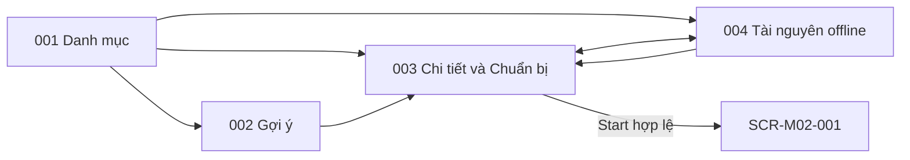

# Screen List M01 — Route Planning & Preparation

## 1. Baseline và phạm vi

- Baseline: [Spec M01 v2.0](../../docs/spec/spec-M01.md), [Function List M01](../../docs/function%20list/function-list-M01.md).
- Release priority: [MVP Scope](../../MVP-Scope.md). Priority dưới đây theo function scope; không thay requirement trong spec.
- Cập nhật: 2026-09-27. Status: screen inventory đồng bộ baseline; chưa phải screen specification/mockup hoặc route implementation.
- Quy ước chung: [Screen index](README.md).
- Giữ ID cũ để truy vết; cách gộp screen là quyết định UI decomposition, không giả định spec yêu cầu đúng số trang này.

## 2. Screen inventory

| Screen ID | Screen | Actor | Functions | Release priority |
|---|---|---|---|---|
| SCR-M01-001 | Danh mục tuyến | Visitor | FN-M01-001, FN-M01-002 | Must |
| SCR-M01-002 | Gợi ý tuyến | Visitor | FN-M01-003 | Should |
| SCR-M01-003 | Chi tiết tuyến & Chuẩn bị | Visitor | FN-M01-002, FN-M01-004, FN-M01-005, FN-M01-006, FN-M01-007 | Must; offline capability Should* |
| SCR-M01-004 | Quản lý tài nguyên offline | Visitor | FN-M01-005, FN-M01-007 | Should* |

* Theo MVP Scope §3.4, offline preparation/package là Should nhưng phải nâng lên Must nếu increment phát hành có checkpoint OFFLINE_REQUIRED. Language là control dùng chung không nâng priority của màn gợi ý/tài nguyên. Xóa package không xóa context hoặc session M02.

## 3. Screen descriptions

### SCR-M01-001 — Danh mục tuyến

| Nội dung | Mô tả |
|---|---|
| Entry | Entry mặc định của visitor; chọn `vi/en` nếu chưa có preference. |
| Data | Published Route từ M03; khi mất nguồn chỉ hiển thị local view với nhãn dữ liệu cũ. |
| Actions / exit | Duyệt route HOAT_DONG có activeContentVersion; mở chi tiết, gợi ý hoặc tài nguyên offline. |
| States / guards | Loading, empty, stale/offline, source unavailable, chưa chọn ngôn ngữ. |

### SCR-M01-002 — Gợi ý tuyến

| Nội dung | Mô tả |
|---|---|
| Entry | Từ danh mục tuyến. |
| Data | Public route tags và một lựa chọn mỗi nhóm timeTag/groupTag/experienceTag. |
| Actions / exit | Xem toàn bộ route exact-match hoặc sửa tiêu chí; chọn route để mở chi tiết. |
| States / guards | Thiếu tiêu chí, 0 kết quả, có kết quả; không ranking hoặc tự nới tiêu chí. |

### SCR-M01-003 — Chi tiết tuyến & Chuẩn bị

| Nội dung | Mô tả |
|---|---|
| Entry | Từ danh mục/gợi ý hoặc package đã tải để Start offline. |
| Data | Localized route metadata; JourneySnapshot online hoặc manifest package SAN_SANG; local readiness/freshness. |
| Actions / exit | Xem thông tin; Tải/Tiếp tục không tải/Quay lại; Start hợp lệ ghi context atomic rồi mở SCR-M02-001. |
| States / guards | Route unavailable/revoked, nguồn lỗi, thiếu package, đang tải, ready/outdated, incomplete; thất bại không thay context cũ. |

### SCR-M01-004 — Quản lý tài nguyên offline

| Nội dung | Mô tả |
|---|---|
| Entry | Từ danh mục hoặc chi tiết tuyến. |
| Data | Danh sách package local; chỉ request nguồn khi tải/kiểm tra version. Resource management không phải trình đọc nội dung checkpoint. |
| Actions / exit | Xem trạng thái/version, tải, xác nhận xóa; mở chi tiết để Start. Không có Cancel download. |
| States / guards | CHUA_TAI, DANG_TAI, SAN_SANG với CURRENT/OUTDATED, CHUA_HOAN_TAT, storage failure; lỗi update giữ bản ready cũ. |

## 4. Embedded và background behavior

Language selector là control/gate trong shell M01, không có route riêng. Download progress, cảnh báo tiếp tục không tải và xác nhận xóa là panel/dialog trên 003/004. Handoff và package validation là background, không tạo màn hình thành công riêng.

## 5. Navigation

## 6. FR coverage

Screen suffix trong bảng mang prefix `SCR-M01-`; background coverage được ghi tường minh. Tổng 13/13 FR có điểm xử lý, không đồng nghĩa tất cả đã triển khai hoặc đều là user-facing screen.

| Source FR | Screen / owner | Coverage |
|---|---|---|
| FR-M01-001 | 001–004 (language control) | Chọn/đổi ngôn ngữ độc lập package/session. |
| FR-M01-002 | 001, 003 | Catalog/source refresh; bỏ lựa chọn route không khả dụng. |
| FR-M01-003 | 003 | Hiển thị route metadata theo language. |
| FR-M01-004 | 002 | Exact-match ba nhóm tag. |
| FR-M01-005 | 003 | Đếm offline-required và kiểm tra package. |
| FR-M01-006 | 003 | Cảnh báo và ba lựa chọn chuẩn bị. |
| FR-M01-007 | 003, 004 | Download full manifest và offline resource subset. |
| FR-M01-008 | 003, 004 + background | Validate đầy đủ và atomic publish. |
| FR-M01-009 | 004 | View/download/delete, confirmation và serialize operation. |
| FR-M01-010 | 003, 004 + background | Lazy update giữ active package cũ. |
| FR-M01-011 | 003 | Online Start xác nhận nguồn; offline Start cần SAN_SANG. |
| FR-M01-012 | 003 + background | Context v2 mới, atomic; refresh phát hiện closure revoke current context. |
| FR-M01-013 | Shared M01 data + controls | Publish preference/context/ready package; M02 chỉ đọc. |

## 7. Screen specification targets

Các file dưới đây là đầu ra dự kiến, chưa tồn tại; dùng [screen spec template](../../docs/templates/screen%20%20spec%20template.md) khi thiết kế chi tiết.

| Screen ID | Target file |
|---|---|
| SCR-M01-001 | `screens/screen-spec-SCR-M01-001.md` |
| SCR-M01-002 | `screens/screen-spec-SCR-M01-002.md` |
| SCR-M01-003 | `screens/screen-spec-SCR-M01-003.md` |
| SCR-M01-004 | `screens/screen-spec-SCR-M01-004.md` |
