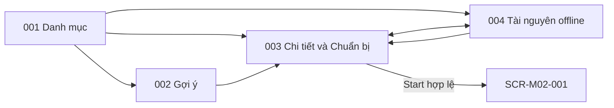

# Screen List M01 — Route Planning & Preparation

## 1. Baseline và phạm vi

- Baseline: [Spec M01 v3.2](../../docs/spec/spec-M01.md), [Function List M01](../../docs/function%20list/function-list-M01.md).
- Release priority: [MVP Scope](../../MVP-Scope.md). Priority dưới đây theo function scope; không thay requirement trong spec.
- Cập nhật: 2026-10-27. Status: screen inventory đồng bộ baseline v3.2; chưa phải screen specification/mockup hoặc route implementation.
- Quy ước chung: [Screen index](README.md).
- Giữ ID cũ để truy vết; cách gộp screen là quyết định UI decomposition, không giả định spec yêu cầu đúng số trang này.

## 2. Screen inventory

| Screen ID | Screen | Actor | Functions | Release priority |
|---|---|---|---|---|
| SCR-M01-001 | Danh mục tuyến | Visitor | FN-M01-001, FN-M01-002 | Must |
| SCR-M01-002 | Gợi ý tuyến | Visitor | FN-M01-001, FN-M01-003 | Should |
| SCR-M01-003 | Chi tiết tuyến & Chuẩn bị | Visitor | FN-M01-001, FN-M01-002, FN-M01-004, FN-M01-005, FN-M01-006, FN-M01-007 | Must; chuẩn bị offline Should* |
| SCR-M01-004 | Quản lý tài nguyên offline | Visitor | FN-M01-001, FN-M01-005, FN-M01-007 | Should* |

\* Theo [MVP Scope](../../MVP-Scope.md) §3.1, gói offline là Should nhưng phải nâng lên Must nếu increment phát hành có điểm dừng `OFFLINE_REQUIRED` hoặc sơ đồ tuyến cần dùng offline. Nút đổi ngôn ngữ là control dùng chung, không nâng priority của màn gợi ý/tài nguyên. Xóa package không xóa context hoặc session M02.

## 3. Screen descriptions

### SCR-M01-001 — Danh mục tuyến

| Nội dung | Mô tả |
|---|---|
| Entry | Entry mặc định của visitor; chọn `vi/en` nếu chưa có preference. Vào từ link QR không đi qua màn này (xem SCR-M02-004). |
| Data | Published Route từ M03; khi mất nguồn chỉ hiển thị local view với nhãn dữ liệu cũ. |
| Actions / exit | Duyệt các thẻ tuyến `HOAT_DONG` có `activeContentVersion`: ảnh đại diện, tên, mô tả ngắn, quãng đường, thời lượng, độ khó, số điểm dừng, dấu "cần tải trước"; mở chi tiết, gợi ý hoặc tài nguyên offline; đổi ngôn ngữ. |
| States / guards | Loading, empty, stale/offline, source unavailable, chưa chọn ngôn ngữ; ảnh lỗi hiện placeholder trung tính. |

### SCR-M01-002 — Gợi ý tuyến

| Nội dung | Mô tả |
|---|---|
| Entry | Từ danh mục tuyến. |
| Data | Public route tags và một lựa chọn mỗi nhóm timeTag/groupTag/experienceTag; nhãn thời gian của tuyến do M03 suy ra, M01 dùng nguyên giá trị. |
| Actions / exit | Xem toàn bộ route exact-match hoặc sửa tiêu chí; chọn route để mở chi tiết. |
| States / guards | Thiếu tiêu chí, 0 kết quả, có kết quả; không ranking hoặc tự nới tiêu chí. |

### SCR-M01-003 — Chi tiết tuyến & Chuẩn bị

| Nội dung | Mô tả |
|---|---|
| Entry | Từ danh mục/gợi ý hoặc package đã tải để Start offline. |
| Data | Thông tin chi tiết theo ngôn ngữ (gallery với ảnh đầu là ảnh bìa, mô tả đầy đủ, điểm xuất phát, yêu cầu tham gia, chuẩn bị, thời điểm phù hợp, điểm nổi bật, sơ đồ tuyến, cảnh báo an toàn nổi bật, tên các điểm dừng theo thứ tự); JourneySnapshot online hoặc manifest package `SAN_SANG`; trạng thái readiness/freshness. Offline: chữ cốt lõi đã lưu kèm thời điểm lưu. |
| Actions / exit | Xem thông tin; khi cần gói (có điểm dừng cần tải trước hoặc sơ đồ offline): Tải / Tiếp tục không tải / Quay lại, kèm tên các điểm dừng bị ảnh hưởng và dung lượng ước tính (hoặc "chưa có thông tin dung lượng"); Start hợp lệ ghi context v3 (hạn 24 giờ) atomic rồi mở SCR-M02-001. |
| States / guards | Route unavailable/revoked, nguồn lỗi, thiếu package, đang tải, ready/outdated, incomplete; một dòng hướng dẫn "không có mạng thì quét bằng nút Quét trong ứng dụng"; trường tùy chọn vắng thì ẩn; thất bại không thay context cũ. |

### SCR-M01-004 — Quản lý tài nguyên offline

| Nội dung | Mô tả |
|---|---|
| Entry | Từ danh mục hoặc chi tiết tuyến. |
| Data | Danh sách package local: route, version, readiness/freshness, thời điểm lưu chữ cốt lõi, có sơ đồ tuyến offline hay không; chỉ request nguồn khi tải/kiểm tra version. |
| Actions / exit | Xem trạng thái/version, tải/cập nhật, xác nhận xóa; mở chi tiết để Start. Không có Cancel download. |
| States / guards | `CHUA_TAI`, `DANG_TAI`, `SAN_SANG` với `CURRENT`/`OUTDATED`, `CHUA_HOAN_TAT`, storage failure; lỗi update giữ bản ready cũ; một dòng hướng dẫn quét bằng nút trong ứng dụng khi không có mạng. |

## 4. Embedded và background behavior

Nút đổi ngôn ngữ VI/EN là control dùng chung có mặt trên mọi màn du khách (kể cả trang mở từ mã QR của M02); M01 là nơi duy nhất ghi `LanguagePreference`. Download progress, cảnh báo tiếp tục không tải và xác nhận xóa là panel/dialog trên 003/004. Handoff, kiểm tra package và làm mới chữ cốt lõi là background, không tạo màn hình thành công riêng.

## 5. Navigation

## 6. FR coverage

Screen suffix trong bảng mang prefix `SCR-M01-`; background coverage được ghi tường minh. Tổng 14/14 FR có điểm xử lý, không đồng nghĩa tất cả đã triển khai hoặc đều là user-facing screen.

| Source FR | Screen / owner | Coverage |
|---|---|---|
| FR-M01-001 | 001–004 và SCR-M02-004 (language control) | Chọn/đổi ngôn ngữ độc lập package/session; vào từ link QR dùng ngôn ngữ máy. |
| FR-M01-002 | 001, 003 | Thẻ tuyến; refresh nguồn; bỏ route không khả dụng. |
| FR-M01-003 | 003 | Chi tiết tuyến theo ngôn ngữ; ẩn trường vắng; chữ cốt lõi khi offline. |
| FR-M01-004 | 002 | Exact-match ba nhóm tag. |
| FR-M01-005 | 003 | Cờ cần gói và kiểm tra package. |
| FR-M01-006 | 003 | Cảnh báo, dung lượng ước tính, hướng dẫn quét và ba lựa chọn chuẩn bị. |
| FR-M01-007 | 003, 004 | Tải manifest, tài nguyên từng mã QR, sơ đồ offline và chữ cốt lõi. |
| FR-M01-008 | 003, 004 + background | Kiểm tra đầy đủ và atomic publish. |
| FR-M01-009 | 004 | View/download/delete, confirmation và serialize operation. |
| FR-M01-010 | 003, 004 + background | Lazy update giữ active package cũ; làm mới chữ cốt lõi. |
| FR-M01-011 | 003 | Online Start xác nhận nguồn; offline Start cần `SAN_SANG`. |
| FR-M01-012 | 003 + background | Context v3 mới, hạn 24 giờ, atomic; refresh phát hiện closure revoke current context. |
| FR-M01-013 | Shared M01 data + controls | Publish preference/context/ready package; M02 chỉ đọc. |
| FR-M01-014 | 003, 004 + background | Lưu và làm mới chữ cốt lõi kèm thời điểm lưu. |

## 7. Screen specifications

| Screen ID | File | Trạng thái |
|---|---|---|
| SCR-M01-001 | [screen-spec-SCR-M01-001.md](../screen-spec/M01/screen-spec-SCR-M01-001.md) | Lỗi thời so với Spec M01 v3.2; cập nhật ở bước sau |
| SCR-M01-002 | [screen-spec-SCR-M01-002.md](../screen-spec/M01/screen-spec-SCR-M01-002.md) | Lỗi thời so với Spec M01 v3.2; cập nhật ở bước sau |
| SCR-M01-003 | [screen-spec-SCR-M01-003.md](../screen-spec/M01/screen-spec-SCR-M01-003.md) | Lỗi thời so với Spec M01 v3.2; cập nhật ở bước sau |
| SCR-M01-004 | [screen-spec-SCR-M01-004.md](../screen-spec/M01/screen-spec-SCR-M01-004.md) | Lỗi thời so với Spec M01 v3.2; cập nhật ở bước sau |
