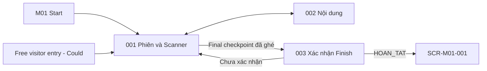

# Screen List M02 — Field Quest Experience

## 1. Baseline và phạm vi

- Baseline: [Spec M02 v2.0](../../docs/spec/spec-M02.md), [Function List M02](../../docs/function%20list/function-list-M02.md).
- Release priority: [MVP Scope](../../MVP-Scope.md). Priority dưới đây theo function scope; không thay requirement trong spec.
- Cập nhật: 2026-09-27. Status: screen inventory đồng bộ baseline; chưa phải screen specification/mockup hoặc route implementation.
- Quy ước chung: [Screen index](README.md).
- Giữ ID cũ để truy vết; cách gộp screen là quyết định UI decomposition, không giả định spec yêu cầu đúng số trang này.

## 2. Screen inventory

| Screen ID | Screen | Actor | Functions | Release priority |
|---|---|---|---|---|
| SCR-M02-001 | Phiên trải nghiệm & Quét QR | Visitor; free visitor khi capability được phát hành | FN-M02-001, FN-M02-002, FN-M02-003, FN-M02-004, FN-M02-006, FN-M02-007, FN-M02-008 | Must; sync Should; free visitor Could |
| SCR-M02-002 | Nội dung checkpoint | Visitor; free visitor nếu enabled | FN-M02-004, FN-M02-005, FN-M02-008 | Must; free visitor Could |
| SCR-M02-003 | Kết thúc phiên | Visitor có session | FN-M02-006, FN-M02-007 | Must; sync status Should |

Free-visitor mode không có progress/Finish; không tạo screen hoặc visitor account mới. BO_DO xuất hiện khi nhận handoff mới, không bổ sung nút tự bỏ phiên ngoài spec. Sync conflict dừng retry tự động và hiện lỗi; không sửa immutable payload.

## 3. Screen descriptions

### SCR-M02-001 — Phiên trải nghiệm & Quét QR

| Nội dung | Mô tả |
|---|---|
| Entry | M01 Start với authorized unused handoff; reload/resume phiên cũ; free-visitor entry riêng khi bật capability. |
| Data | PlaySession/CheckpointVisit local; RouteJourneyMap từ frozen journeyCheckpoints đã copy handoff M01, không dựng lại từ live M03. |
| Actions / exit | Start/resume; xem timeline, quét QR; mở content; Finish chỉ khi checkpoint sequence cao nhất đã ghé. |
| States / guards | Context thiếu/revoked/đã dùng, camera denied/unavailable, scan duplicate/outside journey, invalid QR khác network failure. Handoff mới thay session nguyên tử; lỗi không bỏ phiên cũ. |

### SCR-M02-002 — Nội dung checkpoint

| Nội dung | Mô tả |
|---|---|
| Entry | Sau QR result hoặc mở lại checkpoint đã ghé; free visitor chỉ live content. |
| Data | OFFLINE_REQUIRED đọc package SAN_SANG theo stable checkpointId; ONLINE_AVAILABLE và ngoài journey đọc M03 live. |
| Actions / exit | Đọc nội dung vi/en và ảnh; audio/video online chỉ phát khi người dùng yêu cầu; quay về scanner/session. |
| States / guards | Loading, unavailable, package outdated/missing resource, media error. Package cũ vẫn dùng được nếu có resource; lỗi content không rollback visit. |

### SCR-M02-003 — Kết thúc phiên

| Nội dung | Mô tả |
|---|---|
| Entry | Final checkpoint đã ghé và người dùng chọn Finish. |
| Data | Local session, frozen journey và visits; terminal sync status khi capability được phát hành. |
| Actions / exit | Xác nhận hoặc quay lại; sau xác nhận hiển thị HOAN_TAT và các checkpoint đã ghé, quay danh mục. |
| States / guards | Confirmation, completed/pending sync, synced, sync conflict. Không yêu cầu ghé 100%; Finish không bị chặn bởi mạng. |

## 4. Embedded và background behavior

Scanner là vùng/fullscreen mode trong 001. Camera permission do browser cấp, UI chỉ giải thích trạng thái và cách thử lại. Sync là background với status trong session/result, không có trang sync queue. Language control gọi owner M01, M02 không tự ghi preference.

## 5. Navigation

## 6. FR coverage

Screen suffix trong bảng mang prefix `SCR-M02-`; background coverage được ghi tường minh. Tổng 20/20 FR có điểm xử lý, không đồng nghĩa tất cả đã triển khai hoặc đều là user-facing screen.

| Source FR | Screen / owner | Coverage |
|---|---|---|
| FR-M02-001 | 001 | Validate handoff v2 authorized, unused. |
| FR-M02-002 | 001 + local transaction | Tối đa một active session. |
| FR-M02-003 | 001 + local transaction | UUID sessionId và unique sourceHandoffId. |
| FR-M02-004 | 001 + local storage | Copy manifest thành frozen journey. |
| FR-M02-005 | 001 | Resume cùng session/visits sau reload. |
| FR-M02-006 | 001 | QR resolution về checkpointId. |
| FR-M02-007 | 001, 002 | Ghi visit một lần trước tải nội dung. |
| FR-M02-008 | 001 | Check-in không bắt thứ tự; hiển thị đã ghé. |
| FR-M02-009 | 001 | Quét lại hiển thị thời điểm cũ. |
| FR-M02-010 | 002 | Ready offline resource, kể cả package cũ phù hợp. |
| FR-M02-011 | 002 | Live content và media on demand. |
| FR-M02-012 | 001, 002 | QR ngoài journey chỉ xem live content. |
| FR-M02-013 | 001, 002 | Invalid QR khác source failure. |
| FR-M02-014 | 002 + shared language control | Đọc LanguagePreference M01; đổi qua control M01. |
| FR-M02-015 | 001, 003 | Finish enabled sau highest-sequence visit. |
| FR-M02-016 | 003 | Hoàn tất khi xác nhận. |
| FR-M02-017 | 001 + local transaction | New session + BO_DO phiên cũ là một operation. |
| FR-M02-018 | 001, 003 + sync background | Frozen terminal queue; retry success/conflict. |
| FR-M02-019 | 001, 002 free mode | Không tạo session/visit/report data. |
| FR-M02-020 | Tất cả + data adapters | M01/M03 source data là read-only. |

## 7. Screen specification targets

Các file dưới đây là đầu ra dự kiến, chưa tồn tại; dùng [screen spec template](../../docs/templates/screen%20%20spec%20template.md) khi thiết kế chi tiết.

| Screen ID | Target file |
|---|---|
| SCR-M02-001 | `screens/screen-spec-SCR-M02-001.md` |
| SCR-M02-002 | `screens/screen-spec-SCR-M02-002.md` |
| SCR-M02-003 | `screens/screen-spec-SCR-M02-003.md` |
