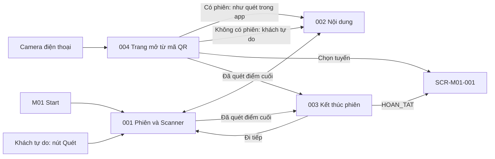

# Screen List M02 — Field Quest Experience

## 1. Baseline và phạm vi

- Baseline: [Spec M02 v3.2](../../docs/spec/spec-M02.md), [Function List M02](../../docs/function%20list/function-list-M02.md).
- Release priority: [MVP Scope](../../MVP-Scope.md). Priority dưới đây theo function scope; không thay requirement trong spec.
- Cập nhật: 2026-10-27. Status: screen inventory đồng bộ baseline v3.2; chưa phải screen specification/mockup hoặc route implementation.
- Quy ước chung: [Screen index](README.md).
- Giữ ID cũ để truy vết; cách gộp screen là quyết định UI decomposition, không giả định spec yêu cầu đúng số trang này.

## 2. Screen inventory

| Screen ID | Screen | Actor | Functions | Release priority |
|---|---|---|---|---|
| SCR-M02-001 | Phiên trải nghiệm & Quét QR | Visitor có phiên; khách tự do dùng nút Quét | FN-M02-001, FN-M02-002, FN-M02-003, FN-M02-004, FN-M02-006, FN-M02-007, FN-M02-008 | Must; đồng bộ Should |
| SCR-M02-002 | Nội dung điểm tham quan | Visitor; khách tự do | FN-M02-004, FN-M02-005, FN-M02-008 | Must |
| SCR-M02-003 | Kết thúc phiên | Visitor có phiên | FN-M02-006, FN-M02-007 | Must; trạng thái đồng bộ Should |
| SCR-M02-004 | Trang mở từ mã QR | Bất kỳ ai quét mã bằng camera điện thoại | FN-M02-004, FN-M02-005, FN-M02-006, FN-M02-008 | Must |

Khách tự do không có tiến độ hoặc Finish; không tạo visitor account. Phiên chỉ thành `BO_DO` khi nhận handoff mới hoặc khi tự đóng sau 24 giờ; không có nút "Dừng chuyến đi". Sync conflict hoặc bản ghi bị M03 từ chối thì dừng retry tự động và hiện lỗi; không sửa immutable payload.

## 3. Screen descriptions

### SCR-M02-001 — Phiên trải nghiệm & Quét QR

| Nội dung | Mô tả |
|---|---|
| Entry | M01 Start với handoff v3 `AUTHORIZED`, chưa dùng, chưa hết hạn; reload/resume phiên cũ; khách tự do mở nút Quét khi không có phiên. Mỗi lần mở app, phiên đã bắt đầu quá 24 giờ được tự đóng trước. |
| Data | `PlaySession`/`CheckpointVisit` local của trình duyệt này; RouteJourneyMap từ frozen `journeyCheckpoints` đã copy handoff M01, không dựng lại từ live M03; số thứ tự hiển thị liên tục dù `sequence` có khoảng trống. |
| Actions / exit | Start/resume; xem timeline (điểm đã quét ghi là "Đã quét QR", không phải "đã đến"); quét QR; mở nội dung; Finish khi đã quét điểm dừng có sequence cao nhất. |
| States / guards | Handoff thiếu/revoked/đã dùng/hết hạn/version 2 (thông báo rõ); camera denied/unavailable; mã không phải link QR của môi trường hiện tại; quét lặp; ngoài journey; `INVALID` và `TEMPORARILY_CLOSED` (không ghi lượt ghé) khác lỗi mạng/quá thời gian chờ; câu gợi ý "hãy quét bằng nút Quét trong ứng dụng" khi bắt đầu phiên; thông báo phiên trước đã tự kết thúc. Handoff mới thay phiên nguyên tử; lỗi không bỏ phiên cũ. |

### SCR-M02-002 — Nội dung điểm tham quan

| Nội dung | Mô tả |
|---|---|
| Entry | Sau kết quả quét hoặc mở lại điểm đã quét; từ SCR-M02-004. |
| Data | Nội dung của đúng mã đã quét: online lấy từ tra cứu M03 (`VALID`) cho cả hai loại kết nối; offline hoặc tra cứu lỗi lấy từ package `SAN_SANG` theo `qrIdentifier`. |
| Actions / exit | Đọc tên điểm dừng, tên đối tượng, giới thiệu `vi/en`, ảnh; audio/video chỉ hiện khi nội dung có và chỉ phát khi người dùng bấm; quay về scanner/phiên. |
| States / guards | Loading, không có nội dung offline cho điểm này, package outdated, media error, thông báo khu vực tạm đóng (không có nội dung), câu gợi ý khách tự do. Lỗi nội dung không xóa lượt ghé đã ghi. |

### SCR-M02-003 — Kết thúc phiên

| Nội dung | Mô tả |
|---|---|
| Entry | Câu hỏi "Bạn đã đến điểm cuối. Kết thúc chuyến đi?" ngay khi lượt ghé điểm cuối được ghi lần đầu, hoặc nút Finish sau đó. |
| Data | Phiên local, frozen journey và các lượt ghé; trạng thái đồng bộ khi capability được phát hành. |
| Actions / exit | [Kết thúc] → `HOAN_TAT` và hiển thị các điểm đã quét, quay danh mục; [Đi tiếp] → quay lại phiên, Finish vẫn còn. |
| States / guards | Confirmation, completed/pending sync, synced, conflict/rejected. Không yêu cầu quét 100%; kết thúc không bị chặn bởi mạng. |

### SCR-M02-004 — Trang mở từ mã QR

| Nội dung | Mô tả |
|---|---|
| Entry | Camera điện thoại mở link công khai `{QR_PUBLIC_BASE_URL}/q/{qrIdentifier}`; không qua màn chọn ngôn ngữ hay chọn tuyến. |
| Data | `qrIdentifier` lấy từ link; phiên đang chạy trong cùng trình duyệt nếu có; `LanguagePreference` nếu có, nếu không dùng ngôn ngữ của máy. |
| Actions / exit | Tự đóng phiên quá 24 giờ trước; có phiên trong cùng trình duyệt → xử lý y như quét trong app (ghi lượt ghé khi được chấp nhận, câu hỏi kết thúc) rồi hiển thị nội dung như SCR-M02-002; không có phiên → chế độ khách tự do, hiển thị nội dung kèm câu gợi ý và link sang danh mục tuyến (SCR-M01-001); đổi ngôn ngữ bằng nút VI/EN. |
| States / guards | Không bao giờ tạo phiên; `INVALID`, `TEMPORARILY_CLOSED`, cần kết nối mạng; offline chỉ mở được nếu trình duyệt này từng mở app (app shell đã cache), nếu không trình duyệt tự báo không có kết nối. Phiên ở trình duyệt khác hoặc app đã cài không được nhận diện. |

## 4. Embedded và background behavior

Scanner là vùng/fullscreen mode trong 001; camera permission do browser cấp, UI chỉ giải thích trạng thái và cách thử lại. Câu hỏi kết thúc chuyến là dialog mở 003. Sync là background với status trong phiên/kết quả, không có trang sync queue. Tự đóng phiên quá 24 giờ chạy khi mở app hoặc quay lại màn hình. Nút đổi ngôn ngữ gọi control của M01; M02 không tự ghi preference.

## 5. Navigation

## 6. FR coverage

Screen suffix trong bảng mang prefix `SCR-M02-`; background coverage được ghi tường minh. Tổng 26/26 FR có điểm xử lý, không đồng nghĩa tất cả đã triển khai hoặc đều là user-facing screen.

| Source FR | Screen / owner | Coverage |
|---|---|---|
| FR-M02-001 | 001 | Kiểm tra handoff v3 `AUTHORIZED`, chưa dùng, chưa hết hạn; từ chối v2/hết hạn. |
| FR-M02-002 | 001 + local transaction | Tối đa một phiên đang chạy mỗi trình duyệt. |
| FR-M02-003 | 001 + local transaction | UUID `sessionId` và unique `sourceHandoffId`. |
| FR-M02-004 | 001 + local storage | Copy manifest thành frozen journey. |
| FR-M02-005 | 001 | Resume cùng phiên/lượt ghé sau reload. |
| FR-M02-006 | 001, 004 | Lấy `qrIdentifier` từ link; phân giải qua tra cứu online hoặc frozen journey khi offline. |
| FR-M02-007 | 001, 002, 004 | Ghi lượt ghé một lần cho lần quét được chấp nhận, trước khi hiển thị nội dung. |
| FR-M02-008 | 001 | Check-in không bắt thứ tự; hiển thị đã quét. |
| FR-M02-009 | 001, 002 | Quét lại hiển thị nội dung mã đó và thời điểm cũ. |
| FR-M02-010 | 002 | Tài nguyên offline theo mã QR, kể cả package cũ phù hợp. |
| FR-M02-011 | 002, 004 | Tra cứu online, nội dung live và media khi bấm. |
| FR-M02-012 | 001, 002, 004 | QR ngoài journey chỉ xem nội dung. |
| FR-M02-013 | 001, 002, 004 | `INVALID`/`TEMPORARILY_CLOSED` khác lỗi nguồn. |
| FR-M02-014 | 002, 004 + language control M01 | Đọc `LanguagePreference`; đổi qua control M01. |
| FR-M02-015 | 001, 003 | Finish mở sau khi quét điểm có sequence cao nhất. |
| FR-M02-016 | 003 | Hoàn tất khi xác nhận. |
| FR-M02-017 | 001 + local transaction | Phiên mới + `BO_DO` phiên cũ là một operation. |
| FR-M02-018 | 001, 003 + sync background | Frozen terminal queue; retry success/conflict/rejected. |
| FR-M02-019 | 001, 002, 004 chế độ khách tự do | Không tạo phiên/lượt ghé/dữ liệu báo cáo. |
| FR-M02-020 | Tất cả + data adapters | Dữ liệu M01/M03 chỉ đọc. |
| FR-M02-021 | 002, 004 | Thông báo khu vực tạm đóng, không nội dung, không lượt ghé. |
| FR-M02-022 | 001, 004 | Mã thêm sau khi chuyến bắt đầu được nhận diện qua tra cứu online. |
| FR-M02-023 | 003 | Câu hỏi kết thúc chuyến khi quét điểm cuối lần đầu. |
| FR-M02-024 | 001, 004 + background | Tự đóng phiên quá 24 giờ khi mở app; thông báo. |
| FR-M02-025 | 004, 001 | Trang mở từ mã QR; câu gợi ý khi bắt đầu phiên. |
| FR-M02-026 | 001 | Nút Quét chỉ nhận link QR của môi trường hiện tại. |

## 7. Screen specifications

| Screen ID | File | Trạng thái |
|---|---|---|
| SCR-M02-001 | [screen-spec-SCR-M02-001.md](../screen-spec/M02/screen-spec-SCR-M02-001.md) | Lỗi thời so với Spec M02 v3.2; cập nhật ở bước sau |
| SCR-M02-002 | [screen-spec-SCR-M02-002.md](../screen-spec/M02/screen-spec-SCR-M02-002.md) | Lỗi thời so với Spec M02 v3.2; cập nhật ở bước sau |
| SCR-M02-003 | [screen-spec-SCR-M02-003.md](../screen-spec/M02/screen-spec-SCR-M02-003.md) | Lỗi thời so với Spec M02 v3.2; cập nhật ở bước sau |
| SCR-M02-004 | Chưa có | Tạo ở bước cập nhật screen spec |
