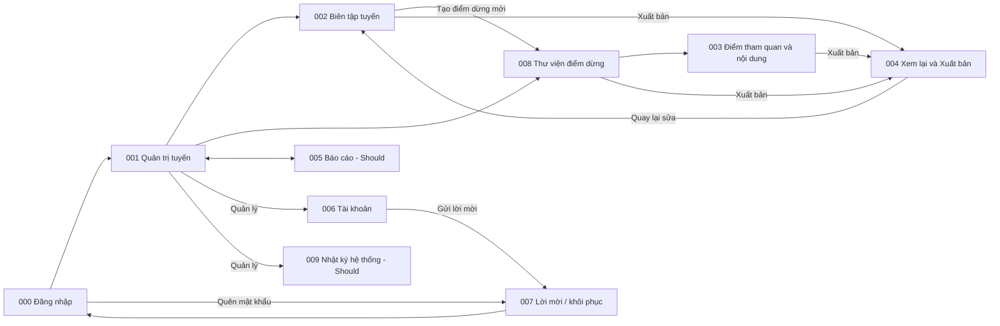

# Screen List M03 — Operations & Content Administration

## 1. Baseline và phạm vi

- Baseline: [Spec M03 v3.7](../../docs/spec/spec-M03.md), [Function List M03](../../docs/function%20list/function-list-M03.md).
- Release priority: [MVP Scope](../../MVP-Scope.md). Priority dưới đây theo function scope; không thay requirement trong spec.
- Cập nhật: 2026-10-30. Status: screen inventory và screen specification (Draft) đồng bộ baseline v3.7; có mockup tĩnh cho cả 10 màn SCR-M03-000…009 (screens/html/, kèm demo tương tác trong screens/html/interactive/); chưa có route implementation.
- Quy ước chung: [Screen index](README.md). Mọi màn bắt buộc cho administrative journey nằm trực tiếp trong danh mục M03 này.
- Giữ ID cũ để truy vết; cách gộp screen là quyết định UI decomposition, không giả định spec yêu cầu đúng số trang này.

## 2. Screen inventory

| Screen ID | Screen | Actor | Functions | Release priority |
|---|---|---|---|---|
| SCR-M03-000 | Đăng nhập quản trị | Nhân viên nội dung, Quản lý | FN-M03-008 | Must |
| SCR-M03-001 | Quản trị tuyến | Nhân viên nội dung, Quản lý | FN-M03-001, FN-M03-007, FN-M03-008, FN-M03-011 | Must |
| SCR-M03-002 | Biên tập tuyến | Nhân viên nội dung, Quản lý | FN-M03-001, FN-M03-005, FN-M03-006, FN-M03-008, FN-M03-011 | Must |
| SCR-M03-003 | Điểm tham quan (QR) & Nội dung | Nhân viên nội dung, Quản lý | FN-M03-003, FN-M03-004, FN-M03-005, FN-M03-008, FN-M03-011 | Must; xem trước như du khách Should |
| SCR-M03-004 | Xem lại & Xuất bản | Nhân viên nội dung, Quản lý | FN-M03-005, FN-M03-006, FN-M03-008 | Must; xem trước như du khách Should |
| SCR-M03-005 | Báo cáo vận hành | Nhân viên nội dung, Quản lý | FN-M03-010 | Should |
| SCR-M03-006 | Tài khoản & Vai trò | Quản lý | FN-M03-008 | Must |
| SCR-M03-007 | Nhận lời mời & Khôi phục mật khẩu | Người được mời; Nhân viên nội dung; Quản lý | FN-M03-008 | Must |
| SCR-M03-008 | Thư viện điểm dừng | Nhân viên nội dung, Quản lý | FN-M03-002, FN-M03-003, FN-M03-005, FN-M03-007, FN-M03-008, FN-M03-011 | Must |
| SCR-M03-009 | Nhật ký hệ thống | Quản lý | FN-M03-011 | Should |

M03 online-only và không có public sign-up. Mọi màn sau đăng nhập có nút Đăng xuất ở header (BR-M03-K06). Giao diện chỉ dùng tiếng Việt dễ hiểu: tên hiển thị cho mọi trạng thái, thông báo từ danh mục cố định, không hiện dữ liệu thô hay mã kỹ thuật. Mỗi editor có một nút "Lưu bản nháp"; nội dung đang gõ được giữ khi lưu lỗi; không cam kết khôi phục bản nháp qua reload. Report dùng `endedAt` theo Asia/Ho_Chi_Minh; RPT-02 nhóm theo stable ID và label/sequence từ record có `endedAt` mới nhất trong kỳ. Snapshot retention, session intake và provisioning Reviewer đầu tiên là backend/operations coverage, không được đếm thành UI screen.

## 3. Screen descriptions

### SCR-M03-000 — Đăng nhập quản trị

| Nội dung | Mô tả |
|---|---|
| Entry | Màn vào chính khi mở M03 mà chưa có provider session hợp lệ hoặc session đã hết hạn. Visitor M01/M02 không dùng màn này. |
| Data | Email và password được gửi trực tiếp tới authentication provider; M03 không lưu password. |
| Actions / exit | Đăng nhập; mở SCR-M03-007 ở mode quên mật khẩu. Thành công chỉ vào SCR-M03-001 hoặc protected destination ban đầu sau khi backend xác nhận `AdminAccount` active và role hợp lệ. |
| States / guards | Submitting, credential error, network error, session expired, account inactive/missing role, không có quyền. Provider identity đơn lẻ không cấp quyền; không có đăng ký công khai. |

### SCR-M03-001 — Quản trị tuyến

| Nội dung | Mô tả |
|---|---|
| Entry | Sau SCR-M03-000 và kiểm tra server-side identity, role/status. |
| Data | Danh sách tuyến với trạng thái (tên hiển thị), dấu có bản nháp chưa xuất bản. |
| Actions / exit | Tìm/lọc, tạo hoặc mở tuyến; đóng tạm (cả hai role), mở lại và lưu trữ (Quản lý), hủy tuyến chưa từng xuất bản; xem lịch sử; đi editor, thư viện điểm dừng, báo cáo, tài khoản, nhật ký hệ thống. |
| States / guards | Loading, empty, không có quyền, network error, có thao tác khác đang chạy; tuyến không bao giờ tự mở lại. |

### SCR-M03-002 — Biên tập tuyến

| Nội dung | Mô tả |
|---|---|
| Entry | Tạo mới hoặc mở tuyến từ danh sách. |
| Data | Bốn bước: (1) thẻ tuyến — ảnh đại diện, tên, mô tả ngắn, quãng đường, thời lượng, độ khó; (2) chi tiết — mô tả, điểm xuất phát, yêu cầu tham gia, chuẩn bị, thời điểm phù hợp, cảnh báo an toàn, ảnh chi tiết, sơ đồ tuyến và dấu "cần cho offline", điểm nổi bật; (3) nhóm đối tượng và trải nghiệm (nhãn thời gian chỉ đọc); (4) chọn các điểm dừng đã xuất bản từ thư viện và sắp thứ tự. |
| Actions / exit | "Lưu bản nháp" cho cả editor; upload nhiều ảnh; mở "Tạo điểm dừng mới" sang SCR-M03-008 rồi quay lại; "Xuất bản" mở SCR-M03-004; khôi phục bản cũ, bỏ thay đổi. |
| States / guards | Lỗi hiện ngay dưới ô; panel "Còn thiếu để xuất bản"; quãng đường ≤ 100 km, tối đa 1 chữ số sau dấu phẩy, thời lượng ≤ 1440 phút (MSG-NUMBER-POSITIVE, MSG-NUMBER-TOO-BIG, MSG-NUMBER-DECIMALS, chặn khi lưu); mỗi nhóm nhãn không chọn trùng giá trị; nhãn mâu thuẫn bị chặn khi lưu; điểm dừng trùng trong danh sách bị chặn (MSG-CHECKPOINT-DUPLICATE); danh sách tối đa 30 điểm dừng, tính cả điểm dừng đã đóng, thêm quá bị chặn khi lưu (MSG-LIMIT-CHECKPOINTS), bỏ điểm dừng khỏi bản nháp luôn được phép; stale write cần tải lại; hộp thoại khi rời trang còn thay đổi chưa lưu; bản công khai giữ nguyên tới khi xuất bản. |

### SCR-M03-003 — Điểm tham quan (QR) & Nội dung

| Nội dung | Mô tả |
|---|---|
| Entry | "Thêm điểm tham quan" hoặc mở một điểm tham quan từ SCR-M03-008; chỉ thêm được khi điểm dừng đã lưu loại kết nối. |
| Data | Tiêu đề "Đang sửa: {tên}" và nhãn bản đang xem (bản nháp / đang hiển thị cho du khách); tên đối tượng và giới thiệu `vi/en`; ảnh; audio/video chỉ với điểm dừng có mạng; ghi chú lắp đặt; trạng thái, "Sẵn sàng"/"Chưa đủ", "Mã …6 ký tự". |
| Actions / exit | "Lưu bản nháp" cho cả form (lần lưu đầu tạo mã QR); upload nhiều tệp với trạng thái từng tệp và tick quyền sử dụng từng tệp; "Xem trước như du khách"; tải ảnh mã QR (SVG/PNG, dòng cảnh báo cho điểm cần tải trước, dấu bản thử ngoài Production); in lại, thu hồi, hủy điểm chưa xuất bản; "Xuất bản" mở SCR-M03-004; khôi phục bản cũ, bỏ thay đổi. |
| States / guards | Mỗi điểm dừng tối đa 20 điểm tham quan chưa thu hồi, thêm quá bị chặn (MSG-LIMIT-QR); tệp quá dung lượng/sai định dạng/quá số lượng; audio/video ở điểm cần tải trước bị từ chối; tệp đã tải nhưng chưa lưu; không thu hồi được mã cuối của điểm dừng đang hoạt động; cảnh báo khi tải ảnh mã của điểm chưa xuất bản; stale write; rời trang còn thay đổi chưa lưu. |

### SCR-M03-004 — Xem lại & Xuất bản

| Nội dung | Mô tả |
|---|---|
| Entry | "Xuất bản" từ SCR-M03-002, SCR-M03-003 hoặc SCR-M03-008; cả hai role dùng; không có hàng đợi duyệt. |
| Data | Đơn vị xuất bản; so sánh bản đang chạy và bản mới; các tuyến bị ảnh hưởng và tuyến nào có gói tải trước của du khách cần cập nhật; điểm dừng/điểm tham quan bị để lại; dung lượng offline ước tính từng tuyến; thay đổi nhạy cảm được tô sáng. |
| Actions / exit | Quay lại sửa; tick xác nhận không có cảnh báo an toàn khi cần; xem trước như du khách; xác nhận một lần → xuất bản (tự xuất bản được ghi vào audit). |
| States / guards | Lỗi chặn xuất bản kèm vị trí sửa; vượt trần 50 MB nêu tên tuyến và ảnh nặng nhất; nhắc in lại mã khi đổi loại kết nối; xác nhận bị từ chối nếu dữ liệu đã đổi (mở lại review); có thao tác khác đang chạy; xuất bản lỗi thì dữ liệu công khai giữ nguyên. |

### SCR-M03-005 — Báo cáo vận hành

| Nội dung | Mô tả |
|---|---|
| Entry | Chọn Báo cáo khi increment đồng bộ + nhận phiên/báo cáo được phát hành. |
| Data | Bản ghi phiên đã nhận (đã kiểm tra theo snapshot); RPT-01 và RPT-02. |
| Actions / exit | Lọc khoảng ngày/tuyến (chọn cả hai ngày), mặc định 30 ngày lịch kết thúc hôm nay theo Asia/Ho_Chi_Minh, tính cả hai đầu; xem tổng chuyến đi/trạng thái và số lượt ghé theo điểm dừng. |
| States / guards | Loading, khoảng ngày sai, khoảng chọn dài quá 366 ngày (cả hai đầu, MSG-REPORT-SPAN), số 0, có dữ liệu, lỗi tải. Ghi chú dạng chữ một dòng (không banner): "Số liệu tính đến…" hoặc "Chưa có chuyến đi nào…", phạm vi tính, ý nghĩa một lượt ghé dưới RPT-02, thông báo không có chuyến đi trong khoảng đã chọn; chỉ lỗi tải dùng kiểu cảnh báo. |

### SCR-M03-006 — Tài khoản & Vai trò

| Nội dung | Mô tả |
|---|---|
| Entry | Quản lý đã đăng nhập mở quản lý tài khoản. |
| Data | Email, vai trò và trạng thái tài khoản (tên hiển thị) từ backend/authentication provider. |
| Actions / exit | Nhập email, chọn Nhân viên nội dung/Quản lý, gửi hoặc gửi lại lời mời; đổi vai trò; khóa/mở khóa. Người nhận hoàn tất credential tại SCR-M03-007. |
| States / guards | Chờ nhận lời mời/đã gửi/lỗi, email trùng, dữ liệu sai, không có quyền, chặn khóa hoặc hạ quyền Quản lý cuối cùng; gửi lại cùng tài khoản đang chờ không tạo bản ghi trùng. |

### SCR-M03-007 — Nhận lời mời & Khôi phục mật khẩu

| Nội dung | Mô tả |
|---|---|
| Entry | Link lời mời do provider gửi; link khôi phục do provider gửi; hoặc "Quên mật khẩu" từ SCR-M03-000. |
| Data | Token lời mời/khôi phục do authentication provider quản lý; email cho yêu cầu khôi phục; password mới chỉ gửi tới provider. |
| Actions / exit | Lời mời hợp lệ: đặt credential, backend xác nhận provider identity khớp tài khoản `INVITATION_PENDING` rồi kích hoạt, sau đó về SCR-M03-000. Yêu cầu khôi phục: nhập email và nhận phản hồi chung. Callback khôi phục hợp lệ: đặt password mới rồi về SCR-M03-000. |
| States / guards | Processing, request accepted, link sai/hết hạn, lỗi provider/mạng. Màn này không tạo application account, không cấp/chọn role và không kích hoạt lại tài khoản đã khóa. |

### SCR-M03-008 — Thư viện điểm dừng

| Nội dung | Mô tả |
|---|---|
| Entry | Từ menu M03 hoặc "Tạo điểm dừng mới" trong SCR-M03-002. |
| Data | Danh sách điểm dừng (trạng thái, loại kết nối, số điểm tham quan, các tuyến đang dùng); khi mở một điểm dừng: tên `vi/en`, loại kết nối với tick "đã khảo sát thực địa", ghi chú vị trí nội bộ, danh sách điểm tham quan với tên, trạng thái, "Sẵn sàng"/"Chưa đủ" và "Mã …6 ký tự". |
| Actions / exit | Tạo/sửa điểm dừng ("Lưu bản nháp"); "Thêm điểm tham quan" sang SCR-M03-003; "Xuất bản" mở SCR-M03-004; đóng tạm (cả hai role), mở lại và lưu trữ (Quản lý), hủy điểm chưa từng xuất bản; khôi phục bản cũ, bỏ thay đổi. |
| States / guards | Tên tiếng Việt trùng bị chặn, so với cả bản nháp lẫn bản đã xuất bản của điểm dừng khác chưa lưu trữ (MSG-CHECKPOINT-NAME-TAKEN); thêm điểm tham quan quá 20 điểm chưa thu hồi bị chặn (MSG-LIMIT-QR); chưa lưu loại kết nối thì không thêm được điểm tham quan; không đổi sang "Cần tải trước" khi còn audio/video; hộp thoại đóng nêu các tuyến bị ảnh hưởng và tuyến sẽ tự đóng; đóng lỗi thì đề nghị "Đóng tạm các tuyến liên quan"; không lưu trữ được khi còn tuyến đang dùng. |

### SCR-M03-009 — Nhật ký hệ thống

| Nội dung | Mô tả |
|---|---|
| Entry | Quản lý mở từ menu M03. |
| Data | Các dòng audit toàn hệ thống: ai, lúc nào, mục nào, trước/sau, kết quả, lý do, dấu "tự xuất bản", các tuyến bị ảnh hưởng. |
| Actions / exit | Xem và lọc; mở mục liên quan. |
| States / guards | Chỉ Quản lý; không bao giờ hiện mật khẩu/token; diễn đạt bằng tiếng Việt dễ hiểu, không mã lỗi nội bộ. |

## 4. Embedded và background behavior

Lịch sử bản đã xuất bản, khôi phục bản cũ và "Bỏ thay đổi" là panel trong 001, 002, 003 và 008. Hộp thoại đóng/mở lại/lưu trữ, thu hồi mã QR, hủy và rời trang khi còn thay đổi chưa lưu nằm trong màn tương ứng. Panel "Còn thiếu để xuất bản", thông báo stale write và trạng thái upload từng tệp là state trong editor. Báo cáo có hai tab RPT-01/RPT-02. Không có hàng đợi duyệt, media library riêng, snapshot browser, provisioning UI hoặc màn nhập phiên.

## 5. Navigation

## 6. FR coverage

Screen suffix trong bảng mang prefix `SCR-M03-`; background coverage được ghi tường minh. Tổng 18/18 FR đang dùng có điểm xử lý (FR-M03-017 đã bỏ trong spec), không đồng nghĩa tất cả đã triển khai hoặc đều là user-facing screen.

| Source FR | Screen / owner | Coverage |
|---|---|---|
| FR-M03-001 | 001, 002 | Thông tin, ảnh, tag, danh sách và thứ tự điểm dừng, lifecycle tuyến. |
| FR-M03-002 | 008 | Thư viện điểm dừng, tên duy nhất, loại kết nối. |
| FR-M03-003 | 003, 008 | Điểm tham quan, mã QR, link công khai, ảnh in, in lại, thu hồi. |
| FR-M03-004 | 003 | Nội dung song ngữ từng mã, media, upload nhiều tệp, quyền sử dụng. |
| FR-M03-005 | 002, 003, 004, 008 | Kiểm tra hai mức, lỗi tại ô, panel còn thiếu. |
| FR-M03-006 | 004 + tất cả + backend | Màn review bắt buộc, tự xuất bản, quyền kiểm tra server-side. |
| FR-M03-007 | 001–004, 006, 008 + backend | Một bản nháp, lưu một lần, từ chối stale write, thao tác tuần tự. |
| FR-M03-008 | 004, 008 + publication transaction | Xuất bản tuyến lần đầu và điểm dừng lần đầu. |
| FR-M03-009 | 004 + publication/closure backend | Snapshot mới cho mọi tuyến liên quan, trần dung lượng, ước tính. |
| FR-M03-010 | Snapshot retention backend | Không xóa snapshot; không có màn dọn dẹp. |
| FR-M03-011 | 001, 008 + closure backend | Đóng/mở lại/lưu trữ, tuyến tự đóng, không ngắt phiên đang chạy. |
| FR-M03-012 | Live service; UI consumer SCR-M02-001/002/004 | `VALID`/`TEMPORARILY_CLOSED`/`INVALID`; không tạo màn M03 riêng. |
| FR-M03-013 | 000, 006, 007 + backend/provisioning | Đăng nhập, lời mời/khôi phục, hai vai trò, Quản lý đầu tiên và cuối cùng. |
| FR-M03-014 | Intake backend; status SCR-M02-003 | Nhận phiên bất biến, kiểm tra theo snapshot; không có màn nhập phiên. |
| FR-M03-015 | 005 | RPT-01 kèm ghi chú dữ liệu. |
| FR-M03-016 | 005 | RPT-02 kèm ghi chú ý nghĩa lượt ghé. |
| FR-M03-018 | 001, 002, 003, 008 (lịch sử), 009 + backend | Audit mọi thao tác; lịch sử từng mục; nhật ký toàn hệ thống cho Quản lý. |
| FR-M03-019 | Tất cả | Tiếng Việt dễ hiểu, tên hiển thị, danh mục thông báo cố định. |

## 7. Screen specifications

| Screen ID | File | Trạng thái |
|---|---|---|
| SCR-M03-000 | [screen-spec-SCR-M03-000.md](../screen-spec/M03/screen-spec-SCR-M03-000.md) | Draft — đồng bộ Spec M03 v3.7 |
| SCR-M03-001 | [screen-spec-SCR-M03-001.md](../screen-spec/M03/screen-spec-SCR-M03-001.md) | Draft — đồng bộ Spec M03 v3.7 |
| SCR-M03-002 | [screen-spec-SCR-M03-002.md](../screen-spec/M03/screen-spec-SCR-M03-002.md) | Draft — đồng bộ Spec M03 v3.7 |
| SCR-M03-003 | [screen-spec-SCR-M03-003.md](../screen-spec/M03/screen-spec-SCR-M03-003.md) | Draft — đồng bộ Spec M03 v3.7 |
| SCR-M03-004 | [screen-spec-SCR-M03-004.md](../screen-spec/M03/screen-spec-SCR-M03-004.md) | Draft — đồng bộ Spec M03 v3.7 |
| SCR-M03-005 | [screen-spec-SCR-M03-005.md](../screen-spec/M03/screen-spec-SCR-M03-005.md) | Draft — đồng bộ Spec M03 v3.7 |
| SCR-M03-006 | [screen-spec-SCR-M03-006.md](../screen-spec/M03/screen-spec-SCR-M03-006.md) | Draft — đồng bộ Spec M03 v3.7 |
| SCR-M03-007 | [screen-spec-SCR-M03-007.md](../screen-spec/M03/screen-spec-SCR-M03-007.md) | Draft — đồng bộ Spec M03 v3.7 |
| SCR-M03-008 | [screen-spec-SCR-M03-008.md](../screen-spec/M03/screen-spec-SCR-M03-008.md) | Draft — đồng bộ Spec M03 v3.7 |
| SCR-M03-009 | [screen-spec-SCR-M03-009.md](../screen-spec/M03/screen-spec-SCR-M03-009.md) | Draft — đồng bộ Spec M03 v3.7 |
