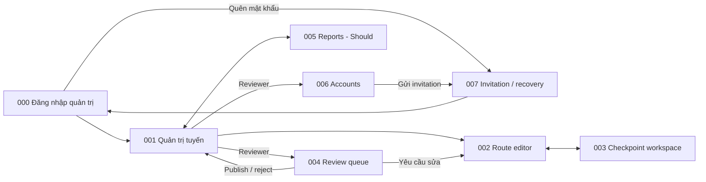

# Screen List M03 — Operations & Content Administration

## 1. Baseline và phạm vi

- Baseline: [Spec M03 v2.0](../../docs/spec/spec-M03.md), [Function List M03](../../docs/function%20list/function-list-M03.md).
- Release priority: [MVP Scope](../../MVP-Scope.md). Priority dưới đây theo function scope; không thay requirement trong spec.
- Cập nhật: 2026-09-27. Status: screen inventory đồng bộ baseline; chưa phải screen specification/mockup hoặc route implementation.
- Quy ước chung: [Screen index](README.md). Mọi màn bắt buộc cho administrative journey nằm trực tiếp trong danh mục M03 này.
- Giữ ID cũ để truy vết; cách gộp screen là quyết định UI decomposition, không giả định spec yêu cầu đúng số trang này.

## 2. Screen inventory

| Screen ID | Screen | Actor | Functions | Release priority |
|---|---|---|---|---|
| SCR-M03-000 | Đăng nhập quản trị | Content Staff, Reviewer | FN-M03-008 | Must |
| SCR-M03-001 | Quản trị tuyến | Content Staff, Reviewer | FN-M03-001, FN-M03-007, FN-M03-008 | Must; emergency actions Should |
| SCR-M03-002 | Biên tập tuyến & Thứ tự checkpoint | Content Staff, Reviewer | FN-M03-001, FN-M03-002, FN-M03-005, FN-M03-008 | Must |
| SCR-M03-003 | Checkpoint, QR & Nội dung | Content Staff, Reviewer | FN-M03-002, FN-M03-003, FN-M03-004, FN-M03-005, FN-M03-006, FN-M03-007, FN-M03-008 | Must; emergency actions Should |
| SCR-M03-004 | Kiểm duyệt & Phát hành | Reviewer | FN-M03-005, FN-M03-006, FN-M03-008 | Must |
| SCR-M03-005 | Báo cáo vận hành | Content Staff, Reviewer | FN-M03-010 | Should |
| SCR-M03-006 | Tài khoản & Vai trò | Reviewer | FN-M03-008 | Must |
| SCR-M03-007 | Nhận lời mời & Khôi phục mật khẩu | Người được mời; Content Staff; Reviewer | FN-M03-008 | Must |

M03 online-only và không có public sign-up. Form đang nhập được giữ trong memory khi save lỗi; không cam kết khôi phục draft qua reload. Report dùng endedAt theo Asia/Ho_Chi_Minh; RPT-02 nhóm theo stable ID và label/sequence từ record có endedAt mới nhất trong kỳ. Không thêm checkpoint filter chưa có trong report input contract. Snapshot retention, session intake và provisioning Reviewer đầu tiên là backend/operations coverage, không được đếm thành UI screen.

## 3. Screen descriptions

### SCR-M03-000 — Đăng nhập quản trị

| Nội dung | Mô tả |
|---|---|
| Entry | Màn vào chính khi mở M03 mà chưa có provider session hợp lệ hoặc session đã hết hạn. Visitor M01/M02 không dùng màn này. |
| Data | Email và password được gửi trực tiếp vào Supabase Auth; M03 không lưu password. |
| Actions / exit | Đăng nhập; mở SCR-M03-007 ở mode quên mật khẩu. Thành công chỉ vào SCR-M03-001 hoặc protected destination ban đầu sau khi backend xác nhận `AdminAccount` active và role hợp lệ. |
| States / guards | Submitting, credential error, network error, session expired, account inactive/missing role, permission denied. Provider identity đơn lẻ không cấp quyền; không có đăng ký công khai. |

### SCR-M03-001 — Quản trị tuyến

| Nội dung | Mô tả |
|---|---|
| Entry | Sau SCR-M03-000 và kiểm tra server-side identity, role/status. |
| Data | Admin routes, lifecycle và revision state online. |
| Actions / exit | Tìm/lọc, tạo hoặc mở route; action đóng/mở lại theo quyền; đi editor/review/reports/accounts. |
| States / guards | Loading, empty, permission denied, network error, lifecycle conflict. Cả hai role được đóng; chỉ Reviewer mở lại. |

### SCR-M03-002 — Biên tập tuyến & Thứ tự checkpoint

| Nội dung | Mô tả |
|---|---|
| Entry | Tạo mới hoặc mở revision từ danh sách tuyến. |
| Data | Route vi/en, measures, difficulty, tag groups, ordered checkpoint references, concurrency revision. |
| Actions / exit | Save draft chưa hoàn chỉnh; sửa revision của dữ liệu live; sắp checkpoint; submit để Reviewer khác duyệt. |
| States / guards | Draft, validation gaps, submitted, stale write cần reload; public version giữ nguyên khi chờ duyệt. |

### SCR-M03-003 — Checkpoint, QR & Nội dung

| Nội dung | Mô tả |
|---|---|
| Entry | Mở checkpoint thuộc route từ 001/002. |
| Data | Checkpoint mode/sequence, QR identities và installation label, content revisions vi/en, media rights/publication. |
| Actions / exit | Edit checkpoint; xác nhận kiểm tra thực địa cho ONLINE_AVAILABLE; tạo/reprint/replace/withdraw QR; soạn content và media; submit revision. |
| States / guards | Stale write, missing language/rights, QR replacement pending, last-active-QR blocked, closed/archived. Reprint giữ identity; replacement cần Reviewer duyệt. |

### SCR-M03-004 — Kiểm duyệt & Phát hành

| Nội dung | Mô tả |
|---|---|
| Entry | Reviewer mở revision CHO_DUYET từ queue/list; submit của Staff không cấp quyền vào màn này. |
| Data | Revision diff, submitter identity, completeness gaps và publication result. |
| Actions / exit | Duyệt/từ chối kèm lý do; xem kết quả publication/snapshot. Người duyệt khác revision submitter, không so với original creator. |
| States / guards | Self-approval blocked, gaps, publishing, published, error; first-publish lỗi giữ CHO_DUYET, không partial public state. |

### SCR-M03-005 — Báo cáo vận hành

| Nội dung | Mô tả |
|---|---|
| Entry | Chọn Reports khi sync + intake/report increment được phát hành. |
| Data | Terminal records đã ingest bất biến; RPT-01 và RPT-02. |
| Actions / exit | Lọc date range/route, mặc định 30 ngày; xem tổng phiên/trạng thái và unique visits theo checkpoint. |
| States / guards | Loading, invalid from/to, zero counts/rates, data, query failure; hiện last successful ingestion time và giới hạn dữ liệu chưa sync. |

### SCR-M03-006 — Tài khoản & Vai trò

| Nội dung | Mô tả |
|---|---|
| Entry | Reviewer đã đăng nhập mở quản lý tài khoản. |
| Data | Admin identity, email, application role/status từ backend/Auth provider. |
| Actions / exit | Nhập email, chọn `CONTENT_STAFF`/`REVIEWER`, gửi hoặc retry lời mời; đổi role; activate/deactivate. Người nhận hoàn tất credential tại SCR-M03-007. |
| States / guards | Invitation pending/sent/error, duplicate email, invalid input, permission denied, last-active-Reviewer blocked; retry cùng pending account không tạo bản ghi trùng; không public sign-up/custom role. |

### SCR-M03-007 — Nhận lời mời & Khôi phục mật khẩu

| Nội dung | Mô tả |
|---|---|
| Entry | Link invitation do provider gửi; link recovery do provider gửi; hoặc “Quên mật khẩu” từ SCR-M03-000. |
| Data | Invitation/recovery token do Supabase Auth quản lý; email cho recovery request; password mới chỉ gửi tới provider. |
| Actions / exit | Invitation hợp lệ: đặt credential, backend xác nhận provider identity khớp account `INVITATION_PENDING` rồi kích hoạt account, sau đó về SCR-M03-000. Recovery request: nhập email và nhận phản hồi chung. Recovery callback hợp lệ: đặt password mới rồi về SCR-M03-000. |
| States / guards | Processing, request accepted, invalid/expired link, provider/network error. Màn này không tạo application account, không cấp/chọn role và không kích hoạt lại account đã `DEACTIVATED`; chỉ completion invitation hợp lệ có thể kích hoạt account pending khớp identity. |

Reviewer đầu tiên không đi qua một màn provisioning riêng. Environment operator chạy thao tác server-side một lần trên environment trống; provider gửi invitation và người nhận hoàn tất tại SCR-M03-007. Sau lần đăng nhập đầu, Reviewer này dùng SCR-M03-006 để mời ít nhất một backup Reviewer.

## 4. Embedded và background behavior

Close/reopen confirmation, reject reason, QR reprint preview, access denied/not found và concurrency error là dialog/state/panel theo context. Route editor chứa checkpoint ordering; checkpoint workspace chứa content/media. Reports có hai tab RPT-01/RPT-02. Không thêm dashboard, media library, audit browser, snapshot browser, provisioning UI hoặc session ingestion screen độc lập.

## 5. Navigation

## 6. FR coverage

Screen suffix trong bảng mang prefix `SCR-M03-`; background coverage được ghi tường minh. Tổng 16/16 FR có điểm xử lý, không đồng nghĩa tất cả đã triển khai hoặc đều là user-facing screen.

| Source FR | Screen / owner | Coverage |
|---|---|---|
| FR-M03-001 | 001, 002 | Route drafts/metadata/lifecycle. |
| FR-M03-002 | 002, 003 | Checkpoint stable identity/order/connectivity. |
| FR-M03-003 | 003, 004 | QR lifecycle và identity replacement approval. |
| FR-M03-004 | 003, 004 | Bilingual content revisions/media. |
| FR-M03-005 | 002, 003, 004 | Submit/publication completeness gaps. |
| FR-M03-006 | Tất cả + backend; 004 | Server permissions và submitter/approver separation. |
| FR-M03-007 | 001–004, 006 + backend | Reject stale administrative writes. |
| FR-M03-008 | 004 + publication transaction | First public state/snapshot switch nguyên tử. |
| FR-M03-009 | 003, 004 + publication/closure backend | Journey change tạo immutable snapshot. |
| FR-M03-010 | Snapshot retention backend | Current/previous/replaced <30 days; không có màn cleanup. |
| FR-M03-011 | 001, 003 + closure backend | Close/reopen theo role; không ngắt running sessions. |
| FR-M03-012 | Live service; UI consumer SCR-M02-001/002 | QR/content output, không tạo M03 screen riêng. |
| FR-M03-013 | 000, 006, 007 + backend/provisioning | Login, invite/recovery, fixed roles, initial/last active Reviewer. |
| FR-M03-014 | Intake backend; status SCR-M02-003 | Terminal immutable insert/compare; không có màn nhập session. |
| FR-M03-015 | 005 | RPT-01 unique session counts/rates. |
| FR-M03-016 | 005 | RPT-02 unique sessions per route/checkpoint. |

## 7. Screen specification targets

Các file dưới đây là đầu ra dự kiến, chưa tồn tại; dùng [screen spec template](../../docs/templates/screen%20%20spec%20template.md) khi thiết kế chi tiết.

| Screen ID | Target file |
|---|---|
| SCR-M03-000 | `screens/screen-spec-SCR-M03-000.md` |
| SCR-M03-001 | `screens/screen-spec-SCR-M03-001.md` |
| SCR-M03-002 | `screens/screen-spec-SCR-M03-002.md` |
| SCR-M03-003 | `screens/screen-spec-SCR-M03-003.md` |
| SCR-M03-004 | `screens/screen-spec-SCR-M03-004.md` |
| SCR-M03-005 | `screens/screen-spec-SCR-M03-005.md` |
| SCR-M03-006 | `screens/screen-spec-SCR-M03-006.md` |
| SCR-M03-007 | `screens/screen-spec-SCR-M03-007.md` |
